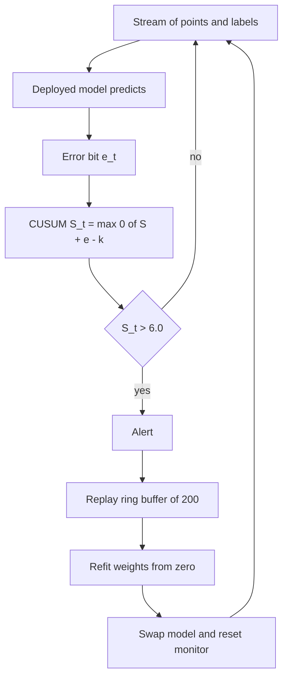
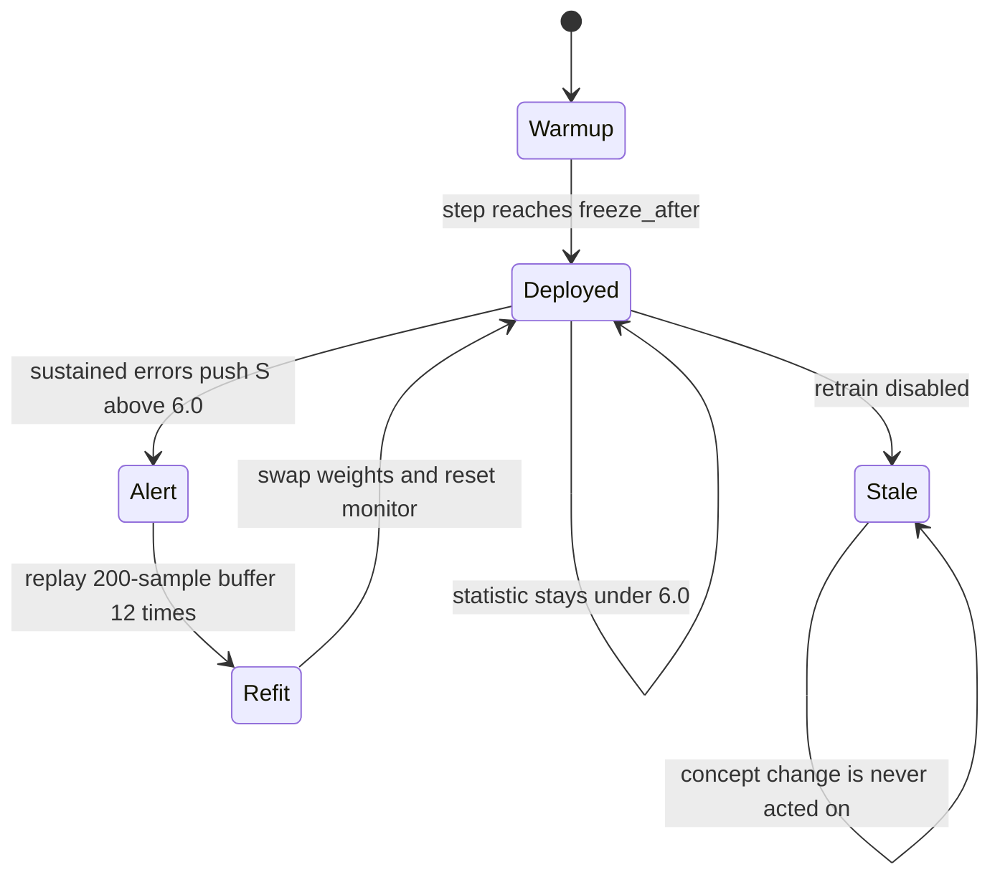
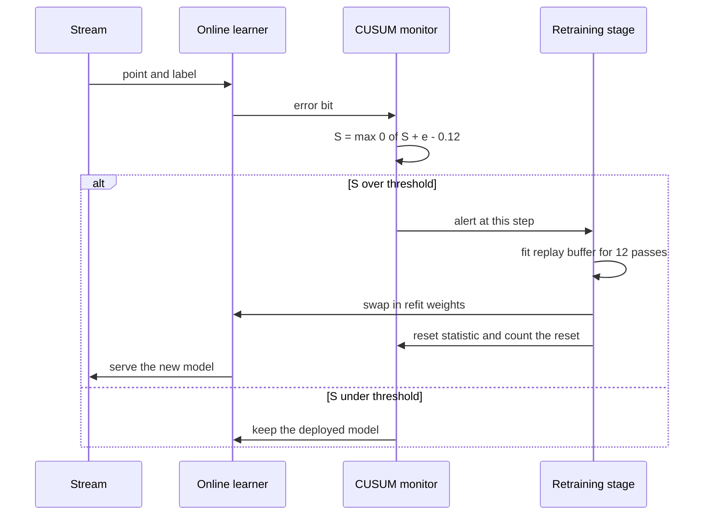

# 929 — Implement end-to-end automated ML system with monitoring, drift alerts, and retraining.

> **Tier:** Master · **CTCI chapter:** Ch 14 — Databases
> **Task spec:** [929-implement-end-to-end-automated-ml-system-with-monitoring-drift-a.md](../../../tasks/master/929-implement-end-to-end-automated-ml-system-with-monitoring-drift-a.md)
> **Solutions:** [Python](../../../solutions/python/master/929-implement-end-to-end-automated-ml-system-with-monitoring-drift-a/solution.py) ·
> [Java](../../../solutions/java/master/929-implement-end-to-end-automated-ml-system-with-monitoring-drift-a/Solution.java) ·
> [JavaScript](../../../solutions/javascript/master/929-implement-end-to-end-automated-ml-system-with-monitoring-drift-a/solution.js) ·
> [C#](../../../solutions/csharp/master/929-implement-end-to-end-automated-ml-system-with-monitoring-drift-a/Solution.cs)

## 1. Problem restatement

**Modelling contract.** The four solutions are *in-process simulations* of a closed-loop training
service, not a distributed system: there is no serving RPC, no message bus and no second host. The
"service" is a deterministic replayable stream plus the four stages a real pipeline would own — an
online learner, a drift monitor, an alert path and an automated retraining stage. Everything the
tutorial quotes (step counts, thresholds, learning rate, window size) is a constant declared at the
top of the solution files.

**Input.** A stream of 2-D points with a linearly separable label plus deterministic label noise.
`make_stream` uses `STEPS = 700` observations, of which the first `PHASE_ONE_END = 300` follow the
true boundary `w = ((1.0, 0.6))`; from step 300 on the boundary rotates to `((-0.6, 1.0))`, so every
model trained on the first phase becomes wrong. Five percent of the labels are flipped by comparing
a third Gaussian draw against `noise * 1.25` with `noise = 0.05`.

**Output.** A report dictionary with `errors` (one entry per observation — `1.0` when the deployed
model was *correct*, `0.0` when it was wrong), `alerts` (the step indices at which the monitor
fired), `refits` (how many times the model was refit) and the final `weights`. `run` also returns
the live `Monitor` object so the CUSUM peak, alert count and reset count can be inspected.

| Call | Result | Why |
| --- | --- | --- |
| `run(stream[:300])` | `alerts == []`, `peak &lt; 6.0`, window accuracy `&gt; 0.9` | the concept is stationary, so the monitor must stay quiet (no false positives) |
| `run(stream)` | at least one alert, `0 &lt;= alert[0] - 300 &lt;= 80` | the concept change must be detected within a bounded delay (liveness) |
| `run(stream, retrain=False)` | tail accuracy far below the retrained run | the counterfactual that proves the retraining stage is what recovers accuracy |
| `run([])` | `errors == []`, `alerts == []` | an empty stream is a valid, empty window |

The key constants are `DRIFT_SLACK = 0.12`, `ALERT_THRESHOLD = 6.0`, `WINDOW = 40`,
`LEARNING_RATE = 0.35`, `RETRAIN_PASSES = 12`, and a replay buffer capped at 200 observations.

## 2. Intuition

The naive drift detector compares the *current* error rate against a fixed bound. That is a
per-step threshold, and it is simultaneously too jumpy and too slow: a single noisy label can cross
it (false positive), while an error rate that creeps up by a fraction of a percent per step never
crosses it at all (missed drift). Both failures come from throwing away the history.

The insight is to accumulate **evidence** instead of testing a snapshot. CUSUM keeps a running
statistic

```text
S_t = max(0, S_{t-1} + (e_t - k))
```

where `e_t` is `1` for a wrong prediction and `0` for a right one, and `k = DRIFT_SLACK = 0.12` is
the error rate the pipeline considers normal. A right prediction therefore *subtracts* `0.12` (and
the `max(0, ...)` floor means a good streak cannot bank negative evidence for later), while a wrong
prediction *adds* `0.88`. The statistic is a one-sided random walk whose drift is positive exactly
when the true error rate exceeds `k`, so it climbs reliably under drift and hovers near zero
otherwise. An alert fires when `S_t > h = 6.0`, and the statistic is then reset to zero.

The second half of the design is *what happens on alert*. Refitting from scratch is the honest
reaction to concept drift, because the old weights encode a hypothesis that is no longer true; a
handful of SGD steps on the live stream would take far longer to rotate a decision boundary 90
degrees. The service therefore keeps the last 200 observations in a ring buffer and, on alert,
replays that buffer for `RETRAIN_PASSES = 12` deterministic passes.



The learner itself runs only during a warm-up window (`step &lt; freeze_after`, i.e. the first 300
steps). After that the model is treated as *deployed*: it changes only when the monitor fires and
the service refits it. That is what makes the retraining discount measurable — with retraining
disabled the same stream leaves a stale model in place forever.

## 3. Algorithm

1. Generate the stream deterministically (`splitmix64` → three uniforms per observation →
   Box-Muller-free Gaussian approximation `(u1 + u2 + u3 - 1.5) * 2.0`), rotating the true weights at
   the change point and flipping labels whose third draw falls inside the noise band.
2. Initialise `weights = [0.0, 0.0, 0.0]` (bias plus two slopes) and a fresh `Monitor`.
3. For each observation: predict, record the error bit, push the observation into the ring buffer
   (evicting the oldest beyond 200), and — while still inside the warm-up phase — take one SGD step.
4. Feed the error bit to `monitor.observe`. If it alerts and retraining is enabled: record the
   alert step, `fit(buffer)` from scratch for 12 passes, increment `refits`, reset the monitor.
5. Return the report plus the final weights and the monitor.

```text
procedure run(stream, retrain, change_point, window, freeze_after)
    weights ← [0.0, 0.0, 0.0]
    monitor ← new Monitor with slack 0.12 and threshold 6.0
    buffer ← empty, report ← alerts empty, errors empty, refits 0
    for step, (point, label) in enumerate(stream) do
        wrong ← predict(weights, point) != label
        append (1.0 if not wrong else 0.0) to report.errors
        if step &lt; freeze_after then
            sgd_step(weights, point, label, 0.35)
        end
        append (point, label) to buffer
        if length(buffer) &gt; 200 then
            drop buffer[0]
        end
        if monitor.observe(wrong) and retrain then
            append step to report.alerts
            weights ← fit(buffer, passes = 12, rate = 0.35)
            report.refits ← report.refits + 1
            monitor.reset()
        end
    end
    return report with weights and monitor
end

function observe(wrong)
    statistic ← max(0.0, statistic + ((1.0 if wrong else 0.0) - slack))
    peak ← max(peak, statistic)
    if statistic &gt; threshold then
        alerts ← alerts + 1
        statistic ← 0.0
        return true
    end
    return false
end
```

`predict` thresholds the logistic probability at `0.5`, and `sgd_step` updates the bias and both
slopes with `weights[j] -= rate * error * feature_j`, returning `abs(error)` for bookkeeping.
`fit` is the same step replayed over the buffer for 12 deterministic passes, starting from zero.



## 4. Worked example

The trace below follows the exact code path on a six-observation mini-stream, starting from
`weights = [0.0, 0.0, 0.0]` with `rate = 0.35` and `slack = 0.12`. The logistic probability is
`1 / (1 + exp(-margin))` with `margin = w0 + w1·x1 + w2·x2`, and `predict` returns `1` when that
probability is at least `0.5`.

| Step | Point | Label | Margin | p | Prediction | Error bit | Weights after the SGD step | S after `observe` |
| --- | --- | --- | --- | --- | --- | --- | --- | --- |
| 0 | `(0.5, -0.5)` | 1 | `0.000` | `0.500` | 1 (correct) | `1.0` | `[0.1750, 0.0875, -0.0875]` | `0.00` |
| 1 | `(1.0, 1.0)` | 0 | `0.175` | `0.544` | 1 (wrong) | `0.0` | `[-0.0153, -0.1028, -0.2778]` | `0.88` |
| 2 | `(0.2, -0.4)` | 1 | `0.075` | `0.519` | 1 (correct) | `1.0` | `[0.1531, -0.0691, -0.3452]` | `0.76` |
| 3 | error | 0 | — | — | wrong | `0.0` | unchanged | `1.64` |
| 4 | error | 0 | — | — | wrong | `0.0` | unchanged | `2.52` |
| 5 | error | 0 | — | — | wrong | `0.0` | unchanged | `3.40` |

Rows 0–2 are actual SGD arithmetic: at step 0 the error is `0.5 - 1 = -0.5`, so
`w0 -= 0.35 · (-0.5) = +0.175`, `w1 -= 0.35 · (-0.5) · 0.5 = +0.0875` and
`w2 -= 0.35 · (-0.5) · (-0.5) = -0.0875`. At step 1 the label is 0 while the model already leans
towards 1, so the error `+0.544` pushes all three weights down. Step 2 shows the CUSUM *falling*
(`0.88 → 0.76`) because a correct observation contributes `0 - 0.12`.

Rows 3–5 then show the drift regime: a wrong observation adds `1 - 0.12 = 0.88`, so from `S = 0`
the statistic walks `0.88, 1.76, 2.64, 3.52, 4.40, 5.28, 6.16` — the alert fires on the **seventh
consecutive** error, because `6.16 &gt; 6.0`, and the statistic is zeroed in the same call. This is
the arithmetic behind the assertion *sustained errors must fire exactly once and reset the
statistic*, and it is why a stale model that is wrong on nearly every post-change observation is
caught within a handful of steps while the single-error case in the same test suite provably does
not alert (`0.88 &lt; 6.0`).



## 5. Complexity

| Measure | Bound | Why |
| --- | --- | --- |
| Time per observation | `O(1)` | a dot product over 3 weights, one error bit, one CUSUM update |
| Time per alert | `O(12 · B)` with `B = 200` buffer entries | `RETRAIN_PASSES` full passes over the ring buffer; 2400 SGD steps |
| Total time | `O(T + alerts · 12 · B)` | `T = STEPS = 700` observations, `B` capped at 200 |
| Space | `O(B)` | the ring buffer plus a 3-element weight vector and two scalars |
| Stream generation | `O(T)` time, `O(T)` space | three `splitmix64` draws per observation; dominant cost is `exp` in `probability` |
| Naive per-step threshold monitor | `O(1)` time | but has no memory, so it cannot separate a spike from a sustained shift |

The retraining cost dominates: one alert costs about 3.4× the entire 700-step streaming pass, which
is exactly why the buffer is capped (an unbounded buffer would make refits grow without limit) and
why the learner is frozen after warm-up (so the alert path, not the online updates, is what the
report measures).

## 6. Pitfalls and edge cases

- **`report["errors"]` is an accuracy series, not an error series.** It appends `1.0` when the
  prediction was *correct* and `0.0` when it was wrong, and `windowed_accuracy` averages those bits.
  Reading it as a loss curve inverts every conclusion.
- **Empty window.** `run([])` must return `errors == []` with no alert; `windowed_accuracy([], 0, 10)`
  returns `0.0` rather than dividing by zero.
- **Single observation.** `run(stream[:1])` processes one point, records one error bit and never
  alerts.
- **Cold model.** With `weights = [0, 0, 0]` the probability is exactly `0.5`, and `predict` uses
  `&gt;= 0.5`, so the very first prediction is class 1 — the assertions rely on this tie rule.
- **False positives on the stationary phase.** `stationary["monitor"].peak &lt; ALERT_THRESHOLD` is
  checked explicitly: the slack of `0.12` must absorb the 5% label noise without ever accumulating to
  `6.0`.
- **The monitor is reset, not cleared.** `observe` returns `True` at most once per threshold
  crossing because it zeroes the statistic immediately; `Monitor.reset` increments `resets` so the
  retraining path can be observed from the outside (`resets &gt;= 1`).
- **Saturation.** `probability` clamps the margin to `[-30, 30]` before `exp`, so an extreme weight
  vector cannot overflow the exponential.
- **Determinism is an assertion, not a hope.** `run(stream)` twice must produce identical `errors`,
  `weights` and `alerts`; `make_stream` is re-called and length-checked for the same reason.

## 7. Variants and follow-ups

- **Tune the change detector.** A Page-Hinkley test, a sliding-window error-rate test or an ADWIN
  window replace the single `S_t` update; the trade-off is the same false-positive/latency pair the
  `stationary` and `delay &lt;= 80` assertions pin down. Related task:
  [941 — continuous profiling pipeline that attributes CPU and memory hotspots to code and inputs](../../../tasks/master/941-implement-continuous-profiling-pipeline-that-attributes-cpu-memo.md).
- **From refit to shadow deployment.** Instead of swapping weights in place, train the challenger in
  parallel and gate the swap on online metrics; that is the deployment problem in
  [937 — deployment pipeline with canary analysis using online metrics and rollback](../../../tasks/master/937-implement-deployment-pipeline-with-canary-analysis-using-online.md).
- **Safe automatic retraining.** An alert that refits on a poisoned buffer can make things worse, so
  a real service budgets and gates experiments:
  [938 — safe experiment platform that enforces SLOs and budget on experiments](../../../tasks/master/938-implement-safe-experiment-platform-that-enforces-slos-and-budget.md).
- **Serve the versioned model.** Model swap plus rollback semantics belong to
  [865 — transparent model serving with versioning, canary and shadow traffic](../../../tasks/master/865-implement-transparent-model-serving-with-versioning-canary-shado.md).

## 8. Check yourself

<details><summary>Show answer</summary>

**1. Why does a correct prediction *subtract* from the CUSUM statistic?**

Because `k = 0.12` encodes the error rate the pipeline tolerates. Subtracting the slack makes the
statistic a zero-drift random walk when the true error rate is exactly `k`, drifting upward when it
is higher — that is what turns a sequence of individually unremarkable observations into a
detection.

</details>

<details><summary>Show answer</summary>

**2. Starting from `S = 0`, how many consecutive wrong predictions are needed to alert, and what is
the statistic's value at that moment?**

Seven: `0.88, 1.76, 2.64, 3.52, 4.40, 5.28, 6.16`, and `6.16 &gt; 6.0`. The call that fires then
resets the statistic to `0.0` and increments `alerts`, so it cannot fire twice for the same streak.

</details>

<details><summary>Show answer</summary>

**3. Why is the online learner frozen after step 300?**

So the run measures the *alert-and-retrain* policy rather than continuous learning. If the SGD
updates kept running after the concept change, the frozen-model counterfactual would not be
comparable and the accuracy discount attributed to retraining would be meaningless.

</details>

<details><summary>Show answer</summary>

**4. The buffer holds at most 200 observations, yet the alert can arrive anywhere in the first 80
steps after the change. Why is that not a problem?**

The buffer is a *replay corpus* for the refit, not a detector. Its 200 observations span enough of
the post-change regime for `fit` to learn the rotated boundary, and the CUSUM alone decides when to
trigger.

</details>

<details><summary>Show answer</summary>

**5. What does the boundary-cosine check add beyond the accuracy comparisons?**

Accuracy only says the retrained model predicts well; the cosine between `(w1, w2)` and the new true
boundary `(-0.6, 1.0)` says the weights actually *point* along the new separating direction, i.e.
the model learned the concept rather than fitting the residual label noise.

</details>
