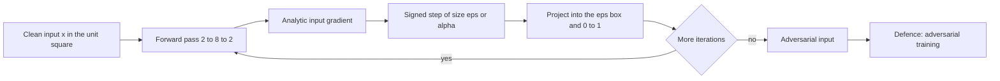
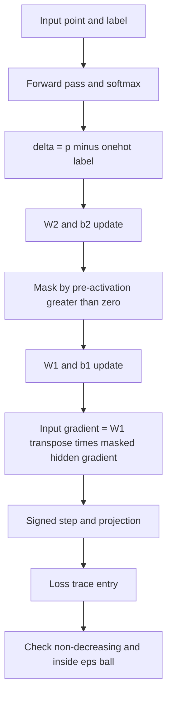
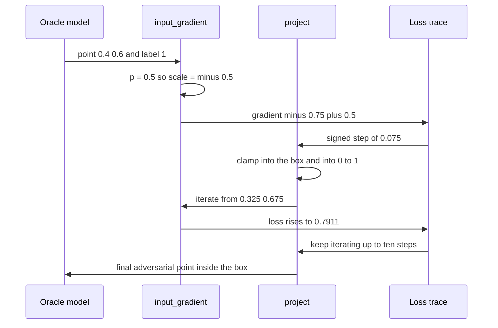

# 930 — Implement adversarial attack generator for models and defenses (PGD).

> **Tier:** Master · **CTCI chapter:** Ch Beyond — Machine Learning and AI
> **Task spec:** [930-implement-adversarial-attack-generator-for-models-and-defenses-p.md](../../../tasks/master/930-implement-adversarial-attack-generator-for-models-and-defenses-p.md)
> **Solutions:** [Python](../../../solutions/python/master/930-implement-adversarial-attack-generator-for-models-and-defenses-p/solution.py) ·
> [Java](../../../solutions/java/master/930-implement-adversarial-attack-generator-for-models-and-defenses-p/Solution.java) ·
> [JavaScript](../../../solutions/javascript/master/930-implement-adversarial-attack-generator-for-models-and-defenses-p/solution.js) ·
> [C#](../../../solutions/csharp/master/930-implement-adversarial-attack-generator-for-models-and-defenses-p/Solution.cs)

## 1. Problem restatement

**Modelling contract.** The solutions are *self-contained, single-process* implementations of an
adversarial machine-learning pipeline: a hand-written neural network, the gradient-based attacks
against it, and adversarial training as the defence. There is no framework, no autodiff and no GPU —
the network is `2 → 8 (ReLU) → 2 (softmax)`, the gradients are derived by hand, and the "dataset" is
a deterministic 2-D two-class sample. Everything quoted below is a declared constant.

**Input and output.** `make_dataset()` produces `SAMPLES = 120` points in the unit square labelled by
`x1 + 0.6·x2 > 0.8`, dropping the ambiguous band `0.72 &lt; x1 + 0.6·x2 &lt; 0.88` so the task is
perfectly separable. `train(data, initial_parameters())` runs `EPOCHS = 90` deterministic SGD passes
with `LEARNING_RATE = 0.35`. `fgsm` and `pgd` return adversarial points inside the `EPSILON = 0.3`
box around the input and inside `[0, 1]`; `pgd` also returns the loss trace.

| Call | Result | Why |
| --- | --- | --- |
| `accuracy(trained, data)` | `&gt; 0.95` | the network must fit the separable task |
| `accuracy(trained, data, pgd_attack)` | `&lt; 0.3` | a `0.3` budget breaks the undefended model |
| `success_rate(trained, data, pgd_attack)` | `&gt; 0.9` | the attack flips almost every sample, or drops its confidence |
| `fgsm_linear([1.5, -1.0], [0.4, 0.6], 1, 0.3)` | `[0.1, 0.9]` | the closed-form oracle for a class-1 point |
| `fgsm(model, p, y, 0.0)` | the input unchanged | a zero budget may not touch a single pixel |
| `accuracy(defended, data, pgd_attack)` | `&gt; robust + 0.2` | adversarial training materially improves robustness |

`input_gradient` is checked against central finite differences with `h = 1e-6` and tolerance `1e-5`,
which is the only "ground truth" the pipeline needs: every attack is a function of that one vector.

## 2. Intuition

The naive way to find an adversarial example is to search: nudge each pixel, keep whatever hurts.
With two input features you could brute-force a grid, but the search cost grows exponentially with
the dimension, so the idea does not survive contact with an image.

The insight is that the network *tells* you the direction. The loss `-log p_y` is differentiable in
`x`, and `dloss/dx` computed by the chain rule points uphill in input space. FGSM takes the single
most efficient step allowed by the budget:

```text
x_adv = x + eps · sign(grad_x loss)
```

Sign turns the gradient into a corner of the `ℓ∞` ball, which is the best a one-step method can do.
PGD is the same idea iterated: take smaller signed steps of `eps/4` and after every step project back
into the ball and into the valid input range, so the iterates cannot walk out of the budget. That
"project after every step" is what separates PGD from FGSM, and it is why the loss is asserted to be
non-decreasing along the trace.

Two details make the implementation trustworthy. First, the input gradient is derived analytically:
with `delta = p - onehot(y)`, `hidden_gradient = W2ᵀ delta`, and

```text
grad_x = W1ᵀ (hidden_gradient ⊙ 1[pre-activation &gt; 0])
```

the ReLU mask kills the contribution of dead units — exactly what backpropagation gives. Second, the
attacks are validated against independent oracles: central finite differences for the gradient, and
the closed form `x - eps·sign(w)` for FGSM on a *linear* logistic model, where the analytic gradient
reduces to `(p - y)·w`.



Adversarial training closes the loop: during each epoch the batch is augmented with *freshly
generated* FGSM images, so the network sees the perturbation it is about to be judged on. The
defence is then scored against PGD — the standard, weaker-to-stronger transfer check that prevents
"defending against your own attack" from looking better than it is.

## 3. Algorithm

1. Build the deterministic dataset and the initial parameters (uniform draws in `[-0.6, 0.6]`, zero
   biases).
2. Forward pass: `pre = W1·x + b1`, `hidden = max(0, pre)`, `logits = W2·hidden + b2`, softmax with
   the max subtracted for stability.
3. Backward pass: `delta = p - onehot(y)`; update `W2, b2`; then mask by `pre &gt; 0` to get
   `hidden_gradient` and update `W1, b1`. This is also exactly `input_gradient` before the `W1ᵀ`
   contraction.
4. `fgsm`: one signed gradient step of size `eps`, then project.
5. `pgd`: repeat `PGD_STEPS = 10` times — signed step of `PGD_ALPHA = 0.075`, project into the ball of
   radius `min(alpha · steps, epsilon) = 0.3` around the *original* input and into `[0, 1]`, append
   the new loss to the trace.
6. Defence: retrain with `epsilon = 0.15`, augmenting every sample with a fresh FGSM image.
7. Score clean accuracy, attacked accuracy and the attack success rate, then assert the invariants.

```text
procedure pgd(parameters, point, label, epsilon, steps, alpha)
    current ← copy of point
    trace ← one entry, the loss at point
    for step ← 1 to steps do
        gradient ← input_gradient(parameters, current, label)
        for index ← each feature do
            if gradient[index] &gt; 0 then
                current[index] ← current[index] + alpha
            else if gradient[index] &lt; 0 then
                current[index] ← current[index] - alpha
            end
        end
        current ← project(current, point, min(alpha * steps, epsilon))
        append loss(parameters, current, label) to trace
    end
    return current, trace
end

procedure project(candidate, original, radius)
    for index ← each feature do
        value ← clamp(candidate[index], original[index] - radius, original[index] + radius)
        result[index] ← clamp(value, 0.0, 1.0)
    end
    return result
end
```

`project` is coordinate-wise, i.e. the budget is an `ℓ∞` box rather than an `ℓ2` ball; the inner
`clamp` to `[0, 1]` is what keeps "images" valid, and it is why even `eps = 0.5` cannot produce an
out-of-range pixel.



## 4. Worked example

The closed-form oracle makes the arithmetic auditable. Take the logistic model `w = (1.5, -1.0)`,
the class-1 point `x = (0.4, 0.6)`, `eps = 0.3` and a step size of `0.075`. Its margin is
`1.5·0.4 - 1.0·0.6 = 0`, so `p1 = 0.5`, `scale = p1 - 1 = -0.5`, and the analytic gradient is
`scale · w = (-0.75, +0.5)`.

| Iteration | Point | Margin | `p1` | Loss `-log p1` | Gradient | Action |
| --- | --- | --- | --- | --- | --- | --- |
| 0 | `(0.400, 0.600)` | `0.0000` | `0.5000` | `0.6931` | `(-0.750, +0.500)` | start |
| 1 | `(0.325, 0.675)` | `-0.1875` | `0.4533` | `0.7911` | `(-0.820, +0.547)` | step `0.075` down/up |
| 2 | `(0.250, 0.750)` | `-0.3750` | `0.4073` | `0.8983` | `(-0.889, +0.593)` | step again |
| 3 | `(0.175, 0.825)` | `-0.5625` | `0.3629` | `1.0135` | `(-0.956, +0.637)` | still inside the box |
| FGSM | `(0.100, 0.900)` | `-0.7500` | `0.3208` | `1.1370` | — | single step of `eps = 0.3` |

Two properties fall out of the table. The loss rises monotonically — `0.6931 → 1.1370`, `+64%` — for
both FGSM and the first PGD iterates, which is the assertion *PGD must never decrease the loss it is
ascending*. And every point satisfies `|x_i - 0.4| &lt;= 0.3` and `0 &lt;= x_i &lt;= 1`, which is the
projection invariant. PGD is at least as strong as FGSM because FGSM is precisely the single
iteration that *overshoots* to the corner before projection; the iterated version climbs further
along the same direction within the same box.



## 5. Complexity

| Measure | Bound | Why |
| --- | --- | --- |
| Forward pass | `O(d·h + h·k)` = `O(2·8 + 8·2)` | two dense layers, `d = 2`, `h = 8`, `k = 2` |
| Training | `O(EPOCHS · SAMPLES · (d·h + h·k))` = `O(90 · 120 · 32)` | one forward and one backward pass per sample per epoch |
| Adversarial training | same order, one extra FGSM per sample | a fresh perturbation is generated inside the loop, not cached |
| FGSM | one forward plus one backward pass | the gradient is analytic, not finite-differenced |
| PGD | `PGD_STEPS = 10` forward passes plus 10 gradients | linear in the number of iterations, `alpha = eps/4` |
| Space | `O(d·h + h·k)` parameters, `O(1)` per attack | no tape, no per-step copies beyond the iterate |

The finite-difference cross-check costs `2 · d` extra forward passes for a single point — affordable
for two features and the reason the check is a test, not a production path. A real `ℓ2` PGD would add
a projection onto a sphere, still `O(d)`.

## 6. Pitfalls and edge cases

- **Zero budget.** `fgsm(model, p, y, 0.0)` and `pgd(model, p, y, 0.0)` must return the input bit for
  bit; the assertion is an equality on the returned lists, so any accidental copy-order change shows up.
- **Zero gradient.** For an all-zero network the gradient is `(0, 0)`; FGSM must leave the point
  untouched rather than stepping with `sign(0) = 0` producing `x` (the code branches explicitly on
  `gradient != 0`).
- **Dead ReLU units.** The input gradient masks by `pre &gt; 0.0`; forgetting the mask makes the
  finite-difference comparison fail at `1e-5`, which is exactly what the check is there for.
- **Projection order.** Clamping into the ball *and* into `[0, 1]` is one expression; doing them in
  the wrong order can push the point outside the ball near the image border.
- **Single sample.** `accuracy(model, data[:1], attack)` must return exactly `0.0` or `1.0` — the
  assertion accepts both, so the test documents intent rather than a tuned value.
- **Loss floor.** `loss` guards `-log(max(p, 1e-12))` so an over-confident wrong prediction yields a
  finite number instead of infinity, which keeps the trace comparison meaningful.
- **Trace comparisons need slack.** The monotonicity check uses `-1e-9` and the ball check `1e-12`,
  because softmax probabilities are floating point.
- **Defence ≠ immunity.** Adversarial training raises robust accuracy by more than `0.2` here; it
  does not eliminate the attack, and a larger `eps` would erode the gain again.

## 7. Variants and follow-ups

- **Certify instead of attack.** Rather than sampling perturbations and hoping for a flip, propagate
  an input box through the network and *prove* the label cannot change:
  [931 — certified robustness verifier for small networks using interval bound propagation](../../../tasks/master/931-implement-certified-robustness-verifier-for-small-networks-inter.md).
- **Attack other machinery.** The same signed-gradient recipe is applied to arbitrary-precision
  numerics and numerics regression in
  [932 — differential testing between CPU and GPU implementations for numerical ops](../../../tasks/master/932-implement-differential-testing-between-cpu-gpu-implementations-f.md)
  and to privacy budgets in
  [943 — composable privacy guarantees across combined DP mechanisms](../../../tasks/master/943-implement-composable-privacy-guarantees-across-combined-dp-mecha.md).
- **Squeeze the defended model.** A certified-defence-aware runtime compresses weights and must keep
  accuracy under the same attack:
  [897 — compressed neural network runtime with weight sharing](../../../tasks/master/897-implement-compressed-neural-network-runtime-with-weight-sharing.md).
- **Perturb the data pipeline.** Label noise and concept drift test a model's *training* stability
  rather than its input robustness:
  [929 — end-to-end automated ML system with monitoring, drift alerts and retraining](../../../tasks/master/929-implement-end-to-end-automated-ml-system-with-monitoring-drift-a.md).

## 8. Check yourself

<details><summary>Show answer</summary>

**1. Why is `sign(gradient)` used instead of the gradient itself in FGSM?**

Because the budget is an `ℓ∞` box: to maximise a linearised loss inside `{x + δ : |δ_i| ≤ eps}` you
push every coordinate to its own extreme, and the sign vector is that extreme. Using the raw gradient
would produce a step whose `ℓ∞` norm is smaller than the budget.

</details>

<details><summary>Show answer</summary>

**2. In the oracle table, why is the FGSM point exactly `(0.1, 0.9)`?**

`x + eps·sign(grad)` with `grad = (-0.75, +0.5)` gives `(0.4 - 0.3, 0.6 + 0.3) = (0.1, 0.9)`, and
the projection leaves it unchanged because both coordinates are inside `[0, 1]` and inside `±0.3` of
the original.

</details>

<details><summary>Show answer</summary>

**3. What does the project step guarantee, and why is the radius `min(alpha·steps, epsilon)`?**

It keeps every iterate inside the allowed perturbation box and inside the valid input range, so the
final point is a legal adversarial example. The radius is capped at `epsilon`: with `alpha·steps`
exceeding the budget, the projection would otherwise permit larger perturbations than certified by
the threat model.

</details>

<details><summary>Show answer</summary>

**4. Why is the defence evaluated with PGD rather than FGSM?**

Because the defence was trained on FGSM images. Scoring it with its own attack would be circular;
PGD is a stronger, differently parameterised attack, so a robustness gain measured under it is
evidence that the defence generalises rather than overfits to one perturbation pattern.

</details>

<details><summary>Show answer</summary>

**5. The analytic gradient is checked against central differences. Why central and not forward?**

Central differences have error `O(h²)` instead of `O(h)`, so at `h = 1e-6` they reach accuracy around
`1e-9`. That is well below the `1e-5` tolerance, whereas forward differences would be dominated by
the `O(h)` term and could not resolve a real implementation bug from truncation error.

</details>
