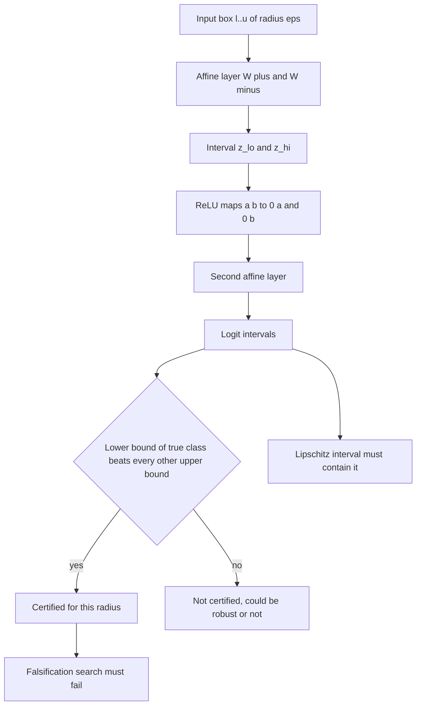
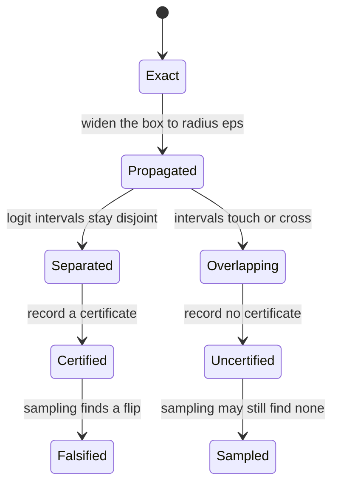
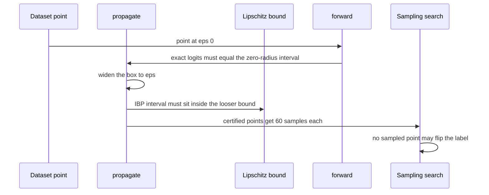

# 931 — Implement certified robustness verifier for small networks (interval bound propagation).

> **Tier:** Master · **CTCI chapter:** Ch Beyond — Machine Learning and AI
> **Task spec:** [931-implement-certified-robustness-verifier-for-small-networks-inter.md](../../../tasks/master/931-implement-certified-robustness-verifier-for-small-networks-inter.md)
> **Solutions:** [Python](../../../solutions/python/master/931-implement-certified-robustness-verifier-for-small-networks-inter/solution.py) ·
> [Java](../../../solutions/java/master/931-implement-certified-robustness-verifier-for-small-networks-inter/Solution.java) ·
> [JavaScript](../../../solutions/javascript/master/931-implement-certified-robustness-verifier-for-small-networks-inter/solution.js) ·
> [C#](../../../solutions/csharp/master/931-implement-certified-robustness-verifier-for-small-networks-inter/Solution.cs)

## 1. Problem restatement

**Modelling contract.** This is a *soundness-first* verifier implemented in one process: a small,
fixed dense network is given as data, the weighted layers are propagated analytically, and the
claims are cross-checked by independent oracles (a Lipschitz bound and a sampling search). There is
no SMT solver, no branch-and-bound and no tightness optimisation — the four files implement exactly
one bound-propagation method and say so.

**Input.** `make_network()` builds a deterministic `2 → 4 (ReLU) → 2` network: weights are uniform
draws scaled by `3.0` and rounded to six decimals, hidden biases are `0.0`, and the output layer
carries a bias of `0.3`. `dataset()` picks `24` points inside `[0.15, 0.85]²` whose logits differ by
more than `0.35`, so the clean accuracy is exactly `1.0` and every point starts away from the
boundary. The verifier is queried with radii from `EPSILONS = (0.0, 0.02, 0.05, 0.1, 0.25)`.

**Output.** `propagate(network, lower, upper)` returns the output interval `(low, high)`;
`certified(network, point, label, epsilon)` returns `True` when the lower bound of the true class
exceeds the upper bound of *every* other class inside the `ℓ∞` box
`[max(0, x - eps), min(1, x + eps)]`; `certified_accuracy` counts the certified fraction of the
dataset.

| Call | Result | Why |
| --- | --- | --- |
| `propagate(net, p, p)` | equals `forward(net, p)` to `1e-12` | at radius zero the interval collapses onto the exact evaluation |
| `certified_accuracy(net, data, 0.0)` | `1.0` | with no perturbation, certification is just correctness |
| `certified_accuracy(net, data, 5.0)` | `0.0` | an absurd radius certifies nothing |
| `propagate(flat, [0,0],[1,1])` | `low == high == [1.0, 0.0]` | a zero-weight network bounds to its activated biases |

Every `certified` point is additionally attacked: `60` deterministic samples per point inside the
box must *never* flip the label (`flipped == 0` is an assertion, not a report).

## 2. Intuition

A robustness claim is an "all points in this box" statement, and sampling can never establish one:
you can show a hundred perturbations that fail to flip the label and still have missed the one bad
corner. The insight is to stop sampling inputs and propagate *sets* of inputs instead — carry an
interval `[l, u]` for every neuron through the network.

The propagation rule is an exact affine-image argument. For `z = W·x + b` with `x ∈ [l, u]`, the
tightest elementwise interval is obtained by sending each coordinate to the endpoint that helps:

```text
z_lo = W⁺·l + W⁻·u + b        z_hi = W⁺·u + W⁻·l + b
```

with `W⁺ = max(W, 0)` and `W⁻ = min(W, 0)`. A positive weight takes the lower input bound for the
lower output bound; a negative weight takes the upper one. ReLU then maps `[a, b]` to
`[max(0, a), max(0, b)]`, because ReLU is monotone. Nothing here is approximate: every real
activation of the network on the box lies inside the propagated interval, which is what makes the
certificate *sound*.

Soundness alone is cheap to achieve by being pessimistic — which is why the file carries two
cross-checks. A Lipschitz bound (`‖z - z'‖ ≤ L·eps` with `L` the product of the layer Frobenius
norms) must *contain* the IBP interval, proving IBP is at least as tight; and a sampling search must
fail to falsify any certificate, proving it is not vacuous.



The practical shape of the result is a *certified accuracy curve*: at `eps = 0` every point is
certified, and as the box grows the interval widens until the logit intervals overlap and the
certificates disappear. The curve is monotone non-increasing in `eps` — more perturbation can never
create a new certificate.

## 3. Algorithm

1. Build the network and the dataset (labels are produced by the network itself, so clean accuracy
   is `1.0` by construction).
2. `forward`: dense layer, then ReLU, twice; the final ReLU is applied to the logits too, mirroring
   what `propagate` does.
3. `propagate`: for each row of the weight matrix, start from the bias, add `W⁺·l + W⁻·u` for the
   lower end and `W⁺·u + W⁻·l` for the upper end, then clamp both ends at zero.
4. `lipschitz_interval`: evaluate the centre, multiply the radius by the product of the layer norms,
   and return `centre ± bound`.
5. `certified`: clip the box to `[0, 1]`, propagate it, then compare the true-class lower bound with
   the maximum upper bound over the other classes.
6. Score the curve over `EPSILONS`, run the sampling cross-checks and the falsification search.

```text
procedure propagate(network, lower, upper)
    low ← copy of lower, high ← copy of upper
    for each layer (matrix, bias) in network do
        for row ← each output unit do
            minimum ← bias[row], maximum ← bias[row]
            for index ← each input unit do
                positive ← max(matrix[row][index], 0.0)
                negative ← min(matrix[row][index], 0.0)
                minimum ← minimum + positive * low[index] + negative * high[index]
                maximum ← maximum + positive * high[index] + negative * low[index]
            end
            next_low[row] ← minimum, next_high[row] ← maximum
        end
        low ← [max(0.0, value) for value in next_low]
        high ← [max(0.0, value) for value in next_high]
    end
    return low, high
end

function certified(network, point, label, epsilon)
    lower ← [max(0.0, value - epsilon) for value in point]
    upper ← [min(1.0, value + epsilon) for value in point]
    low, high ← propagate(network, lower, upper)
    return low[label] &gt; max(high[index] for index != label)
end
```

The strict `&gt;` is the whole margin: a certificate exists only when the true class beats every
other class *with the intervals still separated*, i.e. no perturbation in the box can even tie it.



## 4. Worked example

Trace the zero-weight and dead-unit edge cases, which are exact and short, then read the interval of
the real network at `eps = 0`.

**Zero-weight network.** `W1 = 0`, `b1 = 0.5` for all four hidden units, `W2 = 0`, `b2 = (1.0, -1.0)`,
box `[0,0] × [1,1]`. Every row's interval starts at the bias and never moves, because every weight
contributes `0 · l` and `0 · u`:

| Stage | Lower | Upper | Action |
| --- | --- | --- | --- |
| hidden pre-activation | `0.5` (×4) | `0.5` (×4) | bias plus `W⁺·l + W⁻·u` with `W = 0` |
| hidden after ReLU | `0.5` (×4) | `0.5` (×4) | `max(0, 0.5) = 0.5` |
| logit 0 | `1.0` | `1.0` | bias `1.0`, zero weights |
| logit 1 | `-1.0` | `-1.0` | bias `-1.0`, then ReLU clamps both ends |
| returned interval | `[1.0, 0.0]` | `[1.0, 0.0]` | `low == high`, the assertion in the file |

**Dead units.** With `W1 = -1` for every entry and `b1 = 0`, the box `[0,0] × [1,1]` gives every
pre-activation interval `[-1, 0]`; ReLU maps that to `[0, 0]`, so the hidden layer is provably
inactive and the output layer bounds to exactly `[0.0, 0.0]` — matching the assertion *units that can
never activate must bound to zero*.

**Real network at `eps = 0`.** `propagate(net, p, p)` uses `W⁺·l + W⁻·u = W⁺·p + W⁻·p = W·p`, and
ReLU over the degenerate interval `[a, a]` gives `[max(0,a), max(0,a)]`. The propagated interval
therefore reproduces `forward(net, p)` value for value, which the file checks with a `1e-12`
tolerance — the tightest possible sanity check on the propagation rule.



## 5. Complexity

| Measure | Bound | Why |
| --- | --- | --- |
| One `propagate` pass | `O(d·h + h·k)` = `O(2·4 + 4·2)` | two dense layers, each weight touched once for both endpoints |
| Certified accuracy over the curve | `O(|EPSILONS| · n · d·h·k)` | `5` radii × `24` points, one propagation each |
| Lipschitz cross-check | `O(d·h + h·k)` per call | one forward pass plus one norm per layer |
| Falsification search | `O(certified_points · 60 · (d·h + h·k))` | the sampling budget dominates; `160` samples are used for the soundness sweep |
| Space | `O(d·h + h·k)` for the network, `O(d + h + k)` per interval | no search tree, no solver state |
| Branch-and-bound alternative | exponential in the number of unstable ReLUs | tighter bounds, incompatible with "one method, no tightening" |

The cost structure is why IBP is the workhorse of certified training: each certificate costs one
interval propagation, so a whole curve costs `|EPSILONS|` propagations per point. The opposite
temptation — tightening bounds by splitting unstable ReLUs — multiplies that by a search tree, which
is exactly the simplification the file documents as out of scope.

## 6. Pitfalls and edge cases

- **`&gt;` versus `&ge;`.** Certification uses a strict comparison between the true-class lower bound
  and the competitor upper bound; using `&ge;` would certify ties that a perturbation can reach.
- **Clipping the box.** `certified` clips to `[0, 1]` *before* propagating, so a point near the border
  gets a smaller effective radius; skipping the clip would certify a box containing invalid inputs.
- **Radius zero.** The interval must collapse exactly; the `1e-12` check catches a propagation rule
  that adds a bias twice or forgets the ReLU on the logits.
- **Monotonicity in `eps`.** The certified curve must be non-increasing (`curve[i] &gt;= curve[i+1]`),
  and the file also checks that a bigger box's interval *contains* a smaller one's — a sign error in
  `W⁺`/`W⁻` breaks both.
- **Certificate vs correctness.** Certified accuracy can never exceed clean accuracy, because a
  certificate implies the clean prediction is right; the assertion makes that implication explicit.
- **Sampling cannot prove.** `flipped == 0` over `60` samples is evidence of non-vacuity, not of
  soundness; the proof is the interval arithmetic.
- **Empty-box degeneracies.** A network with all-zero weights returns `low == high`, which the code
  handles without special-casing; a never-activating unit bounds to `[0, 0]` rather than a negative
  interval — ReLU must be applied to *both* interval ends.
- **Determinism.** `sample_box` and `propagate` are re-run and compared for equality, so no
  floating-point nondeterminism or dict ordering may leak into the verifier.

## 7. Variants and follow-ups

- **Attack instead of certify.** Sampling search is the falsification half of this task; the
  generator that produces those samples adversarially is
  [930 — adversarial attack generator for models and defenses with PGD](../../../tasks/master/930-implement-adversarial-attack-generator-for-models-and-defenses-p.md).
- **Compare implementations of the same op.** Instead of proving an input property, prove that two
  numerics implementations agree within tolerance, including injected kernel bugs:
  [932 — differential testing between CPU and GPU implementations for numerical ops](../../../tasks/master/932-implement-differential-testing-between-cpu-gpu-implementations-f.md).
- **Certify the arithmetic.** Bounds of the same flavour apply to rounding and precision: see
  [944 — high-precision numeric library with arbitrary precision rational arithmetic](../../../tasks/master/944-implement-high-precision-numeric-library-with-arbitrary-precisio.md).
- **Fuse the kernels you certify.** Real verifiers run against compiled graphs, which is the runtime
  problem in [933 — runtime that compiles high-level ops into fused kernels with autotuning](../../../tasks/master/933-implement-runtime-that-compiles-high-level-ops-into-fused-kernel.md).

## 8. Check yourself

<details><summary>Show answer</summary>

**1. Why does the affine rule use `W⁺·l + W⁻·u` for the lower bound?**

For a positive weight the smallest product comes from the smallest input; for a negative weight the
product is decreasing in the input, so the smallest product comes from the *largest* input. Splitting
`W` into its positive and negative parts expresses both cases in one expression.

</details>

<details><summary>Show answer</summary>

**2. What does IBP give you that a sampling search cannot?**

A guarantee. Sampling explores finitely many points and can never rule out the corner it missed,
whereas IBP bounds *every* point of the box at once — the certificate is a proof, not evidence.

</details>

<details><summary>Show answer</summary>

**3. Why must the Lipschitz interval contain the IBP interval?**

The Lipschitz argument bounds the output movement by `L·eps` from the centre, an independent and
looser argument. Containment is the check that IBP is at least as tight as that argument; if IBP
stuck out of the Lipschitz interval, the propagation would be unsound.

</details>

<details><summary>Show answer</summary>

**4. When does the certified accuracy curve reach zero, and why is it monotone?**

`certified_accuracy(net, data, 5.0)` returns `0.0`: at that radius every clipped box is essentially
the whole input domain and the logit intervals overlap for all points. Monotonicity holds because a
larger box contains the smaller one, so its interval is wider and any certificate that survives at
the larger radius already existed at the smaller one.

</details>

<details><summary>Show answer</summary>

**5. A point is not certified at `eps = 0.1`. Does that mean it is fragile?**

No. No-certificate means IBP could not separate the intervals — the interval may simply be too
loose, and a stronger method (or a search) might still prove robustness. The verifier deliberately
returns "unknown" rather than claiming fragility.

</details>
