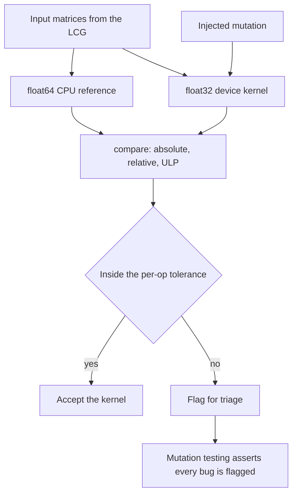
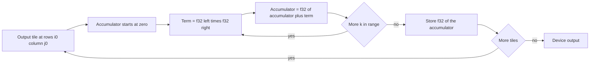
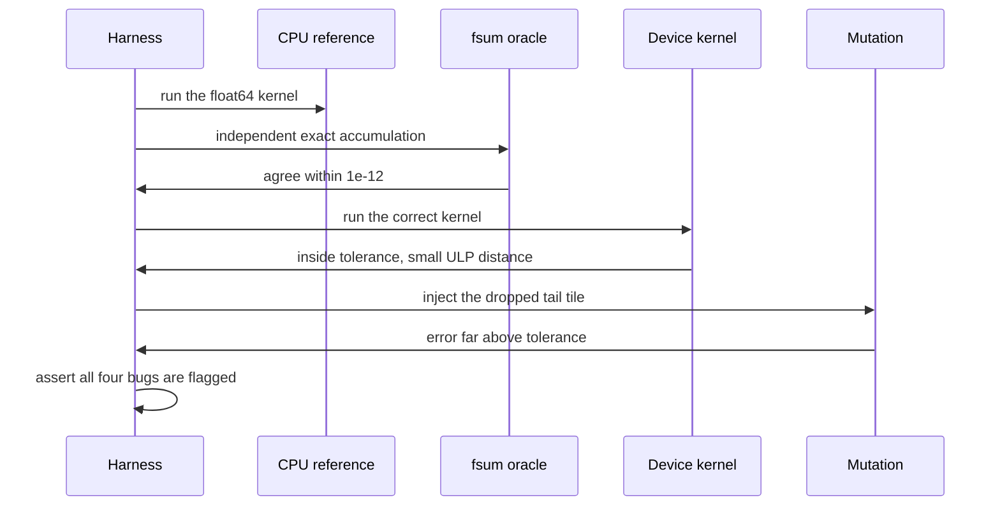

# 932 — Implement differential testing between CPU/GPU implementations for numerical ops.

> **Tier:** Master · **CTCI chapter:** Ch Beyond — Numerical and Scientific Computing
> **Task spec:** [932-implement-differential-testing-between-cpu-gpu-implementations-f.md](../../../tasks/master/932-implement-differential-testing-between-cpu-gpu-implementations-f.md)
> **Solutions:** [Python](../../../solutions/python/master/932-implement-differential-testing-between-cpu-gpu-implementations-f/solution.py) ·
> [Java](../../../solutions/java/master/932-implement-differential-testing-between-cpu-gpu-implementations-f/Solution.java) ·
> [JavaScript](../../../solutions/javascript/master/932-implement-differential-testing-between-cpu-gpu-implementations-f/solution.js) ·
> [C#](../../../solutions/csharp/master/932-implement-differential-testing-between-cpu-gpu-implementations-f/Solution.cs)

## 1. Problem restatement

**Modelling contract.** The "GPU" is simulated *in process*: the device kernels round every
intermediate result to float32 with an explicit `struct` round-trip and accumulate in a different
order from the scalar reference. That is the honest way to reproduce what a device kernel does
without a device, and it is why the harness can be deterministic and portable across the four
languages. No CUDA, no driver, no real tensor library.

**Input.** Three kernels — batched matmul, row softmax and layer normalisation — each implemented
twice: a float64 CPU reference (`cpu_matmul`, `cpu_softmax`, `cpu_layernorm`) and a float32 "device"
kernel (`device_matmul`, `device_softmax`, `device_layernorm`) that tiles the output in `2 × 2`
blocks and reduces in a different order (reversed for softmax and the squared deviations, forward
for the mean). Matrices come from a deterministic LCG
(`state = (state · 6364136223846793005 + 1442695040888963407) mod 2⁶⁴`), rounded to six decimals:
`left` is `5 × 3` at scale `1.5`, `right` is `3 × 4` at scale `1.2`, `batch` is `4 × 5`.

**Output.** `compare(name, expected, actual)` returns `(max absolute error, max relative error, max
ULP distance)`; `within(name, expected, actual)` compares the first two against the per-op tolerances
`TOLERANCE = {"matmul": (2e-5, 2e-4), "softmax": (1e-6, 1e-5), "layernorm": (2e-5, 2e-4)}`.

| Call | Result | Why |
| --- | --- | --- |
| `compare("matmul", exact, reference)` | absolute error `&lt; 1e-12` | the float64 reference must match the `fsum` oracle |
| `within("matmul", ref, device_matmul(left, right))` | accepted | a correct kernel must not be flagged |
| `within(...)` with `bug="tile"` | rejected | the dropped tail tile is a real divergence |
| `compare(...)` with `bug="tile"` | `&gt; 100 ×` the clean kernel's ULP distance | the metric separates rounding from bugs |

Four mutations are injected one at a time: `BAD_TILE` (the last `k` slice is dropped), `BAD_SOFTMAX`
(divide by the element count instead of the sum), `BAD_NORM` (divide by `n` instead of `n - 1`) and
`BAD_ACCUMULATOR` (the accumulator is overwritten instead of accumulated).

## 2. Intuition

The naive way to test a fast kernel is to assert a fixed expected value. That fails immediately:
float32 accumulation is order-dependent, so the device result is *legitimately* different from the
float64 answer in the last bits. A tolerance that is loose enough to accept that difference is
usually too loose to catch a real bug — until it isn't, because rounding error can be amplified by
cancellation arbitrarily far above any fixed bound.

Differential testing changes the question from "is this value right?" to "is this value *closer to
the reference than to a buggy reference*?" Two pieces make it work.

The first is a **bit-exact metric**. `ulp_distance` compares the two float32 bit patterns as
integers, so a difference of one ULP (about `1.19e-7` near `1.0`, since float32 has 23 mantissa bits)
is visibly distinguishable from a difference of a million ULPs. Absolute error alone cannot make that
distinction at different scales.

The second is **mutation testing of the harness itself**. A differential harness can fail in two
directions — flagging correct kernels (false positives) and missing broken ones (false negatives) —
and both must be demonstrated. The four injected bugs are the plausible mistakes: dropping the tail
tile, normalising softmax by the count, using the population variance, and overwriting an
accumulator. The harness must accept every correct kernel *and* reject all four mutations. That is
the only way to show that the tolerance calibration is meaningful rather than tuned to pass.



## 3. Algorithm

1. Build the matrices deterministically; produce the float64 reference.
2. Cross-check the reference against `exact_matmul`, which accumulates with `math.fsum` — an ordering
   independent of the reference's own left-to-right sum.
3. Run the device kernels with no bug and assert `within(...)` accepts all three.
4. Run each mutation and assert `within(...)` rejects all four, and that the ULP distance of the
   tile bug exceeds `100×` the clean kernel's.
5. Check algebraic invariants: softmax rows sum to one, layer-norm rows have zero mean and sample
   variance one, multiplying by the identity returns the input.
6. Exercise the shapes: `k = 1`, a single element, empty operands.
7. Show cancellation: a badly scaled row loses low-order bits in float32 and is flagged, while the
   same kernel on a well-scaled row is accepted.
8. Assert the report is identical on a second run.

```text
function f32(value)
    return the nearest float32 to value
end

function ulp_distance(left, right)
    low, high ← sorted bit patterns of f32(left) and f32(right)
    return high - low
end

procedure device_matmul(left, right, block, bug)
    for each output tile of block rows and block columns do
        limit ← inner if bug != "tile" else inner - 1
        for each row, column in the tile do
            accumulator ← 0.0
            for k ← 0 to limit - 1 do
                term ← f32(left[row][k]) * f32(right[k][column])
                accumulator ← f32(term) if bug == "accumulator" else f32(accumulator + term)
            end
            out[row][column] ← f32(accumulator)
        end
    end
    return out
end

function within(name, expected, actual)
    absolute, relative, ulps ← compare(name, expected, actual)
    limit_abs, limit_rel ← TOLERANCE[name]
    return absolute &lt;= limit_abs and relative &lt;= limit_rel
end
```

The relative error denominator is floored at `1e-12`, so a reference value near zero contributes a
large relative error instead of an infinity — deliberate, because near-zero outputs are exactly where
catastrophic cancellation shows up.



## 4. Worked example

Three tiny cases make the harness auditable by hand. Take `left = [[1.0, 2.0, 3.0], [4.0, 5.0, 6.0]]`
and `right = [[1.0], [1.0], [1.0]]`, so the exact products are `6.0` and `15.0`.

| Kernel | Row 0 | Row 1 | Absolute error | Verdict |
| --- | --- | --- | --- | --- |
| `cpu_matmul` / `exact_matmul` | `6.0` | `15.0` | `0.0` | reference |
| `device_matmul` (correct) | `6.0` | `15.0` | `0.0` | accepted |
| `device_matmul(bug="tile")` | `3.0` | `9.0` | `6.0` | rejected (relative error `0.4`) |
| `device_matmul(bug="accumulator")` | `3.0` | `6.0` | `9.0` | rejected |

The `tile` mutation is `limit = inner - 1 = 2`, so the last term of every dot product vanishes: row 0
drops `3.0` and row 1 drops `6.0`. The `accumulator` mutation replaces `accumulator + term` with
`term`, so the result is simply the *last* product — with a column of ones, the last column of `left`.

The cancellation case shows why the relative error is the interesting metric:

| Row | Exact sum | float32 accumulation | Absolute error | Relative error | Verdict |
| --- | --- | --- | --- | --- | --- |
| `(1e6, 0.01, -1e6, 0.02)` | `0.03` | `0.02` | `0.01` | `0.333` | flagged for triage |
| `(1.0, 2.0, 3.0, 4.0)` | `10.0` | `10.0` | `0.0` | `0.0` | accepted |

At `1e6` the float32 spacing is `2⁻⁴ = 0.0625`, so `1e6 + 0.01` rounds straight back to `1e6`: the
`0.01` is annihilated before the `-1e6` cancels the rest, and the surviving `0.02` differs from the
exact `0.03` by a third. The error is under `0.1` in absolute terms but `1600×` over the `2e-4`
relative tolerance, which is precisely why the harness reports both numbers and triages the case
instead of silently failing a nightly run.



## 5. Complexity

| Measure | Bound | Why |
| --- | --- | --- |
| Reference matmul | `O(n·m·k)` | the dense triple loop, in float64 |
| Device matmul | `O(n·m·k)` plus one `f32` round per multiply and per add | the block structure changes the order, not the work |
| Softmax / layer norm | `O(n·m)` per call | two passes per row |
| Harness per kernel | `O(kernels · n · m)` for `compare` | one zip over both tensors plus a bit-pattern conversion per pair |
| Mutation suite | `4×` the kernel cost | each bug re-runs one kernel |
| Space | `O(n·m)` per tensor | no tapes; the `f32` round-trip is `O(1)` |

ULP comparison is `O(1)` per element because it reinterprets the already-rounded float32, so the
extra metric costs nothing asymptotically. A real GPU harness would add kernel launch overhead and
non-determinism from atomics — the reason the simulated kernels here are strictly deterministic and
the report is asserted to be bit-identical across runs.

## 6. Pitfalls and edge cases

- **Fixing the tolerance to hide a bug.** The four mutations exist to prove the tolerances are
  calibrated: the clean kernels sit far inside them, the bugs far outside.
- **The relative-error denominator.** Values near zero would produce an infinite relative error; the
  `max(|expected|, 1e-12)` floor keeps the metric finite, and the cancellation case is expected to be
  flagged.
- **Empty operands.** `device_matmul([], [])`, `device_softmax([])` and `device_layernorm([])` return
  `[]` rather than raising — the guard `if not left or not right or not right[0]` exists for that.
- **Single element and `k = 1`.** A `1 × 1` softmax row must be exactly `1.0`, and a rank-one
  contraction must agree within `1e-5`; both are asserted on purpose.
- **Variance convention.** Layer norm uses the *sample* variance (`n - 1`); the `BAD_NORM` mutation
  swaps in `n`, which passes a naive sum-to-zero check but is caught by the variance assertion at
  `1e-4`.
- **Identity is not exact in general.** Multiplying by the identity is asserted only within `1e-6`,
  because the device path still rounds to float32.
- **Reversed reductions matter.** Softmax and the squared deviations reduce in the reverse order;
  without that difference the harness would not exercise the ordering sensitivity at all.
- **Determinism.** The `compare` report is computed twice and compared for equality, so the harness
  cannot drift between runs.

## 7. Variants and follow-ups

- **Test the ops a fused runtime emits.** The kernels here are the primitives a graph compiler fuses
  and autotunes: [933 — runtime that compiles high-level ops into fused kernels with autotuning](../../../tasks/master/933-implement-runtime-that-compiles-high-level-ops-into-fused-kernel.md).
- **Prove bounds instead of comparing values.** Where differential testing measures a gap, an
  interval verifier *proves* one:
  [931 — certified robustness verifier for small networks using interval bound propagation](../../../tasks/master/931-implement-certified-robustness-verifier-for-small-networks-inter.md).
- **Attack the tolerance itself.** The same mutation discipline applies to numeric libraries whose
  contract is exactness rather than tolerance:
  [944 — high-precision numeric library with arbitrary precision rational arithmetic](../../../tasks/master/944-implement-high-precision-numeric-library-with-arbitrary-precisio.md).
- **Attribute a regression to an input.** Once a divergence is flagged, the next question is which
  inputs trigger it — the profiling pipeline in
  [941 — continuous profiling pipeline that attributes CPU and memory hotspots to code and inputs](../../../tasks/master/941-implement-continuous-profiling-pipeline-that-attributes-cpu-memo.md).

## 8. Check yourself

<details><summary>Show answer</summary>

**1. Why is the ULP distance a better signal than the absolute error alone?**

Absolute error scales with the magnitudes involved, so a fixed numeric threshold means different
things for different tensors. ULP distance is scale-free: it counts how many representable float32
values separate the two results, so one ULP is always rounding and a million ULPs is always a bug.

</details>

<details><summary>Show answer</summary>

**2. The `tile` mutation produces a 100% relative error, but the cancellation case is flagged with
only a 33% relative error. Why is that not a contradiction?**

They are flagged for different reasons. The tile bug produces a structurally wrong value — a missing
term — while the cancellation case is a mathematically correct kernel whose *input* is badly scaled
for float32. Both must leave the tolerance band; the report distinguishes them so a human can decide
whether the kernel or the tolerance needs attention.

</details>

<details><summary>Show answer</summary>

**3. Why compare the reference against `math.fsum` and not against the oracle only?**

`fsum` is an independently ordered exact accumulation, so it detects an error in the reference's own
summation order — the reference must be trustworthy before it can be used as the standard for the
device kernel.

</details>

<details><summary>Show answer</summary>

**4. Why does the harness reduce in a different order on the device path?**

Because a real kernel does: tiling and parallel reduction change the summation order, so the result
differs in the last bits even when the code is correct. Without that difference the tolerance
calibration would be untested, and the harness would over-report agreement.

</details>

<details><summary>Show answer</summary>

**5. In the cancellation table, why does `1e6 + 0.01` lose the `0.01`?**

The float32 spacing at `1e6` is `2⁻⁴ = 0.0625`, and `0.01` is less than half of one ULP, so the sum
rounds back to `1e6`. The subsequent `-1e6` then removes the large value entirely, leaving `0.02`
instead of the exact `0.03`.

</details>
