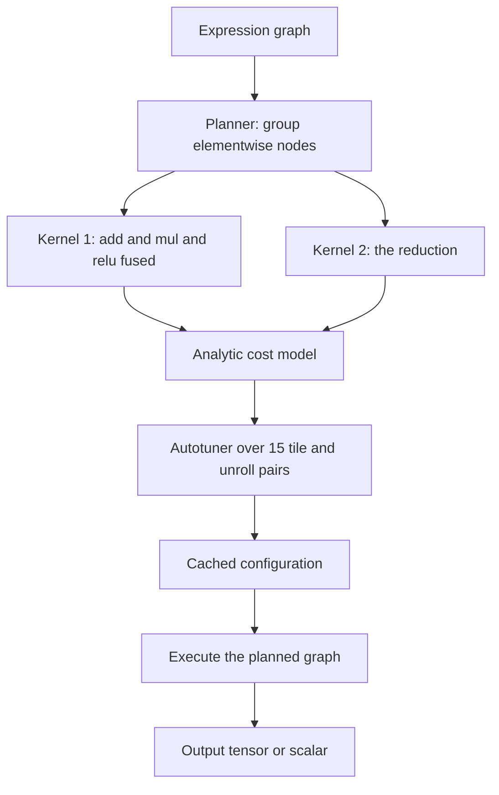
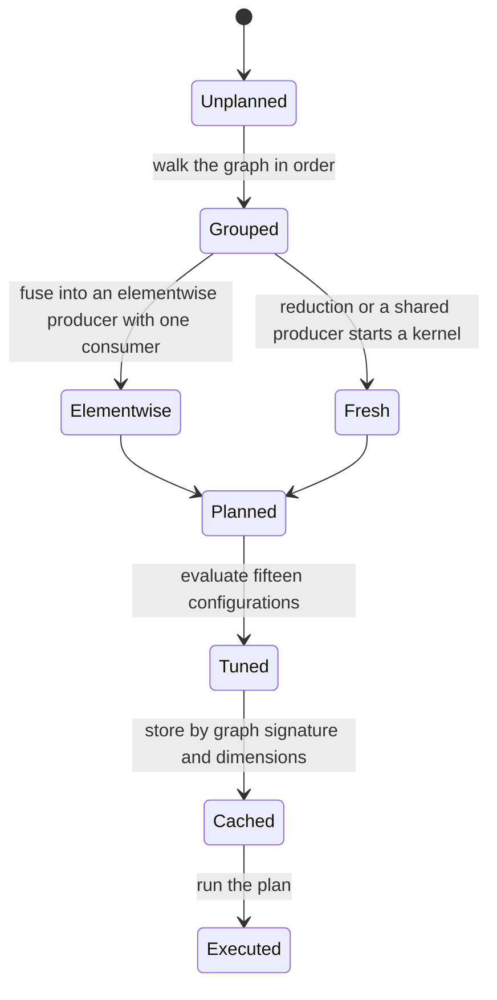
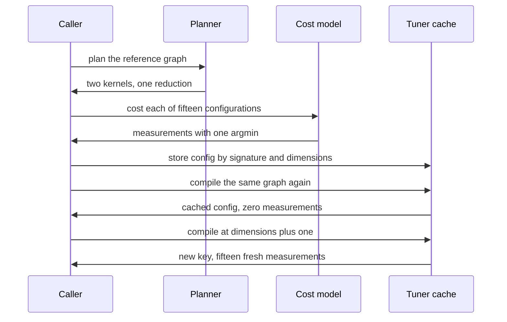

# 933 — Implement runtime that compiles high-level ops into fused kernels with autotuning.

> **Tier:** Master · **CTCI chapter:** Ch Beyond — Compilers, Languages and Solvers
> **Task spec:** [933-implement-runtime-that-compiles-high-level-ops-into-fused-kernel.md](../../../tasks/master/933-implement-runtime-that-compiles-high-level-ops-into-fused-kernel.md)
> **Solutions:** [Python](../../../solutions/python/master/933-implement-runtime-that-compiles-high-level-ops-into-fused-kernel/solution.py) ·
> [Java](../../../solutions/java/master/933-implement-runtime-that-compiles-high-level-ops-into-fused-kernel/Solution.java) ·
> [JavaScript](../../../solutions/javascript/master/933-implement-runtime-that-compiles-high-level-ops-into-fused-kernel/solution.js) ·
> [C#](../../../solutions/csharp/master/933-implement-runtime-that-compiles-high-level-ops-into-fused-kernel/Solution.cs)

## 1. Problem restatement

**Modelling contract.** A tensor runtime in miniature, entirely in process: flat dense tensors (lists
of floats), a graph of five ops, a planner, an *analytic* cost model and a configuration tuner. There
is no real hardware, no vectorisation, no multi-threading and no machine-code generation — the
autotuner measures nothing, it evaluates a model. The files state this simplification explicitly, and
it is the reason the harness can assert the argmin exactly instead of comparing timings.

**Input.** A graph of nodes `("in", name)`, `("const", value)`, `("add", a, b)`, `("mul", a, b)`,
`("relu", a)` and `("sum", a)`, where each child is the node tuple itself (structural sharing is
expressed by reusing the same tuple). The reference graph used by the tests is

```text
in x → in y → add(x, y) → mul(add, y) → relu(mul) → sum(relu)
```

with `dimensions = 5`, `environment = {"x": [0.5, -1.5, 2.0, -0.25, 1.75], "y": [1.0, 2.0, -1.0,
0.5, -2.0]}`.

**Output.** `plan(graph)` returns kernels, each with its `nodes`, `output`, `external` inputs and
`reductions` count; `compile_graph(graph, dimensions, cache)` returns a configuration
`("config", tile, unroll)` plus the measurements; `run(graph, environment, config)` executes the
graph and returns the final value.

| Call | Result | Why |
| --- | --- | --- |
| `run(graph, env, ("config", 4, 1))` | `3.125` | equals the unfused reference `evaluate` |
| `plan(graph)` | `2` kernels, `1` reduction | the reduction always starts a fresh kernel |
| `fused_traffic(kernels, graph, 5)` | `84` bytes | one three-pass kernel plus a read and a scalar write |
| `unfused_traffic(graph, 5)` | `200` bytes | every node materialises its own tensor |
| `compile_graph(graph, 5, {})` | `15` measurements | `tile ∈ {2,4,8,16,32}` × `unroll ∈ {1,2,4}` |

Cost constants: `FLOP_COST = 1e-9`, `BYTE_COST = 4e-9`, `LAUNCH_COST = 5e-7`, `ELEMENT_BYTES = 4`.

## 2. Intuition

A naive interpreter evaluates one node at a time: for every node it walks the whole tensor, reads
its inputs from memory and writes its output back. For the six-node reference graph that is
`200` bytes of traffic for a computation whose live values never exceed one intermediate vector. The
memory system, not the arithmetic, is the bottleneck — so the first insight is **fusion**: a chain of
elementwise nodes can be evaluated in a single pass, keeping intermediate values in registers.

The rule that makes fusion *legal* is the interesting part, and it is where naive implementations
break. An elementwise node may be fused into the kernel of its producer only when

1. the producer is elementwise (a reduction would need to complete before the consumer starts), and
2. the producer has **exactly one consumer** — otherwise the producer's value is needed elsewhere
   and recomputing it inside two kernels duplicates work.

That is why a `sum` always starts a new kernel, and why the fan-out graph in the tests forces the
shared `add` node to be materialised once.

The second insight is that *the best launch configuration depends on the graph*. The model charges
`flops · FLOP_COST / efficiency(tile) + traffic · BYTE_COST + launches · LAUNCH_COST` with
`efficiency = tile / (tile + 4)`: a wider tile amortises the index arithmetic but reduces the number
of launched blocks, and `unroll` divides the launch count. Enumerating the `15` configurations and
keeping the cheapest is only tolerable if the result is **cached** — the key is the graph signature
plus the dimension count, so recompiling the same graph performs zero measurements.



## 3. Algorithm

1. Collect consumers for every node (how many nodes read it) — the fan-out test needs this.
2. Walk the graph in order. Skip `in` and `const` nodes. For a non-reduction node, look for a child
   that is already in a kernel, is elementwise, and has exactly one consumer; if found, append the
   node to that kernel, otherwise open a new kernel.
3. For each kernel compute `external` inputs (children outside the fused set) and the reduction count.
4. `kernel_traffic`: `4 · dimensions · |external|` bytes read plus `4 · dimensions` (or `4` for a
   scalar reduction output) written.
5. `kernel_cost`: `flops` counts `elements` per elementwise node and `elements - 1` per reduction;
   launches are `ceil(elements / tile) / unroll`; the efficiency factor `tile / (tile + 4)` divides
   the flop term.
6. `compile_graph`: if the key `(signature(graph), dimensions)` is cached, return it with an empty
   measurement list; otherwise evaluate all `15` configurations and store the argmin with the stable
   tie-break `(cost, tile, unroll)`.
7. `run`: evaluate nodes in graph order, reusing the planned evaluation (the plan decides what stays
   in registers; the simulation materialises them anyway).

```text
procedure plan(graph)
    consumers ← count of children per node
    kernels ← empty list
    kernel_of ← empty map from node to kernel index
    for index, node in enumerate(graph) do
        if node is in or const then continue
        target ← none
        if node kind is not sum then
            for child in inputs_of(node) do
                if child in kernel_of and len(consumers[child]) == 1 and child kind is not sum then
                    target ← kernel_of[child]
                    break
                end
            end
        end
        if target is none then
            append a kernel with nodes [index] and output index to kernels
            target ← last index of kernels
        else
            append index to kernels[target].nodes
        end
        kernel_of[node] ← target
    end
    for kernel in kernels do
        fused ← the node tuples of kernel.nodes
        kernel.external ← children outside fused, in first-seen order
        kernel.reductions ← count of sum nodes in kernel.nodes
    end
    return kernels
end

procedure compile_graph(graph, dimensions, cache)
    key ← signature of graph together with dimensions
    if key in cache then return cache[key], plan(graph), empty measurements
    for each (tile, unroll) in CONFIGURATIONS do
        cost ← sum of kernel_cost over the plan
        keep the smallest cost, breaking ties by tile then unroll
    end
    cache[key] ← the winning configuration
    return cache[key], plan(graph), the measurements
end
```

`evaluate` is the unfused oracle: every node materialises its own tensor, and `run` must agree with
it exactly, because fusion is a scheduling transformation and may not change a single value.



## 4. Worked example

The reference graph on `x = [0.5, -1.5, 2.0, -0.25, 1.75]` and `y = [1.0, 2.0, -1.0, 0.5, -2.0]`
fuses into two kernels: `add → mul → relu` (fifteen elementwise operations, all one pass) and `sum`.

| Stage | Values | Kernel |
| --- | --- | --- |
| `add(x, y)` | `[1.5, 0.5, 1.0, 0.25, -0.25]` | fused |
| `mul(add, y)` | `[1.5, 1.0, -1.0, 0.125, 0.5]` | fused |
| `relu(mul)` | `[1.5, 1.0, 0.0, 0.125, 0.5]` | fused |
| `sum(relu)` | `3.125` | separate kernel |

The plan's traffic is exactly the assertion in the file: kernel 0 reads `x` and `y` once
(`4 · 5 · 2 = 40` bytes) and writes one vector (`20` bytes) for `60`; kernel 1 reads that vector
(`20` bytes) and writes one scalar (`4` bytes) for `24`; total `84` bytes against `200` unfused — a
`58%` reduction with the same arithmetic.

The autotuner then evaluates the cost model for all `15` configurations. A slice of the scan for this
graph (kernel 0 has `flops = 15`, `60` bytes; kernel 1 has `flops = 4`, `24` bytes):

| `tile` | `unroll` | launches per kernel | kernel 0 cost | kernel 1 cost | total |
| --- | --- | --- | --- | --- | --- |
| `2` | `1` | `3` | `1.845e-6` | `1.608e-6` | `3.453e-6` |
| `4` | `1` | `2` | `1.270e-6` | `1.104e-6` | `2.374e-6` |
| `4` | `4` | `0.5` | `5.200e-7` | `3.540e-7` | `8.740e-7` |
| `16` | `4` | `0.25` | `3.838e-7` | `2.260e-7` | `6.098e-7` |
| `32` | `4` | `0.25` | `3.819e-7` | `2.256e-7` | `6.075e-7` |

The winner is `tile = 32, unroll = 4` by a `0.4%` margin over `16/4` — which is exactly why the
tie-break is `(cost, tile, unroll)` and why the tuner must be deterministic: at this margin, a
nondeterministic iteration order over the configuration list would make the "compiled" artifact
irreproducible. A second `compile_graph` on the same graph returns the cached configuration with an
*empty* measurement list, while `dimensions + 1` is a new key and gets its own `15` measurements.



## 5. Complexity

| Measure | Bound | Why |
| --- | --- | --- |
| Plan | `O(V + E)` time, `O(V + E)` space | one pass for consumers, one pass over nodes and children |
| Traffic accounting | `O(V + E)` | each kernel's external list is walked once |
| Tuning | `O(|CONFIGURATIONS| · K · V)` = `15 · 2 · 6` | 15 configurations, each summing over kernels and their nodes |
| Cached compile | `O(V + E)` | the signature lookup replaces the whole scan |
| Execution | `O(dimensions · V)` time, `O(dimensions)` space | flat tensors, one pass per node; registers are simulated |
| Unfused alternative | `O(dimensions · V)` time but `V` materialised tensors | the traffic comparison is `200` versus `84` bytes |

The cost model's constants are not calibrated to hardware — they are chosen so that a trade-off
*exists* (the file asserts that the measurements contain more than one distinct positive cost). A
real runtime would replace `kernel_cost` with measured timings and the cache with an on-disk
autotune database.

## 6. Pitfalls and edge cases

- **Fusing a reduction.** `sum` must start a new kernel; fusing a consumer into a reduction kernel
  changes the order of evaluation and would break the equality with the unfused reference.
- **Fusing a shared producer.** The fan-out graph `add` is consumed by both a `sum` and another
  `sum`; the single-consumer guard prevents the planner from recomputing it in two kernels.
- **External inputs counted twice.** Each external input must appear once across the whole plan —
  asserted by `len(externals) == len(set(externals))` — otherwise the traffic model double-counts.
- **Empty graph.** `plan([])` returns `[]` and `run([], env, config)` returns `None`; a graph with
  only `in` nodes plans nothing but *is still tuned*, since the cache key exists regardless.
- **Single-node graph.** `relu(x)` plans one kernel and must return
  `[0.5, 0.0, 2.0, 0.0, 1.75]`, i.e. the same values as the unfused oracle.
- **Cost ties.** The argmin is taken with the tuple key `(cost, tile, unroll)`; comparing costs alone
  would pick whichever configuration the enumeration happened to place first.
- **`elements - 1` flops for a reduction.** The last addition of a sum needs two inputs, so the
  count is `n - 1`; using `n` inflates the flop term by `25%` at dimension five.
- **Cache invalidation.** The key is `(signature(graph), dimensions)`: changing the dimension changes
  the launch count and therefore the optimal tile, so it must not be reused. `len(cache) == 2` after
  two distinct compiles is asserted.
- **Determinism.** `plan` is called twice and compared, and a fresh cache must produce the same
  configuration as the warm one.

## 7. Variants and follow-ups

- **Trust the fused kernel.** Differential testing is how a runtime verifies that a fused kernel
  matches its scalar reference — including injected bugs:
  [932 — differential testing between CPU and GPU implementations for numerical ops](../../../tasks/master/932-implement-differential-testing-between-cpu-gpu-implementations-f.md).
- **Checkpoint mid-graph.** Long-running compiled graphs need resumable state, which requires naming
  the intermediate values fusion would otherwise keep in registers:
  [936 — transparent operator checkpointing and resume in a compute graph](../../../tasks/master/936-implement-transparent-operator-checkpointing-and-resume-in-compu.md).
- **Find what the fusion missed.** Choosing which chains to fuse is a hot-path problem:
  [942 — hot-path optimization analyzer that suggests inline and caching opportunities](../../../tasks/master/942-implement-hot-path-optimization-analyzer-that-suggests-inline-an.md).
- **Schedule the hardware you just compiled for.** Configuration choice interacts with device
  contention: [935 — multi-tenant GPU scheduler with preemption and memory reclamation](../../../tasks/master/935-implement-multi-tenant-gpu-scheduler-with-preemption-and-memory.md).

## 8. Check yourself

<details><summary>Show answer</summary>

**1. Why can an elementwise node fuse into its producer but a reduction cannot be fused *through*?**

Elementwise ops are pointwise: element `i` of the output depends only on element `i` of the inputs, so
a chain can be evaluated in one pass with each element staying consistent. A reduction collapses the
index space, so no consumer can begin until the whole reduction has finished — the kernel boundary is
structural, not a scheduling preference.

</details>

<details><summary>Show answer</summary>

**2. Why is the single-consumer condition required for fusion?**

If a producer feeds two consumers, its value is needed in two places. Fusing it into both kernels
computes it twice, which increases flops and breaks the traffic accounting; the file therefore
materialises such producers once and asserts that no node index appears in two kernels.

</details>

<details><summary>Show answer</summary>

**3. Where does the fused traffic `84` come from, and why is it not `5 · 4` times smaller?**

`84 = 4·5·2` (reading `x` and `y`) `+ 4·5` (writing the elementwise result) `+ 4·5` (reading it for the
reduction) `+ 4` (writing the scalar). Fusion removes intermediate *materialisations*, not the reads
of genuine external inputs or the final result, so the saving is bounded by the number of internal
edges, not by the number of nodes.

</details>

<details><summary>Show answer</summary>

**4. The tuner picks `tile = 32, unroll = 4` with a `0.4%` margin. What breaks if the tie-break is
unstable?**

Reproducibility. Two compilations of the same graph could produce different artifacts, so a cached
build and a rebuilt one would differ, and any benchmark comparison would be measuring the tie-break
rather than the configuration. The stable `(cost, tile, unroll)` key removes the ambiguity.

</details>

<details><summary>Show answer</summary>

**5. Why does a graph with only `in` nodes still get tuned?**

Because `compile_graph` keys on the graph signature, not on whether any kernel exists: the decision
"what configuration for this graph" is still well defined (and the answer is irrelevant, since there
is nothing to launch). Returning a cached answer keeps the caller's contract uniform.

</details>
