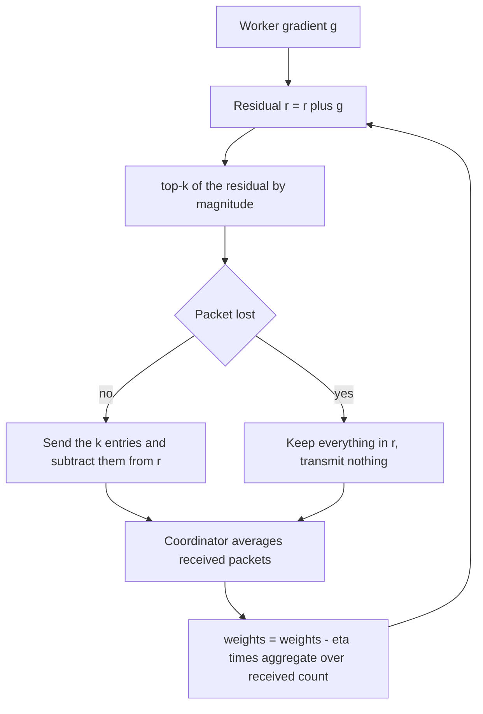
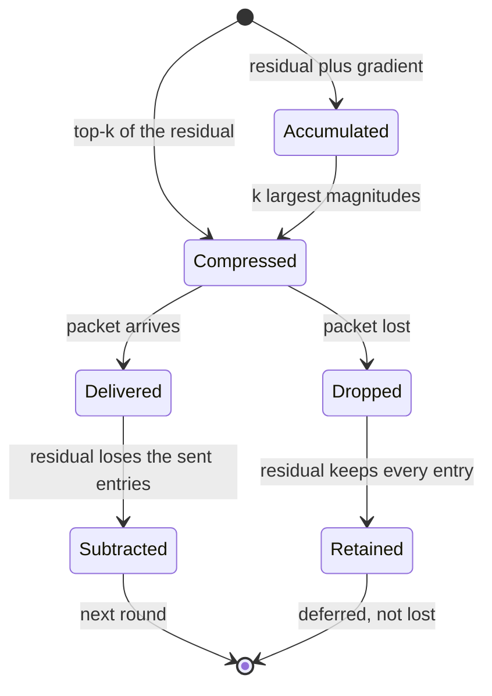
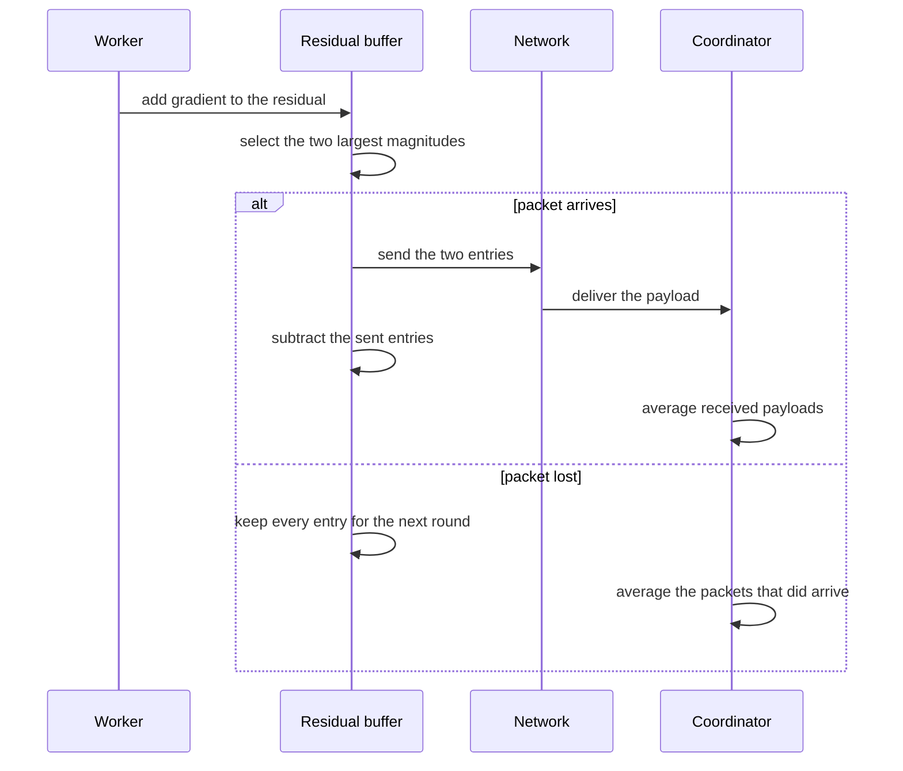

# 934 — Implement distributed gradient compression with error correction under packet loss.

> **Tier:** Master · **CTCI chapter:** Ch 9 — System Design and Scalability
> **Task spec:** [934-implement-distributed-gradient-compression-with-error-correction.md](../../../tasks/master/934-implement-distributed-gradient-compression-with-error-correction.md)
> **Solutions:** [Python](../../../solutions/python/master/934-implement-distributed-gradient-compression-with-error-correction/solution.py) ·
> [Java](../../../solutions/java/master/934-implement-distributed-gradient-compression-with-error-correction/Solution.java) ·
> [JavaScript](../../../solutions/javascript/master/934-implement-distributed-gradient-compression-with-error-correction/solution.js) ·
> [C#](../../../solutions/csharp/master/934-implement-distributed-gradient-compression-with-error-correction/Solution.cs)

## 1. Problem restatement

**Modelling contract.** A single-process simulation of data-parallel SGD: `WORKERS = 4` workers each
hold a shard of a separable quadratic, compress their gradient packet, and a single coordinator
averages whatever arrived and applies the update. Packet loss is a deterministic Bernoulli draw from
the replayable `splitmix64` stream, not a network; there is no second process, no RPC and no
asynchrony. The header of the solutions states exactly this simplification: one compression scheme, a
quadratic objective, one coordinator.

**Input.** `DIM = 8` coordinates with curvatures `CURVATURE = (1.0, 1.4, 1.8, 2.2, 1.2, 1.6, 2.0,
1.1)` and targets `TARGET = (1.0, -0.5, 0.75, 0.25, -1.25, 0.5, -0.75, 1.5)`, starting at
`START = (0.0, …, 0.0)`. `K_TOP = 2` coordinates per packet, `ROUNDS = 40`, and the learning rate
obeys the stability bound `LEARNING_RATE = 0.5 / max(CURVATURE)`.

**Output.** `run(variant, loss_rate, k, rounds, state)` returns `weights`, the `losses` curve, the
`distance` to the target, the number of `transmitted` entries, `bytes`, and an `invariant` flag that
tracks the error-feedback bookkeeping every round.

| Call | Result | Why |
| --- | --- | --- |
| `run("ef", k=DIM)` | matches `closed_form()` within `1e-9` | the uncompressed run *is* the exact recursion |
| `run("ef")` (`k = 2`) | `transmitted == 320`, `bytes == 1280` | `40` rounds × `4` workers × `2` entries × `4` bytes |
| `run("naive")` | final loss `&gt; 100×` the EF run's | dropping the tail leaves a variance floor |
| `run("ef", loss_rate=0.3)` | still converges (`distance &lt; 0.15`) | a lost packet deferral is not a lost gradient |
| `run("ef", k=0)` | `transmitted == 0`, distance unchanged | nothing sent, nothing forgotten |
| `run("ef", loss_rate=1.0)` | the model freezes | every packet dropped is a deferral, not corruption |

Each worker's gradient differs from the true one by a fixed shard bias, and the biases are centred so
they sum to exactly zero per coordinate — the averaged worker gradient *is* the true gradient, which
the tests assert to `1e-12`.

## 2. Intuition

Communicating `d` floats per worker per round is the naive design, and on a real cluster it is what
makes the interconnect, not the GPU, the bottleneck. The obvious compression is to send the `k`
largest-magnitude coordinates: gradients are heavy-tailed, so most of the mass sits in a few entries.

The obvious compression is also wrong in a subtle way. If you throw away the tail and send nothing
about it, you never send it again in the next round either — the *same* small coordinates keep
missing the cut. The error accumulates as a systematic floor: the model converges to a point that is
biased by everything the compressor discarded, and no number of rounds fixes it. The file
demonstrates this by implementing the naive variant and asserting that its final loss is more than a
hundred times the error-feedback loss.

The fix costs nothing but bookkeeping. Each worker keeps a **residual** vector `r`:

```text
r ← r + g            accumulate the new gradient
send ← topk(r, k)    transmit the largest coordinates
r ← r − send         keep the part that was not transmitted
```

Nothing is forgotten: a coordinate that missed the top-k once stays in `r` and is a candidate next
round, so every coordinate eventually gets transmitted. This is error feedback, and it is what turns
a biased sparsifier into an unbiased-ish convergent one. The coordination path then averages only the
packets it *received*, and the invariant that makes the whole scheme auditable is

```text
truncated-residual + transmitted total == produced total   (per coordinate, every round)
```

Packet loss interacts elegantly with this: a dropped packet is *deferred*, not lost. The worker
subtracts the transmitted entries from the residual only when the packet actually arrives, so a lost
packet keeps its coordinates in the residual and they lead the next round's top-k. That is why a 30%
loss rate still converges, and why a 100% loss rate freezes the model instead of corrupting it.



## 3. Algorithm

1. Recentre the per-worker biases so that each coordinate's bias sums to zero across workers.
2. For each round: compute each worker's gradient `g_i = c ⊙ (w − t) + bias_i`.
3. Draw the loss coin for that worker from the deterministic stream; if it is below `loss_rate` the
   packet will be dropped.
4. Compression variant:
   - `exact`: send all `d` coordinates;
   - `ef`: `r += g`, send `topk(r, k)`, and subtract the sent entries from `r` **only if received**;
   - `naive`: send `topk(g, k)` scaled by `d / k` and forget the tail.
5. If received: count the entries and bytes and add them into `transmitted_total`.
6. Re-check the invariant `resident + transmitted == produced` per coordinate (EF only).
7. If at least one packet arrived, average the payload sum over the *number of received packets* and
   take a gradient step; if none arrived, leave the weights untouched.

```text
procedure run(variant, loss_rate, k, rounds)
    weights ← START, residuals ← zeros for each worker
    transmitted_total ← zeros, produced_total ← zeros
    for round ← 1 to rounds do
        payloads ← empty list
        for worker ← 0 to WORKERS - 1 do
            gradient ← worker_gradients(weights)[worker]
            produced_total ← produced_total + gradient
            dropped ← (loss_rate &gt; 0) and (uniform() &lt; loss_rate)
            if variant is exact then
                sent ← all coordinates of gradient
            else if variant is ef then
                residuals[worker] ← residuals[worker] + gradient
                sent ← top_k(residuals[worker], k)
                if not dropped then
                    residuals[worker] ← residuals[worker] - sent
                end
            else
                sent ← top_k(gradient, k) scaled by DIM / k
            end
            if dropped then continue end
            transmitted_total ← transmitted_total + sent
            append sent to payloads
        end
        if variant is ef then
            resident ← sum of residuals over workers
            invariant ← invariant and all(|resident + transmitted_total - produced_total| &lt; 1e-9)
        end
        if payloads is not empty then
            aggregate ← sum of payloads
            weights ← weights - LEARNING_RATE * aggregate / count(payloads)
        end
    end
    return weights, losses, distance, transmitted, bytes, invariant
end
```

`top_k` sorts by `(-|value|, index)` so ties break by coordinate index — a detail that matters,
because a nondeterministic tie order would make the transmitted set unreproducible.



## 4. Worked example

Take coordinate `0` of the exact run: `TARGET[0] = 1.0`, `CURVATURE[0] = 1.0`, `START[0] = 0.0`, so
the true gradient is `1.0 · (0 − 1.0) = −1.0`. The raw shard biases are
`0.05 · ((worker + 0) mod 5 − 2)`, and after centring they become `−0.075, −0.025, +0.025, +0.075`
(sum `0`).

| Worker | Raw bias | Centred bias | Worker gradient | Transmitted (exact) | Transmitted (EF, `k = 2`) |
| --- | --- | --- | --- | --- | --- |
| 0 | `-0.10` | `-0.075` | `-1.075` | `-1.075` | depends on the residual norm |
| 1 | `-0.05` | `-0.025` | `-1.025` | `-1.025` | — |
| 2 | `0.00` | `+0.025` | `-0.975` | `-0.975` | — |
| 3 | `+0.05` | `+0.075` | `-0.925` | `-0.925` | — |
| aggregate | — | — | `-4.000` | `-4.000` | `k` coordinates per worker |

The coordinator divides by the received count (`4`), giving `-1.000` — the true gradient, exactly as
the file asserts to `1e-12` — and the update is `w₀ ← 0 + 0.227273 · 1.0 = 0.227273`, since
`LEARNING_RATE = 0.5 / 2.2`. The closed-form oracle `w_n − t = (1 − η·c)ⁿ (w_0 − t)` predicts the
same value, so the *exact* trajectory is a geometric recursion the simulation must reproduce to
`1e-9`.

Now the error-feedback mechanism on a four-coordinate toy residual, `k = 2`:

| Stage | Coordinate 0 | Coordinate 1 | Coordinate 2 | Coordinate 3 | Sum |
| --- | --- | --- | --- | --- | --- |
| residual after `r += g` | `0.90` | `-0.40` | `0.20` | `-0.10` | `0.60` |
| `topk(r, 2)` transmitted | `0.90` | `-0.40` | `0.00` | `0.00` | `0.50` |
| residual after subtraction | `0.00` | `0.00` | `0.20` | `-0.10` | `0.10` |
| **if the packet is dropped** | `0.90` | `-0.40` | `0.20` | `-0.10` | `0.60` |

With the packet delivered, `resident (0.10) + transmitted (0.50) = produced (0.60)` per-coordinate and
in total. With the packet dropped, `transmitted` is never incremented, so `resident (0.60) + 0 = 0.60`
— the invariant still holds, and the `0.90` and `-0.40` are at the front of the queue for the next
round. The naive variant instead sends `0.90 × 4 = 3.60` and `-0.40 × 4 = -1.60` and sets the whole
residual to zero: the scaling preserves the *expected* value but the `0.20` and `-0.10` are gone
forever, which is the variance floor the assertions measure.



## 5. Complexity

| Measure | Bound | Why |
| --- | --- | --- |
| Compression per worker | `O(d log d)` worst case | a full sort of the residual; a heap would give `O(d log k)` |
| Per round | `O(WORKERS · d log d + WORKERS · d)` | compression plus accumulation |
| Total | `O(ROUNDS · WORKERS · d log d)` = `O(40 · 4 · 8 log 8)` | the simulated cluster is tiny; the constants are the point |
| Communication | `O(ROUNDS · WORKERS · k)` entries = `320` | `4` bytes each, so `1280` bytes against `5120` uncompressed |
| Compression ratio | `d / k = 4` | asserted as `received · d == (d / k) · transmitted` |
| Space | `O(WORKERS · d)` for the residuals, `O(1)` besides | the coordinator keeps one aggregate vector |
| Naive variant | same time, same traffic | identical cost, but a permanent bias floor |

The asymptotic story of the task is the compression ratio: the *progressive* gain of error feedback
is not in the per-round cost, it is that `O(1/k)` of the batch's coordinates travel while the
trajectory still matches the uncompressed one to within a small distance.

## 6. Pitfalls and edge cases

- **Forgetting the residual.** Subtracting the sent entries *unconditionally* (outside the delivered
  branch) throws away lost packets' contribution and reintroduces the variance floor under loss.
- **Averaging by the worker count instead of the received count.** With a 30% loss rate, dividing by
  `WORKERS` shrinks every update by the loss factor; the file divides by `len(payloads)`.
- **Bias that does not cancel.** If the shard biases summed to anything but zero, the averaged
  gradient would be biased and the closed-form comparison at `1e-9` would fail.
- **`k = 0`.** Nothing is transmitted, the residual keeps everything, and the distance stays exactly
  `dist(START, TARGET)` — the assertion uses equality, so the update must be skipped entirely rather
  than applied with a zero aggregate.
- **`k = d` with no loss.** Must be bit-identical to the exact run, because `topk` with `k = d`
  returns every coordinate.
- **100% loss.** The model freezes: no payload, no update, no corruption. The file asserts
  `transmitted == 0` *and* an unchanged distance.
- **Tie-breaking in `top_k`.** Sorting by `(-magnitude, index)` keeps the transmitted set
  reproducible; ties on magnitude are common when coordinates start from identical values.
- **Instability bound.** `LEARNING_RATE = 0.5 / max(CURVATURE) = 0.227273` is chosen so that plain
  descent is provably non-increasing; the loss curve is asserted monotone within `1e-12`.
- **Single round.** `run("ef", rounds=1)` yields two loss entries with the second no larger than the
  first.

## 8. Check yourself

<details><summary>Show answer</summary>

**1. Why does the naive top-k sparsifier stall instead of converging slowly?**

Because the discarded tail is discarded *every* round — the same small coordinates always miss the
cut. The error never gets communicated, so it accumulates into a fixed bias in the weights, and the
objective plateaus at a floor far above zero (asserted to be more than `100×` the EF loss).

</details>

<details><summary>Show answer</summary>

**2. What exactly does the invariant `resident + transmitted == produced` protect against?**

Double-sending and silent dropping. If a worker subtracted an entry it never sent, `resident` would
be short; if it sent an entry twice, `transmitted` would exceed `produced`. Checking it per
coordinate every round catches both, with and without packet loss.

</details>

<details><summary>Show answer</summary>

**3. Why does the coordinator divide by the number of received packets?**

Because the aggregate is a sum over the workers that actually reported. Dividing by `WORKERS` would
scale every update down by the packet-loss rate, slowing convergence by a constant factor and
biasing the effective learning rate downwards; the EF run at 30% loss is asserted to still converge
tightly.

</details>

<details><summary>Show answer</summary>

**4. In the worked example, why does the dropped packet still satisfy the invariant?**

`transmitted_total` is only incremented for received packets, so a dropped packet contributes `0` to
it while its coordinates remain in `resident`. The identity `resident + transmitted = produced`
therefore holds by construction — the deferral is explicit, not an accounting hole.

</details>

<details><summary>Show answer</summary>

**5. What is the cost of error feedback compared with naive top-k?**

No extra traffic and no extra rounds: `k` entries per worker per round, `320` entries in the whole
run. The cost is one `d`-length residual vector per worker and one vector add/subtract per round,
i.e. `O(WORKERS · d)` extra space and arithmetic — the cheapest part of the system.

</details>

## 7. Variants and follow-ups

- **Keep the numbers exact.** Compression is only safe if the arithmetic it replaces is well
  understood; rational arithmetic removes the rounding argument entirely:
  [944 — high-precision numeric library with arbitrary precision rational arithmetic](../../../tasks/master/944-implement-high-precision-numeric-library-with-arbitrary-precisio.md).
- **Budget the run.** Compression trades communicate against iterations, which is exactly the budget
  language of [938 — safe experiment platform that enforces SLOs and budget on experiments](../../../tasks/master/938-implement-safe-experiment-platform-that-enforces-slos-and-budget.md).
- **Compile the kernel that averages the payloads.** The coordinator's reduce is a fused kernel:
  [933 — runtime that compiles high-level ops into fused kernels with autotuning](../../../tasks/master/933-implement-runtime-that-compiles-high-level-ops-into-fused-kernel.md).
- **Feel the loss in the cluster.** Packet loss here is a coin flip; the load and contention story
  behind it is [940 — high-fidelity load generator with correlated user behavior models](../../../tasks/master/940-implement-high-fidelity-load-generator-with-correlated-user-beha.md).
