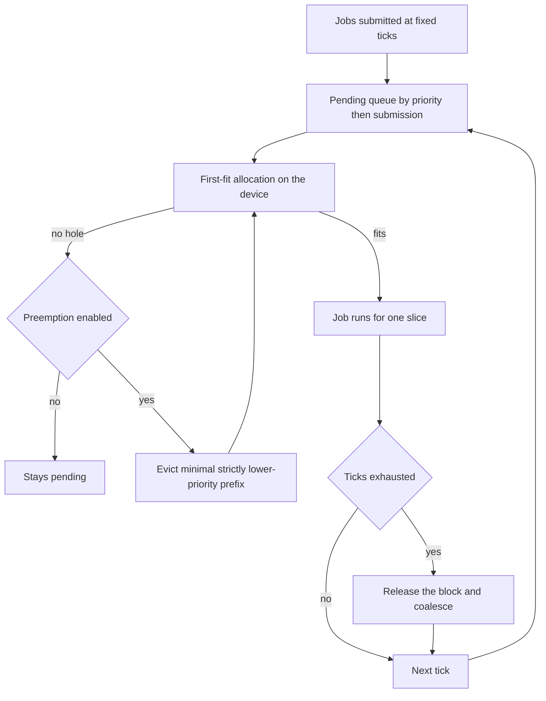
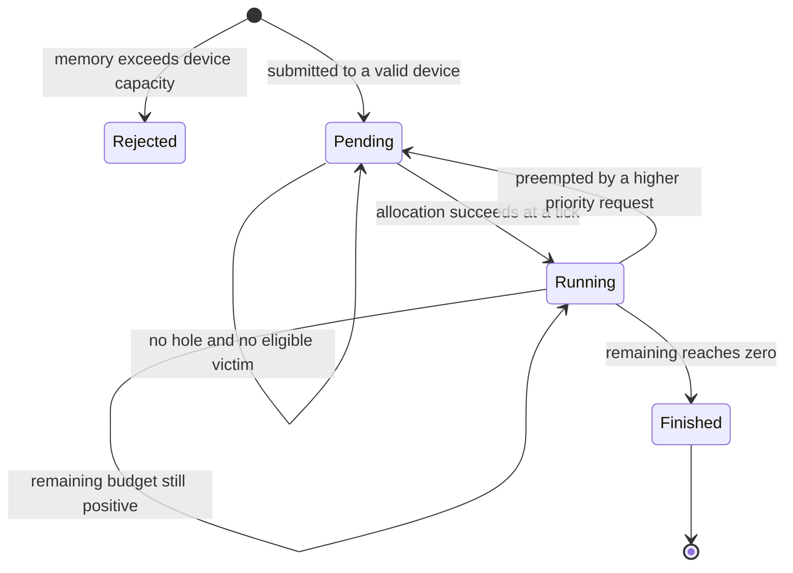
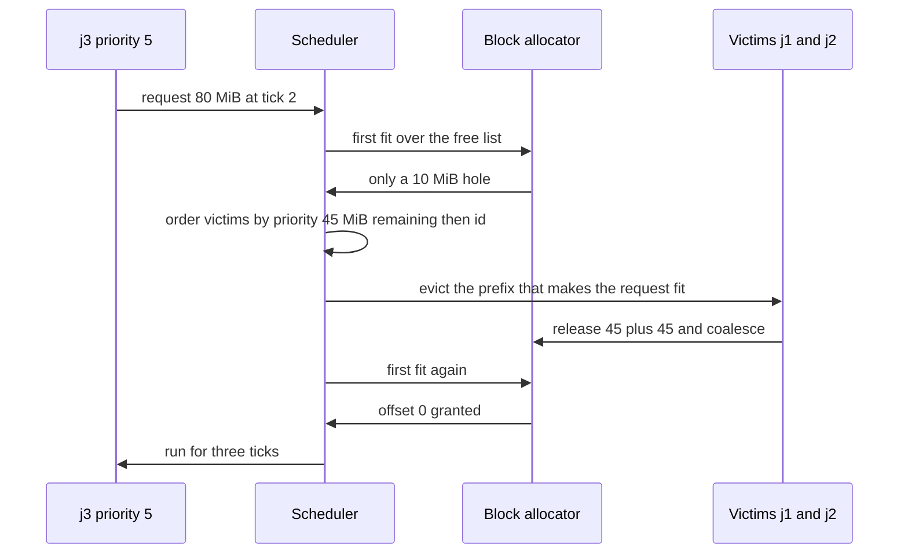

# 935 — Implement multi-tenant GPU scheduler with preemption and memory reclamation.

> **Tier:** Master · **CTCI chapter:** Ch 9 — System Design and Scalability
> **Task spec:** [935-implement-multi-tenant-gpu-scheduler-with-preemption-and-memory.md](../../../tasks/master/935-implement-multi-tenant-gpu-scheduler-with-preemption-and-memory.md)
> **Solutions:** [Python](../../../solutions/python/master/935-implement-multi-tenant-gpu-scheduler-with-preemption-and-memory/solution.py) ·
> [Java](../../../solutions/java/master/935-implement-multi-tenant-gpu-scheduler-with-preemption-and-memory/Solution.java) ·
> [JavaScript](../../../solutions/javascript/master/935-implement-multi-tenant-gpu-scheduler-with-preemption-and-memory/solution.js) ·
> [C#](../../../solutions/csharp/master/935-implement-multi-tenant-gpu-scheduler-with-preemption-and-memory/Solution.cs)

## 1. Problem restatement

**Modelling contract.** A deterministic *in-process* scheduler: devices are tick counters with a
capacity in MiB, jobs are records, and preemption is instantaneous (there is no save/restore of
device state). Jobs never migrate between devices, an oversized job is rejected once rather than
queued forever, and time advances in fixed ticks where every running job consumes one slice. The
solution headers list exactly these simplifications relative to a real driver.

**Input.** Two devices, `{"gpu-a": 100, "gpu-b": 60}`, and six jobs submitted at fixed ticks:

| Job | Tenant | Device | MiB | Priority | Ticks | Submit |
| --- | --- | --- | --- | --- | --- | --- |
| `j1` | tenant-1 | gpu-a | 45 | 1 | 12 | 0 |
| `j2` | tenant-2 | gpu-a | 45 | 1 | 12 | 0 |
| `j3` | tenant-3 | gpu-a | 80 | 5 | 3 | 2 |
| `j4` | tenant-4 | gpu-a | 150 | 9 | 1 | 1 |
| `j5` | tenant-2 | gpu-b | 60 | 2 | 2 | 0 |
| `j6` | tenant-1 | gpu-a | 20 | 3 | 4 | 8 |

**Output.** A `Scheduler` holding the run queues, the eviction log `(tick, victim, victim priority,
requester, requester priority)`, the rejection log and the `violations` list produced by the
per-tick audit. Each `Job` records its `offset`, `finished` tick and `preemptions`.

| Call | Result | Why |
| --- | --- | --- |
| `pre.violations` / `pre.pending` | `[]` / `[]` | no over-commit ever occurred and nothing starves |
| `pre.rejected` | `["j4"]` | `150 &gt; 100`, rejected on both devices' account |
| `evictions for j3` | `("j1", "j2")` | the minimal strictly lower-priority victim prefix |
| `pre_jobs["j3"].finished` | `4` (non-preemptive: `14`) | the high-priority tenant wins the device |
| `pre_jobs["j1"].preemptions` | `2` (non-preemptive: `0`) | 45 MiB victims pay for the 80 MiB and 20 MiB requesters |
| `pre_jobs["j5"]` | `(offset 0, finished 1, 0 preemptions)` | on the sibling device, untouched |

## 2. Intuition

The naive scheduler is a single number: memory used per device. `used + request ≤ capacity` admits
or refuses, and it is wrong in both directions. It admits a 60 MiB job onto a device whose free
memory is 40 + 20 in two disjoint holes — that allocation cannot exist. And it has no answer for a
high-priority job that arrives when the device is full of low-priority work.

The first insight is that the device's memory is a **block list, not a counter**. A first-fit
allocator over a coalescing free list — the classic algorithm — knows both the amount free and which
contiguous ranges are free, so `alloc` returns `None` exactly when no hole is large enough. Releasing
a block merges it with both neighbours, which is the reclamation path, and the tests pin the merge
behaviour on a hand-checkable sequence: allocate `30 + 20 + 50`, free the middle, free the last, free
the first, and watch the free list become one block of `100` again.

The second insight is *which* victims to choose. Evicting anything that fits is tempting and wrong:
it can evict far more work than necessary, or evict a more important tenant. The policy in the files
is precise:

1. only strictly lower-priority, still-running, preemptible jobs are eligible;
2. they are ordered by `(priority, −mem, −remaining, jid)` — cheapest priority first, then the
   *largest* block (it frees the most per eviction), then the least remaining work, then job id for
   determinism;
3. evict the **prefix** that makes the request fit, stopping as soon as it does.

That prefix rule is what "minimal victim set" means in the assertions: for `j3` the prefix is
`(j1, j2)` — evicting `j1` alone leaves `90 − 45 + 80 = 125 &gt; 100` — while for `j6` the prefix is
`j1` alone, because `90 − 45 + 20 = 65 ≤ 100`.



## 3. Algorithm

1. `BlockAllocator(capacity)` starts with one free block `(0, capacity)` and an empty `live` map.
2. `alloc(key, size)` first-fits over the free list, splitting the block; rejects `size ≤ 0` and
   `size &gt; capacity`.
3. `release(key)` moves the block back to the free list, sorts it, and merges every pair of adjacent
   blocks — the reclamation path.
4. `Scheduler.step()` (per tick): admit pending jobs in `(−priority, submit, jid)` order; then
   decrement `remaining` for every running job, releasing and recording `finished` when it hits zero;
   then run the audit.
5. `_admit(job)` tries `alloc`; on failure with preemption it builds the victim list, accumulates
   `freed` over the prefix, and evicts the prefix as soon as
   `held − freed + mem ≤ capacity`; victims are requeued with their remaining budget and counted.
6. `_audit()` re-checks per device: `held == allocator.used()`, no over-commit, no negative offsets,
   no overlapping spans and the last span inside capacity.

```text
procedure admit(job)
    offset ← allocator.alloc(job.id, job.mem)
    if offset is none and preemption then
        victims ← running jobs that are preemptible, not finished, and strictly lower priority
        order victims by priority, then by largest memory, then by smallest remaining, then by id
        freed ← 0
        for count ← 1 to length(victims) do
            freed ← freed + victims[count].mem
            if held(device) - freed + job.mem &gt; capacity then continue end
            for victim in victims[1 .. count] do
                allocator.release(victim.id)
                remove victim from running
                victim.preemptions ← victim.preemptions + 1
                victim.offset ← -1
                append victim to pending
                log the eviction at the current tick
            end
            offset ← allocator.alloc(job.id, job.mem)
            break
        end
    end
    if offset is none then return false end
    job.offset ← offset
    append job to running
    return true
end

procedure release(key)
    append live-block of key to free
    sort free by offset
    merged ← empty
    for offset, size in free do
        if merged is non-empty and merged.last.offset + merged.last.size == offset then
            merged.last.size ← merged.last.size + size
        else
            append (offset, size) to merged
        end
    end
    free ← merged
end
```



## 4. Worked example

The preemptive run, tick by tick, on `gpu-a` (`j5` sits alone on `gpu-b` and finishes at tick 1):

| Tick | Event | gpu-a held after | Notes |
| --- | --- | --- | --- |
| 0 | `j1` at offset 0, `j2` at offset 45 | 90 | both priority 1, 45 MiB each |
| 1 | `j4` submitted | 90 | `150 &gt; 100` → appended to `rejected` |
| 2 | `j3` (80, priority 5) evicts `j1` and `j2` | 80 | `90 − 45 + 80 = 125 &gt; 100`, `90 − 90 + 80 = 80 ≤ 100` |
| 4 | `j3` finishes | 0 | 3 ticks of work, released and coalesced |
| 5 | `j1`, `j2` re-admitted at 0 and 45 | 90 | requeued with their remaining budget |
| 8 | `j6` (20, priority 3) evicts `j1` only | 65 | `90 − 45 + 20 = 65 ≤ 100` |
| 11 | `j6` finishes | 45 | `j2` continues undisturbed |
| 14 | `j2` finishes | 0 | preempted once, so it loses three ticks |
| 21 | `j1` finishes | 0 | preempted twice — once for `j3`, once for `j6` |

The accounting that the assertions pin: `j3` finishes at tick **4** preemptively versus **14** in the
independent non-preemptive reference run, `j1` finishes strictly later than its tick-**11** reference
finish and is recorded with exactly **2** preemptions, the first eviction is `(2, "j1")`, every
eviction satisfies `victim_priority &lt; requester_priority`, and `j5` — the exactly-fitting job on
the sibling device — keeps offset 0, finishes at tick 1 and is never preempted in either run.

The memory accounting is verified twice per tick: the audit checks `held == allocator.used()` for
every device, so an allocation that succeeded but was never counted (or a release that forgot to
decrement) shows up as a violation. The reclamation path is demonstrated separately, by hand:

| Step | Operation | Free list | `used()` |
| --- | --- | --- | --- |
| 0 | `alloc(a, 30)` | `[(30, 70)]` | 30 |
| 1 | `alloc(b, 20)` | `[(50, 50)]` | 50 |
| 2 | `alloc(c, 50)` | `[]` | 100 |
| 3 | `release(b)` | `[(30, 20)]` | 80 |
| 4 | `release(c)` | `[(30, 70)]` | 30 |
| 5 | `release(a)` | `[(0, 100)]` | 0 |

Step 3 shows why the merge must happen on release: the block for `b` is free but *isolated* — `a` and
`c` are still live — so no merge occurs. Only when the neighbours are released do the holes coalesce,
and the last row shows the device fully reclaimed to a single 100 MiB block.

**Fragmentation is not the same as capacity.** Allocate `40 + 40`, release the first, and the device
has 60 MiB free — in two holes of `40` and `20`. A 60 MiB request is refused (`alloc` returns
`None`) even though the total is sufficient, which is exactly the case a byte counter would get
wrong. The same test asserts that `alloc(d, 0)` and `alloc(e, 101)` are refused, and that
`alloc(f, 40)` succeeds at offset 0.



## 5. Complexity

| Measure | Bound | Why |
| --- | --- | --- |
| `alloc` | `O(F)` | first fit scans the free list of `F` blocks |
| `release` | `O(F log F)` | sort plus a linear merge pass |
| Admission with preemption | `O(R log R + O(F))` | sorting `R` running jobs, then one allocation attempt |
| One tick | `O(P log P + R + D · F log F)` | pending sort, the decrement sweep, the audit per device |
| Whole simulation | `O(horizon · (P log P + R + D · F log F))` | `horizon = 40`, `D = 2` devices |
| Space | `O(D · (F + R + P))` | jobs are shared between the queues, not copied |
| Byte-counter alternative | `O(1)` per decision | but admits allocations that cannot exist (the fragmentation case) |

The audit is the most expensive per-tick step in the model (`O(F log F)` for the span sort) and it is
deliberate: it is what converts "the scheduler looked right in the log" into a checked invariant that
holds on every tick.

## 6. Pitfalls and edge cases

- **Fragmentation versus free memory.** Never admit on a byte count alone; the file asserts that a
  60 MiB request fails on a device with 40 + 20 free.
- **Exact fit.** `alloc` uses `block &gt;= size` and removes the block entirely when
  `block == size`, so `j5` (60 MiB on a 60 MiB device) lands at offset 0 and finishes untouched.
- **Oversized requests.** `submit` rejects `size &gt; capacity` immediately (`j4`), rather than
  queueing a job that can never run; `alloc` also rejects `size ≤ 0` and `size &gt; capacity`.
- **Priority must be *strictly* lower.** A victim with equal priority is never evicted, which is why
  `j1` cannot displace `j2` at ticks 12–14 when it is re-admitted and blocked.
- **Minimal prefix.** Stopping at the first prefix that fits is asserted by
  `evictions for j3 == (j1, j2)` and `evictions for j6 == (j1,)`; a "largest victim first" or
  "all lower-priority victims" policy breaks both.
- **Preemption accounting.** Evicted jobs keep their `remaining` budget, get `offset = -1` and are
  requeued; `preemptions` counts every eviction, which is how the test distinguishes the preemptive
  from the non-preemptive run (`2` versus `0`).
- **Isolation.** `gpu-b` has its own allocator and queue; nothing about the `45 + 45` contention on
  `gpu-a` may touch `j5`.
- **Determinism.** Two runs of the same workload must produce identical finish ticks, preemption
  counts and eviction logs — the reason every sort key ends with the job id.

## 7. Variants and follow-ups

- **Decide what to run from the workload, not the queue.** A load generator that models correlated
  user behaviour is how the request stream is produced in the first place:
  [940 — high-fidelity load generator with correlated user behavior models](../../../tasks/master/940-implement-high-fidelity-load-generator-with-correlated-user-beha.md).
- **Checkpoint the preempted job.** Real preemption costs a save and a restore, which is the
  transparent checkpointing problem in
  [936 — transparent operator checkpointing and resume in a compute graph](../../../tasks/master/936-implement-transparent-operator-checkpointing-and-resume-in-compu.md).
- **Frame admission as canary analysis.** Deciding whether a new workload may share a device is the
  same risk question as rolling an experiment out:
  [937 — deployment pipeline with canary analysis using online metrics and rollback](../../../tasks/master/937-implement-deployment-pipeline-with-canary-analysis-using-online.md).
- **Compile for the device you scheduled.** Launch configuration and occupancy interact with
  contention: [933 — runtime that compiles high-level ops into fused kernels with autotuning](../../../tasks/master/933-implement-runtime-that-compiles-high-level-ops-into-fused-kernel.md).

## 8. Check yourself

<details><summary>Show answer</summary>

**1. Why does the scheduler need a block allocator rather than a used-byte counter?**

Because a request needs a *contiguous* range. The test case with 40 + 20 free bytes and a 60 byte
request shows the counter saying "yes" to an allocation that cannot exist; the free list answers
correctly.

</details>

<details><summary>Show answer</summary>

**2. Why must preemption evict a prefix rather than an arbitrary set of victims?**

Because "fit" is decided by the running total. Evicting a set that is not a prefix would either
evict more than necessary or fail to fit, and the tests pin the exact victim sets (`j3 → j1, j2` and
`j6 → j1`) plus the strict `victim_priority &lt; requester_priority` rule.

</details>

<details><summary>Show answer</summary>

**3. What makes `j5` a useful test case?**

It is an exact fit (`60` MiB on a `60` MiB device), so it exercises the `block == size` branch, and it
lives on the sibling device, so it proves the two devices' accounting and queues are independent: its
offset, finish tick and preemption count are identical in the preemptive and non-preemptive runs.

</details>

<details><summary>Show answer</summary>

**4. In the reclamation table, why is the free list `[(30, 20)]` after releasing `b` and not
`[(0, 30), (30, 20), (50, 50)]`?**

Because `a` and `c` are still live, so `b`'s block has no free neighbour to merge with, and the
allocator only tracks free blocks — the live ones are in the `live` map. The merge to `[(30, 70)]`
happens only when `c` is released.

</details>

<details><summary>Show answer</summary>

**5. What would break if the victim sort key had no job id?**

Determinism. `j1` and `j2` are identical in priority, memory and remaining budget in the tick-2
decision, so without the id tie-break the eviction order would depend on the iteration order of the
running list and the two runs could diverge.

</details>
