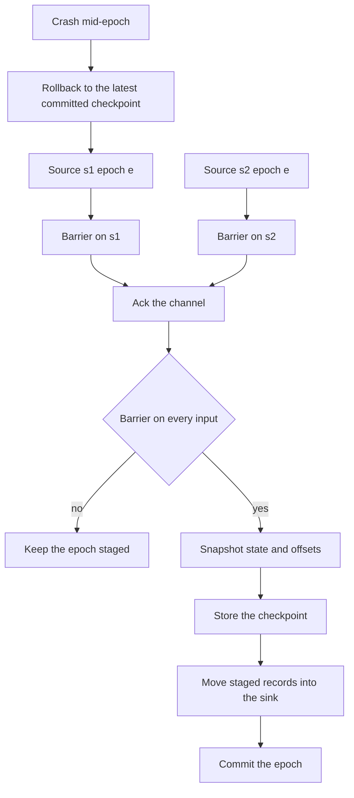
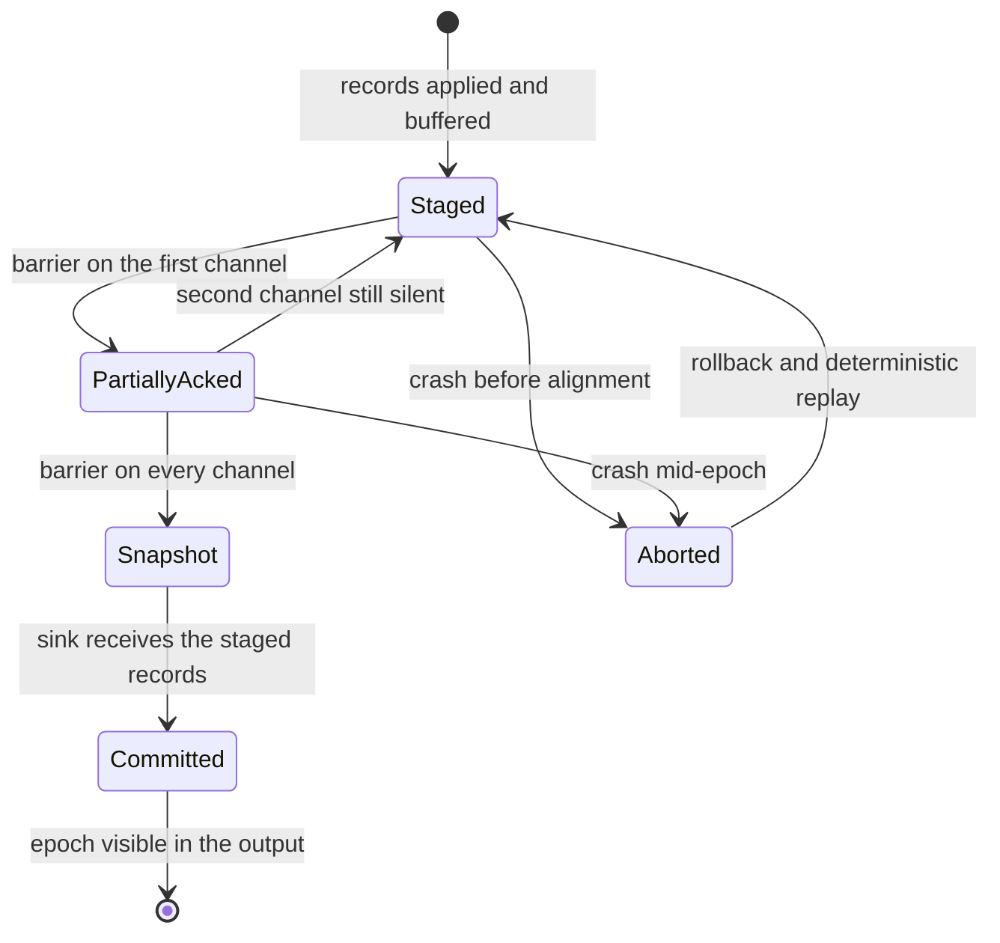
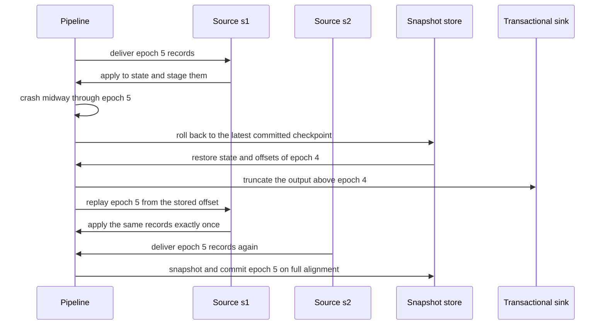

# 936 — Implement transparent operator checkpointing and resume in compute graph.

> **Tier:** Master · **CTCI chapter:** Ch Beyond — Software Engineering and Tooling
> **Task spec:** [936-implement-transparent-operator-checkpointing-and-resume-in-compu.md](../../../tasks/master/936-implement-transparent-operator-checkpointing-and-resume-in-compu.md)
> **Solutions:** [Python](../../../solutions/python/master/936-implement-transparent-operator-checkpointing-and-resume-in-compu/solution.py) ·
> [Java](../../../solutions/java/master/936-implement-transparent-operator-checkpointing-and-resume-in-compu/Solution.java) ·
> [JavaScript](../../../solutions/javascript/master/936-implement-transparent-operator-checkpointing-and-resume-in-compu/solution.js) ·
> [C#](../../../solutions/csharp/master/936-implement-transparent-operator-checkpointing-and-resume-in-compu/Solution.cs)

## 1. Problem restatement

**Modelling contract.** A deterministic, in-memory streaming runtime: two source tasks emit epochs of
keyed records, one stateful aggregate (a per-key running sum) consumes both channels, and a
transactional sink stages records and commits them. A "crash" is a raised exception inside the run
loop, and recovery restarts the failed task *in place*. The headers state the simplifications
relative to Flink or Spark: no network, no watermarks, no asynchronous snapshotting and no alignment
timeout.

**Input.** `SOURCES = ("s1", "s2")` and `source_records(source, epoch)`, which draws from a
`splitmix64` stream seeded with `len(source) · 100_000 + epoch` and returns **two** `(key, value)`
records per source per epoch, with keys `k0`–`k2` and values `1`–`9`. `epochs = 7`.

**Output.** A `Pipeline` exposing `state` (the aggregate's keyed state), `offsets` (per-source
consumed offsets), `checkpoints` (epoch → snapshot), `sink` (epoch → committed records), `staged`
(epoch → records not yet committed), `acked` (epoch → the channels whose barrier arrived) and
`commits` (commit order). `run(start, stop, fail_at, midway)` processes an epoch range and
optionally raises `Crash` at a chosen point; `rollback(epoch)` discards everything after `epoch` and
returns the epoch to replay from.

| Call | Result | Why |
| --- | --- | --- |
| `recover(7)` | `state == oracle(7)` | an interrupted-and-resumed run equals the checkpoint-free reference |
| `recover(7, fail_at=3)` | identical to the oracle | failure between epochs replays from the committed offset |
| `recover(7, fail_at=5, midway=True)` | identical to the oracle | the half-applied epoch is discarded, not double-counted |
| `rollback(None)` | returns `0` | a crash before the first checkpoint rewinds to the empty state |
| `rollback(1)` on a complete run | returns `2` | replaying from a *stale* checkpoint still converges |
| `Pipeline().run(0, 0)` | no state, no checkpoint | the zero-epoch boundary |

## 2. Intuition

The naive way to make a streaming job fault-tolerant is to snapshot state periodically and, on
restart, resume from the snapshot. That produces **at-least-once** semantics: records processed after
the last snapshot are processed again, so a downstream counter double-counts. It also cannot decide
*when* a snapshot is complete, because two input channels advance independently — a snapshot taken
while one channel is ahead captures an inconsistent view of the two streams.

The insight is to make the snapshot **aligned**: the runtime injects a barrier into every channel at
the same point in the epoch, and the operator snapshots its state only when a barrier has arrived on
*every* input. That is what `acked` records: `checkpoints[epoch]` exists only when
`acked[epoch] == set(SOURCES)`, and the tests assert this alignment for every committed epoch.

The second half is the sink. State alone is not enough: if the sink wrote its output before the
checkpoint completed, a rollback would have to *un-write* it. So the sink is transactional — records
are staged per epoch, and only moved into `sink` when the epoch's checkpoint completes. Rollback then
truncates the committed output, discards the staged records of the aborted epoch, restores the state
and offsets from the snapshot, and replays the sources from the stored offsets. Because the replay is
deterministic (the generator is seeded by source and epoch), the replayed records equal the ones that
were discarded, which upgrades the guarantee to **exactly-once**.



## 3. Algorithm

1. `deliver(epoch, source, records, barrier)`: apply every record to the keyed state and append it to
   `staged[epoch]`; if the barrier is present, ack the source; when all sources have acked the epoch,
   take a snapshot `(dict(state), dict(offsets))`, store it, and move the staged records into `sink`.
2. `run(start, stop, fail_at, midway)`: for each epoch, optionally raise `Crash` before the epoch or —
   with `midway` — after the first source, then deliver both sources and advance their offsets.
3. `rollback(epoch)`: with `epoch = None`, clear all state and return `0`; otherwise restore the
   snapshot's state and offsets, drop `sink`, `checkpoints`, `acked` and `commits` above the epoch,
   clear `staged`, and return `epoch + 1`.
4. `recover(epochs, fail_at, midway)`: run; on `Crash`, roll back to `max(checkpoints)` (or `None` if
   there is none) and run again from the returned epoch.
5. `oracle(epochs)`: replay the same inputs with no checkpoints and no failure — the independent
   reference the recovered state must equal.
6. Assert: alignment, snapshot immutability, resume equality for boundary / mid-epoch / no-checkpoint
   crashes, stale-checkpoint replay, the zero-epoch boundary and determinism.

```text
procedure deliver(epoch, source, records, barrier)
    for (key, value) in records do
        state[key] ← state.get(key, 0) + value
        append (key, value) to staged[epoch]
    end
    if not barrier then return end
    acked[epoch] ← acked[epoch] union {source}
    if length(acked[epoch]) == length(sources) then
        checkpoints[epoch] ← (copy of state, copy of offsets)
        sink[epoch] ← staged.pop(epoch, empty)
        append epoch to commits
    end
end

procedure rollback(epoch)
    if epoch is none then
        state ← empty, sink ← empty, staged ← empty
        checkpoints ← empty, acked ← empty, commits ← empty, offsets ← zero for every source
        return 0
    end
    snapshot_state, snapshot_offsets ← checkpoints[epoch]
    state ← copy of snapshot_state
    offsets ← copy of snapshot_offsets
    keep only entries with key ≤ epoch in sink, checkpoints, acked and commits
    staged ← empty
    return epoch + 1
end

procedure recover(epochs, fail_at, midway)
    pipeline ← new Pipeline
    try
        pipeline.run(0, epochs, fail_at, midway)
    catch Crash do
        latest ← max of keys of pipeline.checkpoints, or none when empty
        start ← pipeline.rollback(latest)
        pipeline.run(start, epochs)
    end
    return pipeline
end
```

The snapshot copies the state and the offsets (`dict(...)`), which is why poisoning `clean.state`
after the fact does not change the stored checkpoint — asserted in the tests.



## 4. Worked example

The real trace for epochs 0–3 (`source_records` is deterministic, so these values are exact and
reproducible). Both sources emit the same records, because the seed depends on the source *length*
(`"s1"` and `"s2"` are both two characters) and on the epoch.

| Epoch | `s1` records | `s2` records | State after the epoch | Commit |
| --- | --- | --- | --- | --- |
| 0 | `[("k0", 9), ("k1", 8)]` | `[("k0", 9), ("k1", 8)]` | `{k0: 18, k1: 16}` | `[0]` |
| 1 | `[("k1", 6), ("k1", 1)]` | `[("k1", 6), ("k1", 1)]` | `{k0: 18, k1: 30}` | `[0, 1]` |
| 2 | `[("k1", 7), ("k0", 4)]` | `[("k1", 7), ("k0", 4)]` | `{k0: 26, k1: 44}` | `[0, 1, 2]` |
| 3 | `[("k1", 8), ("k0", 5)]` | `[("k1", 8), ("k0", 5)]` | `{k0: 36, k1: 60}` | `[0, 1, 2, 3]` |

Two things to read off the table. Every epoch raises `k1` by `2 · (6 + 1) = 14` at epoch 1, and the
same key appears twice in the epoch-1 records — the per-key running sum is what makes that
idempotent-looking duplicate a legitimate `+14`. And `oracle(4)` returns exactly
`{k0: 36, k1: 60}`, which is the check that runs on the real `epochs = 7` schedule: the checkpointed
run and the checkpoint-free replay must agree, key for key and value for value.

The failure and recovery paths are then:

| Scenario | What is discarded | Where replay starts |
| --- | --- | --- |
| `fail_at=3`, no midway | nothing (the crash precedes any work on epoch 3) | epoch 3, from checkpoint 2 |
| `fail_at=5, midway=True` | the `s1` records of epoch 5 already applied to the state *and* the staged sink rows | epoch 5, both channels re-delivered |
| `fail_at=0, midway=True` | everything: no checkpoint exists yet | epoch 0, from the empty state |
| `rollback(1)` after a complete run | epochs 2–6: sink rows, checkpoints, acks and commits above 1 | epoch 2, from checkpoint 1 |

The mid-epoch case is the one that separates exact-once from at-least-once. The `s1` records of epoch
5 have already been folded into the state and buffered in `staged[5]`; the rollback restores the
state from checkpoint 4, drops `staged` entirely and rewinds both offsets to `5`. The replay then
delivers those same records again — once. The test asserts not only equality with the oracle but also
that the number of occurrences of a specific record (for example `("k0", 1)`) in the output is
unchanged, which is the direct double-counting check.



## 5. Complexity

| Measure | Bound | Why |
| --- | --- | --- |
| Delivery per epoch | `O(r)` with `r = 2` records per source | the state update and the staged append are constant-time dict operations |
| Snapshot | `O(K + S)` | copies the keyed state (`K` keys) and the per-source offsets (`S = 2`) |
| Rollback | `O(K + S + E)` | restore the snapshot, then filter the maps whose keys exceed the epoch |
| Recovery | one extra replay of the uncommitted suffix | bounded by `O(epochs · r)`, or the whole run when no checkpoint exists |
| Space | `O(epochs · (K + S) + records)` | one snapshot per committed epoch plus the committed sink rows |
| Barrier-alignment check | `O(S)` per epoch | the ack set compared against the source set |
| At-least-once alternative | same asymptotic cost | but replays without truncating the sink, so records duplicate |

Snapshots dominate the storage: `epochs` of them, each `O(K + S)`. Real systems amortise this by
retaining only the latest checkpoint (and the ones pinned by a replay), which is a policy decision
the toy runtime leaves open.

## 6. Pitfalls and edge cases

- **Non-atomic state and sink.** Restoring the state without truncating the sink produces duplicates;
  the rollback must drop `sink`, `checkpoints`, `acked` and `commits` above the checkpoint epoch and
  clear `staged`.
- **Snapshot aliasing.** The snapshot stores copies (`dict(state)`, `dict(offsets)`); storing
  references would let later epochs mutate a completed checkpoint, which the `poison` test detects.
- **Crash before the first checkpoint.** `rollback(None)` must return `0` and leave an empty state,
  an empty `staged` and an empty output — otherwise the resumed run starts from a partial epoch.
- **Mid-epoch crash after one channel.** The offsets of the *already delivered* channel must not
  advance past the uncommitted epoch, so replay re-delivers both channels.
- **Barrier alignment.** A checkpoint may only be written when `acked[epoch]` contains every source;
  the tests assert it for every committed epoch and the invariant makes partial epochs invisible.
- **Stale checkpoint replay.** Rewinding to an older checkpoint and replaying is legal (the
  `rollback(1)` case) and must still converge, because rollback is defined as "discard everything
  above the epoch", not "keep what already happened".
- **Duplicate keys inside an epoch.** Records like `("k1", 6), ("k1", 1)` are the normal case for a
  running sum; treating records as a set would silently lose `1`.
- **Zero epochs.** `run(0, 0)` must leave no state, no output and no checkpoint — the empty input case.
- **Determinism.** Two identical interrupted runs must produce bit-identical state, output and commit
  lists; the generator's seeding by `(source, epoch)` is what makes replay exact.

## 7. Variants and follow-ups

- **Checkpoint the fused graph instead of a stream.** Snapshotting operators over a compiled plan
  means naming the values fusion would keep in registers:
  [933 — runtime that compiles high-level ops into fused kernels with autotuning](../../../tasks/master/933-implement-runtime-that-compiles-high-level-ops-into-fused-kernel.md).
- **Preempt, save, restore.** Real preemption costs the same save/restore pair as a crash:
  [935 — multi-tenant GPU scheduler with preemption and memory reclamation](../../../tasks/master/935-implement-multi-tenant-gpu-scheduler-with-preemption-and-memory.md).
- **Replay production traces to debug a pipeline.** The same "deterministic replay of recorded
  inputs" idea, at request granularity:
  [939 — trace-based replay system for production debugging](../../../tasks/master/939-implement-trace-based-replay-system-for-production-debugging.md).
- **Roll back a bad release, not a bad epoch.** Rollback as a deployment decision:
  [937 — deployment pipeline with canary analysis using online metrics and rollback](../../../tasks/master/937-implement-deployment-pipeline-with-canary-analysis-using-online.md).

## 8. Check yourself

<details><summary>Show answer</summary>

**1. Why is the checkpoint taken only when every input has acked the epoch?**

Because the two channels advance independently. A snapshot taken while one channel is ahead would
pair a state that includes that channel's epoch-`e` records with offsets that do not, so a replay
would either skip records or duplicate them. Barrier alignment is the definition of a consistent cut.

</details>

<details><summary>Show answer</summary>

**2. Why must the sink be transactional rather than written immediately?**

If the output were written as records arrived, a rollback would have to undo writes — and the
already-emitted records could be invisible to the runtime. Staging per epoch and committing only with
the checkpoint means "rollback" is a truncation of an in-memory map, and no record can escape twice.

</details>

<details><summary>Show answer</summary>

**3. What exactly does `rollback(epoch)` undo, and what does it return?**

It restores the state and offsets from `checkpoints[epoch]`, drops every sink row, checkpoint, ack
set and commit entry above `epoch`, and clears `staged`. It returns `epoch + 1`, the first epoch to
replay. With `None` it clears everything and returns `0`.

</details>

<details><summary>Show answer</summary>

**4. The table shows `k1` incremented by 14 at epoch 1 even though each source sends two records.
Why is that correct?**

The value comes from `2 · (6 + 1) = 14`: each source contributes `6 + 1`, and there are two sources.
The key appears twice per source on purpose — a running sum must fold duplicates, not dedupe them.

</details>

<details><summary>Show answer</summary>

**5. Why does replaying from a stale checkpoint still produce the oracle result?**

Because rollback discards *all* effects above the checkpoint epoch and the sources are deterministic
functions of `(source, epoch)`. The replay therefore reproduces the discarded records exactly, and
the commits are rebuilt in the same order — which the file asserts by comparing the final state,
output and commit list with the reference.

</details>
