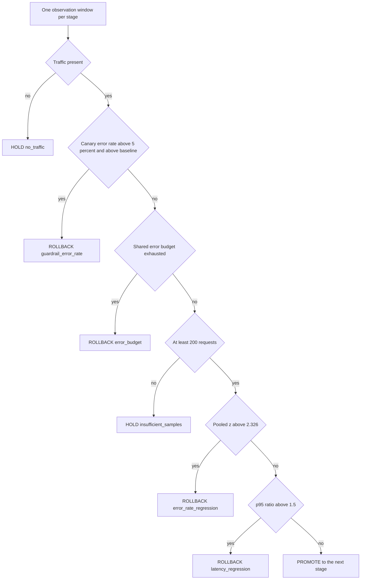
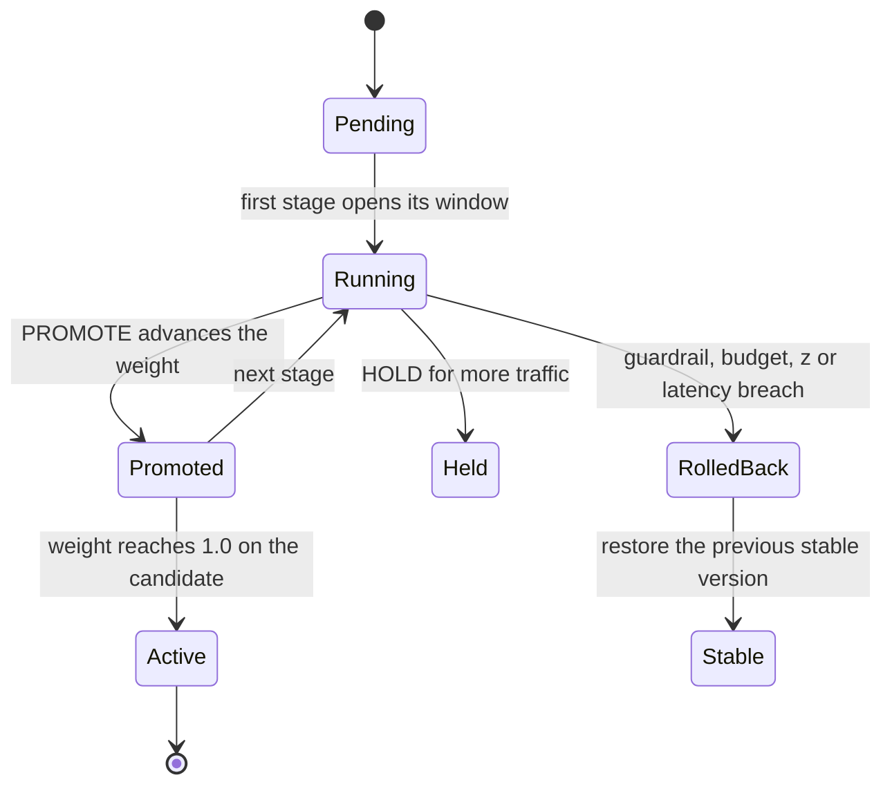
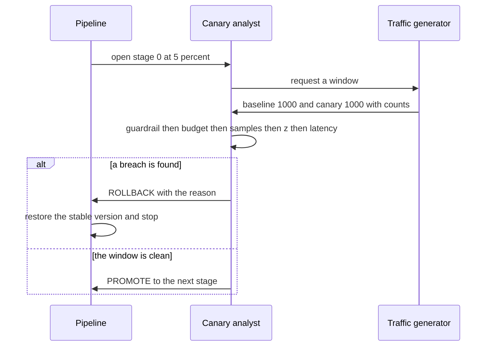

# 937 — Implement deployment pipeline with canary analysis using online metrics and rollback.

> **Tier:** Master · **CTCI chapter:** Ch Beyond — Software Engineering and Tooling
> **Task spec:** [937-implement-deployment-pipeline-with-canary-analysis-using-online.md](../../../tasks/master/937-implement-deployment-pipeline-with-canary-analysis-using-online.md)
> **Solutions:** [Python](../../../solutions/python/master/937-implement-deployment-pipeline-with-canary-analysis-using-online/solution.py) ·
> [Java](../../../solutions/java/master/937-implement-deployment-pipeline-with-canary-analysis-using-online/Solution.java) ·
> [JavaScript](../../../solutions/javascript/master/937-implement-deployment-pipeline-with-canary-analysis-using-online/solution.js) ·
> [C#](../../../solutions/csharp/master/937-implement-deployment-pipeline-with-canary-analysis-using-online/Solution.cs)

## 1. Problem restatement

**Modelling contract.** A deterministic, in-process canary rollout: a seeded traffic generator plays
the role of production, one observation window per stage, and the analyst decides purely from the
recorded counts. The header is explicit about the simplification relative to Argo or Spinnaker with
Kayenta: one window per stage instead of continuous re-analysis, latency compared at p95 by ratio
rather than by a distribution test, and no traffic mirroring.

**Input.** A `Service(base_error, canary_error, base_latency, canary_latency, requests=1000, spread=8)`
that, for a stage and traffic weight, seeds `splitmix64` with `97_531 · (stage + 1) + int(weight ·
100)` and produces a baseline and a canary window of `(requests, errors, latencies)`. The rollout
stages are `STAGES = (0.05, 0.25, 0.5, 1.0)`.

**Output.** A `Canary` object exposing `status` (`pending`, `running`, `held`, `rolled_back`,
`active`), the current `weight` and `version`, and `trail` — one `(stage, weight, decision, reason)`
entry per analyzed window. Decisions are `PROMOTE`, `HOLD` and `ROLLBACK`.

| Call | Result | Why |
| --- | --- | --- |
| `Canary(Service(0.02, 0.02, 120, 122)).roll()` | `["PROMOTE"] * 4`, `status == "active"`, `version == "v2"` | a healthy candidate is ramped to full traffic |
| `Canary(Service(0.005, 0.03, 120, 120)).roll()` | `ROLLBACK` with reason `error_rate_regression` | a real error-rate regression caught by the z test, not the guardrail |
| `Canary(Service(0.02, 0.02, 100, 300)).roll()` | `ROLLBACK` with reason `latency_regression` | errors are clean; the p95 ratio is `~2.87 &gt; 1.5` |
| `error_budget=30` run | `ROLLBACK` with reason `error_budget` | the shared budget is exhausted before the z test fires |
| `analyze(fixed_sample(0, 1000, 50, 1000))` | `ROLLBACK` `error_rate_regression` | a canary rate of *exactly* `5%` is not a guardrail breach |
| `analyze(fixed_sample(0, 1000, 51, 1000))` | `ROLLBACK` `guardrail_error_rate` | one request above the limit is |
| `analyze(fixed_sample(2, 199, 8, 199))` | `HOLD` `insufficient_samples` | `MIN_REQUESTS = 200` is the analyzable boundary |
| `analyze(fixed_sample(0, 0, 0, 0))` | `HOLD` `no_traffic` | an empty window must not divide by zero |

## 2. Intuition

The naive rollout watches a dashboard and promotes when the canary "looks fine". That fails in three
distinct ways, and each failure needs its own mechanism.

First, a small window is not evidence. Two hundred requests is the minimum (`MIN_REQUESTS`), and
below it the correct answer is `HOLD`, not a verdict — that is why the decision ladder returns
`insufficient_samples` *before* any statistical test.

Second, some failures are not statistical at all. A canary that returns errors on 20% of requests does
not need a z-test to be halted; an absolute guardrail (`MAX_ERROR_RATE = 0.05`, strict) stops it
immediately. The tests deliberately pin the boundary: a canary rate of exactly `5%` does **not** trip
the guardrail (`p_can &gt; 0.05` is strict) and falls through to the statistical path, while `5.1%`
does.

Third, and most subtly, a canary can be *slightly* worse in a way that no single window can detect but
which adds up. So the analyst also bills the canary's excess errors to a **shared error budget** and
rolls back when it is exhausted — even if the per-stage z-test never fires. That is the case the
`error_budget` scenario demonstrates: at stage 2 the z statistic is `1.99` (below `Z_CRITICAL =
2.326`) but the cumulative `32` canary errors have already exceeded the budget of `30`.

When the tests do run, they are one-sided and pooled: `Z_CRITICAL = 2.326` is the one-sided `1%`
level, and the latency check is a robust `p95(canary) / p95(baseline) &gt; LATENCY_TOLERANCE = 1.5`.
The quantile is nearest-rank (`ceil(q·n) - 1`, clamped), so no interpolation can decide a verdict.



The order of those checks is the algorithm, not an implementation detail: a guardrail breach must not
be masked by an underpowered z test, and a budget rollback must not be masked by a *clean* z test.

## 3. Algorithm

1. `Service(stage, weight)` seeds the generator from the stage index and the traffic weight and
   produces both windows: `errors` counts uniform draws below `per_mille = round(error_rate · 1000)`
   out of `requests`, and `latencies` are `latency + below(spread)`.
2. `Canary.analyze(sample)` adds the canary's errors to the running total and walks the ladder:
   `no_traffic`, `guardrail_error_rate`, `error_budget`, `insufficient_samples`,
   `error_rate_regression` (z &gt; 2.326), `latency_regression` (p95 ratio &gt; 1.5), else `PROMOTE`.
3. `Canary.roll()` iterates the four stages: `PROMOTE` advances `weight` and sets `version` to the
   candidate once the weight reaches `1.0`; `ROLLBACK` sets `status = "rolled_back"`, `weight = 0.0`
   and restores the stable version, then stops; `HOLD` sets `status = "held"` and stops.
4. A rollout that clears every stage becomes `active` at weight `1.0` on the candidate version.

```text
function zscore(n_base, e_base, n_can, e_can)
    pooled ← (e_base + e_can) / (n_base + n_can)
    se ← square root of pooled * (1 - pooled) * (1 / n_base + 1 / n_can)
    if se == 0 then return 0.0 end
    return (e_can / n_can - e_base / n_base) / se
end

function quantile(values, q)
    ordered ← sorted values
    if ordered is empty then return 0.0 end
    index ← clamp(ceil(q * length(ordered)) - 1, 0, length(ordered) - 1)
    return ordered[index]
end

procedure analyze(sample)
    base_n, base_errors, base_lat ← sample.baseline
    can_n, can_errors, can_lat ← sample.canary
    if can_n == 0 or base_n == 0 then return HOLD, no_traffic end
    canary_errors ← canary_errors + can_errors
    p_base ← base_errors / base_n
    p_can ← can_errors / can_n
    if p_can &gt; MAX_ERROR_RATE and p_can &gt; p_base then return ROLLBACK, guardrail_error_rate end
    if canary_errors &gt; error_budget then return ROLLBACK, error_budget end
    if can_n &lt; MIN_REQUESTS then return HOLD, insufficient_samples end
    if zscore(base_n, base_errors, can_n, can_errors) &gt; Z_CRITICAL then
        return ROLLBACK, error_rate_regression
    end
    ratio ← quantile(can_lat, 0.95) / max(quantile(base_lat, 0.95), 1e-9)
    if ratio &gt; LATENCY_TOLERANCE then return ROLLBACK, latency_regression end
    return PROMOTE with the observed z and ratio
end

procedure roll()
    status ← running
    for stage, weight in enumerate(STAGES) do
        if status != running then stop end
        append (stage, weight, decision, reason) to trail
        if decision == PROMOTE then
            current weight ← weight
            version ← candidate if weight == 1.0 else stable
        else if decision == ROLLBACK then
            status ← rolled_back, weight ← 0.0, version ← stable
        else
            status ← held
        end
    end
    if status == running then status ← active, weight ← 1.0, version ← candidate end
end
```



## 4. Worked example

The generator is deterministic, so these windows are the ones the rollout actually sees. Each stage
runs one window of `1000` requests per arm.

**Healthy candidate** (`Service(0.02, 0.02, 120, 122)`):

| Stage | Weight | Baseline (n, errors) | Canary (n, errors) | z | p95 ratio | Decision |
| --- | --- | --- | --- | --- | --- | --- |
| 0 | `0.05` | `1000, 18` | `1000, 18` | `0.000` | `1.016` | `PROMOTE` |
| 1 | `0.25` | `1000, 14` | `1000, 21` | `1.194` | `1.016` | `PROMOTE` |
| 2 | `0.50` | `1000, 23` | `1000, 12` | `-1.876` | `1.016` | `PROMOTE` |
| 3 | `1.00` | `1000, 18` | `1000, 21` | `0.485` | `1.016` | `PROMOTE` |

No z exceeds `2.326` (the highest is `1.194`), and the p95 ratio never exceeds `1.5`, so the rollout
ends `active` at weight `1.0` on `v2`. Note stage 1: the canary has *more* errors than the baseline
(`21` versus `14`) and still promotes, because `z = 1.19` is not evidence at this sample size — that
is the whole point of the test.

**Regressed candidate** (`Service(0.005, 0.03, 120, 120)`), first stage only:

| Stage | Weight | Baseline (n, errors) | Canary (n, errors) | z | p95 ratio | Decision |
| --- | --- | --- | --- | --- | --- | --- |
| 0 | `0.05` | `1000, 8` | `1000, 26` | `3.114` | `1.000` | `ROLLBACK` `error_rate_regression` |

`p_can = 26/1000 = 2.6%` is below the `5%` guardrail, so the guardrail does not fire and the budget
(`26 ≤ 150`) is intact; the pooled z is `3.114 &gt; 2.326`, which is the statistical path. The file
separately re-derives that same statistic by hand — pooled rate `(8 + 26) / 2000 = 0.017`, standard
error `sqrt(0.017 · 0.983 · 2/1000)`, then the difference of proportions over it — and asserts the two
agree to `1e-12`, which is why the tutorial can quote `3.114` as more than a simulation artifact.

**Latency-only regression** (`Service(0.02, 0.02, 100, 300)`): the error counts are `18` versus `18`
(`z = 0.000`), so the error test is perfectly clean, and the rollout stops at stage 0 on
`latency_regression` with a p95 ratio of `2.869 &gt; 1.5`.

**Budget exhaustion** (`Service(0.02, 0.04, 120, 120, requests=400)`, `error_budget = 30`):

| Stage | Weight | Canary errors | Cumulative | z | p95 ratio | Decision |
| --- | --- | --- | --- | --- | --- | --- |
| 0 | `0.05` | `8` | `8` | `0.839` | `1.000` | `PROMOTE` |
| 1 | `0.25` | `9` | `17` | `0.000` | `1.000` | `PROMOTE` |
| 2 | `0.50` | `15` | `32` | `1.990` | `1.000` | `ROLLBACK` `error_budget` |

Stage 2 is the instructive one: `z = 1.99` is *below* `2.326`, so a z-only pipeline would have
promoted again. The cumulative `32 &gt; 30` fires the budget rule instead — a slow bleed caught by
accounting rather than by statistics.



## 5. Complexity

| Measure | Bound | Why |
| --- | --- | --- |
| One window | `O(stages · requests)` generations | `1000` requests per arm per stage, two arms |
| Decision | `O(n log n)` for the two p95 quantiles | the error test itself is `O(1)` |
| Full rollout | `O(4 · 2 · requests)` time | four stages, two arms, one window each |
| Memory per window | `O(requests)` | the latency samples are retained for the nearest-rank quantile |
| Space for the rollout | `O(stages)` | the trail has one entry per analyzed window |
| Continuous-analysis alternative | `O(T)` over the whole rollout | many more windows, and the false-positive control problem below |

The cost is trivial; the difficulty is statistical. Re-analyzing after every window inflates the
false-positive rate, which is precisely what the sequential-alpha machinery of the experiment
platform addresses in task 938.

## 6. Pitfalls and edge cases

- **Strict guardrail comparison.** `p_can &gt; MAX_ERROR_RATE` means exactly `5%` passes to the z
  test; the two boundary tests (`50/1000` and `51/1000`) exist to pin that.
- **Guardrail needs to beat the baseline too.** Both conditions are required, so a canary that is
  equally bad as a very unhealthy baseline is judged by the budget and the z test instead.
- **Order of the ladder.** Budget is checked before sample size and before z; otherwise a stage that
  is statistically clean but has drained the budget would promote.
- **Nearest-rank quantile.** `ceil(q·n) − 1` with clamping avoids interpolation, and an empty latency
  list returns `0.0` instead of raising; the ratio divides by `max(p95_base, 1e-9)`.
- **Zero traffic.** `can_n == 0` or `base_n == 0` returns `HOLD` `no_traffic` before any division.
- **Sample-size boundary.** `can_n &lt; MIN_REQUESTS` holds; `200` exactly is analyzed (the test pair
  `199`/`200` both promote/hold as expected on a clean window).
- **Monotonicity.** The verdict ladder over increasing canary error counts must be non-decreasing
  (`PROMOTE → HOLD → ROLLBACK`); the test sweeps `0…85` in steps of `5` and asserts it.
- **Rollback restores the stable version.** `version` must be `stable` and `weight` `0.0` after a
  rollback — never a partially ramped candidate.
- **Determinism.** Two rollouts of the same scenario produce identical trails and status; the seed
  depends only on the stage index and the weight, so re-running a stage replays its exact window.

## 7. Variants and follow-ups

- **Control the false-positive rate while peeking.** Repeated canary windows are sequential tests;
  the alpha-spending platform is the tool for that:
  [938 — safe experiment platform that enforces SLOs and budget on experiments](../../../tasks/master/938-implement-safe-experiment-platform-that-enforces-slos-and-budget.md).
- **Model the traffic you roll out onto.** Real canary windows have correlated bursts, which the load
  generator in [940 — high-fidelity load generator with correlated user behavior models](../../../tasks/master/940-implement-high-fidelity-load-generator-with-correlated-user-beha.md)
  produces.
- **Roll back state, not just traffic.** Version rollback plus resumable state is the checkpointing
  problem in [936 — transparent operator checkpointing and resume in a compute graph](../../../tasks/master/936-implement-transparent-operator-checkpointing-and-resume-in-compu.md).
- **Promote a serving version.** The same version/gate ideas at the serving layer:
  [865 — transparent model serving with versioning, canary and shadow traffic](../../../tasks/master/865-implement-transparent-model-serving-with-versioning-canary-shado.md).

## 8. Check yourself

<details><summary>Show answer</summary>

**1. Why is there both an absolute guardrail and a statistical test?**

They catch different failures. The guardrail catches a gross, immediately harmful canary without
needing evidence (and without waiting for a large sample); the z test catches a smaller regression that
is only distinguishable from noise with enough traffic. A canary at `2.6%` errors against a `0.8%`
baseline is a real regression yet nowhere near a `5%` absolute limit.

</details>

<details><summary>Show answer</summary>

**2. In the healthy rollout, stage 1 shows more canary errors than baseline and still promotes. Is
that a bug?**

No. `21` versus `14` errors out of `1000` is `z = 1.194`, far below the `2.326` one-sided `1%`
threshold. The test is designed to not promote *on noise*, and it equally refuses to roll back on
noise.

</details>

<details><summary>Show answer</summary>

**3. What does the error budget add over the z test?**

A second, non-statistical axis of protection. The budget scenario rolls back at `z = 1.99` because the
*cumulative* excess reached `32 &gt; 30`; without it, the rollout would have continued to the next
stage on a candidate that is quietly worse in every window.

</details>

<details><summary>Show answer</summary>

**4. Why is the p95 ratio computed with a nearest-rank quantile?**

So the verdict is reproducible and free of interpolation choices. The p95 is the `ceil(0.95·n)`-th
smallest sample, clamped into range; on `1000` samples that is the `950`-th value, well defined even
when the underlying generator produces only `spread = 8` distinct latencies.

</details>

<details><summary>Show answer</summary>

**5. What happens when the canary is clean but the window has only 150 requests?**

`HOLD` with reason `insufficient_samples`. The decision ladder places the sample-size check after the
guardrail and budget checks (a 150-request window that breaches a guardrail still rolls back) and
before the z and latency tests, since neither is meaningful at that size.

</details>
