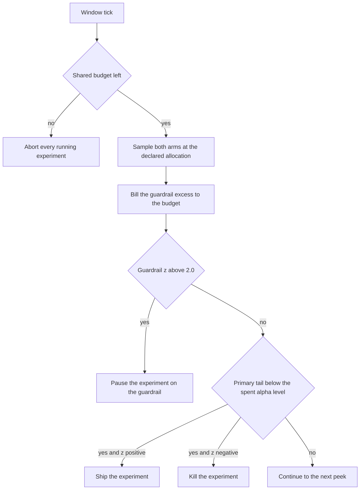
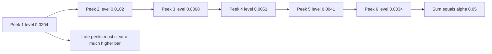
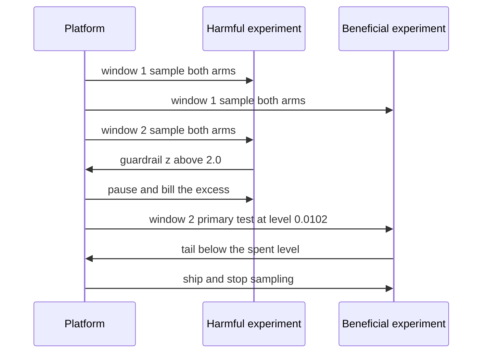

# 938 — Implement safe experiment platform that enforces SLOs and budget on experiments.

> **Tier:** Master · **CTCI chapter:** Ch Beyond — Software Engineering and Tooling
> **Task spec:** [938-implement-safe-experiment-platform-that-enforces-slos-and-budget.md](../../../tasks/master/938-implement-safe-experiment-platform-that-enforces-slos-and-budget.md)
> **Solutions:** [Python](../../../solutions/python/master/938-implement-safe-experiment-platform-that-enforces-slos-and-budget/solution.py) ·
> [Java](../../../solutions/java/master/938-implement-safe-experiment-platform-that-enforces-slos-and-budget/Solution.java) ·
> [JavaScript](../../../solutions/javascript/master/938-implement-safe-experiment-platform-that-enforces-slos-and-budget/solution.js) ·
> [C#](../../../solutions/csharp/master/938-implement-safe-experiment-platform-that-enforces-slos-and-budget/Solution.cs)

## 1. Problem restatement

**Modelling contract.** A deterministic, in-process experiment platform: experiments declare a traffic
allocation, an expected effect on a primary metric (conversion) and an effect on a guardrail metric
(harmful events) with an SLO limit. Every window each running experiment samples both arms from a
seeded generator, the platform bills the observed guardrail excess to a shared budget and applies its
decision rules. The header lists the simplifications versus Optimizely or Statsig: one primary metric
with a pooled two-proportion z-test, no CUPED or variance reduction, no per-tenant budgets, no ramp
schedules, no multi-armed allocation.

**Input.** `Experiment(name, allocation, effect, harm, base_rate=0.10, base_harm=0.02,
per_arm=400)`. A window samples `size = int(per_arm · allocation · window)` requests per arm for the
primary metric (rate `base_rate` versus `base_rate + effect`) and for harmful events (rate
`base_harm` versus `base_harm + harm`). The platform is `Platform(alpha=0.05, peeks=6, budget=300)`
with `GUARDRAIL_Z = 2.0`.

**Output.** Experiment `status` (`running`, `paused`, `ship`, `kill`, `aborted`) and `decision`
(`guardrail`, `primary`, `budget`), plus the platform's `consumed` budget and `audit` log of
`(window, name, event, cumulative consumed)` rows.

| Call | Result | Why |
| --- | --- | --- |
| `Platform().run([...], windows=6)` on a harmful arm | `paused` / `guardrail` after `2` windows | the guardrail z crosses `2.0` quickly |
| the beneficial arm | `ship` / `primary` after `2` windows | the primary effect is significant at the spent alpha |
| `consumed` | `31` = `24 + 7` | billing equals the summed guardrail excess |
| `Platform(budget=10)` with `consumed = 9` / `= 10` | admissible / closed | `has_budget()` is `consumed &lt; budget` |
| `Platform(budget=0)` run | `peeks == 0`, `aborted` | an exhausted platform serves no traffic at all |
| `Experiment("idle", 0.0, ...)` | `peeks == 0`, `running`, `harmed == 0` | zero allocation is never sampled or charged |
| `alpha_level(1, 6, 0.05)` … `alpha_level(6, 6, 0.05)` | `0.020408, 0.010204, 0.006803, 0.005102, 0.004082, 0.003401` | the harmonic levels sum to exactly `0.05` |

## 2. Intuition

Two independent failure modes live in this task, and they need two different mechanisms.

**Harm.** A guardrail metric (error rate, latency breach) is not the primary question — it is a safety
bound. So it gets its own rule: bill the excess harmful events to a shared budget, and pause any
experiment whose guardrail breach is statistically significant (`two_prop_z &gt; 2.0`). The budget is
the blunt instrument: when it is exhausted, the whole platform stops serving experimental traffic,
because the organisation has spent its tolerance for harm regardless of which experiment spent it.

**Peeking.** The subtle failure is statistical. If you test the primary metric after every window at a
fixed `alpha = 0.05` and stop as soon as it is significant, you are performing a sequential test with
many opportunities to cross the threshold, and the false-positive rate inflates dramatically — the
file measures it with an A/A simulation (no true effect) as **0.42** against a nominal `0.05`.

The fix is an **alpha-spending schedule**: pre-register how many peeks you will take, and give peek
`k` a level

```text
level_k = alpha / (k · H_K)         with H_K = 1 + 1/2 + ... + 1/K
```

The harmonic weights are chosen so the levels sum to exactly `alpha` over the pre-registered peeks:
for `alpha = 0.05` and `K = 6` they are `0.0204, 0.0102, 0.0068, 0.0051, 0.0041, 0.0034`, summing to
`0.05`. Early peeks are cheap and get the generous levels; late peeks get very tight ones. Under the
same A/A simulation the spending schedule keeps the false-positive rate at **0.097**, close to
nominal, and less than a quarter of the fixed-alpha value.



## 3. Algorithm

1. `Experiment.window(rng, scale)` computes `size = int(per_arm · allocation · scale)`; a non-positive
   size returns `None` (the experiment is not sampled at all). Otherwise it draws `size` uniform
   values per arm for the primary rate and for the harm rate, and increments `peeks`.
2. `Platform.run_window`: for each running experiment, check the budget first (abort if exhausted),
   then sample; bill `max(0, harm_treatment − harm_control)` to `consumed`; then either pause on the
   guardrail or run the primary test.
3. `guardrail_breached` uses `two_prop_z(control, treatment) &gt; 2.0` on the *harmful* counts.
4. `primary_result(sample, peek)` computes the primary z; if `tail(|z|) ≤ alpha_level(peek, peeks,
   alpha)` it returns `ship` for `z &gt; 0` and `kill` for `z &lt; 0`, otherwise `continue`.
5. `Platform.run(experiments, windows=6, seed=2024)` drives the windows and, whenever the budget runs
   out, aborts every experiment still running — the platform-wide kill switch.
6. `false_positive_rate(trials, peeks, alpha, spending)` is the independent oracle: A/A streams with
   the same peeking schedule, once with a fixed alpha and once with the spending levels.

```text
function alpha_level(peek, peeks, alpha)
    harmonic ← sum of 1 / step for step from 1 to peeks
    return alpha / (peek * harmonic)
end

function two_prop_z(n_control, s_control, n_treatment, s_treatment)
    pooled ← (s_control + s_treatment) / (n_control + n_treatment)
    se ← square root of pooled * (1 - pooled) * (1 / n_control + 1 / n_treatment)
    if se == 0 then return 0.0 end
    return (s_treatment / n_treatment - s_control / n_control) / se
end

procedure run_window(rng, experiments, window)
    for experiment in experiments do
        if experiment.status != running then continue end
        if not has_budget() then
            experiment.status ← aborted, experiment.decision ← budget
            record (window, name, aborted, consumed)
            continue
        end
        sample ← experiment.window(rng, window)
        if sample is none then continue end
        excess ← max(0, sample.treatment.harms - sample.control.harms)
        experiment.harmed ← experiment.harmed + excess
        consumed ← consumed + excess
        if guardrail_breached(sample) then
            experiment.status ← paused, experiment.decision ← guardrail
            record (window, name, paused, consumed)
        else
            verdict ← primary_result(sample, window)
            if verdict is not continue then
                experiment.status ← verdict, experiment.decision ← primary
                record (window, name, verdict, consumed)
            end
        end
    end
end
```

The `tail(|z|)` form is deliberate: the primary test is two-sided (`abs`), and the *sign* of `z`
decides between shipping a win and killing a loss, while the guardrail is one-sided — only more harm
matters.



## 4. Worked example

The trace below is the platform sweep from the tests: `Platform(peeks=6)`, three experiments
(`harmful` with `harm = 0.06` and no primary effect, `beneficial` with `effect = 0.05` and no harm,
`idle` with allocation `0.0`), six windows.

| Window | Event recorded | Experiment | Cumulative consumed |
| --- | --- | --- | --- |
| 1 | (no terminal verdict for either arm) | — | — |
| 2 | `paused` on `guardrail` | `harmful` | `26` |
| 2 | `ship` on `primary` | `beneficial` | `31` |
| 2–6 | never sampled (`allocation = 0.0`) | `idle` | `31` |

Both arms terminate at window 2 with `peeks == 2`: the harmful arm's guardrail z crosses `2.0` after
two windows and it is paused with `24` harmful events billed, and the beneficial arm reaches
significance at the *second* peek's level of `0.010204` and ships with `7` billed. The final
`consumed = 31` is exactly `24 + 7` — the identity `platform.consumed == Σ experiment.harmed` that the
tests assert — and it is far inside the `300` budget, so the kill switch never fires here. The `idle`
experiment with allocation `0.0` stays `running` with `peeks == 0` and `harmed == 0`: it is never
sampled and never charged.

The spending schedule is what makes "significant at window 2" mean something different from "significant
at window 6":

| Peek `k` | Harmonic level `0.05 / (k · H₆)` | A `z` of `2.6` | A `z` of `3.0` |
| --- | --- | --- | --- |
| 1 | `0.020408` | significant | significant |
| 2 | `0.010204` | significant | significant |
| 3 | `0.006803` | significant | significant |
| 4 | `0.005102` | significant | significant |
| 5 | `0.004082` | not significant | significant |
| 6 | `0.003401` | not significant | significant |

`H₆ = 1 + 1/2 + 1/3 + 1/4 + 1/5 + 1/6 = 2.45`, and the six levels sum to exactly `0.05`. The table
shows the guard against endless peeking: a result that only just clears `0.005` at the fifth window is
no longer evidence, because the schedule has spent most of the error budget early.

The A/A oracle quantifies the payoff. Over `300` trials with `5` peeks, `alpha = 0.05` and `100`
requests per arm:

| Policy | Measured false-positive rate | Nominal |
| --- | --- | --- |
| fixed alpha at every peek | `0.420` | `0.050` |
| harmonic alpha spending | `0.097` | `0.050` |

The assertions require `nominal ≥ 0.25`, `sequential ≤ 0.10` and `sequential &lt; nominal / 2`, so the
oracle is not merely "spending is lower" but "fixed-alpha peeking is badly broken and spending brings
the rate back into the right order of magnitude".



## 5. Complexity

| Measure | Bound | Why |
| --- | --- | --- |
| One window | `O(Σ size_i)` samples | `size_i = per_arm · allocation_i · window`, two metrics drawn per sample |
| Full sweep | `O(windows² · per_arm · Σ allocation)` | the window index scales the sample size, so cost grows quadratically |
| Decision per experiment | `O(1)` | two z statistics, one `erfc` evaluation |
| Billing | `O(1)` per experiment per window | one subtraction and one clamp at zero |
| A/A oracle | `O(trials · peeks · per_arm · peek)` | `300` trials × `5` peeks with growing samples |
| Space | `O(1)` per experiment plus the audit log | the audit grows by at most one row per terminal decision |

The `erfc` call is the only transcendental in the hot path, and the sample loop dominates everything
else. A real platform replaces the A/A oracle with a variance-reduction estimator (CUPED), which is
the standard way to reach significance with far fewer samples.

## 6. Pitfalls and edge cases

- **Budget exhaustion aborts everything.** The kill switch is platform-wide: once `consumed` reaches
  the budget, every running experiment becomes `aborted` with decision `budget`, even a healthy one.
- **Boundary inclusivity.** `has_budget()` is `consumed &lt; budget`, so `9` of `10` is admissible and
  `10` closes the platform; `Platform(budget=0)` aborts before sampling (`peeks == 0`).
- **Zero allocation.** An experiment with `allocation = 0.0` gets `size = 0`, returns `None` from
  `window` and is never sampled or charged — its status stays `running`.
- **Excess is clamped at zero.** Billing uses `max(0, harm_treatment − harm_control)`, so a window
  where the control arm suffered more harm does not *credit* the budget.
- **Guardrail before primary.** A breach pauses the experiment even if the primary metric looks
  wonderful; the two verdicts are not combined into one score.
- **Hand-computed threshold.** With `(500, 100, 10)` and `(500, 110, 20)` the pooled z is `1.854`,
  below `2.0`, so no pause; with `22` harmful events it is `2.16`, above the threshold, and the same
  sample still returns `continue` on the primary test.
- **Levels must sum to alpha.** The schedule is only valid over the pre-registered number of peeks;
  adding an extra peek silently changes every level and must be re-derived.
- **Sign of the primary z.** `tail(abs(z)) ≤ level` with `z &gt; 0` ships, with `z &lt; 0` kills; using
  the raw (non-absolute) tail would make a strong negative effect look insignificant.
- **Determinism.** The generator is seeded from `2024` (and `12345 + 7919 · trial` per A/A trial), so
  two sweeps produce identical audits.

## 7. Variants and follow-ups

- **Canary, not experiment.** A staged rollout with guardrails and a shared error budget, decided per
  stage: [937 — deployment pipeline with canary analysis using online metrics and rollback](../../../tasks/master/937-implement-deployment-pipeline-with-canary-analysis-using-online.md).
- **Budget the training, not the traffic.** The same "declared budget, enforced by the platform" idea
  applies to compute: [929 — end-to-end automated ML system with monitoring, drift alerts and retraining](../../../tasks/master/929-implement-end-to-end-automated-ml-system-with-monitoring-drift-a.md).
- **Account for the privacy budget too.** Composition of privacy loss across mechanisms is the same
  accounting problem with a different unit:
  [943 — composable privacy guarantees across combined DP mechanisms](../../../tasks/master/943-implement-composable-privacy-guarantees-across-combined-dp-mecha.md).
- **Generate the traffic honestly.** Sample sizes are only meaningful if the traffic model is
  realistic: [940 — high-fidelity load generator with correlated user behavior models](../../../tasks/master/940-implement-high-fidelity-load-generator-with-correlated-user-beha.md).

## 8. Check yourself

<details><summary>Show answer</summary>

**1. Why is the guardrail test one-sided while the primary test uses `abs(z)`?**

A guardrail only fails in one direction — more harm. A primary metric can move either way, and both
directions are informative: a significant positive effect ships, a significant negative effect kills.
Hence `abs(z)` for significance and the sign to choose the verdict.

</details>

<details><summary>Show answer</summary>

**2. What exactly does `level_k = alpha / (k · H_K)` buy you?**

It makes the pre-registered peeks sum to `alpha`. Early looks are treated as expensive in total risk,
so they get large levels; later looks get small ones. Without this, repeated fixed-alpha peeking
inflates the false-positive rate to `0.42` in the A/A measurement instead of `~0.05`.

</details>

<details><summary>Show answer</summary>

**3. The budget is shared across experiments. Why is that the right granularity?**

Because harm tolerance is a property of the user population, not of a single experiment: two
experiments each within their own "small" budget can still collectively harm a noticeable fraction of
traffic. A shared counter makes the trade-off explicit and gives the platform a single kill switch.

</details>

<details><summary>Show answer</summary>

**4. In the worked trace, `consumed = 31` even though the harmful experiment had 24 harmful events.
Where does the rest come from?**

From the beneficial experiment: `7` excess harmful events were observed in its two windows and billed
too. Billing is per observed excess, not per *causal* harm — the platform charges whatever the guardrail
metric actually moved by.

</details>

<details><summary>Show answer</summary>

**5. Why does the trial harness use an A/A stream to validate the policy?**

Because under A/A there is no true effect, so every "significant" result is by definition a false
positive. That is the only clean way to measure the false-positive rate of a *sequential* policy, and
it is why the test asserts the fixed-alpha rate is high (`≥ 0.25`) and the spending rate is low
(`≤ 0.10`).

</details>
