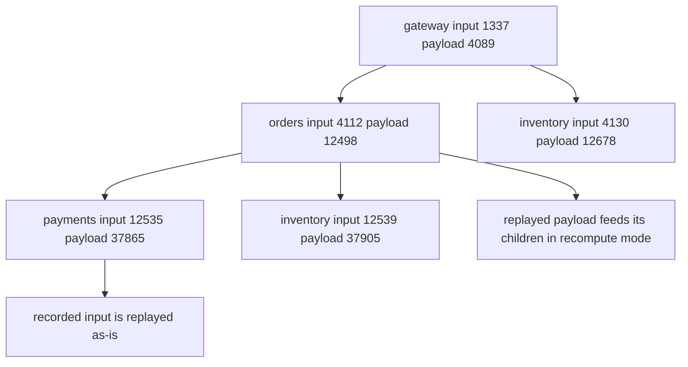
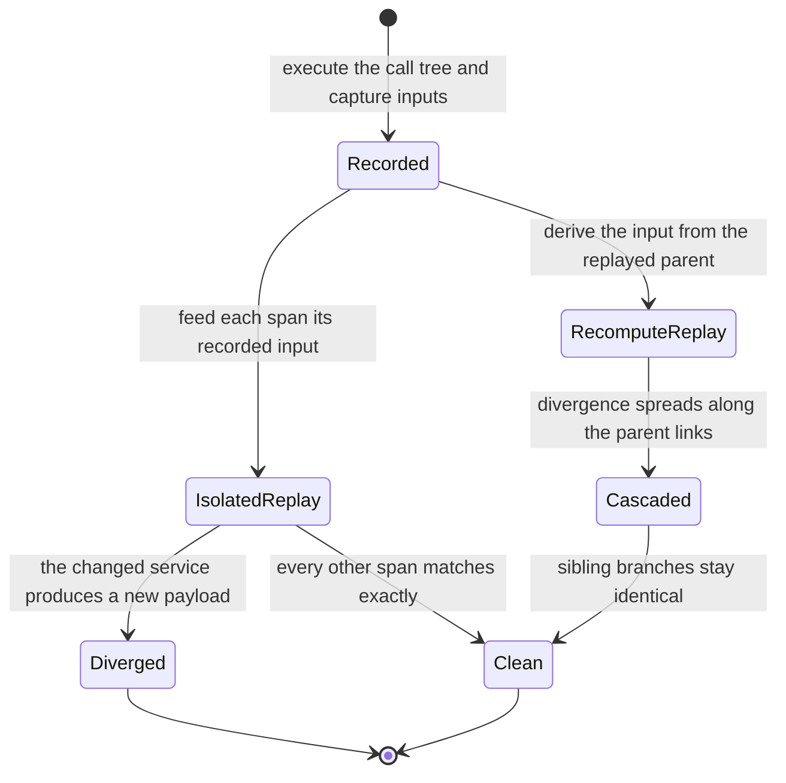
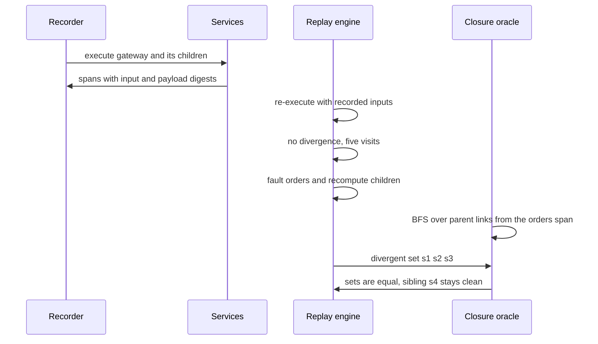

# 939 — Implement trace-based replay system for production debugging.

> **Tier:** Master · **CTCI chapter:** Ch Beyond — Software Engineering and Tooling
> **Task spec:** [939-implement-trace-based-replay-system-for-production-debugging.md](../../../tasks/master/939-implement-trace-based-replay-system-for-production-debugging.md)
> **Solutions:** [Python](../../../solutions/python/master/939-implement-trace-based-replay-system-for-production-debugging/solution.py) ·
> [Java](../../../solutions/java/master/939-implement-trace-based-replay-system-for-production-debugging/Solution.java) ·
> [JavaScript](../../../solutions/javascript/master/939-implement-trace-based-replay-system-for-production-debugging/solution.js) ·
> [C#](../../../solutions/csharp/master/939-implement-trace-based-replay-system-for-production-debugging/Solution.cs)

## 1. Problem restatement

**Modelling contract.** A deterministic trace recorder and replay engine that runs entirely in one
process. A request fans out over a microservice call tree; every span records its service, the digest
of its input, the digest of the payload it produced, its parent and its start tick. Payloads are
32-bit digest-like integers rather than bytes, clocks are integer ticks, and there is no sampling,
retry or asynchronous continuation — the simplifications the headers list against a real tracer such
as Jaeger.

**Input.** A service map (the default bodies are the injective transforms
`payload = (input · 3 + SALT[service] · 7 + 1) mod 1_000_003`), the call tree
`CHILDREN = {gateway: (orders, inventory), orders: (payments, inventory)}`, and a root input
(`1337` by default). A `faulted_services(target, only)` helper perturbs one service — optionally only
for inputs satisfying a predicate.

**Output.** `record(services, root_input)` returns the spans in deterministic DFS order;
`replay(spans, services, recompute)` returns `(replayed spans, divergences, visits, orphans)`, where
each divergence is `(span id, service, recorded payload, replayed payload)` sorted by
`(start tick, span id)`.

| Call | Result | Why |
| --- | --- | --- |
| `replay(record(default_services()), default_services())` | no divergences, `visits == 5` | a fault-free replay is identical to the recording |
| `replay(spans, faulted_services("payments"), recompute=False)` | `("s2", "payments", 37865, 37866)` | an isolated fault diverges at exactly one span |
| `replay(spans, faulted_services("orders"), recompute=True)` | `("s1", "s2", "s3")` | the divergence cascades to the descendants closure |
| `replay([], services)` | `({}, [], 0, [])` | an empty trace replays to nothing |
| `replay(orphaned, services)` | `orphans == ["orphan"]`, one divergence | a span whose parent is missing is replayed and flagged |

## 2. Intuition

The naive debugger reproduces a production incident by re-running the request with the same *user*
input. That rarely works: the request's behaviour depends on the payloads of every downstream call,
which depend on data that has since changed. You end up debugging a different execution.

Trace replay inverts the dependency. The recording captures, for every span, the **input digest** it
consumed. On replay the engine re-executes the *recorded call structure* but feeds each span the
recorded input, so the replayed execution is isolated from the environment — a service whose code has
not changed is guaranteed to produce exactly the payload it produced in production. That is the
determinism the tests assert: a fault-free replay has zero divergences and visits every span once.

Two modes then fall out of the same machinery. With `recompute=False` the replay answers "what changed
in this service?" — the faulted service diverges and **nothing else does**, which is what makes an
isolated bug unambiguous. With `recompute=True` a span's input is derived from its *parent's replayed
payload*, so a change propagates down the call tree and the divergent set is exactly the descendants
closure of the fault. The file computes that closure independently, by BFS over the recorded parent
links, and asserts equality with the observed divergence set — an oracle, not a self-consistency
check.

The structure of the tree makes the cascade check meaningful in a way a linear pipeline would not. The
default trace visits `inventory` twice: once under `orders` and once directly under `gateway`. A
fault in `orders` changes the first `inventory` span and leaves the second untouched, which is exactly
how the tests separate "descendants of the fault" from "everything with the same service name".



## 3. Algorithm

1. `record`: walk the call tree depth first. For each service, compute `payload = service(input)`,
   allocate a span id from the running counter, record `(span_id, parent, service, input, payload,
   start, start + 1)`, then recurse over the children with `start + offset + 1` and the child input
   `(payload + SALT[child]) mod MODULUS`.
2. `descendants(spans, span_id)`: BFS over the recorded parent links — the independent closure oracle.
3. `replay`: index the recorded spans by id, collect **orphans** (spans whose parent is not in the
   trace), then walk the recorded spans in order. For each span, choose the input: the recorded input,
   or — in recompute mode when the parent has been replayed — `(parent payload + SALT[service]) mod
   MODULUS`. Evaluate the service, count a visit, and record a divergence when the new payload differs.
4. Sort the divergences by `(start tick, span id)` so the report is stable regardless of the traversal
   order.
5. Return `(replayed, divergences, visits, orphans)`.

```text
procedure record(services, root_input)
    spans ← empty
    procedure walk(service, parent_id, input_digest, start)
        payload ← run_service(service, input_digest)
        span_id ← "s" + length(spans)
        append Span(span_id, parent_id, service, input_digest, payload, start, start + 1) to spans
        for offset, child in enumerate(CHILDREN[service]) do
            walk(child, span_id, (payload + SALT[child]) mod MODULUS, start + offset + 1)
        end
        return payload
    end
    walk(gateway, none, root_input, 0)
    return spans
end

procedure replay(spans, services, recompute)
    recorded ← map from span id to span
    orphans ← span ids whose parent is not in recorded
    replayed ← empty, divergences ← empty, visits ← 0
    for span in spans do
        parent ← replayed[span.parent]
        if recompute and parent is not none then
            input_digest ← (parent.payload + SALT[span.service]) mod MODULUS
        else
            input_digest ← span.input
        end
        payload ← run_service(span.service, input_digest)
        visits ← visits + 1
        replayed[span.span_id] ← Span(span.span_id, span.parent, span.service, input_digest,
                                      payload, span.start, span.end)
        if payload != span.payload then
            append (span.span_id, span.service, span.payload, payload) to divergences
        end
    end
    sort divergences by (recorded[id].start, id)
    return replayed, divergences, visits, orphans
end
```

Because the walk order is DFS over the recorded spans, a parent is always replayed before its
children — the precondition `recompute` needs to read `parent.payload`.



## 4. Worked example

The recorded trace for the default map and root input `1337` (all five spans, in DFS order):

| Span | Service | Parent | Input | Payload | Start tick |
| --- | --- | --- | --- | --- | --- |
| `s0` | gateway | — | `1337` | `4089` | 0 |
| `s1` | orders | `s0` | `4112` | `12498` | 1 |
| `s2` | payments | `s1` | `12535` | `37865` | 2 |
| `s3` | inventory | `s1` | `12539` | `37905` | 3 |
| `s4` | inventory | `s0` | `4130` | `12678` | 2 |

The child input is `(parent payload + SALT[child]) mod 1_000_003`: `orders` receives
`4089 + 23 = 4112`, and `inventory` under `gateway` receives `4089 + 41 = 4130`. Each payload is then
`(input · 3 + SALT · 7 + 1) mod 1_000_003`, e.g. `payments` at `12535`: `12535 · 3 + 260 = 37865`.

**Isolated fault** (`faulted_services("payments")`, `recompute=False`): the perturbed body adds `1`, so
`payments` produces `37866` instead of `37865`. The divergence report is exactly

```text
[("s2", "payments", 37865, 37866)]
```

— one span, and `visits == 5`, so the engine really did replay everything and found nothing else.
This is the mode to use when you suspect a single service.

**Cascading fault** (`faulted_services("orders")`, `recompute=True`): `orders` produces a different
payload (`12499`), its children then derive different inputs, and the divergence set is

| Span | Service | Why it diverges |
| --- | --- | --- |
| `s1` | orders | the perturbed body changed its payload |
| `s2` | payments | its recomputed input comes from `s1`'s new payload |
| `s3` | inventory | same, along the `orders → inventory` edge |
| `s4` | inventory | **clean** — it hangs off `gateway`, whose payload is unchanged |

The independent oracle `descendants(spans, orders_id) | {orders_id}` is `{s1, s2, s3}` and the test
asserts set *and* cardinality equality with the observed divergences. Note the subtlety the trace is
built to expose: `inventory` is one service appearing twice, and only the copy inside the `orders`
subtree diverges.

**Boundaries.** An empty trace replays to `({}, [], 0, [])`; a trace containing only the root span
replays on its own with one visit and no divergence; and replacing the third span with a span whose
parent `s404` does not exist yields `orphans == ["orphan"]`, one visit for it, and one divergence
(its recorded payload `0` is not what the service produces for input `7`) — the engine flags the
inconsistency instead of crashing.



## 5. Complexity

| Measure | Bound | Why |
| --- | --- | --- |
| `record` | `O(S)` span creations | one span per service invocation, plus one digest per edge |
| `descendants` | `O(S + E)` | BFS over the parent links, each span enqueued once |
| `replay` | `O(S + D log D)` | one service call per span, then sorting the `D` divergences |
| Space | `O(S)` | the recorded trace, the replayed map and the divergence list |
| Payload comparison | `O(1)` per span | digests, not payload bytes — the reason replay is cheap |
| Byte-exact alternative | `O(bytes)` per comparison | realistic, but requires storing and diffing full payloads |

The whole engine is linear in the trace size apart from the divergence sort, which exists purely so
the report is stable. A real replayer would add the cost of deserialising recorded payloads, which is
why the toy model uses digests — it keeps the focus on the traversal and the closure semantics.

## 6. Pitfalls and edge cases

- **Sibling branches are not descendants.** A fault in `orders` must not touch the `inventory` span
  under `gateway`; the test asserts that every span outside the closure replays identically.
- **Recompute needs replayed parents first.** The DFS order of the recorded spans guarantees the
  parent is already in `replayed`; replaying in arbitrary order would read a missing parent.
- **Orphans do not crash the engine.** A span whose parent id is absent is recorded in `orphans`,
  replayed (with its recorded input, since there is no replayed parent) and reported as a divergence
  when its payload differs.
- **Empty and single-span traces.** `replay([], services)` returns `({}, [], 0, [])`, and a
  root-only trace replays with one visit, no orphans and no divergences.
- **Conditional faults.** `only` gates the perturbation per input digest: with
  `only=lambda digest: digest % 2 == 0` the odd payments input is untouched and the replayed trace can
  be completely clean — the assertion allows either emptiness or exactly the payments span.
- **Injective service bodies.** Because the default bodies are injective, a changed input always
  changes the payload; a constant body would make divergences disappear and the cascade assertions
  meaningless.
- **Deterministic ordering.** Divergences are sorted by `(start tick, span id)`, and two replays of
  the same fault must project to identical `(id, input, payload)` triples.
- **Visit accounting.** `visits == len(spans)` even when there are orphans and divergences: every
  recorded span is replayed exactly once, which is what makes the divergence list trustworthy.

## 7. Variants and follow-ups

- **Replay against recorded state instead of digests.** Replaying from a checkpoint is the same
  "resume from a recorded position" idea at operator granularity:
  [936 — transparent operator checkpointing and resume in a compute graph](../../../tasks/master/936-implement-transparent-operator-checkpointing-and-resume-in-compu.md).
- **Decide whether the change is a regression.** A divergence is a signal, not a verdict; the canary
  analysis machinery turns signals into rollouts:
  [937 — deployment pipeline with canary analysis using online metrics and rollback](../../../tasks/master/937-implement-deployment-pipeline-with-canary-analysis-using-online.md).
- **Feed the trace back as load.** Recorded request structures are the raw material for a realistic
  workload: [940 — high-fidelity load generator with correlated user behavior models](../../../tasks/master/940-implement-high-fidelity-load-generator-with-correlated-user-beha.md).
- **Attribute the divergence to a code path.** Locating the span is step one; attributing cost to it
  is [941 — continuous profiling pipeline that attributes CPU and memory hotspots to code and inputs](../../../tasks/master/941-implement-continuous-profiling-pipeline-that-attributes-cpu-memo.md).

## 8. Check yourself

<details><summary>Show answer</summary>

**1. Why does the isolated replay feed spans their *recorded* inputs?**

So the replay is isolated from the environment: unchanged services are guaranteed to reproduce their
recorded payloads, which makes a divergence a statement about changed *code*, not about changed data.
It is the same reason a replay against recorded payloads is useful in production debugging.

</details>

<details><summary>Show answer</summary>

**2. What does recompute mode add, and what is its cost?**

It propagates a change to downstream spans by deriving each child's input from the replayed parent
payload, so the divergent set becomes the descendants closure — ideal for "what else does this change
affect?". The cost is that unchanged services may now diverge too, so the report is larger and needs
the closure oracle to be interpreted.

</details>

<details><summary>Show answer</summary>

**3. In the worked trace, `inventory` appears twice. Does a fault in `orders` diverge both?**

No — only `s3`, the one under `orders`. `s4` derives its input from the `gateway` payload, which the
`orders` fault does not change, and the test explicitly asserts that everything outside the closure
replays identically.

</details>

<details><summary>Show answer</summary>

**4. Why are service bodies required to be injective?**

Because the divergence report compares payload digests. A body that maps many inputs to the same
payload would hide real input changes: the recompute path would show "no divergence" even though the
child was fed a different value, and the cascade test could not distinguish the siblings.

</details>

<details><summary>Show answer</summary>

**5. What does `visits == len(spans)` guarantee, and why does it matter when there are divergences?**

That the replay was complete: every recorded span was re-executed exactly once, so the divergence list
is the result of a full replay rather than of the subset the engine happened to reach. Without it, a
missing or duplicated span could silently mask a real divergence.

</details>
