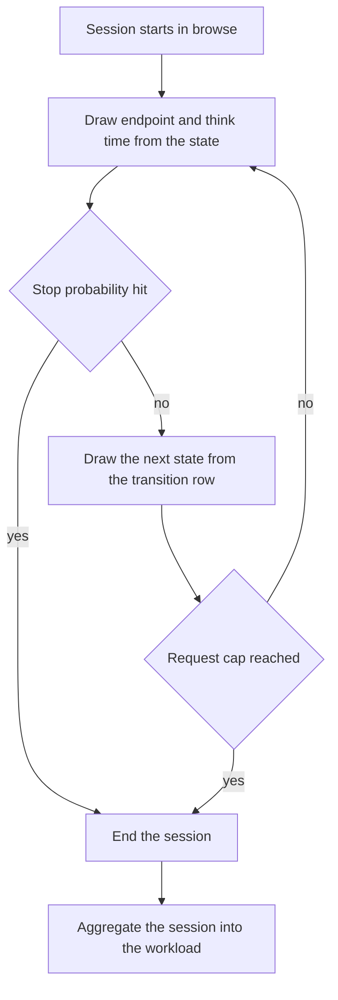
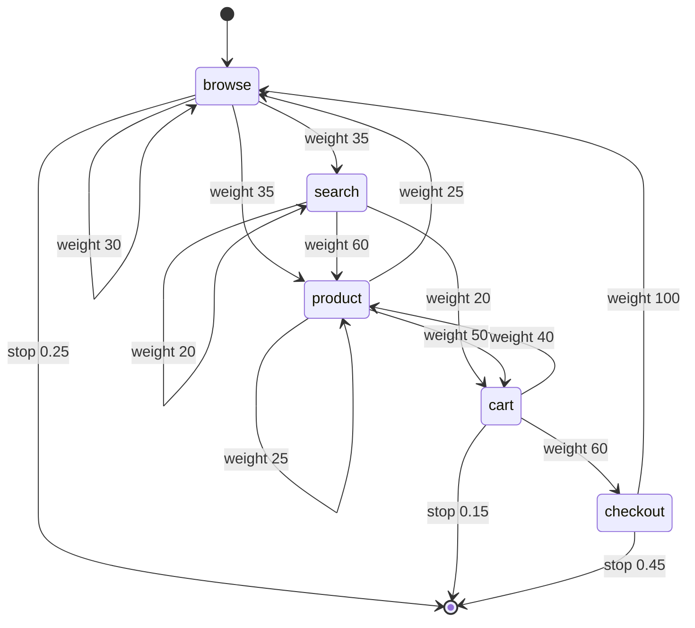
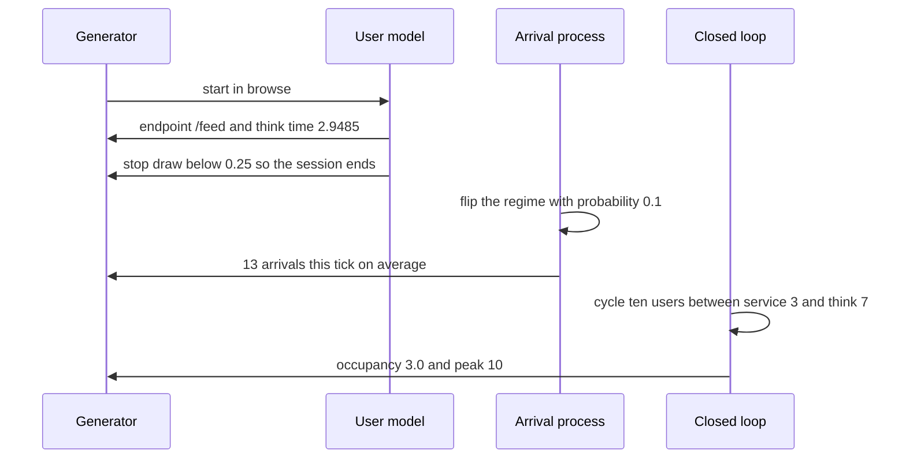

# 940 — Implement high-fidelity load generator with correlated user behavior models.

> **Tier:** Master · **CTCI chapter:** Ch 11 — Testing
> **Task spec:** [940-implement-high-fidelity-load-generator-with-correlated-user-beha.md](../../../tasks/master/940-implement-high-fidelity-load-generator-with-correlated-user-beha.md)
> **Solutions:** [Python](../../../solutions/python/master/940-implement-high-fidelity-load-generator-with-correlated-user-beha/solution.py) ·
> [Java](../../../solutions/java/master/940-implement-high-fidelity-load-generator-with-correlated-user-beha/Solution.java) ·
> [JavaScript](../../../solutions/javascript/master/940-implement-high-fidelity-load-generator-with-correlated-user-beha/solution.js) ·
> [C#](../../../solutions/csharp/master/940-implement-high-fidelity-load-generator-with-correlated-user-beha/Solution.cs)

## 1. Problem restatement

**Modelling contract.** A deterministic, session-based load generator in one process — no worker pool
and no real HTTP, which is the simplification the headers state against Locust or k6. Response times
are *configured*, not measured; the point of the exercise is the *behaviour model*: a Markov chain
over UI states, an open-loop bursty arrival process and a closed-loop virtual-user model.

**Input.** `STATE_TABLE` declares five states, each with a transition row, an endpoint mix, a stop
probability and a mean think time:

| State | Transitions (weight) | Endpoints (weight) | Stop | Think (s) |
| --- | --- | --- | --- | --- |
| `browse` | browse 30, search 35, product 35 | `/home` 70, `/feed` 30 | 0.25 | 2.0 |
| `search` | search 20, product 60, cart 20 | `/search` 60, `/suggest` 40 | 0.30 | 1.5 |
| `product` | product 25, cart 50, browse 25 | `/product` 80, `/reviews` 20 | 0.25 | 3.0 |
| `cart` | product 40, checkout 60 | `/cart` 60, `/cart/price` 40 | 0.15 | 4.0 |
| `checkout` | browse 100 | `/pay` 70, `/confirm` 30 | 0.45 | 6.0 |

**Output.** `one_session(model, rng, cap, start)` returns a list of
`(state, endpoint, think_time)` triples; `generate_sessions` produces a batch. Two independent oracles
are provided: `stationary(model)` (power iteration over the transition rows) and `expected_lengths`
(the analytic recurrence `L(s) = 1 + (1 − stop[s]) · Σ P(s→s') L(s')`).

| Call | Result | Why |
| --- | --- | --- |
| `row_deviation(transitions, sessions, 0)` | `0.0158` | transition frequencies match the declared rows |
| `row_deviation(endpoints, sessions, 1)` | `0.0000` | endpoint mixes match, conditioned on the state |
| mean length, `cap = 200` (4000 sessions) | `3.906` vs analytic `3.8929` | the analytic recurrence is the oracle |
| `stationary(model)` | `browse 0.2705, search 0.1184, product 0.3185, cart 0.1829, checkout 0.1097` | the observed long-chain mix matches within `0.03` total variation |
| `mmpp_arrivals` autocorrelation | `0.714` versus `0.016` memoryless | burstiness, measured |
| `closed_loop(10, 3, 7, 3000)` | occupancy `3.0`, peak `10` | Little's law `N·s/(s+t) = 3.0`, never above `N` |

## 2. Intuition

The naive load generator fires a uniform random endpoint as fast as it can. It produces traffic, and
it measures the wrong thing: real traffic is *correlated*. Users navigate a state machine, endpoints
are conditioned on the state (a `/pay` request only happens from `checkout`), and requests arrive in
bursts rather than as a memoryless stream. A test on uniform traffic will miss the cache-thrashing
bursts and the checkout-path saturation that actually break the system.

Three ideas make the model faithful, and each has a measurable property the file asserts.

**State-conditioned sessions.** Each step draws a think time *and* an endpoint from the current
state's rows, then decides whether the user leaves (stop probability) or moves on (transition row).
Exponential think times come from inverse transform, `−mean · ln(1 − U)`, so the mean is exactly the
declared value; the request cap bounds the tail. Because endpoints are conditioned on the state, the
test can assert that **no** `/pay` request ever appears outside `checkout`.

**Burstiness.** The open-loop process is a two-regime Markov-modulated process: a regime flips with
probability `0.1` per tick, and each tick offers `low=5` or `high=20` slots per half-slot unit. That
gives an arrival series whose mean is close to a memoryless process with the same total rate, but
whose **lag-1 autocorrelation** is `0.714` against `0.016`. Same mean, completely different shape —
which is why a bursty generator finds latency problems a uniform one does not.

**Closed-loop occupancy.** `N` virtual users cycling between service and think time is the other
classic shape. Its steady-state occupancy is `N·s/(s+t)` by Little's law — `10 · 3/10 = 3.0` here —
and it can never exceed `N`. Both facts are asserted, and they are what makes the closed-loop model
useful for capacity planning rather than merely for producing requests.



## 3. Algorithm

1. `UserModel` indexes the state table and `validate()` rejects non-positive weights or a stop
   probability outside `[0, 1]`.
2. `draw(rng, choices)` performs a weighted draw: scale a uniform by the total weight and walk the
   cumulative sum.
3. `one_session`: append `(state, draw(endpoints[state]), −think[state] · ln(1 − U))`; if
   `U &lt; stop[state]` stop, otherwise move to `draw(transitions[state])`; stop at the cap.
4. `mmpp_arrivals` and `memoryless_arrivals` generate the two arrival series; `autocorrelation(series,
   lag)` computes the lag-1 correlation.
5. `closed_loop(users, service_time, think_time, ticks)` alternates service and think budgets per user
   and records the occupancy per tick.
6. `stationary` and `expected_lengths` are the independent oracles for the state mix and the session
   length; `row_deviation` reports the worst `|observed − declared|` conditional frequency.

```text
procedure one_session(model, rng, cap, start)
    session ← empty, state ← start
    while length(session) < cap do
        endpoint ← draw(rng, model.endpoints[state])
        think ← -model.think[state] * ln(1.0 - rng.uniform())
        append (state, endpoint, think) to session
        if rng.uniform() &lt; model.stop[state] then stop end
        state ← draw(rng, model.transitions[state])
    end
    return session
end

procedure mmpp_arrivals(rng, ticks, low, high, switch, slots)
    counts ← empty, regime ← false
    for tick ← 1 to ticks do
        if rng.uniform() &lt; switch then regime ← not regime end
        slots_offered ← (high if regime else low) * slots
        arrivals ← count of draws below 0.5 among slots_offered uniforms
        append arrivals to counts
    end
    return counts
end

procedure closed_loop(users, service_time, think_time, ticks)
    remaining ← zeros, thinking ← zeros, occupancy ← empty
    for tick ← 1 to ticks do
        for user ← 1 to users do
            if remaining[user] &gt; 0 then remaining[user] ← remaining[user] - 1
            else if thinking[user] &gt; 0 then thinking[user] ← thinking[user] - 1
            end
            if remaining[user] == 0 and thinking[user] == 0 then
                remaining[user] ← service_time, thinking[user] ← think_time
            end
        end
        append the count of users with remaining &gt; 0 to occupancy
    end
    return mean(occupancy), max(occupancy)
end
```



## 4. Worked example

The generator is reproducible, so these are the numbers the tests compute. First, one session sampled
from `Rng(5)` (a real head of the generated stream):

| Step | State | Endpoint | Think time | Terminated? |
| --- | --- | --- | --- | --- |
| 1 | `browse` | `/feed` | `2.9485` | yes — the stop draw was below `0.25` |

The think time is `−2.0 · ln(1 − U)` with `U ≈ 0.771`, i.e. `2.0 · ln(4.36) ≈ 2.95`. Endpoint and think
time are drawn from the same state in the same iteration, so an exit still consumes an endpoint — the
session's last request is a real one.

Aggregates over `4000` sessions (`Rng(20240517)`, `cap = 12`) and the independent oracles:

| Property | Observed | Oracle / declared | Bound asserted |
| --- | --- | --- | --- |
| Worst transition-frequency deviation | `0.0158` | declared rows | `≤ 0.03` |
| Worst endpoint-mix deviation | `0.0000` | declared rows | `≤ 0.03`, and `/pay` never outside `checkout` |
| State mix (long chain, stop disabled) | see below | power iteration | total variation `≤ 0.03` |
| Mean session length (`cap = 200`) | `3.906` | `L(browse) = 3.8929` | `≤ 0.15`, max `25 &lt; 200` |
| Mean think time per state | `1.965, 1.535, 3.036, 4.043, 6.069` | `2.0, 1.5, 3.0, 4.0, 6.0` | worst `≤ 0.25` |

The stationary mix from the oracle is `browse 0.2705`, `search 0.1184`, `product 0.3185`,
`cart 0.1829`, `checkout 0.1097` — `product` is the most visited state, which is why the endpoint mix
there (`/product` 80) dominates the request volume even though `checkout` is rare.

The arrival processes show what "high fidelity" buys:

| Series | Mean arrivals per tick | Lag-1 autocorrelation |
| --- | --- | --- |
| Markov-modulated (bursty) | `13.113` | `0.714` |
| Memoryless (same order of magnitude) | `12.488` | `0.016` |

The means are within `1.5` of each other — the assertion requires exactly that, `< 1.5` — while the
autocorrelations differ by `0.7`. A generator calibrated only on the mean would produce the second
row and miss every queue-building burst. Note that `switch = 0.1` makes the *regime* persistent
(mean run length `10` ticks), and that persistence is the whole source of the correlation.

Closed-loop occupancy with `N = 10`, `s = 3`, `t = 7` over `3000` ticks measures `3.0` against the
Little's-law prediction `N·s/(s+t) = 3.0`, with a peak of `10` — every user busy at once, but never
more than the user count.



## 5. Complexity

| Measure | Bound | Why |
| --- | --- | --- |
| One session | `O(cap)` | one draw for the endpoint, one for the think time, one for the stop, one for the transition |
| `generate_sessions(count)` | `O(count · cap)` | sessions are independent; the RNG state carries across them |
| `mmpp_arrivals` | `O(ticks · slots · rate)` | `slots = 2` and up to `high = 20` half-slot trials per tick |
| `closed_loop` | `O(users · ticks)` | one pass over the users per tick |
| `stationary` | `O(iterations · states²)` | power iteration, `200 × 25` multiply-adds |
| `expected_lengths` | `O(iterations · states · row length)` | the analytic recurrence iterated to a fixed point |
| Space | `O(count · cap)` for the sessions, `O(ticks)` for an arrival series | the whole workload is materialised |

The generator is linear in the workload size, which is why `4000` sessions and `4000` arrival ticks are
cheap in every one of the four languages. Production generators would stream sessions instead of
materialising them, trading the memory bound for a callback interface.

## 6. Pitfalls and edge cases

- **Endpoints are state-conditioned.** The test asserts `off_route == 0`, i.e. `/pay` only from
  `checkout`; drawing endpoints from a global mix is the classic fidelity bug.
- **Stop probability is evaluated per step, not per session.** A user can leave after one request
  (`stop = 1.0` → exactly one request) or never (`stop = 0.0` → always hits the cap of `5`).
- **The cap truncates the tail.** With `cap = 12` the mean length is `3.7085`, below the analytic
  `3.8929`; the analytic check raises the cap to `200` so the truncation is not measured as a bias.
- **Invalid models must be rejected.** Zero-weight endpoint rows raise `ValueError` from `validate()`
  instead of silently generating traffic from an empty mix.
- **Autocorrelation needs a persistent regime.** The burstiness comes from the *persistence* of the
  regime (`switch = 0.1`), not from the rate difference; a per-tick independent regime would give a
  high mean with no correlation.
- **Equal means are not equal workloads.** The memoryless series is accepted only because its mean is
  within `1.5` of the bursty one *and* its autocorrelation is below `0.1`; the difference is the point.
- **Closed loop never exceeds `N`.** `peak ≤ 10` is asserted; occupancy is bounded by construction
  since only users with remaining service time are counted.
- **Think times are exponential, not uniform.** The inverse transform gives mean exactly `think[s]`,
  which is why the measured means (`1.965`–`6.069`) sit within `0.25` of the declared values.
- **Reproducibility.** The same seed must reproduce the same sessions list element for element, so no
  set or dictionary iteration order may leak into generation.

## 7. Variants and follow-ups

- **Drive the scheduler with this load.** The generated workload is what a device scheduler admits:
  [935 — multi-tenant GPU scheduler with preemption and memory reclamation](../../../tasks/master/935-implement-multi-tenant-gpu-scheduler-with-preemption-and-memory.md).
- **Score a canary under correlated traffic.** Bursty windows change the effective sample size, which
  matters to [937 — deployment pipeline with canary analysis using online metrics and rollback](../../../tasks/master/937-implement-deployment-pipeline-with-canary-analysis-using-online.md).
- **Replay recorded sessions as load.** The other source of realistic traffic is a production trace:
  [939 — trace-based replay system for production debugging](../../../tasks/master/939-implement-trace-based-replay-system-for-production-debugging.md).
- **Profile the workload you generate.** Correlation shows up as queueing, which the profiler then has
  to attribute: [941 — continuous profiling pipeline that attributes CPU and memory hotspots to code and inputs](../../../tasks/master/941-implement-continuous-profiling-pipeline-that-attributes-cpu-memo.md).

## 8. Check yourself

<details><summary>Show answer</summary>

**1. Why is the endpoint drawn from the *state's* mix rather than a global mix?**

Because real navigation is state-conditioned: you can only hit `/pay` from `checkout`. A global mix
would produce requests that cannot occur, distorting both the endpoint distribution and any
state-dependent behaviour (cache locality, authorisation, transaction sizes).

</details>

<details><summary>Show answer</summary>

**2. The bursty and memoryless arrival series have nearly the same mean. Why is that not enough?**

Because queueing behaviour depends on clustering as much as on rate. The bursty series has lag-1
autocorrelation `0.714` against `0.016`; the same average load arriving in bursts fills queues that a
uniform stream would not.

</details>

<details><summary>Show answer</summary>

**3. Why does the analytic session-length oracle use `cap = 200` while the fidelity run uses `cap = 12`?**

Because the cap truncates the geometric tail. At `cap = 12` the measured mean `3.7085` is below the
analytic `3.8929`; raising the cap to `200` (with a measured max of `25`) makes the truncation
negligible, so the comparison tests the model rather than the bound.

</details>

<details><summary>Show answer</summary>

**4. What does the closed-loop occupancy `3.0` verify?**

Little's law for a finite user population: with `N = 10`, service time `3` and think time `7`, the
expected number of users in service is `N·s/(s+t) = 3.0`. Matching it validates that the
service/think alternation is implemented consistently, and the `peak ≤ 10` assertion catches an
accounting bug that double-books a user.

</details>

<details><summary>Show answer</summary>

**5. How is an invalid model detected, and why does that matter for a load generator?**

`UserModel.validate()` raises `ValueError` when any transition or endpoint weight is non-positive or
the stop probability is outside `[0, 1]`. A load generator that silently emits no traffic because a
weight row is empty produces a *passing* test on an untested system — the worst possible outcome.

</details>
