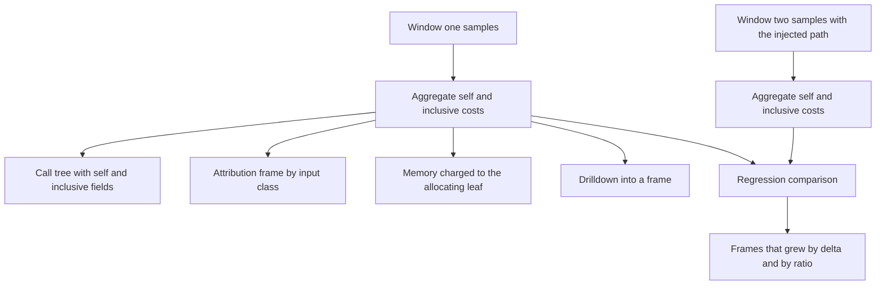
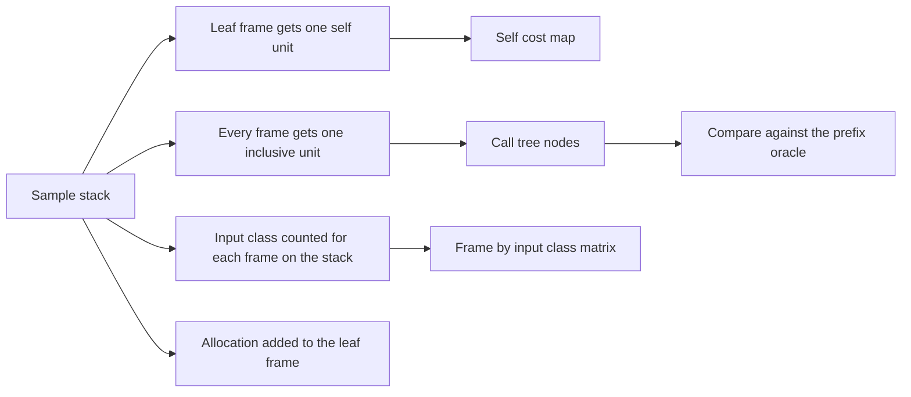
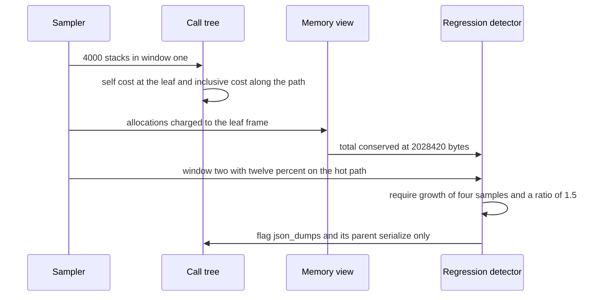

# 941 — Implement continuous profiling pipeline that attributes CPU/memory hotspots to code and inputs.

> **Tier:** Master · **CTCI chapter:** Ch Beyond — Software Engineering and Tooling
> **Task spec:** [941-implement-continuous-profiling-pipeline-that-attributes-cpu-memo.md](../../../tasks/master/941-implement-continuous-profiling-pipeline-that-attributes-cpu-memo.md)
> **Solutions:** [Python](../../../solutions/python/master/941-implement-continuous-profiling-pipeline-that-attributes-cpu-memo/solution.py) ·
> [Java](../../../solutions/java/master/941-implement-continuous-profiling-pipeline-that-attributes-cpu-memo/Solution.java) ·
> [JavaScript](../../../solutions/javascript/master/941-implement-continuous-profiling-pipeline-that-attributes-cpu-memo/solution.js) ·
> [C#](../../../solutions/csharp/master/941-implement-continuous-profiling-pipeline-that-attributes-cpu-memo/Solution.cs)

## 1. Problem restatement

**Modelling contract.** A deterministic sampling profiler over a fixed set of call paths, entirely in
process. Instead of real symbols, DWARF unwinding and wall-clock sampling, the model declares five
paths, takes **one sample per unit of work** and stores stacks as tuples of short frame names. The
headers state exactly this simplification against pprof or Parca.

**Input.** `FRAME_PATHS` declares five weighted stacks:

| Path | Weight |
| --- | --- |
| `main → request_handler → db_query` | 30 |
| `main → request_handler → render` | 20 |
| `main → request_handler → cache_lookup` | 25 |
| `main → background → serialize` | 15 |
| `main → background → db_query` | 10 |

`INPUT_MIX` assigns each sample an input class (`tenant-a` 40, `tenant-b` 35, `tenant-c` 25), one in
four samples carries an allocation of up to `4095` bytes, and `HOT_PATH = main → request_handler →
serialize → json_dumps` is the injected regression path.

**Output.** `generate` produces samples of `(stack, window, input_class, alloc)`. The pipeline
provides `self_costs` (leaf frames), `inclusive_costs` (every frame of every stack), `call_tree`
(nested nodes with `self` and `inclusive`), `flatten` (path → cost), `attribution` (frame → input-class
counts), `drilldown` (the samples that ran through a frame), `memory_by_leaf` (allocations charged to
the allocating leaf) and `regressions(before, after, ratio=1.5, delta=4)`.

| Call | Result | Why |
| --- | --- | --- |
| `sum(self_cost.values())` | `4000` | one unit of leaf cost per sample |
| `call_tree` vs `prefix_costs` | equal node for node | the tree's inclusive costs are the brute-force prefix counts |
| `attribution(window_one, "db_query")` | `{tenant-a: 623, tenant-b: 548, tenant-c: 375}` | the frame's input mix follows the declared mix |
| `regressions(window_one, window_two)` | `["json_dumps", "serialize"]` | the injected hot path, and nothing else |
| `regressions(w, w)` | `[]` | identical windows flag nothing |
| `memory_by_leaf(window_one)` | 4 leaves, total `2028420` | memory is conserved and charged to the leaf |
| `drilldown(window_one, "render")` | `803` samples | exactly the visits of that frame |

## 2. Intuition

A profiler that only reports a per-function total answers the wrong question, and the naive "top
functions by samples" view has three failures the pipeline is built to avoid.

The first is **double counting versus inclusivity**. `db_query` appears in two different paths — under
`request_handler` and under `background` — so its total sample count is the sum over both callers.
Charging those samples to `db_query` *and* to its parents would double count the work; charging them
only to the leaf would hide the caller. So the pipeline reports both: `self` cost counts a sample only
at the leaf frame, and `inclusive` cost counts a sample for every frame on the stack. The invariant
`inclusive[frame] ≥ self[frame]` holds for every frame, and the tests verify the whole tree against a
brute-force prefix count (`prefix_costs`) and a brute-force whole-stack count (`stack_costs`) rather
than against itself.

The second is **attribution to inputs**. A hotspot is actionable only if you know which traffic
triggers it. The pipeline keeps the input class of every sample and can produce the class mix of any
frame — if `db_query` were concentrated in one tenant, that would be the finding. Here the mix
(`623 / 548 / 375`) tracks the declared `40 / 35 / 25` mix.

The third is **memory versus CPU**. Allocation cost is not spread over the stack: it belongs to the
frame that called the allocator, which is the **leaf**. So `memory_by_leaf` charges each sample's
allocation to `stack[-1]` and the total is conserved. This is also why drilling into a frame and
re-running `self_costs` on the subset is a meaningful operation: it must reproduce exactly the
frame's visit count.

Continuous means *comparing windows*. `regressions(before, after)` flags frames whose inclusive cost
grew by at least `delta = 4` samples **and** by more than `ratio = 1.5` times — a two-sided test that
avoids flagging small absolute noise and small relative noise.



## 3. Algorithm

1. `generate(rng, count, window, hot_weight)`: with probability `hot_weight/1000` take the injected
   `HOT_PATH`, otherwise draw a declared path by weight; draw an input class from `INPUT_MIX`; give the
   sample an allocation in one case out of four.
2. `self_costs`: count each sample at `stack[-1]`. `inclusive_costs`: count it at every frame of the
   stack. `prefix_costs` and `stack_costs` are the independent oracles.
3. `call_tree`: insert each stack into a nested structure, incrementing `inclusive` at every node and
   `self` at the leaf. `flatten` projects path → cost so the tree can be compared with the oracles.
4. `attribution(samples, frame)`: a `Counter` over the input classes of the samples containing the
   frame. `drilldown` returns those samples in generation order.
5. `memory_by_leaf`: add each sample's allocation to its leaf frame.
6. `regressions(before, after, ratio, delta)`: keep frames with `new − old ≥ delta` and
   `new &gt; ratio · max(old, 1)`, sorted by descending growth then name.

```text
function self_costs(samples)
    counts ← empty
    for sample in samples do
        counts[sample.stack.last()] ← counts.get(sample.stack.last(), 0) + 1
    end
    return counts
end

function inclusive_costs(samples)
    counts ← empty
    for sample in samples do
        for frame in sample.stack do
            counts[frame] ← counts.get(frame, 0) + 1
        end
    end
    return counts
end

procedure call_tree(samples)
    root ← node with self 0, inclusive 0 and no children
    for sample in samples do
        node ← root
        node.inclusive ← node.inclusive + 1
        for frame in sample.stack do
            node ← node.children[frame], creating a fresh node when absent
            node.inclusive ← node.inclusive + 1
        end
        node.self ← node.self + 1
    end
    return root
end

function regressions(before, after, ratio, delta)
    old ← inclusive_costs(before), new ← inclusive_costs(after)
    grown ← frames in new where new[frame] - old.get(frame, 0) &gt;= delta
            and new[frame] &gt; ratio * max(old.get(frame, 1), 1)
    return grown sorted by descending (new - old), then by name
end
```

The `max(old.get(frame, 1), 1)` clamp is deliberate: a frame that appears for the first time has
baseline `1`, so it must grow past `ratio` *and* past `delta` to be flagged — a new frame with three
samples is not a regression.



## 4. Worked example

Window one is `4000` samples with no injected path (`hot_weight = 0`), drawn from `Rng(4242)`:

| Frame | Inclusive | Self | Reading |
| --- | --- | --- | --- |
| `main` | `4000` | `0` | the single root; every sample passes through it |
| `request_handler` | `2997` | `0` | `30 + 20 + 25 = 75%` of the weight |
| `db_query` | `1546` | `1546` | reachable from `request_handler` (30) and `background` (10) |
| `cache_lookup` | `1036` | `1036` | leaf under `request_handler` |
| `background` | `1003` | `0` | `15 + 10 = 25%` |
| `render` | `803` | `803` | leaf under `request_handler` |
| `serialize` | `615` | `615` | leaf under `background` |

The self costs are exactly the four leaf frames (`1546 + 1036 + 803 + 615 = 4000`), so conservation
holds: one self unit and one root visit per sample. `db_query` is the clearest illustration of the
self/inclusive split — it is reachable through two parents, and its inclusive count `1546` is the sum
of the samples from both paths. The flattened tree has `8` nodes, matching the `8` distinct
prefixes; `flatten(tree) == prefix_costs(window_one)` and the tree's `self` fields equal
`stack_costs(window_one)` are asserted as *set equalities*, which is why the aggregation bugs the
oracles catch are the ones that survive a self-consistent implementation.

**Attribution** of `db_query` over the three input classes:

| Input class | Samples through `db_query` | Share | Declared share |
| --- | --- | --- | --- |
| `tenant-a` | `623` | `0.403` | `0.40` |
| `tenant-b` | `548` | `0.354` | `0.35` |
| `tenant-c` | `375` | `0.243` | `0.25` |

The total is `1546`, exactly the inclusive cost of the frame — attribution conserves visits — and the
worst drift is well inside the asserted `0.05`.

**Memory** is charged to the allocating leaf, and the total is conserved:

| Leaf | Bytes |
| --- | --- |
| `serialize` | `299030` |
| `render` | `404493` |
| `cache_lookup` | `588223` |
| `db_query` | `736674` |
| **total** | `2028420` |

**Regression detection.** Window two is generated from the same RNG stream with `hot_weight = 120`
(about `12%` of samples take `main → request_handler → serialize → json_dumps`). The flagged list is
`["json_dumps", "serialize"]` — the injected frame and its parent, because both grew past `delta = 4`
and `ratio = 1.5`. `json_dumps` has `442` self samples in window two and is absent from window one
completely; `regressions(w, w)` returns `[]` for any window compared with itself.



## 5. Complexity

| Measure | Bound | Why |
| --- | --- | --- |
| `self_costs` / `inclusive_costs` | `O(n)` / `O(n · d)` | `n` samples, stack depth `d = 3` here |
| `call_tree` + `flatten` | `O(n · d)` | one node visit per frame per sample |
| `prefix_costs` oracle | `O(n · d²)` | it materialises every prefix tuple explicitly |
| `attribution` | `O(n · d)` | one membership test per frame per sample |
| `memory_by_leaf` | `O(n)` | one dict update per sample |
| `regressions` | `O(n · d + F log F)` | two aggregations plus sorting `F` flagged frames |
| Space | `O(n · d + P)` | the samples plus the `P` distinct tree paths |

The oracles are more expensive than the implementation on purpose: they reconstruct the aggregates by
brute force (`prefix_costs` allocates a tuple per prefix) so that a bug in the tree construction
cannot be compensated by the same bug in the checker. A production profiler adds unwinding cost per
sample, which dominates everything else; here the sample is already a symbol-resolved stack.

## 6. Pitfalls and edge cases

- **Self is not inclusive.** `db_query` has `1546` self and `1546` inclusive, but `request_handler`
  has `0` self and `2997` inclusive; reporting only one of the two hides either the caller or the
  leaf.
- **A frame in two paths.** `db_query` sits under both `request_handler` and `background`, so a naive
  "one parent per frame" tree would fold two paths together and break `flatten == prefix_costs`.
- **Memory belongs to the leaf.** Allocation samples are charged to `stack[-1]`, never spread across
  the stack; the total is asserted to equal the sum of the raw `alloc` fields.
- **Regression thresholds are both required.** Growth must reach `delta = 4` samples *and* exceed
  `ratio = 1.5`; the first-only test flags noise, the second-only test flags a frame going from `1` to
  `2` samples.
- **First appearance of a frame.** The clamp `max(old, 1)` gives a new frame a baseline of one sample;
  `json_dumps` passes because its `442` samples clear both thresholds.
- **Identical windows flag nothing.** `regressions(w, w) == []` is the false-positive control.
- **Empty and single-sample profiles.** `self_costs([])` and `flatten(call_tree([]))` are empty,
  `regressions([], [])` is empty, and a single sample aggregates to unit costs with its allocation
  charged to its leaf.
- **Drilldown consistency.** `len(drilldown(samples, frame)) == inclusive[frame]`, and the drilled
  subset's self costs sum to its own size — a frame's samples are a valid sub-profile.
- **Determinism.** Regenerating with `Rng(4242)` must reproduce the same stacks, and the self-cost
  ranking must equal the ranking derived from the distinct leaf set.

## 7. Variants and follow-ups

- **Turn the profile into a rewrite plan.** Knowing which frame is hot is the input to the optimizer
  in [942 — hot-path optimization analyzer that suggests inline and caching opportunities](../../../tasks/master/942-implement-hot-path-optimization-analyzer-that-suggests-inline-an.md).
- **Profile the load you generate.** A hotspot is only meaningful under a faithful workload:
  [940 — high-fidelity load generator with correlated user behavior models](../../../tasks/master/940-implement-high-fidelity-load-generator-with-correlated-user-beha.md).
- **Attribute a regression to a request.** The same attribution question at request granularity:
  [939 — trace-based replay system for production debugging](../../../tasks/master/939-implement-trace-based-replay-system-for-production-debugging.md).
- **Watch the profiled service in production.** Continuous profiling plus drift monitoring is the
  closed loop of [929 — end-to-end automated ML system with monitoring, drift alerts and retraining](../../../tasks/master/929-implement-end-to-end-automated-ml-system-with-monitoring-drift-a.md).

## 8. Check yourself

<details><summary>Show answer</summary>

**1. Why report both self and inclusive costs?**

Self cost attributes work to the frame that performed it (the leaf), inclusive cost attributes it to
every frame on the call path. `request_handler` shows up only as inclusive (`2997`), while `db_query`
shows up as both. Reporting one alone either hides the caller or destroys the leaf-level signal.

</details>

<details><summary>Show answer</summary>

**2. Why are the tree aggregates checked against `prefix_costs` and `stack_costs` rather than against
themselves?**

Because a self-consistent implementation can share a systematic error with its own aggregation. The
brute-force oracles rebuild the counts from the raw stacks — one tuple per prefix, one tuple per whole
stack — so the comparison is independent of the tree structure.

</details>

<details><summary>Show answer</summary>

**3. Why is an allocation charged to the leaf frame instead of spread across the stack?**

Because the leaf is the frame that actually called the allocator. Spreading it would attribute bytes
to frames that merely happened to be on the stack, which is the inverse of what a memory-profile
reader needs when deciding which function to fix.

</details>

<details><summary>Show answer</summary>

**4. Window two flags `serialize` as well as `json_dumps`. Is that over-reporting?**

No. The injected path is `request_handler → serialize → json_dumps`, so `serialize`'s *inclusive* cost
grows with it — it is genuinely hotter. The assertion is that every flagged frame belongs to `HOT_PATH`
(which contains both names), not that exactly one frame is flagged.

</details>

<details><summary>Show answer</summary>

**5. What would break if `delta` alone, without the ratio, decided the regression list?**

Small absolute changes would flood the report: a frame going from `1` to `6` samples is a `500%` jump
in a frame nobody cares about. Conversely, ratio alone would miss a large frame's meaningful absolute
growth. Requiring both keeps the list to frames that are both materially and proportionally hotter.

</details>
