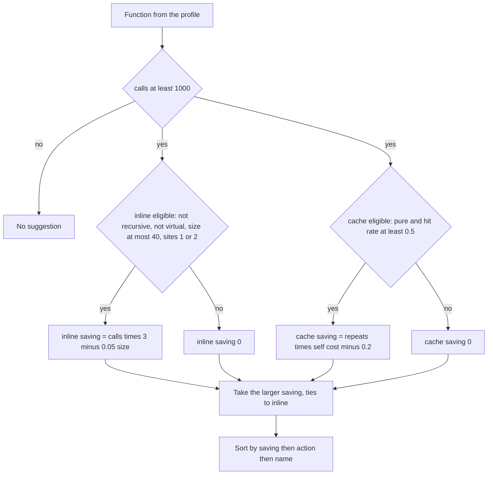
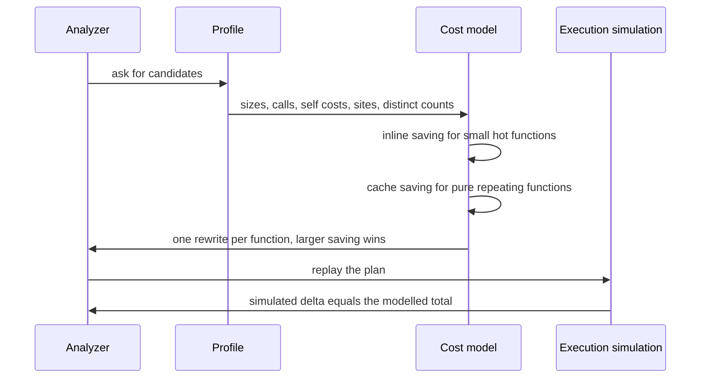
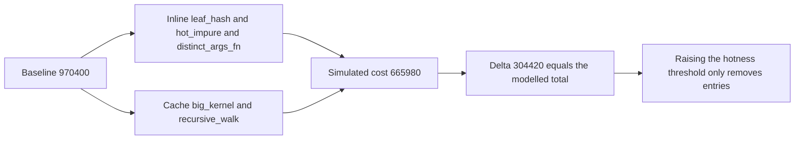

# 942 — Implement hot-path optimization analyzer that suggests inline and caching opportunities.

> **Tier:** Master · **CTCI chapter:** Ch Beyond — Software Engineering and Tooling
> **Task spec:** [942-implement-hot-path-optimization-analyzer-that-suggests-inline-an.md](../../../tasks/master/942-implement-hot-path-optimization-analyzer-that-suggests-inline-an.md)
> **Solutions:** [Python](../../../solutions/python/master/942-implement-hot-path-optimization-analyzer-that-suggests-inline-an/solution.py) ·
> [Java](../../../solutions/java/master/942-implement-hot-path-optimization-analyzer-that-suggests-inline-an/Solution.java) ·
> [JavaScript](../../../solutions/javascript/master/942-implement-hot-path-optimization-analyzer-that-suggests-inline-an/solution.js) ·
> [C#](../../../solutions/csharp/master/942-implement-hot-path-optimization-analyzer-that-suggests-inline-an/Solution.cs)

## 1. Problem restatement

**Modelling contract.** A profile-driven optimizer that emits *suggestions only*. There is no code
emission, no compiler and no hardware counter; the cost model is a small linear formula, which the
headers state as the simplification against PGO or BOLT.

**Input.** A profile list of `Function(name, size, calls, self_cost, sites, distinct, recursive,
virtual, pure)`, where `size` is static nodes, `calls` is the dynamic call count, `self_cost` is the
cost per call, `sites` is the number of call sites, and `distinct` is the number of distinct argument
values (the cache hit-rate proxy). The constructed profile is

| Function | Size | Calls | Self cost | Sites | Distinct | Property |
| --- | --- | --- | --- | --- | --- | --- |
| `leaf_hash` | 12 | 50 000 | 0.8 | 1 | 50 000 | pure |
| `big_kernel` | 60 | 20 000 | 2.0 | 1 | 100 | pure, oversized |
| `recursive_walk` | 10 | 30 000 | 1.0 | 1 | 500 | recursive |
| `hot_impure` | 10 | 40 000 | 1.0 | 1 | 40 000 | impure |
| `many_callers` | 10 | 40 000 | 1.0 | 5 | 40 000 | five call sites |
| `cold_util` | 10 | 100 | 1.0 | 1 | 100 | cold |
| `virtual_runner` | 10 | 40 000 | 1.0 | 1 | 40 000 | virtual |
| `distinct_args_fn` | 10 | 10 000 | 5.0 | 1 | 9 000 | all-distinct args |

**Output.** `analyze(functions, hot_calls)` returns a plan of `(action, name, saving)` sorted by
descending saving, then action, then name, with **at most one rewrite per function**.

| Call | Result | Why |
| --- | --- | --- |
| `analyze(profile())` | `inline leaf_hash 120000`, `inline hot_impure 100000`, `cache big_kernel 35820`, `inline distinct_args_fn 25000`, `cache recursive_walk 23600` | the plan is exactly the expected rewrite set |
| `baseline_cost(profile())` | `970400` | sum of `calls · (self_cost + CALL_OVERHEAD)` |
| `plan_delta(profile(), plan)` | `304420` | the independent simulation reproduces the modelled total to `1e-9` |
| `analyze([], ...)` | `[]` | the empty profile |
| `analyze([Function("root", 10, 50000, 1.0, sites=0)])` | `[]` | a function nobody calls cannot be inlined |

## 2. Intuition

The naive optimizer inlines every hot function. That is a pessimisation for a fat body: inlining
removes one call's overhead but copies the body into each caller, and a large body evicts instruction
cache on **every** call, not just once. So the model charges both sides:

```text
inline saving = calls · (CALL_OVERHEAD − INLINE_PENALTY · size)
```

With `CALL_OVERHEAD = 3.0`, `INLINE_PENALTY = 0.05` and `SIZE_LIMIT = 40`, a body larger than `40`
nodes has a negative net saving and is refused outright. This is why the check is a *guard*, not a
clamp: `big_kernel` at `size = 60` gets `0.0`, not `-3.0`.

Memorisation has its own arithmetic and its own preconditions:

```text
cache saving = (calls − distinct) · (self_cost − CACHE_LOOKUP)
```

The first factor counts how many calls are *repeats* — if every call has a distinct argument, caching
cannot help, which is why `distinct_args_fn` (`hit_rate = 0.1`) is rejected while `big_kernel`
(`hit_rate = 0.995`) is accepted. The second factor is the per-call benefit over a lookup; a function
whose self cost is below `CACHE_LOOKUP = 0.2` loses money by being memoized, and the file pins that
with an `extreme` case whose saving would be negative.

Three more guards keep the plan honest: only pure functions may be cached (memoizing an impure
function changes behaviour), recursion and virtual dispatch block inlining (the call site may not be
statically known, and the recursion would not terminate), and at most two call sites are allowed —
beyond that the body is duplicated so widely that the instruction-cache penalty stops being a
per-call quantity. A function receives **at most one** rewrite, chosen by the larger saving with ties
going to inline.



## 3. Algorithm

1. `inline_saving(function, hot_calls)`: return `0.0` if the function is recursive, virtual, larger
   than `SIZE_LIMIT`, has fewer than `1` or more than `MAX_CALL_SITES` call sites, or has fewer than
   `hot_calls` calls; otherwise `max(0, calls · (CALL_OVERHEAD − INLINE_PENALTY · size))`.
2. `cache_saving(function, hot_calls)`: return `0.0` if the function is impure, colder than
   `hot_calls`, or has `hit_rate() &lt; CACHE_HIT_MIN`; otherwise
   `max(0, (calls − distinct) · (self_cost − CACHE_LOOKUP))`.
3. `analyze`: for each function take `max(inline, cache)`; skip when the maximum is `≤ 0`; record the
   action with the tie going to `inline`; sort by `(−saving, action, name)`.
4. `execution_cost(functions, inlined, cached)` simulates the profile under a plan — inlined functions
   pay `calls · (self_cost + INLINE_PENALTY · size)`, cached ones pay
   `calls · CALL_OVERHEAD + distinct · self_cost + (calls − distinct) · CACHE_LOOKUP`, and untouched
   ones pay `calls · (self_cost + CALL_OVERHEAD)`.
5. `plan_delta` subtracts that simulation from `baseline_cost`, giving an *independent* measurement of
   the plan's benefit.

```text
function inline_saving(function, hot_calls)
    if function.recursive or function.virtual or function.size &gt; SIZE_LIMIT then return 0.0 end
    if function.sites &lt; 1 or function.sites &gt; MAX_CALL_SITES then return 0.0 end
    if function.calls &lt; hot_calls then return 0.0 end
    return max(0.0, function.calls * (CALL_OVERHEAD - INLINE_PENALTY * function.size))
end

function cache_saving(function, hot_calls)
    if not function.pure or function.calls &lt; hot_calls then return 0.0 end
    hit_rate ← (function.calls - function.distinct) / function.calls
    if hit_rate &lt; CACHE_HIT_MIN then return 0.0 end
    return max(0.0, (function.calls - function.distinct) * (function.self_cost - CACHE_LOOKUP))
end

procedure analyze(functions, hot_calls)
    plan ← empty
    for function in functions do
        inline ← inline_saving(function, hot_calls)
        cache ← cache_saving(function, hot_calls)
        if max(inline, cache) &lt;= 0 then continue end
        action ← inline if inline &gt;= cache else cache
        append (action, function.name, max(inline, cache)) to plan
    end
    return plan sorted by descending saving, then action, then name
end

function execution_cost(functions, inlined, cached)
    total ← 0.0
    for function in functions do
        if function.name in inlined then
            total ← total + function.calls * (function.self_cost + INLINE_PENALTY * function.size)
        else if function.name in cached then
            total ← total + function.calls * CALL_OVERHEAD
                    + function.distinct * function.self_cost
                    + (function.calls - function.distinct) * CACHE_LOOKUP
        else
            total ← total + function.calls * (function.self_cost + CALL_OVERHEAD)
        end
    end
    return total
end
```

The simulation is what turns the cost model into a *testable* claim: `plan_delta` and the sum of the
per-suggestion `single_delta` values must both equal the modelled total, so an error in the model
cannot hide behind the same error in the plan.



## 4. Worked example

Every number in the plan can be recomputed by hand from the two formulas. `CALL_OVERHEAD = 3.0`,
`INLINE_PENALTY = 0.05`, `CACHE_LOOKUP = 0.2`.

| Function | Inline saving | Cache saving | Chosen | Arithmetic |
| --- | --- | --- | --- | --- |
| `leaf_hash` | `120000` | `0` | `inline` | `50000 · (3 − 0.05·12) = 50000 · 2.4` |
| `hot_impure` | `100000` | `0` | `inline` | `40000 · (3 − 0.5)`; cache blocked by impurity |
| `big_kernel` | `0` | `35820` | `cache` | `19900 · (2.0 − 0.2)`; inline blocked by `size = 60` |
| `distinct_args_fn` | `25000` | `0` | `inline` | `10000 · 2.5`; cache blocked by `hit_rate = 0.1` |
| `recursive_walk` | `0` | `23600` | `cache` | `29500 · (1.0 − 0.2)`; inline blocked by recursion |
| `many_callers` | `0` | `0` | — | five sites block inline, `hit_rate = 0` blocks cache |
| `virtual_runner` | `0` | `0` | — | virtual blocks inline, `hit_rate = 0` blocks cache |
| `cold_util` | `0` | `0` | — | `100` calls is far below `HOT_CALLS = 1000` |

The plan is the five rows with a suggestion, sorted by saving: `leaf_hash`, `hot_impure`,
`big_kernel`, `distinct_args_fn`, `recursive_walk` — three inlines and two caches.

Now the independent check. The baseline is
`Σ calls · (self_cost + 3) = 970400`. The modelled saving is the sum of the five selected values,
`120000 + 100000 + 35820 + 25000 + 23600 = 304420`. Replaying the plan through the *simulation* —
inlined functions paying `calls · (self_cost + 0.05·size)`, cached ones paying
`calls·3 + distinct·self_cost + repeats·0.2` — yields `970400 − 665980 = 304420` as well, and the
per-suggestion `single_delta` values sum to the same total. All three numbers agreeing to `1e-9` is
what makes the cost model trustworthy rather than merely plausible.

Threshold boundaries are inclusive by construction and are tested explicitly:

| Probe | Value | Result |
| --- | --- | --- |
| `size = 40`, `calls = 1000`, `distinct = 500` | exactly the limits | inline `1000·1.0`, cache `500·0.8` → inline wins |
| `size = 41` | one node over | inline `0.0` |
| `calls = 999` | one call short | inline `0.0` and cache `0.0` |
| `self_cost = 0.1`, `distinct = 1` | below `CACHE_LOOKUP` | cache `max(0, −…) = 0.0` |



## 5. Complexity

| Measure | Bound | Why |
| --- | --- | --- |
| `inline_saving` / `cache_saving` | `O(1)` | a handful of comparisons and multiplies |
| `analyze` | `O(F log F)` | one pass over `F` functions plus the sort |
| `execution_cost` | `O(F)` | one branch per function per simulation |
| Full verification | `O(F log F + |plan| · F)` | the plan delta plus one simulation per suggestion |
| Space | `O(F + |plan|)` | the profile and the plan |
| Real PGO alternative | `O(instrumented runs)` | hardware counters and emitted code, orders of magnitude heavier |

The analyzer is linear apart from the sort, which is what makes it cheap enough to run on every
profile upload. The interesting cost is the *verification*: it re-simulates the whole profile once per
suggestion, deliberately paying `|plan| · F` to keep the measurement independent of the model.

## 6. Pitfalls and edge cases

- **Inlining a fat body is a pessimisation.** The penalty is charged per call (`INLINE_PENALTY · size`
  removed from `CALL_OVERHEAD`), so `size = 60` makes the net saving negative and the guard returns
  `0.0` instead of a negative number that would corrupt the sum.
- **Recursion and virtual dispatch block inlining.** `recursive_walk` and `virtual_runner` are
  rejected on those grounds alone; the call site cannot be resolved statically.
- **Too many call sites.** `many_callers` (`sites = 5 &gt; 2`) is refused, because duplicating a body
  across five sites changes the instruction-cache economics the penalty models.
- **Impure functions may not be cached.** `hot_impure` is rejected for caching even though its
  `distinct` count equals its call count — both guards independently block it.
- **All-distinct arguments.** `distinct_args_fn` has `hit_rate = 0.1 &lt; 0.5`, so caching is refused
  even though its self cost (`5.0`) is large; this is the case that catches "cache everything hot".
- **Break-even self cost.** A function cheaper than `CACHE_LOOKUP = 0.2` cannot benefit from
  memoization at all; the `extreme` probe asserts the clamp to zero.
- **One rewrite per function.** The chosen action is the larger saving, with ties going to inline; the
  plan is asserted to have no duplicate names.
- **Caller-less functions.** `sites = 0` yields no suggestion (there is no call to remove), and the
  empty profile yields `[]`.
- **Monotonicity in the threshold.** Raising `hot_calls` to `2000`, `10000` and `30000` must only
  remove suggestions, never add one or change a decision.

## 7. Variants and follow-ups

- **Decide from a profile, not from a guess.** The input to this analyzer is the aggregate produced by
  [941 — continuous profiling pipeline that attributes CPU and memory hotspots to code and inputs](../../../tasks/master/941-implement-continuous-profiling-pipeline-that-attributes-cpu-memo.md).
- **Apply the rewrite in a real compiler.** The transformation itself belongs to a graph runtime:
  [933 — runtime that compiles high-level ops into fused kernels with autotuning](../../../tasks/master/933-implement-runtime-that-compiles-high-level-ops-into-fused-kernel.md).
- **Memoize a deterministic cost.** Caching is only safe on deterministic computations, the same
  property that makes replay sound in
  [939 — trace-based replay system for production debugging](../../../tasks/master/939-implement-trace-based-replay-system-for-production-debugging.md).
- **Verify the rewrite, do not trust it.** Differential testing is how the emitted kernel is checked:
  [932 — differential testing between CPU and GPU implementations for numerical ops](../../../tasks/master/932-implement-differential-testing-between-cpu-gpu-implementations-f.md).

## 8. Check yourself

<details><summary>Show answer</summary>

**1. Why does inlining a large function lose money in this model?**

Because inlining removes the call overhead once per call but copies the body into every caller, and
the instruction-cache penalty grows with the body size on every call. The net saving
`calls · (CALL_OVERHEAD − INLINE_PENALTY · size)` goes negative past `size = 3.0 / 0.05 = 60`; the
guard `SIZE_LIMIT = 40` rejects those candidates before the clamp is even needed.

</details>

<details><summary>Show answer</summary>

**2. Why is `many_callers` rejected for *both* rewrites?**

It has five call sites, above `MAX_CALL_SITES = 2`, so inlining is refused; and its `distinct` count
equals its call count, so its hit rate is `0` and caching has nothing to exploit.

</details>

<details><summary>Show answer</summary>

**3. What is the role of `execution_cost`, given that `analyze` already computes a saving?**

It is the independent oracle. `analyze` applies a formula; `execution_cost` re-simulates the profile
under the plan and the two must agree to `1e-9`, both per suggestion and for the whole plan — so a
modelling mistake cannot be masked by a matching bug in the formula.

</details>

<details><summary>Show answer</summary>

**4. A function has `calls = 1000`, `distinct = 500`, `self_cost = 1.0` and `size = 40`. What happens,
and why?**

It sits exactly on every boundary: `calls = HOT_CALLS`, `size = SIZE_LIMIT`,
`hit_rate = CACHE_HIT_MIN`. Both savings are positive (`1000` for inline, `400` for cache), so the
function is rewritten by inlining — ties go to inline only when savings are equal, and here inline is
larger.

</details>

<details><summary>Show answer</summary>

**5. Why must raising `hot_calls` only remove suggestions?**

Because the hotness threshold is a lower bound on `calls`. Every candidate that fails the stricter
threshold also failed the looser one, so the plan can only shrink — a useful monotonicity property
that the tests assert over `2000`, `10000` and `30000`.

</details>
