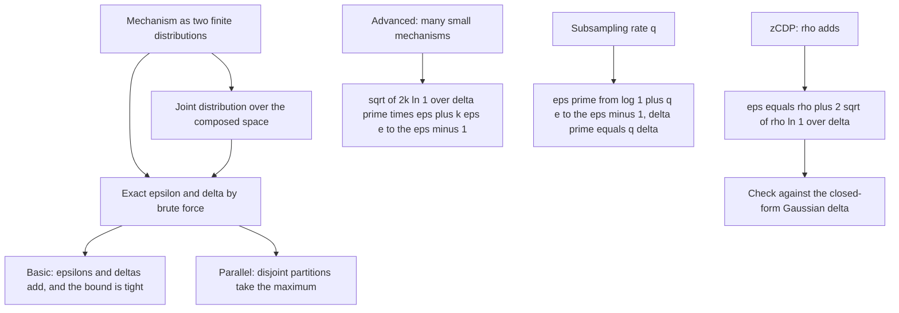
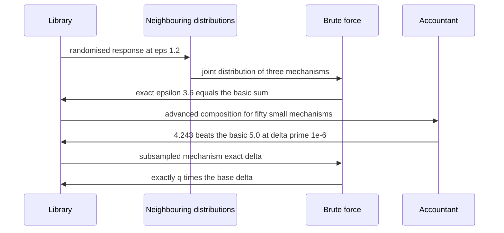
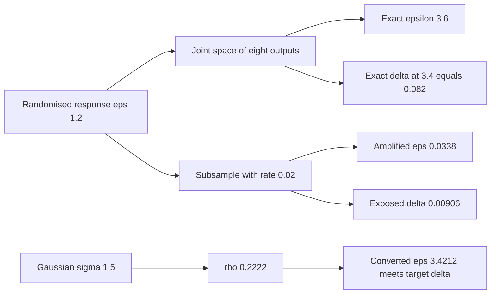

# 943 — Implement composable privacy guarantees across combined DP mechanisms.

> **Tier:** Master · **CTCI chapter:** Ch Beyond — Security and Privacy
> **Task spec:** [943-implement-composable-privacy-guarantees-across-combined-dp-mecha.md](../../../tasks/master/943-implement-composable-privacy-guarantees-across-combined-dp-mecha.md)
> **Solutions:** [Python](../../../solutions/python/master/943-implement-composable-privacy-guarantees-across-combined-dp-mecha/solution.py) ·
> [Java](../../../solutions/java/master/943-implement-composable-privacy-guarantees-across-combined-dp-mecha/Solution.java) ·
> [JavaScript](../../../solutions/javascript/master/943-implement-composable-privacy-guarantees-across-combined-dp-mecha/solution.js) ·
> [C#](../../../solutions/csharp/master/943-implement-composable-privacy-guarantees-across-combined-dp-mecha/Solution.cs)

## 1. Problem restatement

**Modelling contract.** A composition library over *finite* mechanisms, so every claim can be checked
exactly rather than approximately. A mechanism is a pair of conditional distributions over a finite
output space for a pair of neighbouring inputs; from that pair the library computes the **exact** pure
`epsilon` (the maximum log likelihood ratio) and the **exact** `delta` at a given `epsilon` by brute
force. On top of those exact figures it implements the textbook composition rules. The headers state
the simplification against OpenDP or Opacus: explicit probability vectors and closed-form accountants
instead of numeric optimisation over RDP orders.

**Input.** `randomised_response(epsilon, value)` gives `P(output = input) = e^ε / (1 + e^ε)` over two
outcomes; `joint([...])` builds the product distribution over the joint output space;
`gaussian_delta(epsilon, sigma, sensitivity=1.0)` is the classical closed form.

**Output.** `basic`, `advanced`, `parallel`, `subsampled` and `zcdp_to_epsilon` return
`(epsilon, delta)` pairs; `exact_epsilon` and `exact_delta` are the brute-force oracles.

| Call | Result | Why |
| --- | --- | --- |
| `randomised_response(1.2, 0)` | `[0.768525, 0.231475]` | `e^1.2 / (1 + e^1.2)` |
| `exact_epsilon(joint 3 × RR(1.2))` | `3.600000` | basic composition is *tight*: the exact epsilon equals the sum |
| `exact_delta(composed, 3.6)` / `(composed, 3.4)` | `2.2e-16` / `0.082281` | pure mechanisms stay pure at the sum, and lose purity the moment `epsilon` is tightened |
| `parallel(exact)` for `(1.0, 2.0)` | `2.0` versus sequential `3.0` | disjoint partitions take the maximum |
| `advanced([0.1] · 50, 1e-6)` | `4.242777` versus basic `5.0` | advanced composition wins for many small mechanisms |
| `zcdp_to_epsilon(rho, 1e-5)` with `sigma = 1.5` | `3.421239` for one mechanism, `4.968538` for two | `rho` adds; sensitivity becomes `sqrt(2)` |
| `subsampled(1.0, 0.05, 0.02)` | `(0.033788, 0.001)` | amplification: `ε' = log(1 + q(e^ε − 1))`, `δ' = q·δ` |

## 2. Intuition

Every DP system is a *composition* of mechanisms, and composition is where budgets are silently
destroyed. The naive accountant adds the mechanism `epsilon` values and calls it a day. That is
correct — basic composition is a theorem, and the file proves tightness by brute force — but it is
often needlessly pessimistic, and it has no answer for the cases that matter in practice.

Three refinements are implemented, each with a different structural justification:

**Advanced composition** exploits the fact that errors accumulate like a random walk, not linearly. For
`k` mechanisms with the largest `epsilon` and a slack `delta'`:

```text
ε_total = sqrt(2 k ln(1/δ')) · ε + k ε (e^ε − 1),   δ_total = δ'
```

For `k = 3` mechanisms at `ε = 0.1` it yields `0.942` against the exact `0.3` (a valid but loose
bound), and for `k = 50` it yields `4.243` against the basic `5.0` — where the extra `delta'` buys a
real saving in epsilon. Making `delta'` smaller (`1e-9` instead of `1e-5`) costs epsilon (`5.078`
against `3.919`), which is the fundamental privacy trade-off expressed in one number.

**Parallel composition** is structural, not statistical: if two mechanisms touch *disjoint* partitions
of the data, no individual is affected by both, so the guarantee is the maximum of the two, not the
sum. The file demonstrates the gap exactly — `max(1, 2) = 2` against a sequential `3` — by building
the two neighbouring pairs explicitly and brute-forcing the exact epsilon of each.

**Amplification by subsampling** and **zCDP** change the shape of the accounting. Sampling with rate
`q` before a mechanism amplifies the guarantee (`ε' = log(1 + q(e^ε − 1))`, which is exactly `ε` at
`q = 1` and shrinks monotonically in `q`), and it *also* scales the exposed delta by `q`. zCDP
accounting adds `rho` instead of `epsilon` and converts once at the end,
`ε = ρ + 2·sqrt(ρ ln(1/δ))`, which the file validates against the classical Gaussian `delta`.

The critical discipline is that every accountant is checked against the brute-force truth, never
against itself.



## 3. Algorithm

1. `randomised_response(epsilon, value)` builds the two-point distribution and `joint` takes the
   product over mechanisms, giving the joint output distribution for each neighbouring input.
2. `exact_epsilon(dist_x, dist_y)` returns `max log(px / py)` over the shared support;
   `exact_delta(dist_x, dist_y, epsilon)` returns `max(0, Σ (px − e^ε py))` over the coordinates where
   `px &gt; e^ε py`.
3. The accountants: `basic` (sum both), `advanced` (Dwork-Roth with the largest epsilon),
   `parallel` (max), `subsampled` (`log(1 + q(e^ε − 1))`, `q·δ`), `zcdp_to_epsilon`
   (`ρ + 2 sqrt(ρ ln(1/δ))`).
4. Validation: compare the composed exact epsilon to the basic sum (tightness), the parallel exact
   epsilon to `max`, the advanced bound to the exact value and to the basic sum, the subsampled exact
   delta to `q·δ`, and the zCDP conversion against `gaussian_delta`.
5. Boundary and monotonicity checks: zero mechanisms compose to `(0, 0)`, one mechanism is the
   identity, order does not matter for basic composition, and adding a mechanism never weakens the
   guarantee.

```text
function exact_epsilon(dist_x, dist_y)
    return max of log(px / py) over coordinates where px &gt; 0 and py &gt; 0
end

function exact_delta(dist_x, dist_y, epsilon)
    bound ← exp(epsilon)
    return max(0.0, sum of (px - bound * py) over coordinates where px &gt; bound * py)
end

function advanced(epsilons, delta_prime)
    count ← length(epsilons), epsilon ← max(epsilons)
    total ← sqrt(2 * count * ln(1 / delta_prime)) * epsilon
             + count * epsilon * (exp(epsilon) - 1)
    return total, delta_prime
end

function subsampled(epsilon, delta, rate)
    return ln(1 + rate * (exp(epsilon) - 1)), rate * delta
end

function zcdp_to_epsilon(rho, delta)
    return rho + 2 * sqrt(rho * ln(1 / delta))
end
```



## 4. Worked example

**Basic composition, verified exactly.** `randomised_response(1.2, 0)` is `[0.768525, 0.231475]`; the
three-fold joint space has `2³ = 8` outputs, and brute force gives:

| Quantity | Value |
| --- | --- |
| `exact_epsilon` of the composed pair | `3.600000` (= `3 · 1.2`) |
| `exact_delta` at `epsilon = 3.6` | `2.22e-16` (floating-point zero) |
| `exact_delta` at `epsilon = 3.4` | `0.082281` |

The first row is the tightness claim: the brute-force epsilon of the composition *equals* the sum, so
basic composition is not merely sound but exact for randomised response. The third row shows the
cliff: tightening the reported epsilon by `0.2` immediately exposes a `delta` of `0.082` — pure DP
tolerates no discount.

**Parallel versus sequential.** Two mechanisms over disjoint partitions, each built explicitly as a
joint pair, give an exact epsilon of `2.0` (the max of `1.0` and `2.0`), while the sequential bound
would claim `3.0`. Partitioning the data is therefore worth more than any tighter accountant.

**Advanced composition.**

| Setting | Value |
| --- | --- |
| Exact epsilon of 3 mechanisms at `ε = 0.1` | `0.300` |
| `advanced([0.1] · 3, 1e-6)` | `0.942` — valid, loose |
| `advanced([0.1] · 50, 1e-6)` | `4.243` |
| `basic([0.1] · 50, 0)` | `5.000` |
| `advanced([0.1] · 50, 1e-9)` vs `1e-5` | `5.078` vs `3.919` |

So advanced composition only pays off at scale (`k = 50`), and it buys epsilon by spending `delta′`:
a thousand-fold tighter failure probability costs roughly `1.16` extra epsilon here.

**zCDP and the Gaussian mechanism.** With `sigma = 1.5`, `rho = 1/(2·1.5²) = 0.2222`:

| Quantity | `rho` | Converted `epsilon` at `delta = 1e-5` | `gaussian_delta` at that epsilon |
| --- | --- | --- | --- |
| one mechanism | `0.22222` | `3.421239` | `9.15e-08` ✓ ≤ `1e-5` |
| composed with itself | `0.44444` | `4.968538` | `1.29e-12` (sensitivity `sqrt(2)`) ✓ |
| half the reported epsilon | `0.22222` | `1.710620` | `2.44e-03` ✗ far above `1e-5` |

The conversion is validated against an *independent* closed form: the whole point is that
`zcdp_to_epsilon` must produce an epsilon whose classical Gaussian delta meets the target, and that
halving the epsilon provably fails — so the accountant cannot be off by a constant factor.

**Subsampling amplification.** With `ε = 1.0`, `δ = 0.05` and rate `q = 0.02`:

| Quantity | Value |
| --- | --- |
| Amplified `ε' = log(1 + q(e^ε − 1))` | `0.033788` |
| Reported `δ' = q·δ` | `0.001` |
| Brute-force exact delta of the subsampled mechanism at `ε'` | `0.0090575` |
| `q ×` exact delta of the base mechanism at `ε'` | `0.0090575` (equal to `1e-12`) |
| At `q = 1.0` / `q = 0.05` / `q = 0.01` | `1.000000` / `0.082422` / `0.017037` |

Two facts are being checked here. The identity `q = 1 ⇒ ε' = ε` confirms the formula degenerates
correctly, monotonicity confirms that sampling rarely is strictly safer, and the last two rows check
the *mechanism-level* claim: the sub-sampled mechanism's exact delta is exactly `q` times the base
mechanism's delta at the *amplified* epsilon — amplification in both parameters, not just epsilon.



## 5. Complexity

| Measure | Bound | Why |
| --- | --- | --- |
| `joint` over `k` two-point mechanisms | `O(2^k)` space and time | the product distribution is materialised |
| `exact_epsilon` / `exact_delta` | `O(2^k)` | one pass over the joint output space |
| `basic`, `parallel` | `O(k)` | a sum or a maximum |
| `advanced`, `subsampled`, `zcdp_to_epsilon` | `O(1)` per call | closed forms with one `log` and one `exp` |
| Verification suite | `O(2^k)` per brute-force case | `k ≤ 3` keeps it tiny, by design |
| Real accountant alternative | `O(orders · mechanisms)` | numeric optimisation over RDP orders instead of enumeration |

The exponential joint space is exactly why the exact oracles are only used as *tests*: `k = 3` is
`8` outputs, `k = 50` would be `2^50`. The accountants exist precisely to avoid enumeration, and the
tutorial's numbers come from the small cases where enumeration is affordable and therefore
trustworthy.

## 6. Pitfalls and edge cases

- **Basic composition is tight but not optimal.** The exact epsilon of composed randomised response
  equals the sum, which validates the rule — but parallel composition still beats it (`2` against
  `3`), so structure matters more than arithmetic.
- **Purity has a cliff.** At the summed epsilon the composition is still pure (`delta ≈ 2.2e-16`),
  but reporting `epsilon − 0.2` exposes `delta = 0.082`. Never quote a rounded-down epsilon for a pure
  mechanism.
- **Advanced composition needs a `delta′` budget.** It is not free epsilon: shrinking `delta′` from
  `1e-5` to `1e-9` raises the bound from `3.919` to `5.078`, and for `k = 3` it is worse than basic
  (`0.942` against `0.3`).
- **Division by a non-shared support coordinate.** `exact_epsilon` skips coordinates where either
  probability is zero; including them would produce a division by zero, and treating them as infinite
  would break the finite-mechanism accounting.
- **Subsampling must amplify both parameters.** The exact delta of the subsampled mechanism is exactly
  `q` times the base delta — if only epsilon were amplified, the reported guarantee would be wrong at
  the same `delta`.
- **zCDP conversion is one-way.** It converts `rho` to `(epsilon, delta)`; converting back is not
  part of the library, because the `rho` of an arbitrary mechanism is not recoverable from a
  `(epsilon, delta)` pair without the mechanism itself.
- **Boundaries.** No mechanism composes to `(0, 0)`, a single mechanism is the identity, and basic
  composition is order-independent (a sum); `parallel` is order-independent too (a maximum).
- **Monotonicity.** Adding a mechanism never lowers the composed epsilon or delta under any of the
  four rules — the file asserts it for `basic`, `advanced`, `parallel` and `zcdp_to_epsilon`.
- **Determinism.** The exact accounts are recomputed and compared for equality, so no epsilon ordering
  or iteration order may leak into the results.

## 7. Variants and follow-ups

- **Budget the privacy the way you budget harm.** Both are cumulative, declared up front and enforced
  centrally: [938 — safe experiment platform that enforces SLOs and budget on experiments](../../../tasks/master/938-implement-safe-experiment-platform-that-enforces-slos-and-budget.md).
- **Attack the model that is being privatised.** A privacy mechanism still has to survive an adversary:
  [930 — adversarial attack generator for models and defenses with PGD](../../../tasks/master/930-implement-adversarial-attack-generator-for-models-and-defenses-p.md).
- **Exact arithmetic removes the rounding argument.** The `delta` comparisons here are brute-force
  exact sums, which is the same discipline as
  [944 — high-precision numeric library with arbitrary precision rational arithmetic](../../../tasks/master/944-implement-high-precision-numeric-library-with-arbitrary-precisio.md).
- **Distribute the private computation.** Compressed gradient exchange is where a DP budget is usually
  spent: [934 — distributed gradient compression with error correction under packet loss](../../../tasks/master/934-implement-distributed-gradient-compression-with-error-correction.md).

## 8. Check yourself

<details><summary>Show answer</summary>

**1. Why does the file compute the exact epsilon of composed randomised response rather than trusting
basic composition?**

Because basic composition is a *bound*, and a bound that is never checked can be arbitrarily loose.
Brute-forcing the joint distribution shows the bound is tight here (`3.6` exactly), which is what
licenses using it as the reference for the accountant comparisons.

</details>

<details><summary>Show answer</summary>

**2. When is advanced composition actually better than basic composition?**

For many mechanisms with small epsilons. At `k = 3`, `ε = 0.1` it gives `0.942` against a basic `0.3`,
so it is worse; at `k = 50` it gives `4.243` against `5.0`, a genuine saving bought by accepting a
`delta′ = 1e-6` failure probability.

</details>

<details><summary>Show answer</summary>

**3. Why can parallel composition take the maximum instead of the sum?**

Because the partitions are disjoint: any individual appears in exactly one partition, so only one
mechanism sees their data and the others are unaffected by their presence. The file verifies this by
constructing the neighbouring pairs so that one partition differs and the other is identical, and the
exact epsilon comes out as `max(1, 2) = 2`.

</details>

<details><summary>Show answer</summary>

**4. What does the halved-epsilon check prove about `zcdp_to_epsilon`?**

That the conversion is not conservative in a vacuous sense. It must satisfy the target `delta = 1e-5`
at the epsilon it reports, and halving that epsilon must *fail* (`2.44e-03 &gt; 1e-5`). Together the two
statements pin the conversion to the right order of magnitude against an independent closed form.

</details>

<details><summary>Show answer</summary>

**5. Why is subsampling amplification checked against `q · delta_base` rather than only against
`q · delta_reported`?**

Because the mechanism-level claim is stronger: the exact delta of the subsampled mechanism at the
amplified epsilon equals `q` times the exact delta of the *base* mechanism at that same epsilon. That
verifies amplification in both parameters and rules out a formula that happens to match the reported
`delta` arithmetic while mis-stating the mechanism.

</details>
