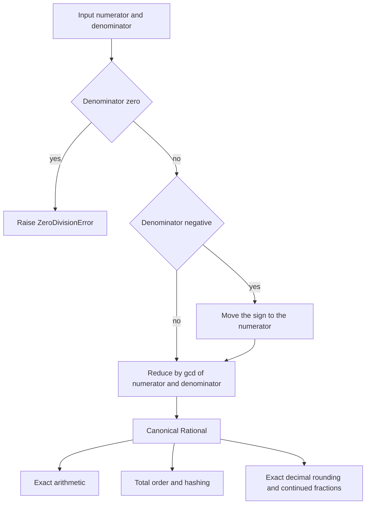
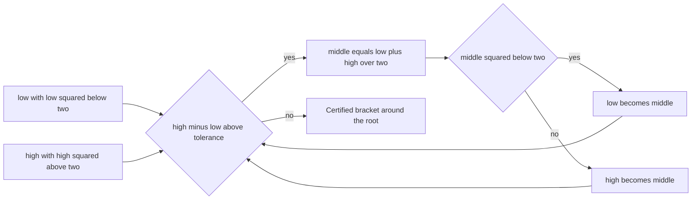
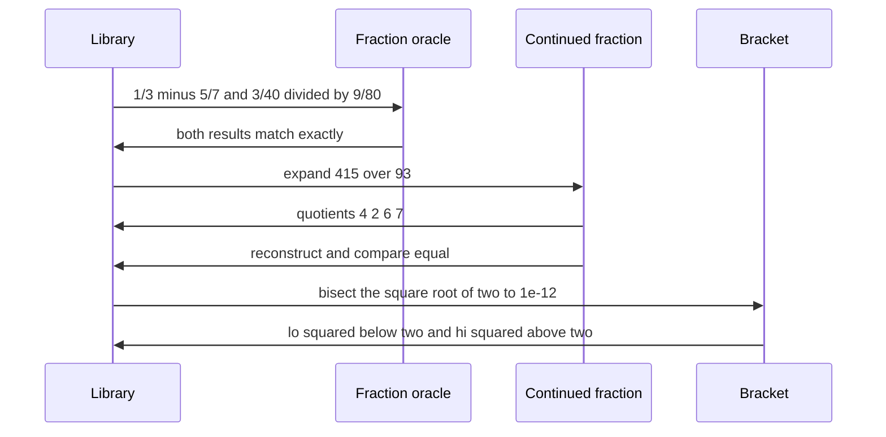

# 944 — Implement high-precision numeric library with arbitrary precision rational arithmetic.

> **Tier:** Master · **CTCI chapter:** Ch Beyond — Numerical and Scientific Computing
> **Task spec:** [944-implement-high-precision-numeric-library-with-arbitrary-precisio.md](../../../tasks/master/944-implement-high-precision-numeric-library-with-arbitrary-precisio.md)
> **Solutions:** [Python](../../../solutions/python/master/944-implement-high-precision-numeric-library-with-arbitrary-precisio/solution.py) ·
> [Java](../../../solutions/java/master/944-implement-high-precision-numeric-library-with-arbitrary-precisio/Solution.java) ·
> [JavaScript](../../../solutions/javascript/master/944-implement-high-precision-numeric-library-with-arbitrary-precisio/solution.js) ·
> [C#](../../../solutions/csharp/master/944-implement-high-precision-numeric-library-with-arbitrary-precisio/Solution.cs)

## 1. Problem restatement

**Modelling contract.** An exact-arithmetic library built on arbitrary-precision integers: a
`Rational` type that normalises every value (sign carried by the numerator, reduced by the greatest
common divisor) and supports exact addition, subtraction, multiplication, division and integer powers;
total ordering; `floor` and `ceil`; continued-fraction expansion and reconstruction; exact decimal
rounding with banker's rounding; and a rational square-root bracket produced by bisection. The headers
are explicit about the limits versus mpmath or gmpy2: **no** transcendental functions, no interval type
beyond the square-root bracket, no precision management beyond the host integers.

**Input.** `Rational(num, den=1)` — a zero denominator raises `ZeroDivisionError`, a negative
denominator is normalised away, and the value is reduced. Coercion (`to_rational`) accepts only
`Rational` or `int` and raises `TypeError` otherwise; `**` accepts only `int` exponents.

**Output.** A normalised `Rational` for every arithmetic operation, plus `decimal(digits)`,
`continued_fraction(terms)`, `floor()`, `ceil()`, `is_integer()`, `float()` and hashing.

| Call | Result | Why |
| --- | --- | --- |
| `Rational(7,9) + Rational(2,15)` | `Rational(41, 45)` | exact addition, reduced |
| `Rational(1,3) - Rational(5,7)` | `Rational(-8, 21)` | sign lives on the numerator |
| `Rational(-22,7) * Rational(49,121)` | `Rational(-14, 11)` | reduction by `gcd(1078, 847) = 77` |
| `Rational(3,40) / Rational(9,80)` | `Rational(2, 3)` | `3/40 · 80/9` |
| `Rational(2,3) ** 5` | `Rational(32, 243)` | integer powers only |
| `Rational(415,93).continued_fraction()` | `(4, 2, 6, 7)` | the classic expansion |
| `from_continued_fraction((4, 2, 6, 7))` | `Rational(415, 93)` | round-trips exactly |
| `Rational(1,8).decimal(2)` | `"0.12"` | banker's rounding on an exact half |
| harmonic sum of `1..20` | `"3.597739657144"` | exact, and within `1e-14` of the float image |

## 2. Intuition

Floating point is a *lossy representation*, and the naive library simply wraps it. The moment you do
that, associativity fails (`(a + b) + c ≠ a + (b + c)` for some triples), exact comparison is
impossible, and any algorithm that depends on an exact tie — banker's rounding, continued fractions,
Pell-type identities — becomes untestable. The insight is to represent a number as a **pair of
integers**, `num/den`, so every operation is defined without rounding.

Three design choices carry the library.

**Canonical form.** Every constructor reduces by `gcd(|num|, den)` and forces the sign onto the
numerator. `Rational(6, 8)` *is* `Rational(3, 4)`; `Rational(6, -8)` is `Rational(-3, 4)`. Because the
representation is canonical, equality is a pair comparison, hashing is consistent
(`hash(Rational(10, 15)) == hash(Rational(2, 3))`), and a `set` of equal rationals has one element —
three properties the file asserts together, since a library that gets normalisation wrong breaks all
three at once.

**Exactness extends to the boundary operations.** `floor` and `ceil` are integer divisions
(`num // den` and `-((-num) // den)`), so `Rational(-7, 2)` floors to `-4` and ceils to `-3`, and
`decimal(digits)` does the rounding *by hand* on scaled integers:
`scaled, remainder = divmod(|num| · 10^d, den)` and then round half to even by inspecting `2·remainder`
against `den`. That is what makes `Rational(1,8).decimal(2) == "0.12"` (the exact half rounds to the
even digit) and `Rational(1,2).decimal(0) == "0"` — no float ever appears.

**Irrationality is handled by bracketing, not by approximation.** `sqrt_bracket(value, tolerance)`
bisects between exact rationals, maintaining the invariant `lo² ≤ value ≤ hi²` until `hi − lo ≤
tolerance`. The bound is *certified* by exact comparisons (`lo·lo &lt; 2 &lt; hi·hi` checked on
rationals, never on floats), and continued fractions give the complementary representation: the
convergents of `sqrt(2)` satisfy the Pell identity `p² − 2q² = ±1`, which is an exact proof of how good
each convergent is.



## 3. Algorithm

1. `Rational(num, den)`: reject `den == 0`; move a negative denominator into the numerator; divide both
   by `gcd(|num|, den)`.
2. Arithmetic: `add` and `sub` cross-multiply, `mul` multiplies numerators and denominators, `div`
   multiplies by the reciprocal, `pow` handles non-negative exponents directly and negative ones by
   inverting. Every result is re-normalised by the constructor.
3. Ordering: cross-multiplication (`num·other.den` against `other.num·den`) makes `==`, `&lt;` and `&le;`
   exact without division.
4. `decimal(digits)`: scale by `10^digits`, take the quotient and remainder, round half to even, then
   splice the decimal point into the digit string; prepend `-` for negative values.
5. `continued_fraction(terms)`: repeated Euclidean division, stopping when the remainder is zero or the
   term budget is exhausted; `from_continued_fraction` reconstructs by Horner form from the back.
6. `sqrt_bracket(value, tolerance)`: start from `[max(1, isqrt(v) − 1), isqrt(v) + 2]` and halve until
   the width is within tolerance, keeping the exact invariant `lo² &lt; v &lt; hi²`.

```text
procedure Rational(num, den)
    if den == 0 then raise ZeroDivisionError end
    if den &lt; 0 then num ← -num, den ← -den end
    common ← gcd(abs(num), den)
    return pair (num / common, den / common)
end

function decimal(value, digits)
    scaled, remainder ← divmod(abs(value.num) * 10 ^ digits, value.den)
    if 2 * remainder &gt; value.den or (2 * remainder == value.den and scaled is odd) then
        scaled ← scaled + 1
    end
    text ← zero-padded string of scaled to at least digits + 1 characters
    body ← text without the last `digits` characters, then a dot, then the last `digits` characters
    return (sign of value.num) concatenated with body
end

function continued_fraction(value, terms)
    num ← value.num, den ← value.den, result ← empty
    while den != 0 and length(result) &lt; terms do
        quotient, remainder ← divmod(num, den)
        append quotient to result
        num, den ← den, remainder
    end
    return result
end

function sqrt_bracket(value, tolerance)
    low ← max(1, isqrt(value) - 1), high ← isqrt(value) + 2
    while high - low &gt; tolerance do
        middle ← (low + high) / 2
        if middle * middle &lt; value then low ← middle else high ← middle end
    end
    return low, high
end
```

`sqrt_bracket` starts from `[1, 3]` for `value = 2`, a width of `2`, and halves it each iteration; the
requirement `hi − lo ≤ 10⁻¹²` therefore needs `⌈log₂(2 · 10¹²)⌉ = 41` halvings, and the resulting
bracket is exact by construction rather than by trust.



## 4. Worked example

**The five arithmetic operations**, each checked against the standard library's `Fraction` as an
independent oracle:

| Operation | Operands | Result | Reduction |
| --- | --- | --- | --- |
| add | `7/9`, `2/15` | `41/45` | `35/45 + 6/45`, already reduced |
| sub | `1/3`, `5/7` | `-8/21` | `(7 − 15)/21` |
| mul | `-22/7`, `49/121` | `-14/11` | `1078/847` reduced by `gcd = 77` |
| div | `3/40`, `9/80` | `2/3` | `240/360` reduced by `gcd = 120` |
| pow | `(2/3)^5` | `32/243` | already reduced |

**Decimal rounding** is where the exactness becomes visible. The rule is round-half-to-even on the
scaled integer:

| Value | Digits | Result | Why |
| --- | --- | --- | --- |
| `1/3` | 10 | `0.3333333333` | exact truncation of a repeating expansion |
| `2/3` | 10 | `0.6666666667` | the remainder exceeds half, so round up |
| `1/8` | 2 | `0.12` | exactly `0.125`: round the `2` down to the *even* digit |
| `3/8` | 2 | `0.38` | exactly `0.375`: round the `3` up to the *even* digit |
| `-1/3` | 4 | `-0.3333` | the sign is applied after rounding the magnitude |
| `1/2` | 0 | `0` | `0.5 → 0`, the even integer |

**Continued fraction of `415/93`** is the Euclidean algorithm written out, which is why it is exact:

| Step | Division | Quotient | Remainder |
| --- | --- | --- | --- |
| 1 | `415 = 4 · 93 + 43` | 4 | 43 |
| 2 | `93 = 2 · 43 + 7` | 2 | 7 |
| 3 | `43 = 6 · 7 + 1` | 6 | 1 |
| 4 | `7 = 7 · 1 + 0` | 7 | 0 → stop |

So `415/93 = [4; 2, 6, 7]`, and Horner reconstruction `4 + 1/(2 + 1/(6 + 1/7))` returns the same
rational exactly. The same machinery applied to `sqrt(2) = [1; 2, 2, 2, …]` yields the Pell
convergents:

| Terms | Convergent `p/q` | `p² − 2q²` |
| --- | --- | --- |
| 1 | `1/1` | −1 |
| 2 | `3/2` | +1 |
| 3 | `7/5` | −1 |
| … | alternating | ±1 |
| 12 | `19601/13860` | +1 |

The alternating `±1` is the exact statement that each convergent is within `1/q²` of `sqrt(2)`, and
`19601/13860` agrees with `math.sqrt(2)` to better than `1e-6` while remaining a rational.

**The square-root bracket** for `sqrt(2)` with tolerance `10⁻¹²`:

| Quantity | Value |
| --- | --- |
| Lower endpoint | `1.41421356237242` |
| Upper endpoint | `1.41421356237333` |
| Width | `≤ 10⁻¹²` |
| Exact invariant | `lo·lo &lt; 2 &lt; hi·hi` (checked on rationals) |

Both endpoints are rationals, so the containment claim is verified by integer arithmetic rather than
by comparing floats. `harmonic(20)` then shows exactness at scale: the sum `1 + 1/2 + … + 1/20` is
`3.597739657144` to twelve digits, its float image differs by less than `1e-14`, and subtracting
`1/20` from it reproduces the exact sum of the first nineteen terms — an identity that floating point
does **not** satisfy. Finally, `2^200 / 3^100` needs `61` and `48` decimal digits for its numerator and
denominator, and `F₂₀₀/F₁₉₉ = 1.618033988750` matches the golden ratio to twelve digits.



## 5. Complexity

| Measure | Bound | Why |
| --- | --- | --- |
| `add` / `sub` | `O(n)` on `n`-digit integers | two multiplications and one `gcd` reduction |
| `mul` / `div` | `O(n log n)` in practice, `O(n²)` schoolbook | integer multiplication dominates; reduction adds one `gcd` |
| `pow` | `O(log e)` big multiplications | binary exponentiation by the host integers |
| `decimal(d)` | `O(n)` plus one `10^d` scaling | a single division into quotient and remainder |
| `continued_fraction(t)` | `O(t · n)` | `t` Euclidean steps, each a division |
| `sqrt_bracket(value, tol)` | `O(log(width / tol))` iterations, each `O(n)` | `41` halvings for `2 / 10⁻¹²`, each an exact compare |
| Space | `O(n)` per value | the pair of integers is the whole state |

The cost model is the interesting part: exactness is bought by *integer size*. Values grow as
operations compose (`2^200 / 3^100` already has `61`-digit components), which is why a real library
adds gcd heuristics and modular reductions — and why an exact library is used for verification and
certification, not for a hot loop.

## 6. Pitfalls and edge cases

- **Zero denominator and division by zero.** `Rational(1, 0)` raises `ZeroDivisionError`, and so does
  `Rational(1,2) / Rational(0,5)`; the reciprocal constructor is the only place division happens.
- **Sign placement.** `Rational(6, -8)` must normalise to `-3/4`; leaving the sign on the denominator
  would break equality and hashing for equal values.
- **Hash consistency.** `hash(Rational(10, 15)) == hash(Rational(2, 3))` holds only because the
  constructor reduces; a non-canonical representation silently breaks `set` and `dict` behaviour.
- **Non-integer exponents.** `Rational(1,2) ** Rational(2)` raises `TypeError` — there is no rational
  power operation, and pretending otherwise would require floats.
- **Banker's rounding, not half-up.** `1/8` at two digits is `0.12`, not `0.13`; the rule inspects
  `2·remainder == den` and rounds to the even digit.
- **Digit splicing.** `Rational(5).decimal(3) == "5.000"` requires zero-padding the scaled integer to
  at least `digits + 1` characters before inserting the point, and `digits = 0` must return the
  rounded integer with no point at all.
- **Continued fractions of negatives and integers.** The expansion of `Rational(-7)` is a single term,
  and `from_continued_fraction(value.continued_fraction()) == value` must hold for `0`, `-7`, `22/7`
  and `355/113`.
- **Bracket invariant, not approximation.** The claim is `lo² &lt; value &lt; hi²` checked on exact
  rationals; comparing `float(lo)` against `math.sqrt(2)` would be a different and weaker statement.
- **Termination tolerance.** The bisection stops on `hi − lo ≤ tolerance`; with `tolerance = 10⁻¹²`
  the width is guaranteed, and the returned endpoints are still rationals of controllable size.

## 7. Variants and follow-ups

- **Use it to make a verifier exact.** The same "no floating-point argument" discipline appears in
  [932 — differential testing between CPU and GPU implementations for numerical ops](../../../tasks/master/932-implement-differential-testing-between-cpu-gpu-implementations-f.md).
- **Certify bounds exactly.** Interval propagation with rational endpoints removes a category of
  soundness doubt: [931 — certified robustness verifier for small networks using interval bound propagation](../../../tasks/master/931-implement-certified-robustness-verifier-for-small-networks-inter.md).
- **Make the privacy claims exact.** Brute-force `delta` sums are exact arithmetic on probability
  vectors: [943 — composable privacy guarantees across combined DP mechanisms](../../../tasks/master/943-implement-composable-privacy-guarantees-across-combined-dp-mecha.md).
- **Budget the big integers.** Precision costs cycles, the same trade-off as compression in
  [934 — distributed gradient compression with error correction under packet loss](../../../tasks/master/934-implement-distributed-gradient-compression-with-error-correction.md).

## 8. Check yourself

<details><summary>Show answer</summary>

**1. Why must the constructor reduce by the gcd?**

Because equality, ordering and hashing are defined on the `(num, den)` pair. Without reduction,
`6/8` and `3/4` would be different objects with different hashes, so `set` membership and dict lookups
would silently fail for mathematically equal values.

</details>

<details><summary>Show answer</summary>

**2. `Rational(-22,7) * Rational(49,121)` gives `-14/11`. Show the reduction.**

`(-22 · 49) / (7 · 121) = -1078/847`. `847 = 7 · 11²` and `1078 = 2 · 7² · 11`, so
`gcd = 7 · 11 = 77`, giving `-14/11`.

</details>

<details><summary>Show answer</summary>

**3. Why is `Rational(1,8).decimal(2)` equal to `"0.12"` and not `"0.13"`?**

Because the library implements banker's rounding. The scaled division gives quotient `12` and a
remainder exactly equal to half the denominator, so the tie rule applies: `12` is even, so it stays.
`3/8` (`0.375`) rounds the odd `37` up to the even `38`, giving `"0.38"`.

</details>

<details><summary>Show answer</summary>

**4. What does the Pell identity `p² − 2q² = ±1` prove about the convergents of `sqrt(2)`?**

That each convergent `p/q` satisfies `|p/q − √2| = 1/(q²(p/q + √2))`, so the error is smaller than
`1/q²`. The identity is exact — it is checked with integers, not floats — which is why the library
uses it as a test rather than comparing against `math.sqrt(2)`.

</details>

<details><summary>Show answer</summary>

**5. Why does the harmonic-sum check subtract `1/20` and compare against the sum of the first 19
terms?**

Because that identity holds exactly in rational arithmetic and generally fails in floating point
(rounding makes `Σ₁²⁰ 1/k − 1/20` differ from `Σ₁¹⁹ 1/k`). It is a compact demonstration that the
library's results are exact rather than merely close, and the file also asserts the float image agrees
to `1e-14` — exactness plus sanity, not exactness instead of sanity.

</details>
