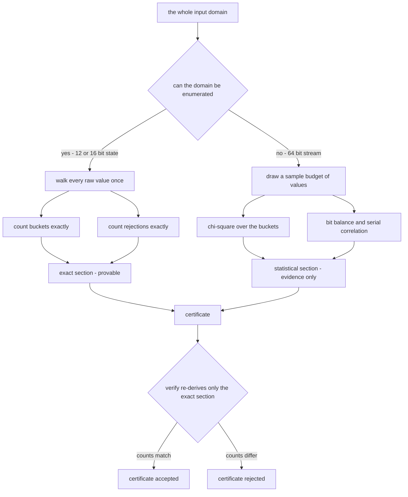
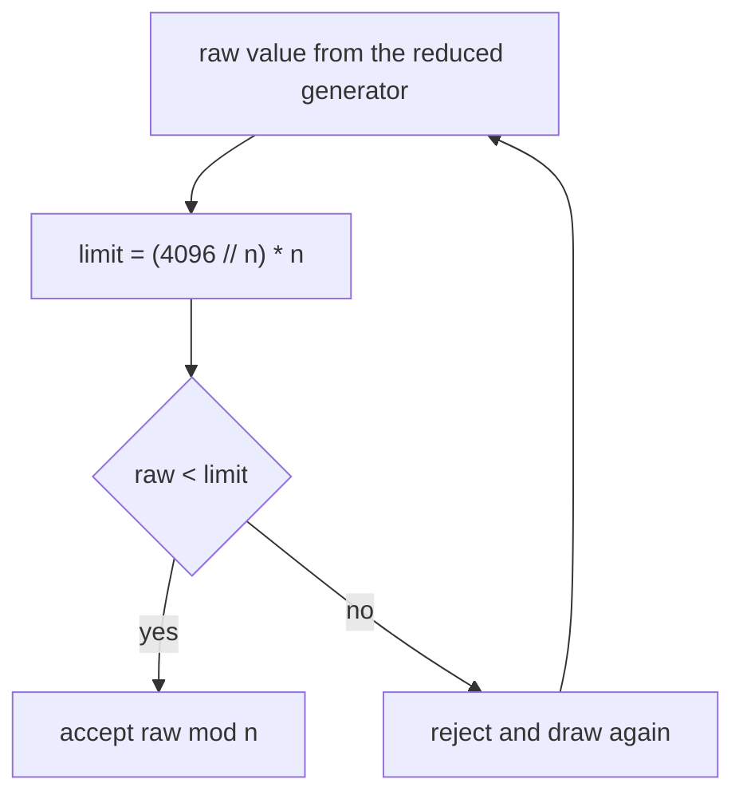
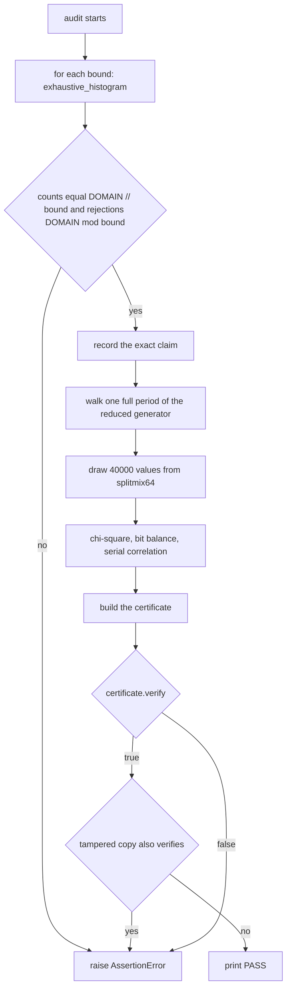
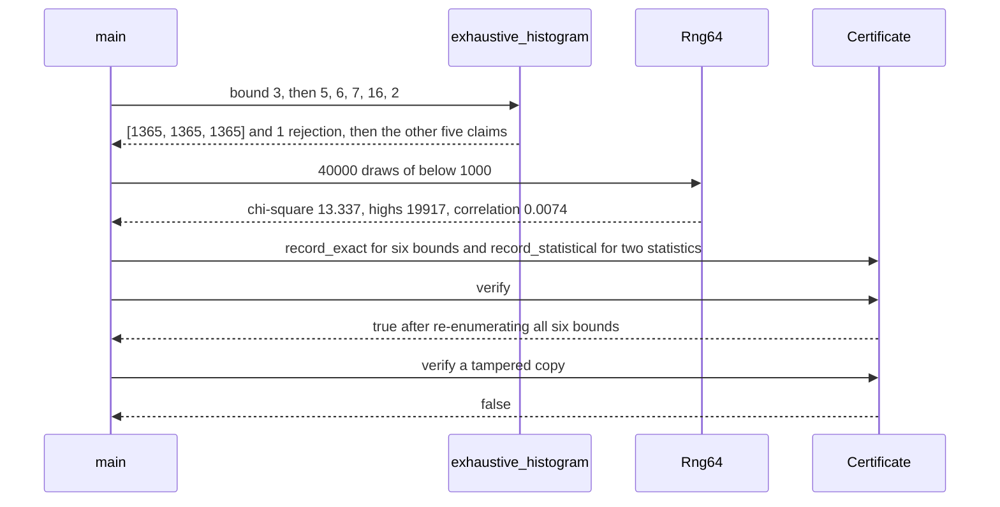

# 945 — Implement certified random number generator with proof of uniformity (small demo).

> **Tier:** Master · **CTCI chapter:** Beyond — Security & Privacy
> **Task spec:** [945-implement-certified-random-number-generator-with-proof-of-unifor.md](../../../tasks/master/945-implement-certified-random-number-generator-with-proof-of-unifor.md)
> **Solutions:** [Python](../../../solutions/python/master/945-implement-certified-random-number-generator-with-proof-of-unifor/solution.py) ·
> [Java](../../../solutions/java/master/945-implement-certified-random-number-generator-with-proof-of-unifor/Solution.java) ·
> [JavaScript](../../../solutions/javascript/master/945-implement-certified-random-number-generator-with-proof-of-unifor/solution.js) ·
> [C#](../../../solutions/csharp/master/945-implement-certified-random-number-generator-with-proof-of-unifor/Solution.cs)

## 1. Problem restatement

**The modelling contract first.** The four files build an *in-process deterministic simulation* of a
certified randomness service: no operating-system entropy source, no clock, no threads, no device.
Every value comes from a counter-based generator written out by hand — splitmix64 for the 64-bit
stream, plus a *reduced-width* generator whose whole state space can be walked. The certificate is an
in-memory record with two deliberately separated sections: an **exact** section that is *proved* by
exhaustive enumeration, and a **statistical** section that is *evidence only* and is never re-judged
by `verify()`.

**Inputs.** A bound `n` (exclusive upper end of the range), a 64-bit seed, a sample budget, the width
of the reduced generator. In the Python file the width is 12 bits, so `DOMAIN = 2^12 = 4096` and every
legal bound lies in `[1, 4096]`.

**Outputs.** Values in `[0, n)`; for each audited bound the exact histogram and the exact rejection
count; a `Certificate` that re-derives its exact claims on demand.

The same contract is instantiated at different widths and precisions:

| File | Provable part | Range mapping | Statistical part |
| --- | --- | --- | --- |
| Python | 12-bit counter, odd increment `0x5BD`, period 4096 | rejection with `limit = (4096 // n) * n` | chi-square over 10 buckets, bit balance at `value ≥ 500`, serial correlation |
| Java | 16-bit LCG of full period 65536, expanded exhaustively | Lemire multiply-shift for the 64-bit stream: low word decides rejection, high word is returned | reproduction of the enumerated counts |
| JavaScript | 16-bit LCG, a bijection of the 2^k state space when `c` is odd and `a ≡ 1 mod 4` | rejection sampling counted over one whole period | chi-square over 100 bins |
| C# | splitmix64 with a fixed sample budget | — | chi-square over 16 bins, two-dimensional serial chi-square, Kolmogorov–Smirnov against `1.36/sqrt(N)`, monobit with a four-sigma band |

Concrete results, all from the Python file's assertions and its printed run:

| Call | Result | Source of the claim |
| --- | --- | --- |
| `exhaustive_histogram(n)` for 2, 3, 5, 6, 7, 16 | rejections `{2: 0, 3: 1, 5: 1, 6: 4, 7: 1, 16: 0}` — exactly `4096 mod n` | printed; asserted in the same shape in Java and C# |
| bucket counts for those bounds | exactly `4096 // n` in *every* bucket (1365 for 3, 256 for 16) | asserted |
| `n = 1` / `n = 4096` | one bucket of 4096 / 4096 buckets of one, zero rejections either way | boundary assertion |
| period of the reduced generator | 4096 distinct states before repetition | full-period assertion |
| 40 000 draws of `below(1000)`, bucketed by `value % 10` | chi-square `13.337`, inside the 9-degrees-of-freedom 1% tail `21.666` | printed |
| bit balance and serial correlation of the same draws | `19 917` draws at `value ≥ 500` against 20 000 expected (3 sigma = 300); correlation `0.0074` | printed |
| 4096 seeds, one draw each | all 1000 values covered, mean within 60 of 499.5 | asserted |
| bounds 0, -3, 4097 / tampered certificate | `ValueError` / `verify()` false while the real certificate returns true | asserted |

## 2. Intuition

The naive submission is a test harness: draw `N` samples, compute a chi-square, print "uniform" when
the statistic is small. It fails for three reasons. A hypothesis test can only reject, never confirm.
Its power is weak exactly where bias matters — a relative bias of `1/n` needs on the order of `n²`
samples before the chi-square notices. And a 1% tail means one run in a hundred fails on a perfectly
good generator.

The insight is to **split the claim by domain size**. Where the state space can be enumerated,
uniformity stops being statistical and becomes counting:

```text
limit  = (DOMAIN // n) * n
accept ⟺ raw < limit
value  = raw % n
```

Over the whole domain exactly `DOMAIN // n` raw values land in each bucket and exactly `DOMAIN mod n`
are rejected. Nothing is sampled and nothing depends on the seed. Where the state space is too large
to enumerate — 2^64 words — the same mapping is still used, but its guarantee is downgraded from
*proof* to *evidence* and parked in a section that `verify()` ignores.



The second insight is small and has a large effect: **a rejection rule needs a rejection count, not an
estimate of one.** `4096 mod 3 = 1` says precisely one raw value in 4096 is thrown away, so a draw
costs `4096 / 4095` raw values on average — a number you can quote without measuring anything.



## 3. Algorithm

1. For each bound 2, 3, 5, 6, 7, 16 enumerate the domain, record exact counts and rejections, and
   assert `counts == [4096 // n] * n` and `rejected == 4096 % n`.
2. Check the boundaries: `n = 1` gives one bucket of 4096, `n = 4096` gives 4096 buckets of one, both
   with zero rejections, and `n = 4096` passes the raw value through unchanged.
3. Walk the reduced generator for a whole period and assert 4096 distinct states — the odd increment
   is what makes the counter a bijection of the state space.
4. Run 40 000 draws of `below(1000)` from splitmix64, bucket by `value % 10`, and assert the
   chi-square lies in `(0, 21.666)` with every bucket within 400 of 4000.
5. Reuse the draws for bit balance (3 sigma band) and serial correlation (absolute value below 0.02).
6. Draw once from each of the 4096 seeds and assert full coverage of 1000 buckets with a mean near
   499.5.
7. Assert seed reproducibility, seed independence, and that bounds 0, -3 and 4097 raise `ValueError`.
8. Build the certificate, verify it, and verify that a tampered copy fails.

```text
procedure debiased(raw, bound)
    if bound &lt; 1 or bound &gt; DOMAIN then
        signal ValueError
    end
    limit = (DOMAIN // bound) * bound
    if raw &lt; limit then
        return accepted, raw mod bound
    end
    return rejected, -1
end

procedure exhaustive_histogram(bound)
    counts = array of bound zeros
    rejected = 0
    for raw = 0 to DOMAIN - 1 do
        accepted, value = debiased(raw, bound)
        if accepted then
            counts[value] = counts[value] + 1
        else
            rejected = rejected + 1
        end
    end
    return counts, rejected
end

procedure draw_below(generator, bound)
    loop
        accepted, value = debiased(generator.next(), bound)
        if accepted then
            return value
        end
    end
end
```

`certificate_verify` is the same walk in reverse: it refuses a certificate whose `exact` section is
empty, then for every recorded bound re-runs `exhaustive_histogram` and compares both the counts and
the rejection count, returning false at the first mismatch and true only if all of them agree. The
64-bit path reuses the same predicate: it feeds the top 12 bits of each splitmix64 word to `debiased`,
so one function serves both generators.



## 4. Worked example

Take `bound = 3` on the 12-bit domain. Then `limit = (4096 // 3) * 3 = 1365 * 3 = 4095`, so the 4096
raw values split into exactly two groups:

| Raw range | Count | Outcome | Bucket contribution |
| --- | --- | --- | --- |
| 0 … 4094 | 4095 | accepted | 1365 values into each of buckets 0, 1, 2 |
| 4095 | 1 | rejected | — |

`4095 mod 3 = 0`, so the accepted run is perfectly cyclic. The same arithmetic over every audited
bound reproduces the printed rejection table:

| Bound `n` | `limit` | Accepted | `4096 // n` per bucket | `4096 mod n` rejected |
| --- | --- | --- | --- | --- |
| 2 | 4096 | 4096 | 2048 | 0 |
| 3 | 4095 | 4095 | 1365 | 1 |
| 5 | 4095 | 4095 | 819 | 1 |
| 6 | 4092 | 4092 | 682 | 4 |
| 7 | 4095 | 4095 | 585 | 1 |
| 16 | 4096 | 4096 | 256 | 0 |

The rejected mass *is* the proof: the surviving values are equinumerous by construction, so no bias
can hide in the mapping whatever the seed is. The generator's period is a second obligation —
starting at state 1 and adding `0x5BD = 1469` modulo 4096 each step, the walk returns to 1 only after
all 4096 states, which is why the file asserts `INCREMENT % 2 == 1`: an even increment would cut the
period in half.

The statistical half runs on a different generator and is reported as a band, never an equality:

| Measurement | Statistic | Band in the file | Verdict |
| --- | --- | --- | --- |
| 10-bucket chi-square over 40 000 draws | 13.337 | `&lt; 21.666` | passes |
| bit balance at `value ≥ 500` | 19 917 | within `3 * sqrt(40000 / 4) = 300` of 20 000 | passes |
| serial correlation of consecutive draws | 0.0074 | absolute value below 0.02 | passes |

Note which column does the proving: the chi-square depends on the seed and the budget, the histogram
counts depend on nothing. What `main()` does with both:



## 5. Complexity

Let `D = 4096`, `n` the bound, `N` the statistical sample budget. "Time" counts draws and loop
iterations, never wall-clock seconds.

| Measure | Bound | Why it holds |
| --- | --- | --- |
| `debiased` | `O(1)` | one division, one multiplication, one comparison |
| `exhaustive_histogram(n)` | `O(D)` time, `O(n)` space | every raw value of the domain is visited once |
| Full audit of six bounds | `6 · D` = 24 576 visits | each bound re-enumerates the domain |
| `draw_below` expected | `O(1)` attempts | rejection probability `(D mod n) / D`, at most `(n - 1) / D` over the tested bounds |
| `draw_below` worst case | geometric tail, no cap | the loop has no iteration limit |
| Statistical battery | `O(N)` | 40 000 draws plus one pass per statistic |
| `certificate_verify` | `O(bounds · D)` | every exact claim is re-derived from scratch |
| Certificate space | `O(sum of bounds)` | stored histograms plus two scalars |

The statistics-only design is *cheaper* — `O(N)` instead of `O(D)` — and that is the trade this task
is about: it cannot separate "the generator is uniform" from "this seed got lucky". The honest limits,
spelled out in the Python docstring, are that the exactness claim covers the 12-bit domain only (2^64
values cannot be walked), that the battery is minimal compared with NIST SP 800-90B (no entropy
estimator, no health test), and that `verify()` deliberately says nothing about the statistical
section — a rewritten chi-square entry leaves `verify()` true, because the evidence channel is not a
tamper seal.

## 6. Pitfalls and edge cases

- **Modulo bias.** `raw % n` alone is biased: for `n = 3` the low buckets would get 1366 values and
  bucket 2 only 1365. The `limit` gate removes exactly those extras, and the rejection count is
  `D mod n`, never "roughly".
- **`n = 1` and `n = D`.** Neither rejects anything: `n = 1` returns 0 for every draw, `n = D` returns
  the raw value unchanged — the file compares `draw_below(Rng12(9), DOMAIN)` with `Rng12(9).next()`.
- **Illegal bounds.** 0, negatives and `D + 1` raise `ValueError`; clamping them silently would turn a
  caller's bug into a biased stream nobody notices.
- **Even increments.** Full period needs `gcd(increment, 2^k) = 1`; the Java and JavaScript variants
  state the LCG form of the same condition (`c` odd, `a ≡ 1 mod 4`).
- **`serial_correlation` divides by the variance.** A constant stream makes the denominator 0, so the
  statistic is only meaningful on the varying 40 000-draw sample.
- **Statistics are seed and budget dependent.** The printed chi-square is what that seed produced with
  that budget; the assertions are bands, so a different seed gives a different number inside the band.
- **`verify()` is not a signature.** A tampered `exact` entry fails because the counts are re-derived,
  but an edit confined to `statistical` still verifies — use a hash chain (task 913) for tamper
  evidence.
- **splitmix64 is not a CSPRNG.** A full 2^64 period and seed independence do not make it safe for
  keys: the file frames the result as a uniformity demo, not a cryptographic one.
- **Width is a cost decision.** Raising the enumerable width to 16 bits (Java, JavaScript) multiplies
  the audit by 16; 32 bits makes exhaustive proof impractical, which is when the provable section has
  to shrink.

## 7. Variants and follow-ups

- **Make rejection vanish.** Choose the domain as a multiple of `n` and the mapping is exact with no
  rejection at all; the 16-bit variants expand the whole 65536-state period through the bucketing step
  and count each bucket exactly.
- **Lemire instead of rejection for the big stream.** The Java file forms the 64×64 → 128-bit product,
  reads the low word to decide rejection and returns the high word: uniform on `[0, n)` with rejection
  probability below `n / 2^64`, one multiplication instead of two divisions.
- **Prove bounds instead of testing.** [901-implement-provable-bounds-for-randomized-algorithms-used-in-your.md](../../../tasks/master/901-implement-provable-bounds-for-randomized-algorithms-used-in-your.md)
  is the general form of the counting argument used here for the rejection mass.
- **Certify the consumer, not the stream.** [913-implement-verified-randomized-algorithm-reproducibility-with-see.md](../../../tasks/master/913-implement-verified-randomized-algorithm-reproducibility-with-see.md)
  chains per-step substreams into a tamper-evident log, and
  [908-implement-certified-ml-predictions-with-conformal-prediction-int.md](../../../tasks/master/908-implement-certified-ml-predictions-with-conformal-prediction-int.md)
  applies the same "issue a certificate, state what it does not cover" pattern to predictions.

## 8. Check yourself

1. Why can the exact section claim uniformity *for every seed*, while the statistical section cannot?

<details><summary>Show answer</summary>

`exhaustive_histogram` never draws: it walks all 4096 raw values and shows that exactly `4096 // n`
accepted values reach each bucket. That is a statement about the mapping, so it holds for every seed.
The statistical section measures one finite path through a 2^64 state space, so it can only bound the
probability of gross bias on that sample.

</details>

2. For `D = 4096` and `n = 7`, how many raw values are rejected and what is the expected draw cost?

<details><summary>Show answer</summary>

`limit = 585 * 7 = 4095`, so one value in 4096 is rejected and the expected number of raw draws per
accepted value is `4096 / 4095 ≈ 1.00024`. The file asserts the rejection count as `4096 % 7 == 1`.

</details>

3. A colleague edits only the recorded chi-square. What does `verify()` return?

<details><summary>Show answer</summary>

True — `verify()` iterates the `exact` section only, so a rewritten statistical entry is invisible.
The certificate is a reproducibility device for provable claims, not a tamper seal; detecting edits of
the evidence channel needs a digest over the whole record, as in the audit-log task 913.

</details>

4. Why does an even increment break the full-period property of the reduced counter?

<details><summary>Show answer</summary>

Adding an even constant modulo 4096 preserves the parity of the state, so the walk is trapped in a
coset of size 2048 and never reaches the other half of the state space. Coprimality with 2^12 —
guaranteed by an odd increment — is what makes the map a single 4096-cycle.

</details>

5. The chi-square passes on one seed. Does the certificate claim anything about *other* seeds?

<details><summary>Show answer</summary>

The exact section does — it enumerates the mapping and never looks at a seed. The statistical section
does not: it measured one finite path, so all it can bound is the probability of gross bias on that
sample. Anything below the resolution of 40 000 samples, including a relative bias of `1 / 4096` in
one bucket, is invisible to it.

</details>
