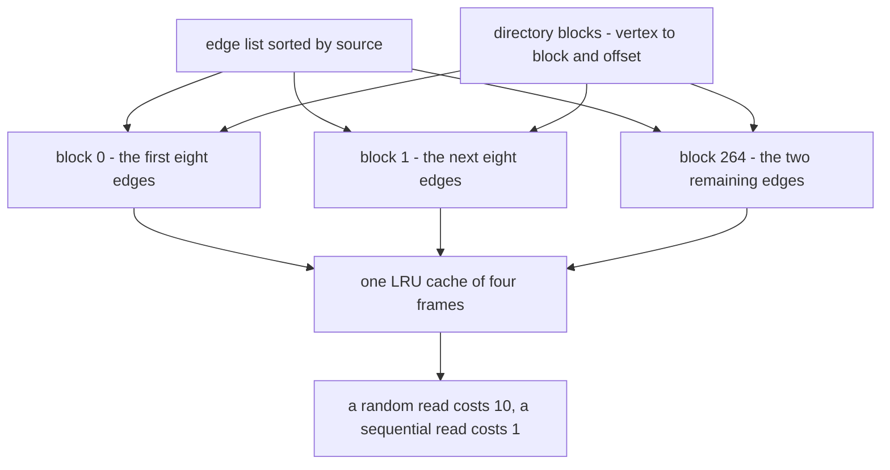
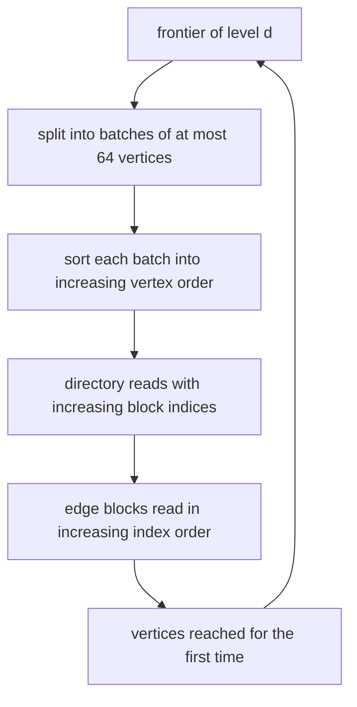
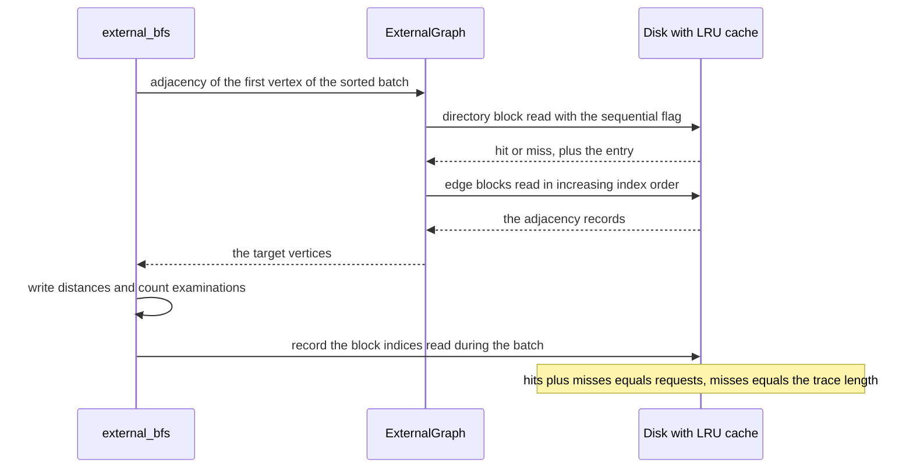

# 946 — Implement high-performance external-memory graph traversal with partitioning.

> **Tier:** Master · **CTCI chapter:** Ch 9 — System Design and Scalability
> **Task spec:** [946-implement-high-performance-external-memory-graph-traversal-with.md](../../../tasks/master/946-implement-high-performance-external-memory-graph-traversal-with.md)
> **Solutions:** [Python](../../../solutions/python/master/946-implement-high-performance-external-memory-graph-traversal-with/solution.py) ·
> [Java](../../../solutions/java/master/946-implement-high-performance-external-memory-graph-traversal-with/Solution.java) ·
> [JavaScript](../../../solutions/javascript/master/946-implement-high-performance-external-memory-graph-traversal-with/solution.js) ·
> [C#](../../../solutions/csharp/master/946-implement-high-performance-external-memory-graph-traversal-with/Solution.cs)

## 1. Problem restatement

**The modelling contract first.** The four files build a *block-level external-memory model* running
in one process: no file, no syscall, no thread, no page fault, no latency. The edge set lives in a
list of fixed-size **blocks**, blocks are reached only through an **LRU cache**, and every physical
read is charged by a two-constant cost model — a *random* read costs 10 units, a *sequential* read
costs 1. That is exactly the simplification the Python docstring admits: blocks in a list instead of a
file, a semi-external model whose visited set fits in memory, and two constants instead of measured
latencies.

**Inputs and knobs.** Python's defaults: `BLOCK = 8` edges per block, `DIR_BLOCK = 16` directory
entries per block, `RANDOM_COST = 10`, `SEQUENTIAL_COST = 1`, an LRU cache of 4 frames shared by the
directory and the edge file, a per-batch memory budget of 64 frontier vertices, and a start vertex.

**Outputs.** A distance map that must equal an in-memory BFS oracle, the number of edge examinations,
the peak batch size, the per-pass read log, and the modelled I/O cost.

| File | Layout | Device model | Levers compared |
| --- | --- | --- | --- |
| Python | edge blocks sorted by source plus a blocked directory, one LRU cache for both arrays | random read 10, sequential read 1 | sorted batches versus FIFO frontier; cache capacities 0, 2, 8, 32 |
| Java | pages sorted by source vertex with an in-memory index of each vertex's record range | buffer pool of `C` frames with true LRU, counting page reads and evictions | frontier in discovery order (thrashing) versus sorted by page id |
| JavaScript | vertices clustered into fixed-size pages | page transfers plus seeks (a read that is not sequential with the previous one) | random versus BFS-clustered page assignment; sorted versus unsorted frontier reads |
| C# | fixed-size contiguous vertex blocks whose adjacency lives "on disk" | LRU page cache counting hits, misses and I/O | cost measured in block reads rather than edge visits |

Concrete results, from the Python file's printed run and its assertions:

| Call | Result | Source of the claim |
| --- | --- | --- |
| `build_graph(300, 6, 40)` | 2114 distinct edges, 300 reachable vertices | printed as `vertices=300 edges=2114` |
| layout | 19 directory blocks plus 265 edge blocks, 9 passes | printed as `blocks=265 passes=9` |
| `external_bfs(fast_graph, 0)` | distances equal the oracle; `examined=2114` | printed and asserted against the degree sum |
| peak batch | 64, i.e. exactly the memory budget | printed as `peak_batch=64`, asserted `peak ≤ 64` |
| partitioned cost | 607, all sequential (`fast.disk.random_reads == 0`) | printed as `partitioned_cost=607` |
| FIFO baseline | 8640 from 864 random reads | printed as `random_access_cost=8640` |
| physical reads | 607 partitioned versus 864 baseline, 257 cache hits | printed as `reads 607 vs 864` |

| empty graph | `{0: 0}` with zero disk requests | asserted |
| isolated pair `(7, 9)` | from 7: `{7: 0, 9: 1}`; from 5: `{5: 0}` alone | asserted |
| all 300 start vertices | every BFS matches the oracle, and their union is the vertex set | asserted |

## 2. Intuition

Start with the obvious traversal: a FIFO queue, pop a vertex, pull its adjacency off the device, push
the neighbours. Every pull is an independent random access into a large structure, so it pays the
random price — 10 units in this model, a seek plus a rotation on real hardware. In the printed run
that strategy costs 8640.

The fix has two halves, and both are about *who decides the order of reads*:

1. **Partition the file by source vertex**, so a vertex's adjacency is contiguous: one adjacency costs
   one block touched, not one block per edge, and the blocks of a vertex are adjacent.
2. **Sort the frontier before touching it.** Discovery order has nothing to do with block order. A
   sorted batch walks the directory and the edge file in increasing block index, so consecutive reads
   are sequential, the cache is used well, and each touched block is paid for once.

Sorting is what converts random reads into sequential reads, and that is where the factor of 10 goes:
the same traversal that costs 8640 becomes 607.





## 3. Algorithm

1. Sort the edge set by source vertex and chop it into blocks of `BLOCK` edges; the last block may be
   shorter (here 2 edges).
2. Build the directory: one entry `(source, block index, offset)` per source — only the *first*
   occurrence, since the sort guarantees the rest follow it — then chop the directory into blocks of
   `DIR_BLOCK` entries and record a map from source to `(directory block, position)`.
3. Concatenate the directory blocks and the edge blocks into one address space, put a single LRU cache
   in front of it, and remember `edge_offset`, the number of directory blocks.
4. `adjacency(vertex, sequential)` reads the directory entry, then walks edge blocks *forward* from
   that entry, collecting targets while `source == vertex`, and stops as soon as `source > vertex`.
5. `external_bfs` processes the frontier level by level in batches of at most `memory` vertices, each
   batch **sorted**, logging the block indices each batch touched.
6. Distances are written the first time a vertex is seen, so each reached vertex is expanded once and
   the examination counter equals the degree sum of the reached vertices.
7. `naive_bfs` walks the FIFO frontier and marks every read as random — the baseline the cost model is
   calibrated against.

```text
procedure build_external_graph(edges, block_size, dir_size)
    sorted_edges = sort edges by source
    edge_blocks = split sorted_edges into chunks of block_size
    first = []
    for each block_index and block in edge_blocks do
        for each offset and edge in block do
            if first is empty or last entry of first has source != edge.source then
                append source, block_index, offset to first
            end
        end
    end
    dir_blocks = split first into chunks of dir_size
    location = map from source to its directory block and position
    return edge_blocks, dir_blocks, location, number of directory blocks
end

procedure adjacency(graph, vertex, sequential)
    if vertex is not in graph.location then
        return empty sequence
    end
    dir_index, position = graph.location[vertex]
    entry = graph.disk.read(dir_index, sequential)[position]
    block_index = graph.edge_offset + entry.block
    offset = entry.offset
    targets = []
    while block_index is inside the edge file do
        block = graph.disk.read(block_index, sequential)
        while offset < length(block) do
            source, target = block[offset]
            if source > vertex then
                return targets
            end
            if source == vertex then
                append target to targets
            end
            offset = offset + 1
        end
        block_index = block_index + 1
        offset = 0
    end
    return targets
end

procedure external_bfs(graph, start, memory)
    distance = map with start mapped to 0
    frontier = list containing start
    examined = 0
    peak = 0
    passes = []
    while frontier is not empty do
        following = []
        for each batch of at most memory vertices from frontier do
            sorted_batch = sort batch
            peak = maximum of peak and length of sorted_batch
            mark = current length of the disk trace
            for each vertex in sorted_batch do
                for each target in adjacency(graph, vertex, true) do
                    examined = examined + 1
                    if target is not in distance then
                        distance[target] = distance[vertex] + 1
                        append target to following
                    end
                end
            end
            append the block indices read since mark to passes
        end
        frontier = following
    end
    return distance, examined, peak, passes
end
```

The cache is the only mutable device state, and it accounts for everything: a request is a hit (and
moves the block to the most-recent end) or a miss (which inserts the block, evicts the least-recently
used frame when the capacity is exceeded, and charges the read as sequential or random according to
the caller's flag). Every miss is appended to a read trace, which is what makes the locality claims
below checkable rather than asserted by faith.

## 4. Worked example

The run builds a 300-vertex graph from a path plus deterministic shortcuts — 6 long-range edges per
source plus 40 extra pairs, deduplicated and self-loop-filtered — giving **2114 edges** over 300
distinct sources. Blocks of 8 edges give `ceil(2114 / 8) = 265` edge blocks, `ceil(300 / 16) = 19`
directory blocks, and `edge_offset = 19`; the last edge block holds 2 edges.

Level by level, as measured by re-running the module's own `external_bfs`:

| Level | Vertices at this distance | Batches of ≤ 64 | Passes | Block reads logged |
| --- | --- | --- | --- | --- |
| 0 | 1 | 1 | 1 | 3 |
| 1 | 8 | 1 | 1 | 18 |
| 2 | 51 | 1 | 1 | 107 |
| 3 | 172 | 3 (64, 64, 44) | 3 | 124, 128, 94 |
| 4 | 67 | 2 (64, 3) | 2 | 122, 8 |
| 5 | 1 | 1 | 1 | 3 |
| total | 300 reached | 9 | 9 | 607 |

Two things to read out of it: six levels become **nine passes** because a level wider than the budget
is cut into sorted batches, and a block may legitimately be read again in a later pass — 607 reads
over a file of `19 + 265 = 284` blocks.

The cost comparison is the whole point:

| Strategy | Physical reads | Read kinds | Modelled cost | Read-order locality |
| --- | --- | --- | --- | --- |
| partitioned, sorted batches, cache of 4 | 607 (257 hits of 864 requests) | 607 sequential, 0 random | `607 × 1 = 607` | every pass's directory indices and edge indices are each non-decreasing |
| FIFO frontier, cache capacity 0 | 864 | 0 sequential, 864 random | `864 × 10 = 8640` | the baseline's read order is asserted *not* sorted |

The same traversal therefore touches fewer blocks *and* touches them in an order the device likes — 14×
cheaper under the model — and the assertion is written as an inequality (`fast_cost < slow_cost`) plus
`examined == degree_sum == 2114` and `peak ≤ 64`, so it survives a change of graph.

The capacity sweep is the second experiment, and more frames never cost more physical reads: capacity
0 misses 864 times (that *is* the baseline), capacity 2 misses 779, the default 4 misses 607, capacity
8 misses 606, and capacity 32 still misses 599 — because the traversal re-reads the same blocks in
nine passes, and with a 284-block file and 32 frames eviction between passes is unavoidable. The
accounting is asserted airtight: `hits + misses == requests`, `random_reads + sequential_reads ==
misses == len(trace)`, and `hits > 0`, so a run that quietly degenerated to capacity 0 cannot pass as
the partitioned strategy.



## 5. Complexity

Let `E` be the edge count, `V` the vertex count, `B` the block size, `D` the number of levels and `M`
the memory budget. "Cost" is the modelled unit count, never seconds.

| Measure | Bound | Why it holds |
| --- | --- | --- |
| Build blocks and directory | `O(E log E)` time, `O(E + V)` space | the sort dominates; one pass over the sorted list finds each source's first entry |
| One `adjacency` | `O(deg(v))` edge visits, `O(deg(v) / B + 1)` block reads | forward scan until `source > vertex` |
| Traversal work | `O(E)` examinations | each reached vertex is expanded once, so the total is the degree sum |
| Reads, partitioned | at most one read per touched block per pass, each sequential | the pass walks blocks in increasing index order |
| Modelled cost, partitioned | `1 × reads` | every read is sequential (`random_reads == 0`) |
| Modelled cost, baseline | `10 × reads` | every read is charged as random |
| Memory | `O(V)` distances, `O(M)` batch, `O(capacity)` cache | semi-external: only the visited set and one batch are in memory |

Two limits belong in this table. The constants 10 and 1 are a *model*, not a measurement: they stand in
for seek-plus-rotate versus streaming, and the file never claims to have timed a disk. And the costs a
production engine also pays — write-back, dirty-page eviction, prefetch misses, lock contention — are
absent, as the docstring says.

## 6. Pitfalls and edge cases

- **An unsorted frontier defeats the layout.** Without the `sort`, a level is read in discovery order;
  the file asserts the baseline's read order is *not* sorted, which is the negative control for the
  locality claim.
- **The edge file must be sorted by source.** The directory stores only each source's first entry and
  `adjacency` stops at the first larger source, so an unsorted file silently truncates adjacency lists
  instead of failing loudly.
- **Self-loops and duplicates.** `build_graph` filters `source == target` and deduplicates through a
  set; otherwise the degree sum would drift away from `examined`.
- **Unknown start vertex.** `external_bfs(isolated, 5)` returns `{5: 0}` although vertex 5 has no
  directory entry, because `adjacency` returns an empty sequence instead of reading a bogus block;
  an empty graph likewise performs zero disk requests.
- **Cache capacity 0.** Insert-then-evict still works and yields zero hits; a guard rejecting 0 would
  destroy the very baseline the cost comparison needs.
- **Metrics must be recorded, not inferred.** A cost model is only as good as its accounting, which is
  why `hits + misses == requests` and `misses == len(trace)` are asserted rather than assumed.
- **The last block is short.** Block 264 holds `2114 - 264 × 8 = 2` edges, so every loop must use the
  block's own length rather than `BLOCK`.
- **Peak batch versus memory.** The batch is cut at `memory`, so the guarantee is a bound on vertices
  held at once (`peak ≤ 64`), not a statement about how wide a level can become.

## 7. Variants and follow-ups

- **Change the partitioner, not the traversal.** [947-implement-large-scale-graph-partitioner-with-balance-and-cut-heu.md](../../../tasks/master/947-implement-large-scale-graph-partitioner-with-balance-and-cut-heu.md)
  asks the same locality question as an optimisation: assign vertices to parts so the cut is small and
  the parts are balanced, and every part becomes a block a traversal can stream.
- **Test a property instead of traversing everything.** [948-implement-sublinear-time-algorithms-for-property-testing-on-grap.md](../../../tasks/master/948-implement-sublinear-time-algorithms-for-property-testing-on-grap.md)
  inspects a sublinear number of adjacency entries with two-sided error — the only way to say anything
  about a graph too large to scan.
- **Never materialise the frontier.** [949-implement-approximate-maximum-matching-in-huge-graphs-with-strea.md](../../../tasks/master/949-implement-approximate-maximum-matching-in-huge-graphs-with-strea.md)
  keeps one pass over the edge stream and `O(V)` bits of state, trading exactness for a single scan
  where this task trades random reads for sorted ones.
- **Tune the device model.** The JavaScript variant adds a *seek* counter for reads that are not
  sequential with the previous one and compares random against BFS-clustered page assignment, which
  separates the layout question from the batch-ordering question.
- **Let a real engine do it.** The Java variant's buffer pool of `C` frames with true LRU is the
  classic buffer-manager contract; the Python model's four-frame cache is its smallest useful version.

## 8. Check yourself

1. Where does the factor of 14 come from — fewer reads, or cheaper reads?

<details><summary>Show answer</summary>

Both, in this run. The partitioned traversal issues 607 physical reads against 864 (fewer, because each
touched block is read once per pass and 257 of the 864 requests are cache hits), *and* each of its
reads is sequential, which the model charges 1 instead of 10. The assertion that isolates the second
effect is `fast.disk.random_reads == 0`.

</details>

2. Why does sorting a batch matter if the cache is LRU and the batches are small?

<details><summary>Show answer</summary>

The device pays per miss and per read kind. In increasing block order, consecutive requests hit
neighbouring blocks, so the pass is a sweep: one miss, one sequential read, and the rest of the
neighbourhood is already resident. In discovery order the same blocks are requested scattered, so
requests tend to miss and are charged at the random price — thrashing, which the Java file's buffer
pool reproduces with the same number of frames.

</details>

3. `examined` equals 2114, the degree sum of the reached vertices. What would make it larger?

<details><summary>Show answer</summary>

Expanding a vertex twice — for instance if a distance were written after enqueueing, or if a vertex
were appended to the next frontier once per incoming edge within the same level. The file guards this
by checking `target not in distance` before both writing the distance and appending to `following`.

</details>

4. Why is the peak batch asserted as `≤ 64` instead of equal to the frontier size?

<details><summary>Show answer</summary>

Because a level can be far wider than the budget: the batch is cut with `frontier[begin : begin +
memory]`, so the guarantee is about the vertices held in memory at one time. Here the widest batch is
exactly 64 (level 3 is cut as 64, 64, 44), but the assertion is a bound, not an equality. If a random
read cost 2 units instead of 10 the conclusion would not change either: 607 sequential reads beat 864
sequential reads, so the win survives even when the random price collapses to the sequential one.
</details>
