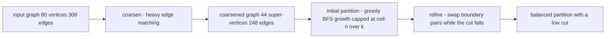
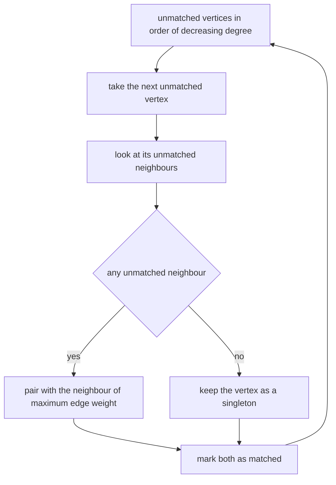
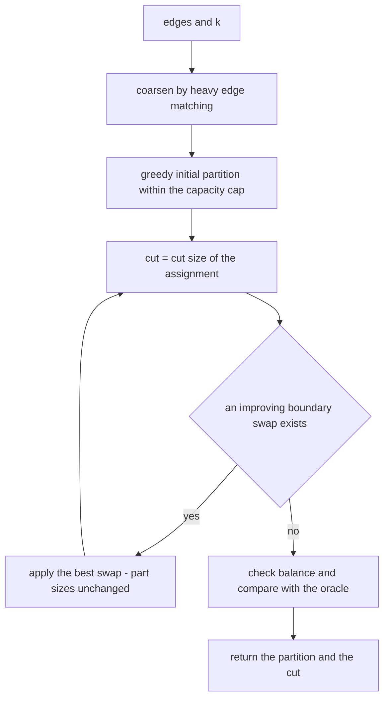
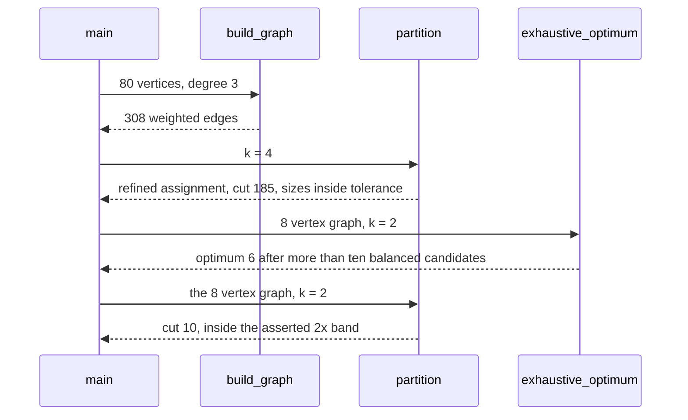

# 947 — Implement large-scale graph partitioner with balance and cut heuristics.

> **Tier:** Master · **CTCI chapter:** Ch 9 — System Design and Scalability
> **Task spec:** [947-implement-large-scale-graph-partitioner-with-balance-and-cut-heu.md](../../../tasks/master/947-implement-large-scale-graph-partitioner-with-balance-and-cut-heu.md)
> **Solutions:** [Python](../../../solutions/python/master/947-implement-large-scale-graph-partitioner-with-balance-and-cut-heu/solution.py) ·
> [Java](../../../solutions/java/master/947-implement-large-scale-graph-partitioner-with-balance-and-cut-heu/Solution.java) ·
> [JavaScript](../../../solutions/javascript/master/947-implement-large-scale-graph-partitioner-with-balance-and-cut-heu/solution.js) ·
> [C#](../../../solutions/csharp/master/947-implement-large-scale-graph-partitioner-with-balance-and-cut-heu/Solution.cs)

## 1. Problem restatement

**The modelling contract first.** The four files build a *multilevel partitioner* over an in-process
weighted graph: no file, no thread, no clock, no external partitioner. A graph of `n` vertices is cut
into `k` parts so that the parts are balanced and the total weight of edges crossing between parts —
the **cut** — is small. Every design decision is measurable inside the process: the cut is a sum over
the edge list, balance is a comparison of part sizes against the tolerance, and quality is judged
against a brute-force optimum on tiny graphs and a deterministic random balanced baseline on large
ones. The Python docstring is explicit about the simplifications versus METIS: a *single* coarsening
level instead of repeated coarsening, greedy growth instead of recursive bisection or a spectral seed,
and one hill-climbing pass instead of gain-bucketed FM refinement.

**Inputs.** An edge list `(source, target, weight)`, a part count `k`, and a balance tolerance
(`TOLERANCE = 0.1` in Python: no part may exceed `1.1 × n/k`).

**Outputs.** A map from vertex to part index, the cut weight, and the part sizes — plus, for the
audit path, the coarsened graph and the exact optimum on tiny instances.

| File | Phase 1 | Phase 2 | Phase 3 |
| --- | --- | --- | --- |
| Python | heavy-edge matching, one coarsening level | greedy BFS growth from the heaviest unassigned vertex, capped at `ceil(n/k)` | FM-style pass swapping boundary pairs whose swap lowers the cut |
| Java | greedy balanced region growth | Kernighan–Lin move of the single best vertex inside the capacity cap, repeated to a local optimum | — |
| JavaScript | repeated heavy-edge coarsening, roughly halving per level | greedy partition of the coarsest graph, then projection back level by level with KL swaps and a repair step | — |
| C# | exact balanced split (`[floor(n/k), ceil(n/k)]`) | Kernighan–Lin exchanges using incremental inside/outside neighbour tables, gain `(outside(v) - inside(v)) + (outside(u) - inside(u)) - 2·[v~u]` | deterministic restarts keeping the best |

Concrete results, from the Python file's printed run and its assertions:

| Call | Result | Source of the claim |
| --- | --- | --- |
| `build_graph(80, 3)` | 80 vertices, 308 weighted edges | printed as `vertices=80 edges=308` |
| `partition(edges, k)` for `k = 2, 3, 4` | cuts `{2: 109, 3: 156, 4: 185}`, all balanced | printed |
| `random_balanced(edges, 4)` | cut 239, so the multilevel result is strictly better | printed as `baseline4=239` |
| brute force on 8 vertices, `k = 2` | optimum 6, the heuristic returns 10 — inside the asserted `≤ 2 × optimum` band | printed as `tiny optimum=6 vs 10` |
| two 4-cliques joined by a bridge | optimum 1, and the heuristic splits them optimally | asserted |
| `coarsen(edges)` | 44 super-vertices and 248 edges from 80 vertices and 308 edges | printed |
| `k = 1` / `k > n` / empty graph | cut 0 / every part at most one vertex / `{}` | asserted |
| balance predicate | accepts 20/20 and 22/18, rejects 30/10 at tolerance 0.1 | asserted |
| determinism | two runs of the same graph give identical partitions | asserted |

## 2. Intuition

The naive idea is a round-robin assignment: deal vertices into `k` parts in index order. It is
perfectly balanced and usually terrible — neighbours land in different parts, so almost every edge
crosses a boundary. The other extreme, a greedy cut-minimiser that lets parts grow as large as it
likes, produces a tiny cut and one monstrous part, which is useless when the parts are the shards of a
distributed system.

The insight is that the two goals fight each other and have to be separated into phases with different
jobs. **Growth** decides *which vertices belong together*; it is allowed to be greedy because the
cut is still local. **Refinement** decides *which vertices to exchange*; swapping one vertex of part A
with one vertex of part B keeps every part size exactly unchanged, so it can only improve the cut and
can never break balance. Between the two sits **coarsening**, whose only job is to make growth cheap:
merge heavy-edge matched pairs so that the graph shrinks while heavy weight stays inside a
super-vertex.





A swap is the second key idea, and it is worth seeing why it is safe: exchanging `u ∈ A` with `v ∈ B`
moves one vertex out of and one vertex into each part, so `|A|` and `|B|` do not change. That is why
the Python refinement can run eight rounds without ever re-checking the balance constraint, and why
the JavaScript variant's separate repair step is only needed after *growth*, never after a swap.

## 3. Algorithm

1. **Coarsen.** Order vertices by decreasing degree, walk the order, and match each still-unmatched
   vertex with its unmatched neighbour of maximum edge weight (ties broken by smaller index); leave a
   vertex unmatched as a singleton when no neighbour is free. Collapse pairs into super-vertices and
   sum parallel edge weights.
2. **Initialise.** Repeatedly take the heaviest unassigned vertex as a seed and grow the part by
   breadth-first expansion, always preferring the unassigned neighbour with the largest edge weight,
   stopping at `ceil(n/k)` vertices. Leftovers go to the currently smallest part.
3. **Refine.** Look at every boundary edge `(u, v)` with `part(u) ≠ part(v)`, try the swap, and keep
   the best swap that strictly lowers the cut; apply it and repeat, at most eight rounds.
4. **Audit.** Recompute the cut from the edge list, check the balance predicate, and on tiny graphs
   compare with a brute force over all balanced `k`-partitions.

```text
procedure coarsen(edges)
    neighbours = adjacency of edges, keyed by vertex with edge weights
    order = vertices sorted by decreasing degree, then by index
    pairs = empty map
    matched = empty set
    for vertex in order do
        if vertex in matched then
            continue
        end
        options = unmatched neighbours of vertex, keyed by weight then by smaller index
        if options is empty then
            pairs[vertex] = (vertex)
        else
            partner = the neighbour of maximum weight in options
            pairs[vertex] = (vertex, partner)
        end
        add every member of pairs[vertex] to matched
    end
    return pairs
end

procedure coarsened_edges(edges, pairs)
    cluster = map from each member of a pair to its representative
    weights = empty map
    for source, target, weight in edges do
        first, second = cluster[source], cluster[target]
        if first != second then
            add weight to weights[key of first and second]
        end
    end
    return sorted weighted edges
end

procedure greedy_initial(edges, k)
    neighbours = adjacency of edges
    limit = ceil(number of vertices / k)
    assignment = empty map
    for part = 0 to k - 1 do
        unassigned = vertices with no part yet
        if unassigned is empty then
            break
        end
        seed = unassigned vertex of maximum degree, then smallest index
        frontier = queue containing seed
        assignment[seed] = part, size = 1
        while frontier is not empty and size < limit do
            vertex = pop frontier
            for other in unassigned neighbours of vertex ordered by decreasing weight do
                if size < limit then
                    assignment[other] = part, size = size + 1
                    push other onto frontier
                end
            end
        end
    end
    give every still-unassigned vertex to the smallest part
    return assignment
end

procedure refine(assignment, edges, k, rounds)
    current = cut size of assignment
    for round = 1 to rounds do
        best = no swap
        for source, target, weight in edges do
            for first, second in both orientations do
                if part of first equals part of second then
                    continue
                end
                trial = copy of assignment with the two vertices exchanged
                gained = current - cut size of trial
                if gained > 0 and gained > gain of best then
                    best = (gained, trial)
                end
            end
        end
        if best is no swap then
            break
        end
        assignment = partition of best, current = current - gain of best
    end
    return assignment, current
end
```



## 4. Worked example

The Python run partitions `build_graph(80, 3)` — a ring plus deterministic chords, 308 weighted edges
after parallel weights are summed — for `k = 2, 3, 4`:

| `k` | Part sizes | Cut after refinement | Cut of the greedy start | Random balanced baseline |
| --- | --- | --- | --- | --- |
| 2 | inside the 10% tolerance of 40 | 109 | at least as large | — |
| 3 | inside the 10% tolerance of 26.67 | 156 | at least as large | — |
| 4 | inside the 10% tolerance of 20 | 185 | at least as large | 239 |

The last column is the interesting one: the deterministic shuffled assignment is balanced by
construction (it hands out contiguous blocks of a shuffled vertex order) and costs 239, while the
multilevel pipeline reaches 185 on the same graph — the assertion is strictly `185 < 239`.

Coarsening is audited as a weight-preserving operation: 80 vertices and 308 edges become 44
super-vertices and 248 edges, the weight total never grows (parallel edges are summed and internal
edges disappear), and every vertex appears in exactly one pair or singleton.

The oracle check is what makes the heuristics honest. On the 8-vertex graph the brute force evaluates
more than ten balanced bipartitions and finds the optimum 6, while the pipeline returns 10 — within
the asserted band `optimum ≤ result ≤ 2 × optimum`. On the crafted instance of two 4-cliques joined by
a single bridge the optimum is 1, and here the pipeline is exactly optimal: it returns 1, because the
growth phase never has a reason to split a clique.



The balance predicate is the invariant everything else is checked against: with 40 vertices and
`k = 2` the target is 20 and the tolerance allows up to `20 × 1.1 = 22`, so 20/20 and 22/18 are
accepted while 30/10 is rejected.

## 5. Complexity

Let `n` be the vertex count, `m` the edge count, `k` the part count and `r` the refinement rounds.

| Measure | Bound | Why it holds |
| --- | --- | --- |
| `coarsen` | `O(m + n log n)` | the degree sort plus one pass over the adjacency of each visited vertex |
| `coarsened_edges` | `O(m)` time, `O(m)` space | one pass summing parallel weights |
| `greedy_initial` | `O(m + n log n)` | each vertex enters a part once; ordering neighbours by weight costs `O(deg log deg)` |
| one refinement round | `O(m · (m + n))` | every boundary edge is tried and each trial recomputes the whole cut |
| full refinement | `O(r · m · (m + n))` | at most `r = 8` accepted rounds |
| `cut_size` | `O(m)` | one sum over the edge list |
| Space | `O(n + m)` | adjacency, assignment, and one trial copy of the assignment per round |

Two honest notes. The refinement in Python is deliberately quadratic in the trial step — it rebuilds
the whole cut for each candidate swap, which makes the monotonicity claim easy to check but expensive
on large inputs; the Java and C# variants maintain incremental gain tables and score an exchange in
`O(1)`. And no part of this is scale-out: the model partitions an in-memory graph, where a production
partitioner streams the edge list from disk and bisects recursively to keep the coarsest level small.

## 6. Pitfalls and edge cases

- **Balance is not a tie-breaker, it is a constraint.** Round-robin gives perfect balance and a
  terrible cut; unbounded greedy gives a great cut and one giant part. The tolerance is what makes the
  comparison meaningful, and `is_balanced` is asserted for `k = 2, 3, 4`.
- **The tolerance boundary is inclusive.** `22 ≤ 20 × 1.1` passes, `30 > 22` fails — the file asserts
  both sides, because an off-by-one here silently changes which partitions are legal.
- **`k = 1`.** Nothing can cross a boundary, so the cut must be exactly 0, not merely small.
- **`k > n`.** With more parts than vertices some parts must stay empty; the file asserts that the
  largest part holds at most one vertex and sizes still sum to `n`.
- **Empty graph.** `partition((), 2)[0] == {}` — an empty partition, not a crash and not a phantom part.
- **Swapping preserves sizes.** The refinement never moves balance, so if the growth phase produced a
  balanced start, every intermediate result stays balanced; the JavaScript variant still needs a
  repair step after growth because its growth can overfill a part.
- **Matching happens at most once.** `coarsen` asserts every vertex appears in exactly one pair or
  singleton, so the coarsened graph cannot double-count weight through a vertex matched twice.
- **Self-loops disappear by construction.** `coarsened_edges` skips pairs whose members end up in the
  same cluster, and the test asserts the coarsened weight total never exceeds the original.
- **The deterministic mix replaces a random generator.** `pseudo` makes the ring chords and the
  baseline shuffle reproducible, so "two runs are identical" is a real assertion rather than luck.
- **Brute force is only an oracle.** `k^n` grows too fast to be anything but a sanity check on tiny
  inputs, which is why it is paired with a random balanced baseline on the 80-vertex graph.

## 7. Variants and follow-ups

- **The layout the partitioner exists for.** [946-implement-high-performance-external-memory-graph-traversal-with.md](../../../tasks/master/946-implement-high-performance-external-memory-graph-traversal-with.md)
  turns the parts into blocks an out-of-core traversal can stream; a small cut there becomes few
  sequential reads per level, so the two tasks measure the same locality from opposite ends.
- **Do not partition at all.** [948-implement-sublinear-time-algorithms-for-property-testing-on-grap.md](../../../tasks/master/948-implement-sublinear-time-algorithms-for-property-testing-on-grap.md)
  samples a bounded local window and never assigns vertices to parts, which is the right answer when
  the question is a property rather than a layout.
- **Partition the stream, not the graph.** [949-implement-approximate-maximum-matching-in-huge-graphs-with-strea.md](../../../tasks/master/949-implement-approximate-maximum-matching-in-huge-graphs-with-strea.md)
  keeps only a matching and never materialises parts, which is the streaming analogue of "make the
  graph smaller before you work on it".
- **Move from heuristics to recursive bisection.** Replace the single coarsening level with repeated
  coarsening, and the flat `k`-way refinement with a bisection tree, as the JavaScript variant sketches.
  The C# variant shows the other half of the refinement question: maintain per-vertex inside/outside
  neighbour counts so a candidate exchange is scored in constant time instead of by recomputing the cut.

## 8. Check yourself

1. Why can the refinement stop worrying about balance?

<details><summary>Show answer</summary>

Because it only ever exchanges a vertex in part A with a vertex in part B: each part loses one vertex
and gains one, so every part size is invariant. The Python file asserts
`part_sizes(refined, k) == part_sizes(initial, k)` for `k = 2, 3, 4`, and the monotonicity check is
`cut_size(refined) <= cut_size(initial)`.

</details>

2. What does coarsening buy, and what does it cost?

<details><summary>Show answer</summary>

It shrinks the graph — 80 vertices and 308 edges become 44 super-vertices and 248 edges in this run —
so growth and refinement run on a much smaller structure while heavy weight stays inside clusters. The
cost is a loss of resolution: decisions made on super-vertices have to be projected back, and the
Python version admits it keeps only a single coarsening level versus METIS's repeated passes.

</details>

3. The 8-vertex heuristic returns 10 where the optimum is 6. Is the implementation broken?

<details><summary>Show answer</summary>

No — it is the documented quality gap. The file asserts `optimum ≤ result ≤ 2 × optimum`, and it also
shows a crafted instance (two 4-cliques joined by a bridge) where the pipeline is exactly optimal at
cut 1. A heuristic is judged against its bound, not against an unreachable optimum on every input.

</details>

4. What does coarsening buy, and what does it cost?

<details><summary>Show answer</summary>

It shrinks the graph — 80 vertices and 308 edges become 44 super-vertices and 248 edges in this run —
so growth and refinement run on a much smaller structure while heavy weight stays inside clusters. The
cost is lost resolution: decisions on super-vertices must be projected back, and Python keeps only one
coarsening level while METIS and the JavaScript variant coarsen repeatedly.

</details>
