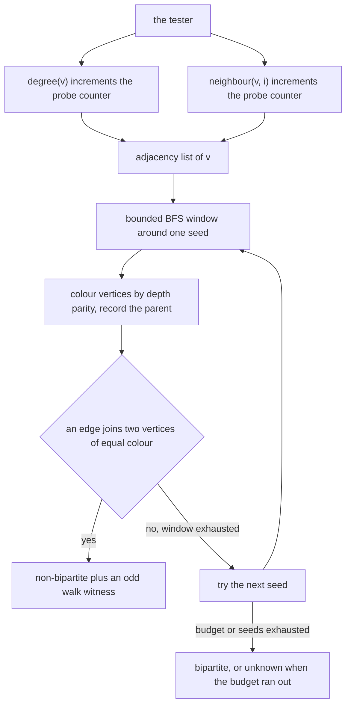
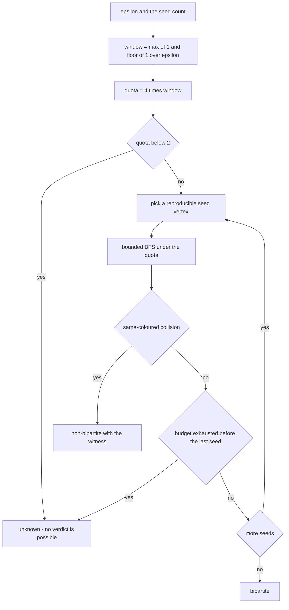
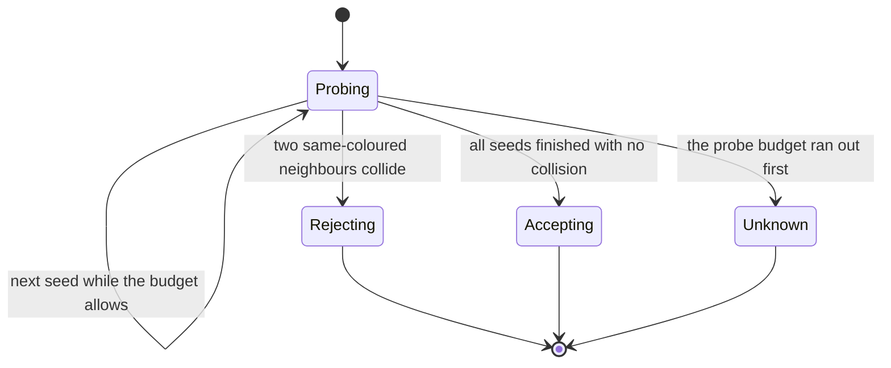
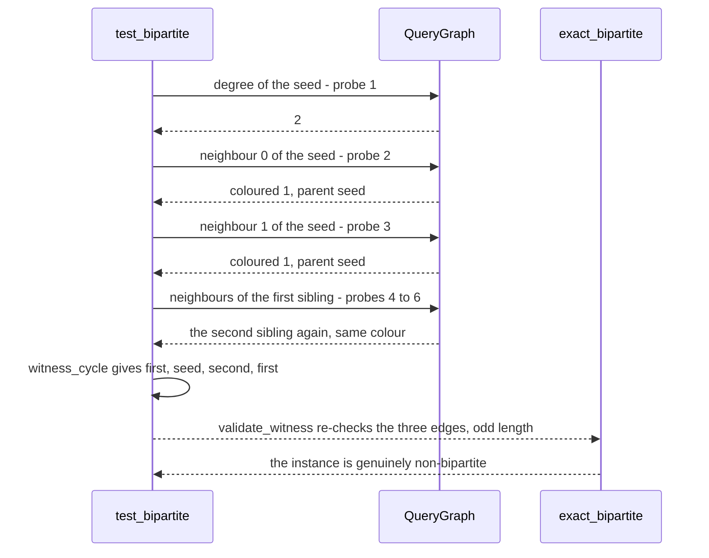

# 948 — Implement sublinear time algorithms for property testing on graphs (e.g., bipartiteness).

> **Tier:** Master · **CTCI chapter:** Ch 4 — Trees and Graphs
> **Task spec:** [948-implement-sublinear-time-algorithms-for-property-testing-on-grap.md](../../../tasks/master/948-implement-sublinear-time-algorithms-for-property-testing-on-grap.md)
> **Solutions:** [Python](../../../solutions/python/master/948-implement-sublinear-time-algorithms-for-property-testing-on-grap/solution.py) ·
> [Java](../../../solutions/java/master/948-implement-sublinear-time-algorithms-for-property-testing-on-grap/Solution.java) ·
> [JavaScript](../../../solutions/javascript/master/948-implement-sublinear-time-algorithms-for-property-testing-on-grap/solution.js) ·
> [C#](../../../solutions/csharp/master/948-implement-sublinear-time-algorithms-for-property-testing-on-grap/Solution.cs)

## 1. Problem restatement

**The modelling contract first.** The four files build an *adjacency-list query model* in one process:
the graph is reachable only through `degree(v)` and `neighbour(v, i)`, every such call is counted, and
the tester's cost is therefore measured in **probes**, not in edges. There is no clock, no thread and
no network; the instances are generated by a deterministic 64-bit mixer so that a run is reproducible.
The answer is a three-valued verdict — `"bipartite"`, `"non-bipartite"` with an odd-cycle witness, or
`"unknown"` when the probe budget runs out — and an independent exact DFS two-colouring sits next to
the tester as an oracle that has no budget at all.

**Inputs.** The query graph, an accuracy parameter `ε`, a seed count and an optional per-seed budget.
In Python `SEEDS = 12`, `window = max(1, int(1/ε))` and `quota = 4 · window`, so `ε = 0.25` gives a
window of 4, a quota of 16 probes per seed and a hard ceiling of `12 × 16 = 192` probes. A quota below
2 — fewer probes than one edge needs — returns `"unknown"` immediately.

**Outputs.** The verdict, the witness walk when there is one, and the number of probes consumed.

| File | Tester shape | Witness | Extra property |
| --- | --- | --- | --- |
| Python | 12 reproducible seeds, each a bounded BFS inside a probe quota | closing walk: BFS discovery paths of the two colliding vertices plus the conflicting edge | exact DFS oracle and a `validate_witness` re-check |
| Java | Goldreich–Ron style: `s = Θ(1/ε)` seeds, bounded BFS touching at most `b` vertices, budget `s·(1 + 3b)` | BFS-tree odd cycle | exact `Θ(n + m)` checker that also bounds "ε-far" |
| JavaScript | one-shot sampling of `O(1/ε)` seeds with a bounded neighbourhood | same-parity edge | a triangle-freeness tester on the same oracle, with the 2/3 confidence measured empirically |
| C# | a few seeds, each a fixed-length random walk, `O(s · L)` probes | walk paths plus the offending edge | an average-degree estimator as a second one-query-per-sample test |

Concrete results, from the Python file's printed run and its assertions:

| Call | Result | Source of the claim |
| --- | --- | --- |
| `build_bipartite(1500, 9000, 5)` with `ε = 0.25` | accepted as `"bipartite"` after spending its whole 192-probe budget, against 8981 edges | printed as `edges=8981`, asserted `probes < edges / 20` |
| `triangle_union(1000)` | rejected as `"non-bipartite"` with a witness whose distinct vertices are exactly 3 and whose length is even (a closed walk back to the start) | printed and re-validated edge by edge |
| distance of that instance | 1000 deletions out of 3000 edges, i.e. 1/3 — far from bipartite | asserted as `≥ 0.3` |
| `add_triangle(bipartite, 0, 3, 7)` | a near-bipartite graph is **accepted** although the exact oracle says non-bipartite | asserted |
| `triangle_union(500)` versus `triangle_union(1000)` | 6 probes and 6 probes: the cost does not grow when the instance doubles | printed as `probes 6 -> 6` |
| one-probe budget, `seeds = 1` | `"unknown"` on both the far and the bipartite instance — never a false accept | asserted |
| empty, isolated, single-edge graphs | all `"bipartite"`, at most 12 probes on the empty one | asserted |
| 40 differently-sized instances | 40/40 far instances rejected, 0 false rejections | printed as `detections=40/40 misses=0` |

## 2. Intuition

The naive answer is to run a full two-colouring: `Θ(n + m)` probes, an exact verdict, and no
randomness at all. It is the right answer when the graph fits in memory and you need certainty. It is
the wrong answer when the graph has billions of edges: you would read the entire input to answer one
yes/no question, and the answer is usually "yes" any way.

The insight of property testing is to change the question. Instead of "*is* this graph bipartite?" ask
"**is it far from bipartite?**" A tester is allowed two-sided slack: it may accept a graph that is
close to bipartite — one bad edge in a huge graph is invisible to it — as long as it never rejects a
genuinely bipartite graph, and rejects every graph that is `ε`-far from bipartite with probability at
least 2/3. Under that relaxed question, a bounded number of probes suffices, independent of `n`.

Two mechanisms make the relaxation work:

1. **One-sided error with a witness.** The tester only ever colours vertices as it walks, and it
   rejects *only* when it sees an edge whose endpoints already carry the same colour. That edge plus
   the two discovery paths forms a closed walk of odd length, which is a proof of non-bipartiteness —
   checkable by anyone, in linear time in the witness length, without trusting the tester.
2. **Sublinear sampling.** `O(1/ε)` independent seeds, each explored inside a probe quota, are enough
   for the far case: when a constant fraction of the vertices sit on odd cycles, a constant number of
   local views must hit one. In the Python run the far instance is rejected after 6 probes, while the
   bipartite graph spends its entire 192-probe budget before it is accepted — and both numbers are
   constants against a graph with 8981 edges.





## 3. Algorithm

1. Derive the window and the quota: `window = max(1, int(1/ε))`, `quota = 4 · window`, and return
   `"unknown"` if `quota < 2`.
2. For each of the `SEEDS` attempts, pick a reproducible start vertex
   `seed = pseudo(attempt · 7919 + n) mod n`.
3. Run a BFS from that vertex while the probes spent in this attempt stay below the quota: call
   `degree(v)`, then `neighbour(v, i)` for every index, and colour each newly discovered vertex with
   the parity opposite to its parent, remembering `(colour, parent)`.
4. If a neighbour already has a colour equal to the current vertex's colour, return
   `("non-bipartite", witness_cycle(parents, v, other), probes)`.
5. If the global probe count reaches the total budget before the last attempt, return `"unknown"`
   rather than guessing.
6. Otherwise return `"bipartite"`.
7. Validate any witness independently: it must start and end at the same vertex, every consecutive
   pair must be a real edge, and the number of edges must be odd.

```text
procedure test_bipartite(graph, epsilon, seeds, budget_per_seed)
    window = maximum of 1 and floor of 1 divided by epsilon
    quota = 4 * window, or budget_per_seed when given
    if quota < 2 then
        return unknown, none, graph.queries
    end
    total = seeds * quota
    for attempt = 0 to seeds - 1 do
        seed = pseudo(attempt * 7919 + graph.vertices) mod maximum of 1 and graph.vertices
        parents = map with seed mapped to colour 0 and no parent
        queue = queue containing seed
        start = graph.queries
        while queue is not empty and graph.queries - start < quota do
            vertex = pop queue
            for index = 0 to graph.degree(vertex) - 1 do
                if graph.queries - start >= quota then
                    break
                end
                other = graph.neighbour(vertex, index)
                if other is in parents then
                    if colour of other equals colour of vertex then
                        return non-bipartite, witness_cycle(parents, vertex, other), graph.queries
                    end
                    continue
                end
                parents[other] = (1 - colour of vertex, vertex)
                push other onto queue
            end
        end
        if graph.queries >= total and attempt + 1 < seeds then
            return unknown, none, graph.queries
        end
    end
    return bipartite, none, graph.queries
end

procedure witness_cycle(parents, first, second)
    left = walk from first to the root following parent pointers
    right = walk from second to the root following parent pointers
    while the last entries of left and right are equal do
        junction = pop the last entry of left
        pop the last entry of right
    end
    return left followed by junction followed by the reverse of right, then first again
end
```

The exact oracle is deliberately a different algorithm — a full iterative DFS two-colouring that
touches every adjacency list — so that agreement between the two is evidence and not a shared bug. It
keeps a `colour` map, starts a new colour-0 root at every unvisited vertex, walks the component with an
explicit stack assigning `colour[other] = 1 - colour[vertex]`, and returns false the moment it meets an
edge whose endpoints already share a colour.



## 4. Worked example

Take the far instance `triangle_union(1000)`: 3000 vertices in 1000 disjoint triangles, 3000 edges,
perfectly balanced degrees of 2 everywhere. The exact distance from bipartiteness is one deletion per
triangle, i.e. 1000 of 3000 edges, or 1/3 — comfortably far for `ε = 0.25`.

| Step | Probe | What happens | State |
| --- | --- | --- | --- |
| seed | — | `seed = pseudo(0 · 7919 + 3000) mod 3000`, some triangle vertex | `parents = {seed: colour 0}` |
| 1 | `degree(seed)` | returns 2 | queue holds one vertex |
| 2 | `neighbour(seed, 0)` | a fresh neighbour | coloured 1, parent = seed |
| 3 | `neighbour(seed, 1)` | the triangle's second neighbour | coloured 1, parent = seed |
| 4 | `degree(neighbour)` | returns 2 | pop the first neighbour |
| 5 | `neighbour(n, 0)` | back edge to the seed: colour 0 versus the vertex's colour 1, no conflict | pop the second neighbour |
| 6 | `neighbour(n, 1)` | the *other* colour-1 vertex | same colour as `n`: collision |

The collision is the answer: the two colour-1 vertices are both reached in one step from the seed, and
the edge between them closes a walk `first → seed → second → first` of three edges. `witness_cycle`
reconstructs exactly that: it walks both parent chains to their common junction (the seed), emitting
`[first, seed, second, first]`, which is a closed walk of 3 edges — odd, so it contains an odd cycle.
`validate_witness` then re-checks it independently: the first and last entries are equal, all three
consecutive pairs are real adjacency entries, and `3 % 2 == 1`.



Now the honest half. On `add_triangle(build_bipartite(1500, 9000, 5), 0, 3, 7)` — a large bipartite
graph with one planted triangle — the exact oracle reports non-bipartite and the tester reports
`"bipartite"`. That is the documented contract, not a bug: one violating edge in a graph with 8981
edges is close to bipartite, and a sublinear tester only promises to catch violations that are *far*
from the property (the C# file demonstrates the same with a single planted odd edge). The measured
reliability comes from the far side instead: a bipartite graph spends the whole 192-probe budget before
acceptance, the far graph is rejected after 6 probes with a validated witness, doubling the instance
leaves the cost at 6 probes, a one-probe budget yields `"unknown"` rather than a guess, and 40 far
instances are rejected 40 times with 0 false rejections across 40 bipartite instances.

## 5. Complexity

Let `s` be the seed count, `q` the per-seed quota, `window = Θ(1/ε)`, `n` the vertex count and `m` the
edge count.

| Measure | Bound | Why it holds |
| --- | --- | --- |
| Probes per attempt | `≤ q` | the quota is checked before every `degree` and `neighbour` call |
| Total probes | `≤ s · q` = 192 in the Python run | 12 seeds × 16 probes, a constant independent of `n` |
| Bounded BFS work | `O(window)` vertices, `O(window²)` edges in the worst case | the window limits how far a single attempt can grow |
| Exact oracle | `Θ(n + m)` probes | it walks every adjacency list once |
| Witness validation | `O(length of witness)` | one adjacency membership test per hop |
| Space | `O(window)` per attempt | parent and colour maps for the local window only |
| Failure probability | at most 2/3 of the far instances missed, measured as 0/40 here | the tester is one-sided: it can miss, never falsely reject |

The comparison against the exact oracle is the point of the whole exercise: `Θ(n + m)` versus a
constant. The price of the constant is the two-sided error — the near-bipartite instance is accepted —
and the `"unknown"` verdict, which exists so that a starved tester says nothing rather than something
wrong. The Python docstring is explicit that this is a simplification of the full Goldreich–Ron and
Alon–Krivelevich testers: a bounded local window replaces scanning `1/ε`-sized vertex subsets, and the
instances are sparse rather than dense, so the constants are illustrative, not tight.

## 6. Pitfalls and edge cases

- **A witness must be verified, not believed.** `validate_witness` re-checks that the walk is closed,
  that every hop is an edge, and that the hop count is odd. The C# variant re-checks its witness edge
  by edge for the same reason.
- **One-sided error means "never falsely reject".** The tester may accept a non-bipartite graph, so
  `near_verdict == "bipartite"` is asserted alongside `not exact_bipartite(near)` rather than being
  treated as a failure.
- **The budget must be able to finish one edge.** With `quota = 1` no edge can be read, so both the far
  and the bipartite instance return `"unknown"`; the guard is `quota < 2`.
- **`"unknown"` is not `"bipartite"`.** The early return happens when the probes reach `seeds × quota`,
  which is exactly the case where a tester would otherwise have to guess.
- **Disconnected and empty graphs.** The empty graph, isolated vertices and a single edge are all
  bipartite; the empty graph costs at most `SEEDS` probes because a `degree` call on a missing vertex
  returns 0.
- **Colour parity, not depth.** Re-colouring must follow the parent's colour (`1 - colour[parent]`)
  rather than the BFS depth, otherwise a walk that revisits a vertex at the same depth looks like a
  violation. A self-loop, by contrast, contradicts any two-colouring immediately, and the Java file
  lists self-looped graphs among its checked boundaries.
- **Determinism needs a mixing function, not a random object.** The seeds come from `pseudo`, so two
  runs probe the same vertices and the probe counts are reproducible.
- **Sparse instances flatter the tester.** A degree-2 triangle union is found almost immediately; a
  dense near-bipartite graph is harder, which is why the file reports the empirically measured
  detection rate (40/40) instead of a theoretical bound.

## 7. Variants and follow-ups

- **Test a different property on the same oracle.** The JavaScript variant adds a triangle-freeness
  tester that checks pairs among the sampled neighbourhoods, and the C# variant estimates the average
  degree with one query per sample — both are property tests in the same counting model.
- **Make the walk a random walk.** The C# tester advances a fixed-length random walk per seed; that is
  cheaper to reason about than a BFS window and converges under different guarantees.
- **Run the search on the whole graph.** [946-implement-high-performance-external-memory-graph-traversal-with.md](../../../tasks/master/946-implement-high-performance-external-memory-graph-traversal-with.md)
  is the opposite trade: it pays for a complete traversal and gets exact distances, in exchange for
  touching every block of the file.
- **Explore the neighbourhood once, cheaply.** [950-implement-scalable-nearest-neighbor-with-multi-index-hashing-and.md](../../../tasks/master/950-implement-scalable-nearest-neighbor-with-multi-index-hashing-and.md)
  asks "who is near?" with bucket hashing plus a rerank stage, the same "few candidates, then verify"
  shape a tester uses when it promotes a collision to a witness.
- **Shrink the graph before testing it.** [947-implement-large-scale-graph-partitioner-with-balance-and-cut-heu.md](../../../tasks/master/947-implement-large-scale-graph-partitioner-with-balance-and-cut-heu.md)
  partitions instead of sampling, which is what you do when the question is a layout rather than a
  property.

## 8. Check yourself

1. Why is the exact `Θ(n + m)` oracle kept in the file at all?

<details><summary>Show answer</summary>

As ground truth. The tester's contract is one-sided, so it needs a reference that decides exactly: the
assertions compare verdicts on bipartite and far instances (where they must agree), and they assert the
*disagreement* on the near-bipartite instance, which is the bounded-error behaviour. Without the oracle
there would be no way to say which disagreements are allowed.

</details>

2. On the far instance the tester returns after 6 probes. Why so few?

<details><summary>Show answer</summary>

Because the instance is a disjoint union of triangles with degree 2 everywhere: from any seed, its two
neighbours are both coloured 1, and the edge between them collides immediately. That is exactly what
"ε-far from bipartite" means in a sparse graph — the violations are everywhere, so a bounded window
almost cannot miss them.

</details>

3. The tester accepts a graph that the exact oracle declares non-bipartite. Which assertion covers that?

<details><summary>Show answer</summary>

`near_verdict == "bipartite"` together with `not exact_bipartite(near)`. The file asserts both, so the
acceptance is a documented property of the tester rather than a divergence nobody noticed; a
one-sided tester is only required never to reject a bipartite graph and to reject far instances.

</details>

4. What does the probe counter change about the assertions compared with an ordinary BFS?

<details><summary>Show answer</summary>

It makes cost an assertion rather than a footnote: the file asserts `probes < edges / 20` on a graph
with 8981 edges, that the count stays at 6 when the instance size doubles, and that the budget is never
exceeded. Counting is what turns "this should be sublinear" into a testable claim — and the `quota < 2`
guard, which returns `"unknown"` because one probe cannot read a single edge, keeps the tester from
accepting by default when it has established nothing.

</details>
