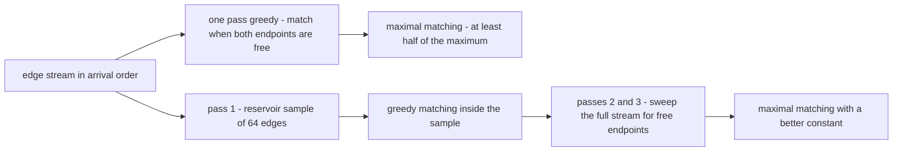
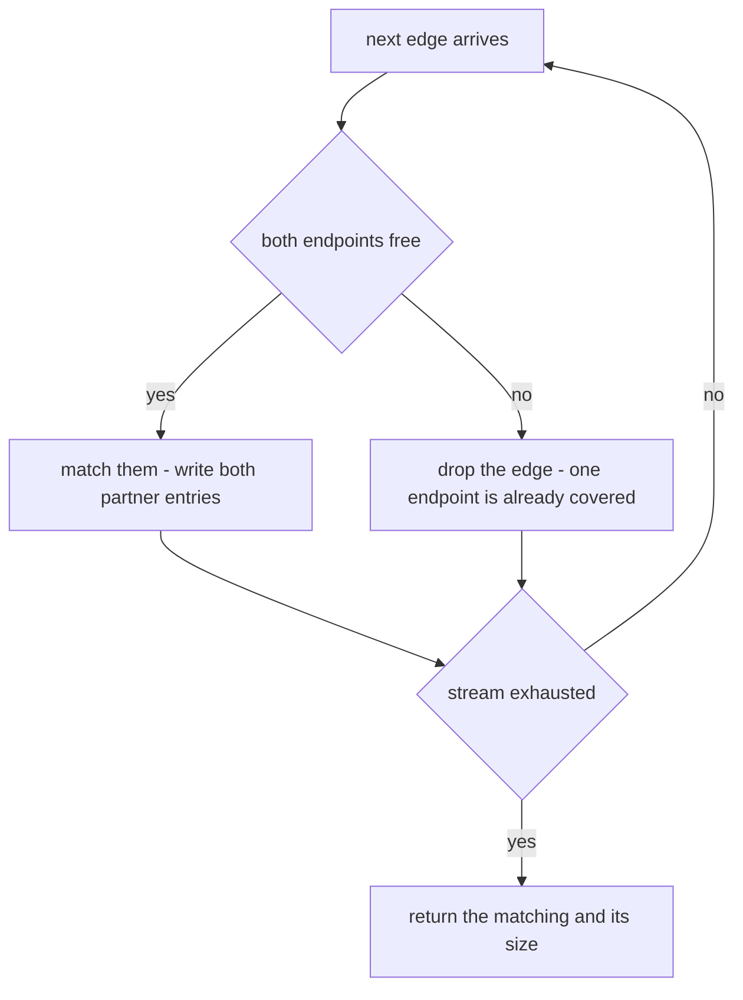
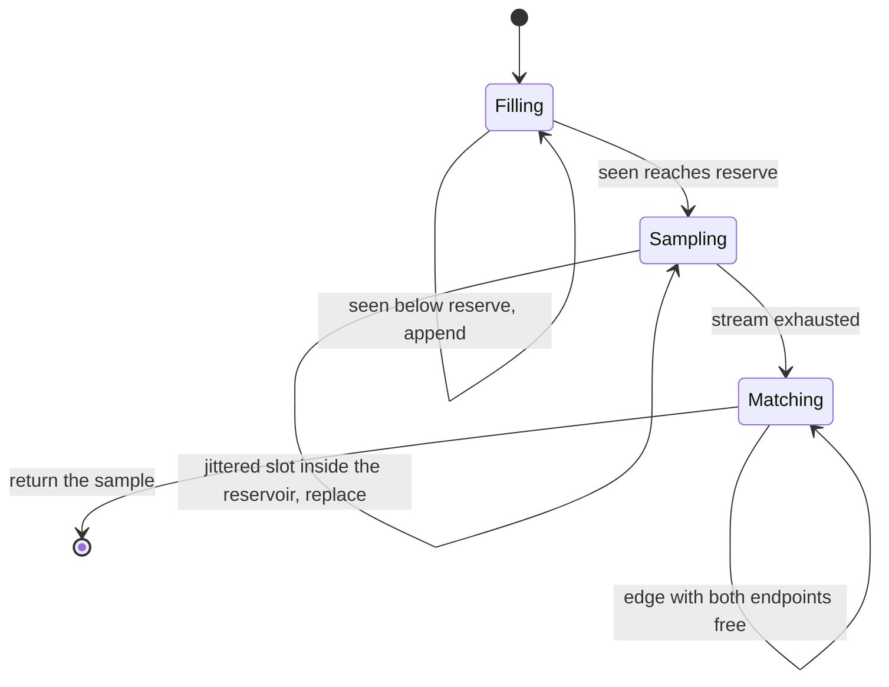
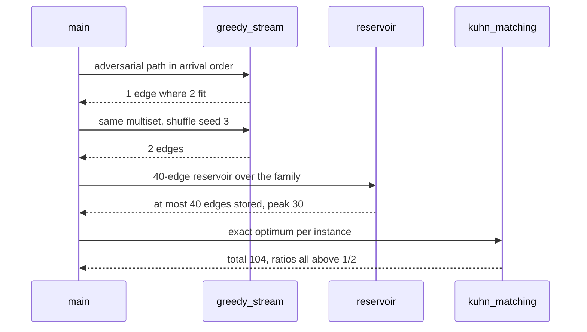

# 949 — Implement approximate maximum matching in huge graphs with streaming algorithms.

> **Tier:** Master · **CTCI chapter:** Ch 4 — Trees and Graphs
> **Task spec:** [949-implement-approximate-maximum-matching-in-huge-graphs-with-strea.md](../../../tasks/master/949-implement-approximate-maximum-matching-in-huge-graphs-with-strea.md)
> **Solutions:** [Python](../../../solutions/python/master/949-implement-approximate-maximum-matching-in-huge-graphs-with-strea/solution.py) ·
> [Java](../../../solutions/java/master/949-implement-approximate-maximum-matching-in-huge-graphs-with-strea/Solution.java) ·
> [JavaScript](../../../solutions/javascript/master/949-implement-approximate-maximum-matching-in-huge-graphs-with-strea/solution.js) ·
> [C#](../../../solutions/csharp/master/949-implement-approximate-maximum-matching-in-huge-graphs-with-strea/Solution.cs)

## 1. Problem restatement

**The modelling contract first.** The four files compute matchings over an *edge stream* in one
process: edges arrive one at a time, the algorithm may keep only `O(V)` state — a partner map plus a
bounded reservoir — and never the edge list itself. In Python the stream is an in-memory list replayed
in different orders, which the docstring names as the simplification: there is no socket and no file,
only orderings. Time is counted in passes over the stream and in memory in stored entries, never in
seconds and never in bytes.

**Inputs.** An edge list presented in a chosen arrival order, a reservoir budget (`BUDGET = 64`) and a
shuffle seed. **Outputs.** A valid matching, its size, and the peak number of stored sample edges.

Two algorithms are implemented, and both are *maximal* — no edge has two free endpoints left — which
is exactly what makes them 2-approximations of the maximum matching:

| Algorithm | Passes | Memory | Recipe |
| --- | --- | --- | --- |
| `greedy_stream` | 1 | partner map | match an arriving edge whenever both endpoints are still free |
| `sampled_stream` | 3 | partner map + reservoir of 64 | reservoir-sample the stream, run greedy *inside the sample*, then sweep the whole stream again to match whatever is still free |

The four languages explore the same family with different second algorithms:

| File | Baseline | Second algorithm |
| --- | --- | --- |
| Python | greedy in arrival order or in a deterministic shuffle | three-pass reservoir core-set then a final sweeping pass |
| Java | one-pass greedy | multi-pass matcher replaying the stream under several deterministic orderings, keeping the largest matching |
| JavaScript | greedy pass | Karp–Sipser style: spend one pass counting degrees, then prefer edges incident to a degree-one vertex before falling back to greedy |
| C# | one-pass greedy | two-pass variant that counts degrees first and matches low-degree vertices first |

Concrete results, from the Python file's printed run and its assertions:

| Call | Result | Source of the claim |
| --- | --- | --- |
| 16 instances (8 shapes × arrival/shuffled order) | worst ratio `0.812` of the exact optimum, total optimum 104 | printed as `worst_ratio=0.812 ... optima=104` |
| adversarial paths, FIFO versus shuffled | 51 matched edges versus 52 | printed as `fifo=51 shuffled=52` |
| textbook instances | `K4 = 2`, `P4 = 2`, `C5 = 2`, `star = 1`, empty `0`, single edge `1` | both oracles reproduce them; asserted |
| reservoir peak with `reserve = 40` | 30, i.e. never above the budget | printed as `reservoir peak=30` |
| core-set lemma on 11 instances | the greedy matching *inside the sample* is at least half the sample optimum | asserted `min(ratios) >= 0.5` |
| star and path, FIFO order | 1/1 and 10/10 — the order is optimal on those shapes | asserted |
| empty stream, single edge, `K3,3` | `([], 0)`, one edge, at least 3 edges against an optimum of 3 | asserted |
| shuffled order | a deterministic permutation: sorted output equals the sorted input, different seeds differ | asserted |

## 2. Intuition

The exact answer needs augmenting paths, which need the graph. A streaming algorithm cannot have it,
so the question changes: instead of *the* maximum matching, produce a *maximal* one — a matching that
cannot be enlarged by any single edge. Every maximal matching is at least half the maximum, so the
algorithm is a 2-approximation with a proof that fits in one line: the endpoints of a maximal matching
form a vertex cover, and any vertex cover is at least as large as any matching.

Greedy already achieves that, so the interesting work is the constant factor between `1/2` and `1`:

1. **The arrival order decides everything.** On a path `v0–v1–v2`, the adversarial order
   `(v1,v2), (v0,v1)` makes FIFO greedy take `(v1,v2)` and leave `v0` stranded: one matched edge out of
   a possible two. The Python file builds exactly those orders (`adversarial_path`), and the fix is to
   *re-order* the stream deterministically — a hash-order shuffle gets 52 matched edges where FIFO gets
   51 across the adversarial family.
2. **A small sample carries enough structure.** Reservoir-sample 64 edges, compute a matching inside
   the sample as if it were the whole problem, and then make one more full pass to pick up whatever
   the sample left free. This is the composable core-set recipe: the sample's optimum is a
   `1/2`-approximation of the sample itself, and the final sweep keeps the result maximal on the full
   stream. It is also where the memory budget actually binds — a sample of 64 edges is `O(1)` state
   even when the stream is endless.





## 3. Algorithm

1. Optionally shuffle the stream deterministically: sort the edges by a hash of `(source, target, seed)`
   so a fixed seed always produces the same permutation.
2. `greedy_stream`: walk the stream, and match an edge exactly when neither endpoint is in the partner
   map; otherwise drop it.
3. `reservoir`: first pass, keep the first `reserve` edges, then replace slot `pseudo(seen · 7919 +
   seed) mod seen` whenever that index falls inside the reservoir — a deterministic reservoir sample.
4. `sampled_stream`: run `greedy_stream` on the reservoir, seed the partner map from that matching, then
   walk the *shuffled whole stream* once more and match anything still free.
5. Assert the result is a valid matching (no shared endpoint, every edge from the input) and that it is
   maximal.
6. Price it against two independent oracles: exhaustive subset enumeration on tiny instances and Kuhn's
   augmenting-path algorithm on the bipartite family.

```text
procedure greedy_stream(edges, seed)
    stream = deterministic shuffle of edges by hash of source, target and seed
    partner = empty map
    matched = empty list
    for source, target in stream do
        if source is not in partner and target is not in partner then
            partner[source] = target
            partner[target] = source
            append (source, target) to matched
        end
    end
    return matched, size of partner
end

procedure reservoir(edges, reserve, seed)
    sample = empty list
    seen = 0
    for edge in edges do
        seen = seen + 1
        if length of sample < reserve then
            append edge to sample
        else
            slot = pseudo(seen * 7919 + seed) mod seen
            if slot < reserve then
                sample[slot] = edge
            end
        end
    end
    return sample
end

procedure sampled_stream(edges, reserve, seed)
    matched = greedy_stream(reservoir(edges, reserve, seed), seed).matched
    partner = map built from matched
    for source, target in deterministic shuffle of edges with seed + 1 do
        if source is not in partner and target is not in partner then
            partner[source] = target
            partner[target] = source
            append (source, target) to matched
        end
    end
    return matched, size of partner, min(length of reservoir, reserve)
end
```

The correctness argument is worth stating in the code's own terms: `valid_matching` checks that the
result uses only input edges and repeats no vertex, and `maximal` checks that every input edge has at
least one covered endpoint. Together those two facts are the whole `1/2` guarantee.



## 4. Worked example

Take the adversarial path of four vertices, edges in the order that hurts FIFO greedy:

| Stream position | Arriving edge | Partner map before | Action | Matching |
| --- | --- | --- | --- | --- |
| 1 | `(1, 2)` | empty | both free, match | `{(1,2)}` |
| 2 | `(0, 1)` | `1 → 2` | vertex 1 is covered, drop | `{(1,2)}` |
| 3 | `(2, 3)` | `1 → 2, 2 → 1` | vertex 2 is covered, drop | `{(1,2)}` |

FIFO greedy ends with one edge where two are possible: `(0,1)` and `(2,3)` would both have fit. Now
run the same edge multiset through the deterministic shuffle (`shuffled(edges, 3)`), which reorders by
a hash of the endpoints:

| Stream position | Arriving edge | Action | Matching |
| --- | --- | --- | --- |
| 1 | `(2, 3)` | both free, match | `{(2,3)}` |
| 2 | `(1, 2)` | vertex 2 covered, drop | `{(2,3)}` |
| 3 | `(0, 1)` | both free, match | `{(2,3), (0,1)}` |

Two edges this time. Across the seven adversarial path lengths (3, 5, 9, 15, 21, 25, 31 edges) the two
orders accumulate 51 and 52 matched edges — the shuffle wins by one edge, and the file asserts
`shuffling > fifo` rather than quoting the pair, so the claim survives a change of family.

The three-pass pipeline is best seen on a full instance. The 16-instance family has a total optimum of
104 edges; the worst single ratio across all algorithms and instances is 0.812, comfortably above the
half that maximality guarantees, and the sample peak with `reserve = 40` is 30 edges, which is simply
"this instance is smaller than the budget".



The core-set lemma is checked the hard way: for each of 11 instances the file computes the greedy
matching *inside the reservoir*, computes the exact optimum of that same reservoir with Kuhn's
algorithm, and asserts the ratio is at least `0.5`; separately it asserts that the three-pass result is
maximal on the full stream and that the reservoir never exceeds its budget. Boundaries behave as the
theory says: the empty stream yields `([], 0)`, a single edge yields one matched edge, and on `K3,3` the
pipeline recovers at least three of the three available edges.

## 5. Complexity

Let `m` be the number of streamed edges, `V` the covered vertices and `r` the reservoir size.

| Measure | Bound | Why it holds |
| --- | --- | --- |
| `greedy_stream` | `O(m)` time, `O(V)` space | one pass, two partner-map lookups per edge |
| `reservoir` | `O(m)` time, `O(r)` space | one pass with a constant-time replacement decision |
| `sampled_stream` | `O(m)` time (three passes), `O(V + r)` space | a pass over the sample, then a pass over the stream |
| Matching validity | `O(|M|)` | each stored edge is checked against the partner map |
| Maximality check | `O(m)` | every input edge must have a covered endpoint |
| Brute-force oracle | `O(2^m)` | only used on tiny instances |
| Kuhn oracle | `O(V · E)` | augmenting paths, polynomial but offline |
| Approximation ratio | at least `1/2`, worst measured `0.812` | maximality gives the bound; the family measures the gap |

The two honest limits are structural. The stream is an in-memory list in all four files, so nothing
here exercises real I/O, and the reservoir is a fixed size rather than the union bound that streaming
work on matchings uses — the Python docstring says as much. And memory is `O(V)` in *vertices*, which
is why a stream of a billion edges is fine but a graph with a billion vertices is not: the partner map
grows with the vertex set, not with the stream.

## 6. Pitfalls and edge cases

- **A matching that is valid but not maximal is not a 2-approximation.** Both properties are asserted
  separately: `valid_matching` for correctness, `maximal` for the ratio.
- **Arrival order is a parameter, not an accident.** The adversarial path orders are in the family
  precisely because FIFO greedy is optimal on the star and the path in *some* orders but not others.
- **Self-loops and parallel edges.** `valid_matching` rejects `source == target`, so a self-loop in the
  stream must never be matched.
- **Empty stream.** `sampled_stream([])` returns `([], 0)`; the reservoir pass must not divide by zero
  on `seen = 0`.
- **A single edge.** One matched edge, equal to the brute-force optimum of one.
- **Repeated vertex count.** `len(partner)` is always `2 × |M|`, which the file asserts for six
  instances; a partner map that keeps stale entries would silently inflate it.
- **The shuffle must be a permutation.** Asserting `sorted(shuffled(e, s)) == sorted(e)` catches a
  hash-order implementation that drops or duplicates edges — a real hazard when the key includes the
  seed.
- **Determinism.** `pseudo` replaces a random generator so two runs of `sampled_stream` are identical
  element by element, which is what makes the printed ratios stable enough to assert.
- **Budget accounting.** The third return value of `sampled_stream` is the *peak* reservoir size; the
  assertion `max(peaks) <= 40` is the memory guarantee, not a comment.

## 7. Variants and follow-ups

- **Use degrees before greedy.** The JavaScript and C# variants spend a first pass counting degrees and
  then prefer edges incident to a degree-one vertex (Karp–Sipser), which beats `1/2` on bounded-degree
  graphs without storing the stream.
- **Replay under several orders.** The Java variant runs independent greedy passes under different
  deterministic orderings and keeps the largest matching; that is the practical fix when an adversary
  controls arrival order and multi-pass access is allowed.
- **Sample instead of stream.** [948-implement-sublinear-time-algorithms-for-property-testing-on-grap.md](../../../tasks/master/948-implement-sublinear-time-algorithms-for-property-testing-on-grap.md)
  also answers a graph question from a bounded number of probes, but it returns a verdict with
  two-sided error rather than an `O(V)`-sized object.
- **Give the stream a layout.** [946-implement-high-performance-external-memory-graph-traversal-with.md](../../../tasks/master/946-implement-high-performance-external-memory-graph-traversal-with.md)
  is the opposite strategy — store the edges, order them well and pay for sequential reads — which is
  what you do when the graph is bigger than memory but the stream can be revisited in bulk.
- **Partition before matching.** [947-implement-large-scale-graph-partitioner-with-balance-and-cut-heu.md](../../../tasks/master/947-implement-large-scale-graph-partitioner-with-balance-and-cut-heu.md)
  produces the vertex groups a distributed matcher would exchange along, the layout counterpart of the
  reservoir's local decisions.

## 8. Check yourself

1. Why does maximality imply "at least half the optimum"?

<details><summary>Show answer</summary>

Because the endpoints of a maximal matching form a vertex cover: every edge has at least one covered
endpoint, or it could have been added. A vertex cover is at least as large as any matching, and the
chosen matching already covers exactly `2 × |M|` vertices, so `|OPT| ≤ 2 × |M|`.

</details>

2. On the adversarial path, why can the shuffle find two edges where FIFO finds one?

<details><summary>Show answer</summary>

The adversarial order delivers `(1,2)` first, which blocks both `(0,1)` and `(2,3)`. A hash-order
shuffle puts `(2,3)` and `(0,1)` in positions where they are picked up before the blocking edge, so the
greedy pass matches two edges. The file asserts the accumulated shuffle total (52) exceeds the FIFO
total (51) over the adversarial family.

</details>

3. What does the reservoir actually buy, given that the final pass is already greedy?

<details><summary>Show answer</summary>

A *good* starting partner map at `O(r)` memory: the matching inside the sample is a `1/2`-approximation
of the sample optimum (the core-set lemma the file asserts), and it is found with a bounded amount of
state. The final full sweep then makes the result maximal on the whole stream, which is what
guarantees the `1/2` ratio for the real instance.

</details>

4. Why is `len(partner) == 2 × |M|` asserted rather than assumed?

<details><summary>Show answer</summary>

Because it is the exact memory and correctness accounting: two partner entries per matched edge, no
vertex twice, no stale entry. A bug that leaves an entry behind after unmatching — or that matches a
vertex to itself — would show up as an inflated count even when the printed matching looked plausible.

</details>
