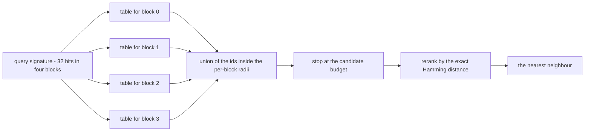
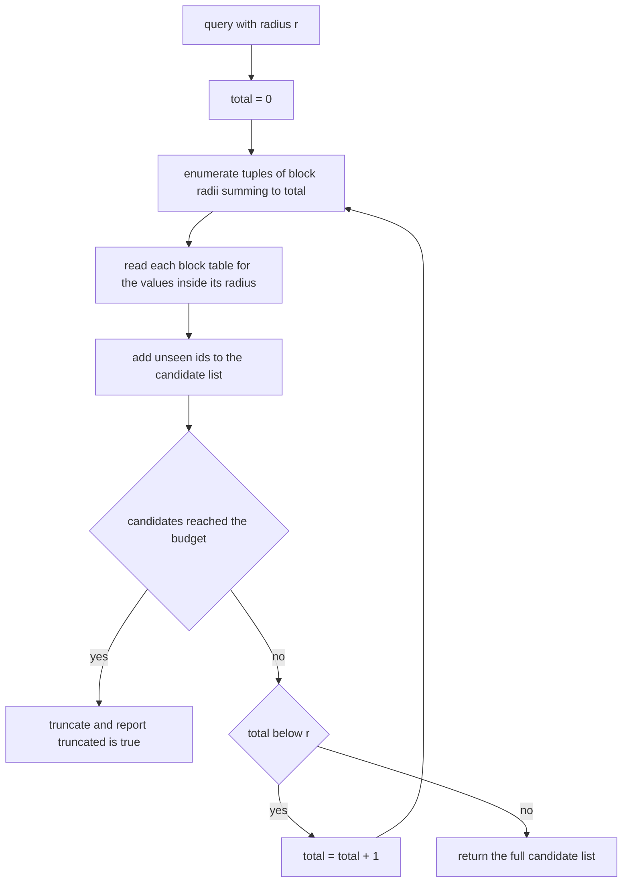
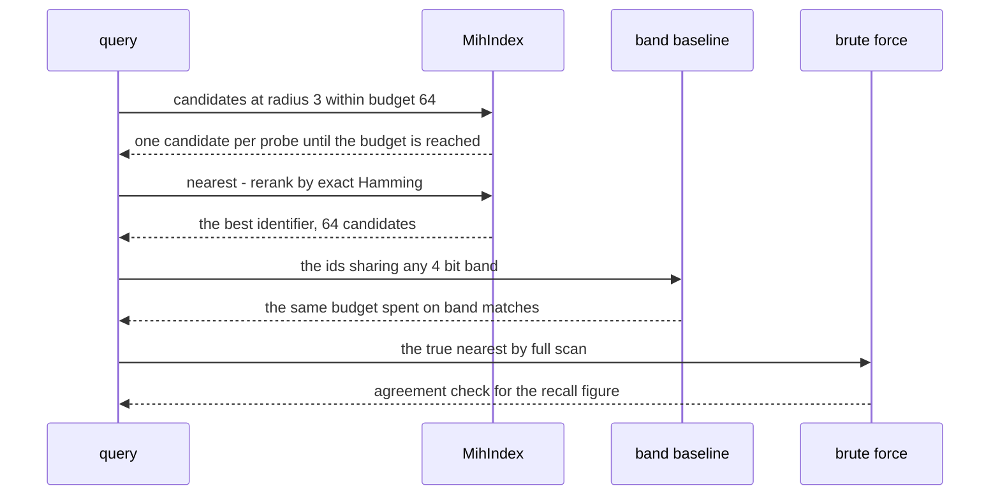

# 950 — Implement scalable nearest neighbor with multi-index hashing and rerank pipeline.

> **Tier:** Master · **CTCI chapter:** Beyond — Advanced Data Structures & Algorithms
> **Task spec:** [950-implement-scalable-nearest-neighbor-with-multi-index-hashing-and.md](../../../tasks/master/950-implement-scalable-nearest-neighbor-with-multi-index-hashing-and.md)
> **Solutions:** [Python](../../../solutions/python/master/950-implement-scalable-nearest-neighbor-with-multi-index-hashing-and/solution.py) ·
> [Java](../../../solutions/java/master/950-implement-scalable-nearest-neighbor-with-multi-index-hashing-and/Solution.java) ·
> [JavaScript](../../../solutions/javascript/master/950-implement-scalable-nearest-neighbor-with-multi-index-hashing-and/solution.js) ·
> [C#](../../../solutions/csharp/master/950-implement-scalable-nearest-neighbor-with-multi-index-hashing-and/Solution.cs)

## 1. Problem restatement

**The modelling contract first.** The four files build an in-process *binary nearest-neighbour search
pipeline*: signatures of `b` bits are produced by hand-written hyperplane hashing, the index is a plain
dictionary per block, and every search is measured in **candidates probed** rather than time. There is
no Faiss, no quantiser, no learned code book and no graph layer — the Python docstring names exactly
that as the simplification. Cost is whatever the file counts, and the ground truth is a brute-force
scan over the same signatures, so recall is a measured number rather than a claim.

**Inputs.** A corpus of 32-bit signatures (320 of them in the run), a query signature, a search radius
`r`, and a candidate budget. Python fixes `BLOCKS = 4`, `BLOCK_BITS = 8` and `BUDGET = 64`.

**Outputs.** A candidate list (possibly truncated), the reranked nearest neighbour by exact Hamming
distance, and the number of candidates examined.

| File | Signature layout | Probe rule | Completeness argument |
| --- | --- | --- | --- |
| Python | 32 bits in 4 blocks of 8 | every tuple of per-block radii whose sum is at most `r`, enumerated in increasing total order | the block distances of a within-radius neighbour sum to at most `r`, so some enumerated tuple covers it |
| Java | `b`-bit code split into `m` bands | buckets whose key is within `floor(r/m)` bits of the query slice, bands unioned | two codes at distance `≤ r` agree within `floor(r/m)` bits on some band |
| JavaScript | 128 bits in 8 blocks of 16 | probe every subset of `m - r` blocks | a bit flip changes its own block, so `≤ r` differing bits means `≤ r` differing blocks |
| C# | 64 bits in `m` blocks of 8 | for each subset `S` with `|S| ≤ p`, read the posting list keyed by the query's bits *outside* `S` | if only `p` blocks can differ then `m - p` agree — the pigeonhole argument |

Concrete results, from the Python file's printed run and its assertions:

| Call | Result | Source of the claim |
| --- | --- | --- |
| `MihIndex(build_signatures(build_vectors(320)))` and 46 queries | recall at `r = 3` with budget 64 is `1.000`, average candidates `64.0` | printed as `recall(r=3, budget=64)=1.000 average_candidates=64.0` |
| unlimited budget, `r = 0, 1, 2` | the candidate set contains *every* signature inside the radius — no false negatives | asserted against a brute-force scan |
| 46 queries, same budget | multi-index hashing finds 46/46 correct, the band-LSH baseline also 46/46 | printed as `MIH 46/46 vs band-LSH 46/46` |
| rerank comparison on the same candidates | exact Hamming rerank 46, ranking by block matches 46 | printed as `exact rerank 46 vs block ranking 46` |
| truncated versus untruncated candidates | the budgeted set is a subset of the full one, and `r = 0` returns the exact matches only | asserted |
| empty index | `nearest` returns `(None, 0, False)` | asserted |
| foreign query (bitwise complement of a stored code) | still returns the closest stored signature, never a crash | asserted |
| two index builds | identical results for the first ten queries; signatures are reproducible bit for bit | asserted |

## 2. Intuition

The brute-force answer is one Hamming distance per corpus entry — 320 32-bit xor-and-popcounts per
query, and 46 queries is 14 720 distance computations. It is exact and it does not scale: the cost is
linear in the corpus, and popcount over long codes is not cheap.

The insight is a **pigeonhole argument on blocks**. Split the signature into `m` blocks and let the
distance between two codes be `d`. Then the sum of the per-block distances is exactly `d`, so if
`d ≤ r` there must be radii `(r_0, …, r_{m-1})` with `r_i ≥` the block distance and `Σ r_i ≤ r`. So
enumerating every such tuple — query each block's table for every value within its budgeted block
radius, union the hits — *cannot miss* a neighbour inside the radius. The candidate set is complete for
radius `r` by construction, which is the property the file checks against brute force rather than
assumes.



The second half of the idea is that the exact distance is *only* spent on the shortlist. Enumeration is
approximate-but-complete; the popcount on the full signature is the expensive step the index exists to
avoid, and it runs on at most 64 candidates instead of the whole corpus. Truncation is where the
approximation enters: with a budget the search may stop before the enumeration is finished, which is why
the file asserts the truncated set is a *subset* of the untruncated one and measures the recall it keeps.



## 3. Algorithm

1. Build the corpus: deterministic 8-dimensional integer vectors, then 32-bit hyperplane signatures —
   one deterministic weight vector per bit, sign of the weighted sum.
2. Build the index: for each block, a table from the 8-bit block value to the list of identifiers that
   have it.
3. Precompute the per-block neighbourhoods: for every block value and radius, the list of 8-bit values
   within that radius (to save recomputing xor-and-popcount during search).
4. For a query, enumerate candidate radius tuples in increasing total order (total `0`, then `1`, … up
   to `r`), read the tables, and de-duplicate identifiers.
5. Stop as soon as the candidate list reaches the budget, and report `truncated = true`.
6. Rerank the candidates by the exact Hamming distance to the query (tie broken by identifier) and
   return the best one with the number of candidates examined.

```text
procedure build_signatures(vectors)
    codes = empty list
    for vector in vectors do
        code = 0
        for bit = 0 to 31 do
            total = weighted sum over the axes using the deterministic weights of that bit
            if total > 0 then
                set bit in code
            end
        end
        append code to codes
    end
    return codes
end

procedure candidates(index, code, radius, budget)
    found = empty list
    truncated = false
    for total = 0 to radius do
        for radii in all tuples of BLOCKS values in 0 to total whose sum equals total do
            for block, block_radius in radii do
                value = block of code at block
                for near in NEIGHBOURHOODS[block_radius][value] do
                    for identifier in index.tables[block][near] do
                        if identifier is not in found then
                            append identifier to found
                        end
                    end
                end
            end
            index.probes = index.probes + length of found
            if length of found >= budget then
                return first budget entries of found, true
            end
        end
    end
    return found, truncated
end

procedure nearest(index, code, radius, budget)
    found, truncated = candidates(index, code, radius, budget)
    ranked = sort found by exact Hamming distance to code, then by identifier
    if ranked is empty then
        return none, 0, truncated
    end
    return first entry of ranked, length of found, truncated
end
```



## 4. Worked example

The enumeration order is the heart of the search, so trace it for `r = 1` on a 4-block signature. The
outer loop runs `total = 0` and then `total = 1`, and each total expands into every tuple of four block
radii that sums to it:

| `total` | Radius tuple | Tables probed | What it can still retrieve |
| --- | --- | --- | --- |
| 0 | `(0, 0, 0, 0)` | the exact block values | codes agreeing on all four blocks, i.e. distance 0 |
| 1 | `(1, 0, 0, 0)` | block 0 within 1 bit, others exact | codes differing from the query in exactly one bit of block 0 |
| 1 | `(0, 1, 0, 0)` | block 1 within 1 bit, others exact | one-bit differences in block 1 |
| 1 | `(0, 0, 1, 0)` | block 2 within 1 bit, others exact | one-bit differences in block 2 |
| 1 | `(0, 0, 0, 1)` | block 3 within 1 bit, others exact | one-bit differences in block 3 |

Five tuples cover *every* code at distance 0 or 1, which is the completeness property made concrete: a
code at distance 1 differs in exactly one block, and the tuple that grants that block a radius of 1
finds it. Now the measured behaviour on the real corpus:

| Measurement | Value | Note |
| --- | --- | --- |
| corpus size | 320 signatures | built from 320 vectors, 8 dimensions, 32 hyperplane bits |
| queries | 46 (every 7th signature) | `range(0, 320, 7)` |
| recall at `r = 3`, budget 64 | 1.000 | the exact nearest neighbour was found for every query |
| average candidates | 64.0 | exactly the budget: at `r = 3` the four-block enumeration fills it |
| MIH versus band-LSH at the same budget | 46/46 versus 46/46 | the band baseline is `8 bands × 4 bits`, truncated at 64 |
| exact rerank versus block-match ranking | 46 versus 46 | both recover a neighbour inside radius 3 on this corpus |

The last two rows are the honest part: on this corpus the baseline ties, because at radius 3 almost any
budget-64 shortlist contains a within-radius neighbour. The assertion is therefore written as "must not
lose" (`mih_hits >= baseline_hits` and `exact_hits >= block_hits`) rather than as a strict win.

Cost accounting is explicit rather than implicit. The file adds the running candidate count to
`index.probes` after each radius tuple, so the counter answers "how much shortlist work did this search
do" — which is the quantity a production pipeline budgets — and it asserts `index.probes > 0` and
`max(probed) <= BUDGET`. Boundaries behave as the theory predicts: at `r = 0` the candidate list holds
exactly the signatures equal to the query, the empty index returns `(None, 0, False)` without any table
access, and a query far outside the corpus (the bitwise complement of a stored code) still returns the
closest stored signature instead of nothing.

## 5. Complexity

Let `n` be the corpus size, `m` the block count, `r` the search radius, `k` the candidate budget and
`B = 2^(b/m)` the number of values a block can take.

| Measure | Bound | Why it holds |
| --- | --- | --- |
| Building signatures | `O(n · b · d)` | `b` deterministic dot products over `d` dimensions per vector |
| Building the index | `O(n · m)` | one table insertion per block per signature |
| Neighbourhood table | `O(m · B²)` once | every block value against every other, per radius |
| Candidate enumeration | `O(number of enumerated tuples × table reads)` | tuples of `m` radii summing to at most `r` |
| Best case | `O(k)` | a dense neighbourhood fills the budget in the first tuples |
| Rerank | `O(k · b)` | exact Hamming distance per candidate, the expensive step kept off the corpus |
| Brute force, for comparison | `O(n · b)` per query | 320 popcounts per query instead of 64 |
| Space | `O(n · m + m · B²)` | posting lists plus the precomputed neighbourhoods |

The trade is visible in the numbers: `n · b` distance computations collapse to `k` of them plus cheap
table reads. The honest caveat is that completeness holds *only* without the budget — truncation is
what introduces the approximation, and the file asserts the truncated set is a subset of the complete
one rather than pretending the guarantee survives. Wider codes change the balance rather than the idea:
the JavaScript variant uses 128-bit codes in eight 16-bit blocks, where the block space is far too
large for a precomputed neighbourhood and the probe rule becomes "pick `m - r` blocks and require exact
agreement on those", which is the same pigeonhole argument read from the other side.

## 6. Pitfalls and edge cases

- **Truncation is not free.** With a budget, the candidate set may miss the true neighbour; the file
  asserts only `subset` and measures the recall, and the docstring states the guarantee is for the
  untruncated enumeration.
- **`r = 0` is exact-match lookup.** The candidate list should hold every stored signature equal to the
  query — the assertion compares it with the list of identical codes rather than trusting the search.
- **Empty index.** `(None, 0, False)`: no candidates, nothing truncated, no exception.
- **Foreign queries.** A query that matches nothing exactly must still return the closest stored
  signature, because the search is nearest-neighbour, not range reporting.
- **De-duplication.** A signature can appear in several block tables and several neighbourhoods; the
  `if identifier not in found` guard is what keeps the candidate list a list of *distinct* ids, and its
  linear cost is the reason the budget matters.
- **Weight determinism.** The hyperplane weights come from the mixing function, so signatures — and
  therefore recall — are reproducible; a real system would learn them, which the docstring lists as the
  first simplification versus Faiss/PQ-MIH.
- **Radius tuples must sum to the total.** The enumeration filters with `sum(radii) == total`, so
  intermediate tuples are never probed twice; dropping that check silently changes the cost profile.
- **Block alignment.** A code shorter than `BLOCKS × BLOCK_BITS` shifts out of range; the C# variant
  spells out the split for a 64-bit vector and the Java variant puts the remainder in the last band.
- **Rerank ties.** Identifiers break ties deterministically, which is what makes "two index builds give
  identical results" a real assertion.

## 7. Variants and follow-ups

- **Sample candidates, then verify.** [948-implement-sublinear-time-algorithms-for-property-testing-on-grap.md](../../../tasks/master/948-implement-sublinear-time-algorithms-for-property-testing-on-grap.md)
  uses the same shape — a bounded candidate window followed by an exact check — for graph properties,
  with a witness instead of a distance.
- **Budget the shortlist under memory pressure.** [949-implement-approximate-maximum-matching-in-huge-graphs-with-strea.md](../../../tasks/master/949-implement-approximate-maximum-matching-in-huge-graphs-with-strea.md)
  keeps a reservoir instead of posting lists, trading completeness for a fixed `O(1)` sample.
- **Store the corpus out of core.** [946-implement-high-performance-external-memory-graph-traversal-with.md](../../../tasks/master/946-implement-high-performance-external-memory-graph-traversal-with.md)
  is the layout half of the same problem: once the candidate lists no longer fit in memory, the order in
  which you read them decides the cost.
- **Change the probe rule with the code width.** Use the band formulation (`floor(r/m)` per band) for
  long codes as the Java variant does, and the subset formulation (`m - r` exact blocks) when the block
  space is too large to precompute, as the JavaScript and C# variants do.
- **Measure, do not assume.** A pipeline like this belongs in the harness of
  [951-implement-end-to-end-reproducible-benchmarking-harness-for-all-e.md](../../../tasks/master/951-implement-end-to-end-reproducible-benchmarking-harness-for-all-e.md),
  where recall and candidate counts become recorded baselines instead of anecdotes.

## 8. Check yourself

1. Why is the enumeration complete for radius `r` when no budget is applied?

<details><summary>Show answer</summary>

Because the per-block distances of a neighbour inside radius `r` sum to at most `r`, so the tuple that
grants each block its own distance is enumerated, and every value within that block radius is read from
that block's table. The file checks this against a brute-force scan at `r = 0, 1, 2`.

</details>

2. What exactly does the budget buy, and what does it cost?

<details><summary>Show answer</summary>

It caps the shortlist work at 64 candidates, so the exact Hamming distance is computed 64 times per
query instead of 320 times. It costs the completeness guarantee: the truncated list is a subset of the
full one (asserted), so the true neighbour can be outside it, which is why recall is measured (1.000
here) rather than proved.

</details>

3. The multi-index search and the band-LSH baseline both score 46/46. Why keep the baseline?

<details><summary>Show answer</summary>

As a control. If recall were low for both, the corpus would be the problem rather than the index; if
the index lost, the probe rule would be wrong. The assertion is deliberately `mih_hits >=
baseline_hits`, because a tie is the honest outcome on a corpus where radius 3 is generous.

</details>

4. Where does the exact Hamming distance run, and why not earlier?

<details><summary>Show answer</summary>

In the rerank stage, on at most `k = 64` candidates. It is the expensive operation — a full-signature
xor and popcount — and the entire point of the index is to avoid running it on the whole corpus. Rank
by block agreement first and the ordering can be wrong, which is why the file asserts
`exact_hits >= block_hits`.

</details>
