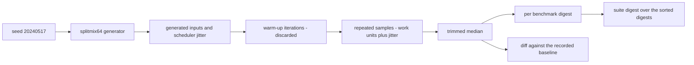
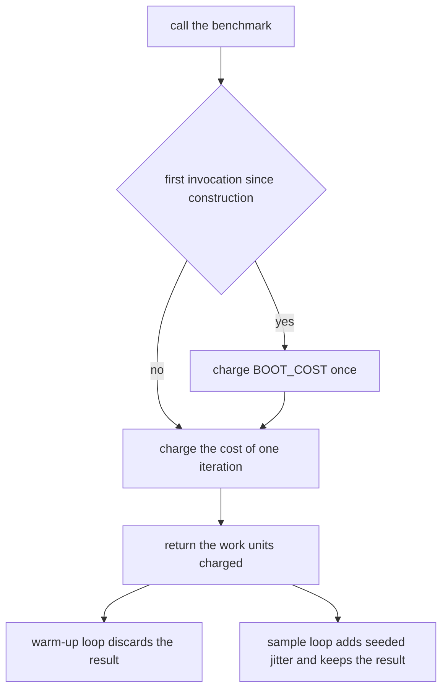
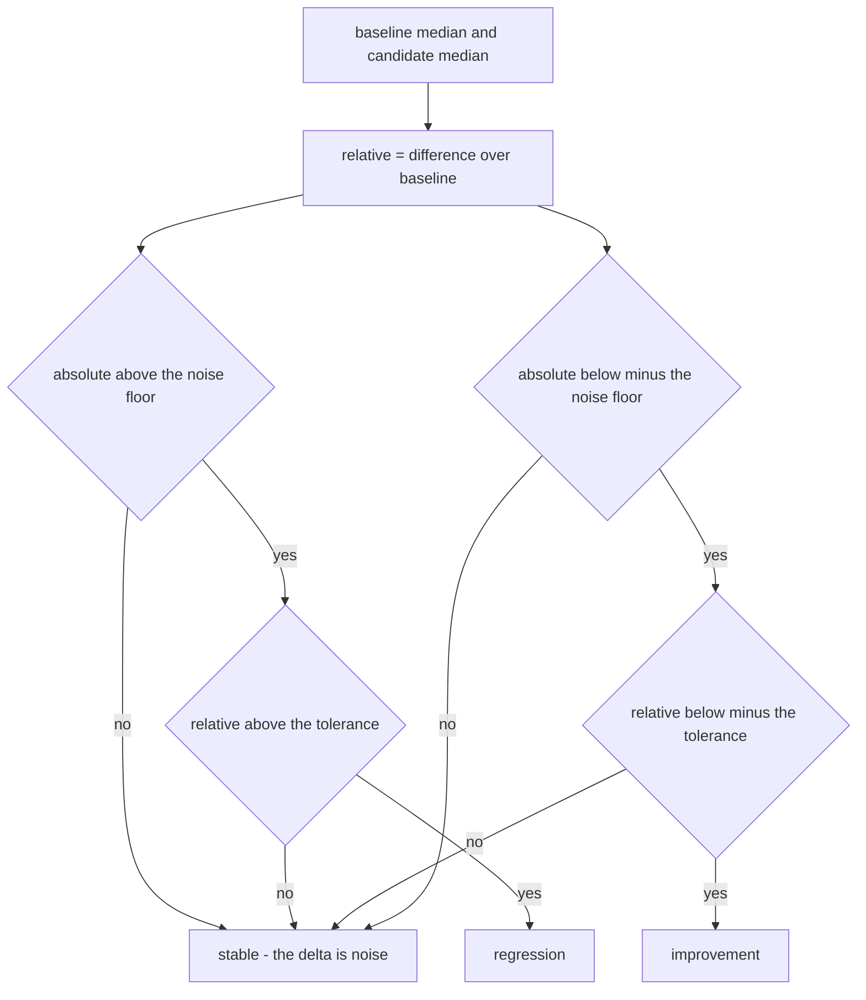
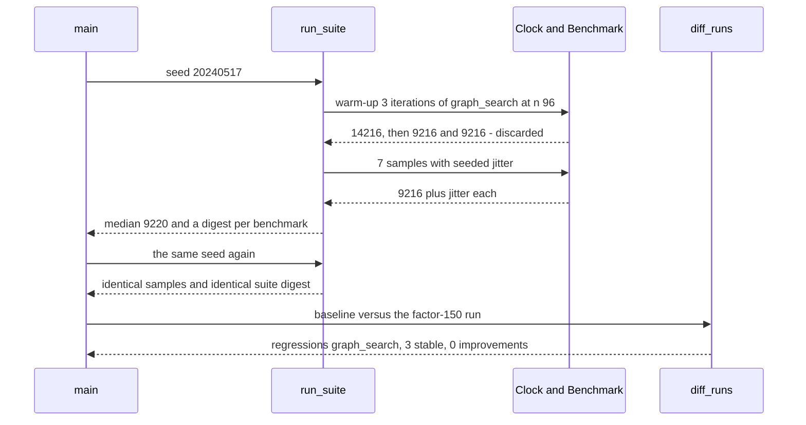

# 951 — Implement end-to-end reproducible benchmarking harness for all exercises in repo.

> **Tier:** Master · **CTCI chapter:** Beyond — Software Engineering & Tooling
> **Task spec:** [951-implement-end-to-end-reproducible-benchmarking-harness-for-all-e.md](../../../tasks/master/951-implement-end-to-end-reproducible-benchmarking-harness-for-all-e.md)
> **Solutions:** [Python](../../../solutions/python/master/951-implement-end-to-end-reproducible-benchmarking-harness-for-all-e/solution.py) ·
> [Java](../../../solutions/java/master/951-implement-end-to-end-reproducible-benchmarking-harness-for-all-e/Solution.java) ·
> [JavaScript](../../../solutions/javascript/master/951-implement-end-to-end-reproducible-benchmarking-harness-for-all-e/solution.js) ·
> [C#](../../../solutions/csharp/master/951-implement-end-to-end-reproducible-benchmarking-harness-for-all-e/Solution.cs)

## 1. Problem restatement

**The modelling contract first.** The four files build an *in-process benchmarking harness* in which
wall-clock time is replaced by an explicit **work-unit counter**: every benchmark charges a `Clock` by
the number of elementary operations it executed, so a whole run is a pure function of its seed. The
Python docstring is explicit that this is the deviation from JMH or pytest-benchmark — no clock, no GC
or JIT effects, no forked JVM, no filesystem output and no JSON report. What is faithful is the
*statistics*: warm-up iterations that are discarded, repeated samples carrying a seeded scheduler
jitter, a trimmed median as the reported metric, and a comparison against a recorded baseline that must
clear both a relative tolerance and an absolute noise floor before anything is called a regression.

**Inputs.** A suite of `Benchmark` objects (name, algorithm, input size, build factor), a seed, a
warm-up count and a repeat count. Python uses `seed = 20240517`, `warmup = 3`, `repeats = 7`,
`BOOT_COST = 5_000`, `JITTER = 7`, `NOISE_FLOOR = 5` and `TOLERANCE = 0.10`.

**Outputs.** For each benchmark: the discarded warm-up samples, the timed samples, the trimmed median
and a SHA-256 digest over `seed | name | factor | samples`; for the suite: one combined digest.

| File | Time source | Aggregation | Comparison |
| --- | --- | --- | --- |
| Python | a `Clock` object charged explicit work units | trimmed median (min and max dropped once there are ≥ 5 samples) | digest per benchmark plus a suite digest over the sorted digests |
| Java | deterministic operation count returned by each workload | min, median, max | environment fingerprint over toolchain tags plus the seed, and one FNV-1a digest over the sorted rows |
| JavaScript | counted steps per implementation, one per language | per-case rows | inputs derived from `(seed, exercise id, size)` so `runOnce(seed)` is a pure function |
| C# | counted operations per workload | aggregated rows | the same "compare one number" idea, over a registry built in memory |

Concrete results, from the Python file's printed run and its assertions:

| Call | Result | Source of the claim |
| --- | --- | --- |
| `run_suite(20240517)` | 4 benchmarks, suite digest `135145f7f732accc…` | printed as `benchmarks=4 seed=20240517 suite_digest=135145f7f732accc` |
| medians | `graph_search@n=96` 9220, `hash_lookup@n=512` 2051, `sort_ledger@n=1024` 5124, `sort_ledger@n=2048` 11269 | printed |
| the same seed again | identical sample vectors, identical per-benchmark digests, identical suite digest | asserted |
| `run_suite(seed + 1)` | every digest changes, the row set does not | asserted |
| `factors={'exercises/graph_search@n=96': 150}` | 1 regression, 3 stable, 0 improvements | printed as `regressions=['exercises/graph_search@n=96'] stable=3` |
| `factors={'sort_ledger@n=2048': 60}` | 1 improvement | asserted |
| `factors={'sort_ledger@n=2048': 101}` | 0 reported changes — the delta is under the tolerance | asserted |
| `warmup = 0, repeats = 1` | the boot cost leaks into the single sample and all four benchmarks are reported as regressions | asserted |

## 2. Intuition

Start with the obvious harness: call `time.perf_counter()` around the workload, repeat a few times,
print the mean. It fails for reasons that have nothing to do with the algorithm. Two runs on the same
machine disagree because of turbo states, noisy neighbours and page-cache luck. The first iteration
pays the interpreter's start-up and the JIT's compilation, so it is an outlier that drags any mean. And
a mean over seven samples has no defence against a single scheduler spike.

Three fixes, each of them a deliberate choice:

1. **Count work instead of measuring time.** A workload that reports "I performed `n²` frontier
   comparisons" is reproducible on any machine, in any container, at any load. The counter is the
   benchmark's contract with the harness, and it is what makes a digest meaningful.
2. **Discard the warm-up.** `BOOT_COST = 5_000` is paid once per benchmark — an order of magnitude more
   than the 2048 units `hash_lookup@n=512` costs — which is precisely why the first warm sample is
   inflated and the assertion `warm[0] > max(samples)` holds with a wide margin.
3. **Use a trimmed median and a two-part threshold.** Drop the min and max once there are at least five
   samples, take the median of the rest, and only call a change a regression when it clears *both* the
   10% relative tolerance and the 5-unit noise floor. That is the difference between a benchmark suite
   people trust and one they mute.





## 3. Algorithm

1. Build the suite: four benchmarks over three cost models — `sort_ledger` (`n · max(1, bit_length(n) -
   1) / 2` comparisons), `graph_search` (`n²` frontier scans) and `hash_lookup` (4 probes per key) —
   each scaled by a build factor where 100 means the reference build.
2. Measure: run `warmup` iterations and discard them, then collect `repeats` samples, each the charged
   work units plus a seeded jitter in `[0, JITTER)`.
3. Aggregate: sort the samples, drop one min and one max when there are at least five, and take the
   median (averaging the two middle values for an even count).
4. Digest: `sha256("seed|name|factor|samples")` per benchmark, then `sha256` over the sorted digests for
   the suite.
5. Diff against a baseline: a delta is a **regression** only if `absolute > NOISE_FLOOR` *and*
   `relative > TOLERANCE`; an **improvement** only if `absolute < -NOISE_FLOOR` *and*
   `relative < -TOLERANCE`; everything else is **stable**.

```text
procedure measure(benchmark, rng, warmup, repeats)
    clock = new Clock with zero units
    warm = empty list
    for iteration = 1 to warmup do
        append clock.measure(benchmark) to warm
    end
    samples = empty list
    for iteration = 1 to repeats do
        append clock.measure(benchmark) + rng.below(JITTER) to samples
    end
    return warm, samples
end

procedure trimmed_median(samples)
    ordered = sort samples in ascending order
    if length of ordered >= 5 then
        ordered = ordered without its first and last entries
    end
    if ordered is empty then
        return 0.0
    end
    middle = length of ordered divided by 2
    if length of ordered is odd then
        return ordered[middle] as a real number
    end
    return (ordered[middle - 1] + ordered[middle]) / 2.0
end

procedure run_suite(seed, factors, warmup, repeats)
    rng = splitmix64 seeded with seed
    report = empty map
    for benchmark in build_suite(factors) do
        warm, samples = measure(benchmark, rng, warmup, repeats)
        payload = seed, name, factor and the samples joined with commas
        report[benchmark.name] = warm, samples, trimmed_median(samples),
                                 sha256 of payload
    end
    return report
end

procedure diff_runs(baseline, candidate)
    report = empty regression, improvement and stable lists
    for name in sorted names present in both runs do
        base = baseline[name].median
        cand = candidate[name].median
        relative = (cand - base) / base when base is not zero, else 0
        absolute = cand - base
        if absolute > NOISE_FLOOR and relative > TOLERANCE then
            append name to report.regressions
        else if absolute < -NOISE_FLOOR and relative < -TOLERANCE then
            append name to report.improvements
        else
            append name to report.stable
        end
    end
    return report
end
```

Two independent implementations of the same statistic are kept side by side on purpose: the harness uses
the statistics module, and `oracle_trimmed_median` recomputes it with explicit index arithmetic over the
same sorted list. The file asserts they agree to within `1e-9` for every benchmark, so the aggregation
cannot quietly drift.



## 4. Worked example

Take `exercises/graph_search@n=96`, whose cost model is `n² = 9216` work units at the reference factor
of 100. The trace below is the actual sequence the harness performs:

| Step | What happens | Value |
| --- | --- | --- |
| build | `Benchmark("exercises/graph_search@n=96", "graph_search", 96)` | cost 9216 units, `_booted = False` |
| warm 1 | boot cost charged, then one iteration | `5000 + 9216 = 14216` |
| warm 2 | one iteration | 9216 |
| warm 3 | one iteration | 9216 |
| sample 1..7 | one iteration plus jitter in `[0, 7)` | 9216 + jitter |
| trimmed median | drop min and max, take the median of the middle five | **9220**, the printed value |

The difference between the first warm sample and any timed sample is the boot cost, and the assertion
computes the *tightest margin over the whole suite* and requires it to be positive. Applied to all four
benchmarks the same arithmetic reproduces the printed medians exactly, because the cost models are
deterministic:

| Benchmark | Cost model | Cold cost | Sample band | Trimmed median |
| --- | --- | --- | --- | --- |
| `sort_ledger@n=1024` | `1024 · (11 - 1) / 2` | 5120 | 5120 … 5126 | 5124 |
| `graph_search@n=96` | `96 · 96` | 9216 | 9216 … 9222 | 9220 |
| `hash_lookup@n=512` | `512 · 4` | 2048 | 2048 … 2054 | 2051 |
| `sort_ledger@n=2048` | `2048 · (12 - 1) / 2` | 11264 | 11264 … 11270 | 11269 |

The medians themselves are asserted to follow the cost model — `graph_search@n=96` (9220) is above
`hash_lookup@n=512` (2051), and `sort_ledger@n=2048` (11269) is above `sort_ledger@n=1024` (5124) — which
is how a *constant* factor build is caught even when nothing crashed.

Now the comparison, on the same seed:

| Experiment | Factor change | Baseline → candidate | Classification | Why |
| --- | --- | --- | --- | --- |
| slow the graph search | `graph_search@n=96` to 150 | 9220 → 13824 | regression | +50% relative, far above the 10% tolerance |
| speed up the big sort | `sort_ledger@n=2048` to 60 | 11269 → 6758 | improvement | −40% relative, beyond the lower tolerance |
| tiny build change | `sort_ledger@n=2048` to 101 | 11269 → 11376 | stable | +0.9% relative, under the tolerance |
| no warm-up at all | `warmup = 0`, `repeats = 1` | every median jumps by ~5000 units | all four regressions | the boot cost leaked into the only sample |
| nothing measured | `repeats = 0` | empty samples, median 0.0 | empty report, digest stable | an empty run is still reproducible |



## 5. Complexity

Let `b` be the suite size, `w` the warm-up count and `r` the repeat count. "Time" is work units charged,
not seconds.

| Measure | Bound | Why it holds |
| --- | --- | --- |
| One benchmark iteration | `O(cost)` | the workload charges its declared work units |
| `measure` | `O((w + r) · cost)` | `w` discarded iterations plus `r` samples |
| `trimmed_median` | `O(r log r)` | one sort of the sample vector |
| `run_suite` | `O(b · ((w + r) · cost + r log r))` | per benchmark measuring plus aggregation plus one digest |
| Digesting | `O(r)` | the sample vector is hashed once per benchmark |
| `diff_runs` | `O(b log b)` | the sorted name intersection |
| Space | `O(b · r)` | the sample vectors; the clocks hold one integer each |

The cost model is where the honesty lives. A real benchmark harness pays for wall-clock resolution,
process start-up, GC pauses and CPU migration; this one replaces all of it with a counter, which is why
the numbers reproduce bit for bit — and why they mean "this is the declared work of that build", not
"this is how long it took". The jitter is a stand-in for scheduler noise, not a measurement of it, and
the boot cost is a single constant standing in for interpreter warm-up rather than a measured start-up
curve.

## 6. Pitfalls and edge cases

- **A mean over samples is the wrong statistic here.** One scheduler spike moves it; the harness uses a
  trimmed median and an independent oracle recomputation to keep the aggregation honest.
- **Warm-up must be discarded, not merely run.** With `warmup = 0` the boot cost leaks into the sample
  and every benchmark is reported as a regression — which the file asserts as the boundary behaviour.
- **Two thresholds, not one.** A 1% factor change is a real difference in the counter but not a
  reportable one; requiring both the relative tolerance and the absolute noise floor is what stops the
  suite from crying wolf.
- **Digests are seed *and* sample sensitive.** Changing the seed changes every digest while leaving the
  row set intact; a run with `repeats = 0` has no samples but still produces a stable suite digest.
- **Zero repeats is a legal configuration.** `median` is `0.0` and the report is empty — `diff_runs` on
  an empty report returns everything as stable rather than crashing on a missing key.
- **Cost models must track the declared complexity.** `sort_ledger` uses `n · max(1, bit_length(n) - 1) /
   2`, so `n = 1024` and `n = 2048` give 5120 and 11264; a model that forgot the `bit_length` term would
  make the two sizes indistinguishable.
- **Boot is per benchmark instance, not per process.** The suite builds fresh `Benchmark` objects, so
  each one pays `BOOT_COST` exactly once — a reused instance would hide the effect the assertion checks.
- **Benchmark names are the join key.** `diff_runs` intersects by name, so a renamed benchmark silently
  disappears from the comparison; the file asserts that the baseline covers exactly the built suite.
- **The counter is not a profiler.** It cannot tell you which line is slow, only that the declared work
  grew; that is a deliberate limitation, and the same repo's CPU-attribute pipeline task covers the
  other question.

## 7. Variants and follow-ups

- **Grade submissions with the same measurements.** [952-implement-autograder-that-runs-tests-measures-complexity-and-rep.md](../../../tasks/master/952-implement-autograder-that-runs-tests-measures-complexity-and-rep.md)
  runs the tests *and* the complexity measurement and reports regressions, which is this harness with a
  score attached.
- **Run it on many machines.** [954-implement-ci-pipeline-that-runs-on-multiple-jdks-and-oses-with-r.md](../../../tasks/master/954-implement-ci-pipeline-that-runs-on-multiple-jdks-and-oses-with-r.md)
  is the CI half: a matrix of JDKs and operating systems where a digest plus a tolerance is what makes
  cross-platform results comparable at all.
- **Publish the numbers.** [959-implement-leaderboard-with-verified-performance-metrics-and-repr.md](../../../tasks/master/959-implement-leaderboard-with-verified-performance-metrics-and-repr.md)
  turns verified runs into a leaderboard, which needs exactly the reproducibility and tamper-evidence
  this harness provides.
- **Combine it with the multi-index pipeline.** [950-implement-scalable-nearest-neighbor-with-multi-index-hashing-and.md](../../../tasks/master/950-implement-scalable-nearest-neighbor-with-multi-index-hashing-and.md)
  reports recall and candidate counts that belong in a harness like this one rather than in a comment.

## 8. Check yourself

1. Why does the harness count work units instead of reading a clock?

<details><summary>Show answer</summary>

Because a clock is the one thing a shared machine cannot reproduce. Work units are a pure function of
the build and the input, so the sample vector, the per-benchmark digest and the suite digest are
bit-for-bit reproducible — which is what lets the file assert identical digests for a repeated run and
different digests for a new seed.

</details>

2. What does the assertion `warm[0] > max(samples)` actually prove?

<details><summary>Show answer</summary>

That the boot cost is real and confined to the first invocation: `warm[0]` includes `BOOT_COST = 5000`
plus one iteration, while every later sample is one iteration plus jitter at most. If the boot charge
leaked into every call, or was never charged at all, the margin would vanish and the assertion would
fail.

</details>

3. A change moves a median by 3 units on a 2000-unit benchmark. Is it reported?

<details><summary>Show answer</summary>

No. The absolute delta is below `NOISE_FLOOR = 5`, so the first condition already fails — even though
the relative delta is tiny anyway. Both conditions must hold for a report, which is why jitter between
runs does not produce false regressions.

</details>

5. What happens when `repeats = 0`, and why is that worth asserting?

<details><summary>Show answer</summary>

Every benchmark reports no samples and a median of `0.0`, and the suite digest is still well defined
and stable across runs, while `diff_runs` on the empty report returns every name as stable. It is worth
asserting because the boundary is where unguarded aggregation code divides by zero or raises on an
empty sequence.

</details>
