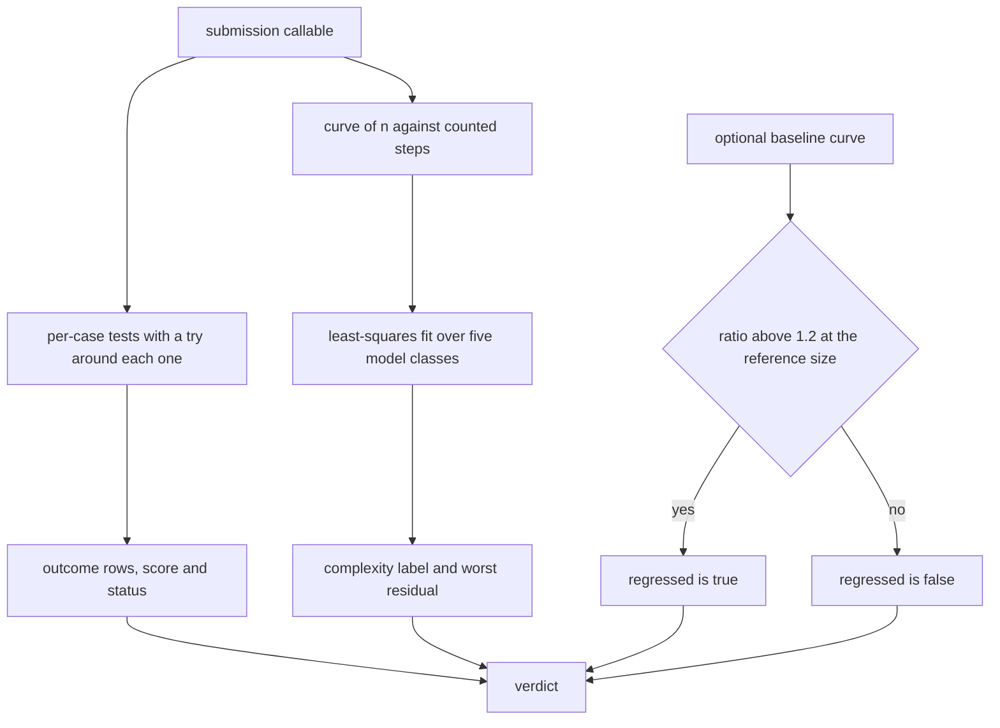
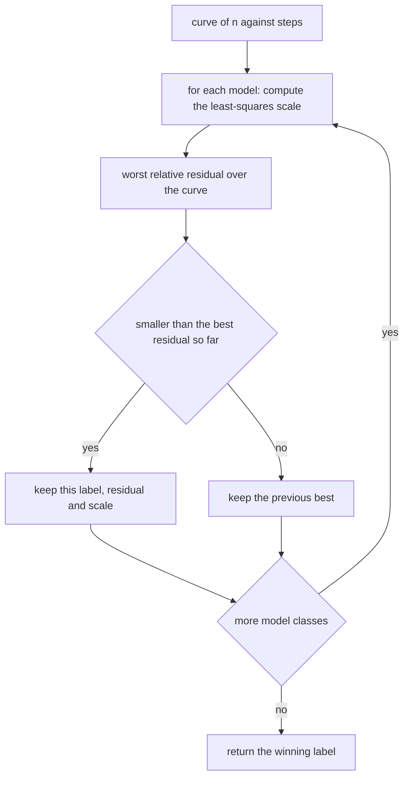
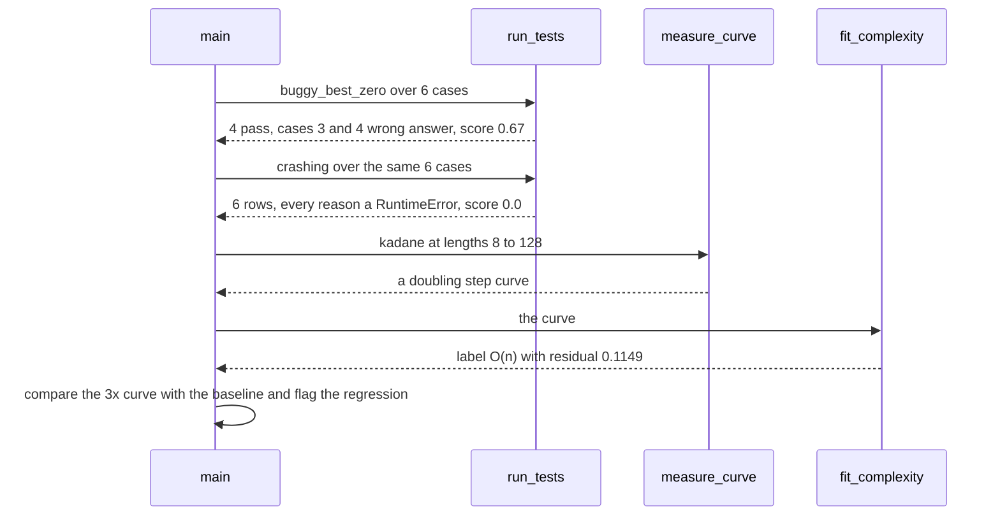

# 952 — Implement autograder that runs tests, measures complexity, and reports regression.

> **Tier:** Master · **CTCI chapter:** Ch 11 — Testing
> **Task spec:** [952-implement-autograder-that-runs-tests-measures-complexity-and-rep.md](../../../tasks/master/952-implement-autograder-that-runs-tests-measures-complexity-and-rep.md)
> **Solutions:** [Python](../../../solutions/python/master/952-implement-autograder-that-runs-tests-measures-complexity-and-rep/solution.py) ·
> [Java](../../../solutions/java/master/952-implement-autograder-that-runs-tests-measures-complexity-and-rep/Solution.java) ·
> [JavaScript](../../../solutions/javascript/master/952-implement-autograder-that-runs-tests-measures-complexity-and-rep/solution.js) ·
> [C#](../../../solutions/csharp/master/952-implement-autograder-that-runs-tests-measures-complexity-and-rep/Solution.cs)

## 1. Problem restatement

**The modelling contract first.** The four files build an *in-memory autograder*: a submission is a
callable that takes an input plus a step counter and returns an answer, and every measurement inside a
run is deterministic. "Runtime" is a counted number of elementary operations, inputs come from a
hand-written splitmix64 stream, and nothing is timed, spawned or written to disk — the Python docstring
names exactly that as the simplification versus a real autograder. What survives the simplification is
the *grading logic*: per-case verdicts with exception isolation, a least-squares fit of the growth
class, and a regression flag against a recorded baseline.

**Inputs.** A submission callable, a suite of test cases (input plus expected answer), a list of input
lengths, and optionally a baseline curve plus a reference size. Python uses lengths
`(8, 16, 32, 64, 128)`, models `O(1)`, `O(log n)`, `O(n)`, `O(n log n)`, `O(n²)`,
`FIT_TOLERANCE = 0.15` and `REGRESSION_RATIO = 1.2`.

**Outputs.** A verdict dictionary with the per-case outcomes, the number passed and the score, the
fitted complexity label with its worst relative residual, and — when a baseline is supplied — the
`regressed` flag and the measured `ratio`.

| File | Submission model | Class fitting | Regression rule |
| --- | --- | --- | --- |
| Python | callable `(values, steps) -> answer`, isolated per case | least squares per model class, smallest worst-case relative residual wins | `ratio > 1.2` on the reference size |
| Java | lambda from `int[]` to a result plus its own operation count | least-squares fit of doubling inputs against `{1, log n, n, n log n, n²}` | largest count above the baseline by 15% |
| JavaScript | one submission per exercise with a step counter | the same class family | the same comparison, reported per exercise |
| C# | a counted submission | the same class family | the same comparison |

Concrete results, from the Python file's printed run and its assertions:

| Call | Result | Source of the claim |
| --- | --- | --- |
| suite of 6 cases | 3 generated plus `([-5], -5)`, `([-4,-3,-2], -2)`, `([3], 3)`, all agreeing with the brute-force oracle | asserted |
| `kadane` and `quadratic` | 6/6, score 1.0, status `graded` | asserted |
| `buggy_best_zero` | score `0.67`, failing cases exactly `[3, 4]` — the two all-negative ones | printed as `buggy_score=0.67 failed_cases=[3, 4]` |
| `crashing` | 0/6 with a `RuntimeError` reason on *every* case row, batch intact | asserted |
| fitted labels | `kadane → O(n)`, `quadratic → O(n²)`, `search → O(log n)` | printed as `labels={'kadane': 'O(n)', 'quadratic': 'O(n^2)', 'search': 'O(log n)'}` |
| fit residuals | `0.1149`, `0.1065`, `0.0` — all below the 0.15 tolerance | printed |
| doubling ratios | 2.02 for the linear curve (128/64), 3.94 for the quadratic one (64/32) | printed as `ratios=2.02/3.94` |
| slowed curve | a 3× curve is flagged (`ratio 3.0`) while a correct submission still scores 1.0 | printed as `regressed=True`, asserted |
| empty suite / single case | `status = "no_tests"`, score 0.0, no outcome rows / one case grades to 1.0 | asserted |

## 2. Intuition

The naive autograder runs the tests and reports the fraction that passed. That misses the failure mode
grading actually cares about: a submission that is *correct but quadratic* — it passes every case and
will still die in production. It also collapses under a single crashing submission, because an
exception in case 3 aborts the loop and hides the other five verdicts.

Three ideas fix it:

1. **Correctness and complexity are graded independently.** Tests decide the score; a *separate* curve
   of `(n, steps)` measurements, taken on a fixed input family, decides the label. The buggy submission
   and the quadratic submission therefore fail in completely different channels.
2. **A crash is data, not an abort.** Each case runs inside its own `try`, and the exception becomes a
   reason string on that row, so a stub that raises still produces a full six-row report with a score
   of 0.00 rather than a stack trace.
3. **Fit the class, do not guess it from one ratio.** Two data points can be fooled by constants; least
   squares over five lengths with the *smallest worst-case relative residual* picks the model whose
   shape actually matches the curve. The file cross-checks the fit against the textbook doubling
   ratios — 2.02 for a linear curve and 3.94 for a quadratic one — which is the independent-oracle
   version of the same claim.





## 3. Algorithm

1. Generate the suite: for each length, random values with one element forced positive, and the expected
   answer from the brute-force oracle; append curated cases — a single element and two all-negative
   arrays — because those are the ones the buggy submission must fail.
2. `run_tests`: for each case, allocate a fresh step counter, call the submission inside `try`, compare
   with the expected answer, and record `{case, ok, steps, reason}` — a mismatch becomes
   `wrong answer …`, an exception becomes `TypeError: …` or `RuntimeError: …`.
3. `measure_curve`: one input per length, count the steps.
4. `fit_complexity`: for each class, compute the least-squares scale, then the worst relative residual
   `max |steps - scale · model(n)| / (scale · model(n))`; keep the smallest.
5. `grade`: assemble the verdict — score rounded to two decimals, status `graded` or `no_tests`, the
   label and residual — and, when a baseline is given, the ratio at the reference size and
   `ratio > REGRESSION_RATIO`.

```text
procedure run_tests(submission, tests)
    outcomes = empty list
    for index, values and expected in tests do
        steps = new Steps with count 0
        try
            produced = submission(values, steps)
            ok = produced equals expected
            reason = none when ok, otherwise "wrong answer produced versus expected"
        catch error
            ok = false
            reason = name of the error type followed by the message
        end
        append case index, ok, steps.count, reason to outcomes
    end
    return outcomes
end

procedure measure_curve(submission, sizes, build)
    curve = empty list
    for n in sizes do
        steps = new Steps with count 0
        submission(build(n), steps)
        append (n, steps.count) to curve
    end
    return curve
end

procedure fit_complexity(curve)
    best = nothing
    for label and model in CLASSES do
        scale = sum of steps * model(n) over the curve divided by sum of model(n)^2
        if scale <= 0 then
            continue
        end
        error = maximum over the curve of |steps - scale * model(n)| / (scale * model(n))
        if best is nothing or error < best.error then
            best = (label, error, scale)
        end
    end
    return best
end

procedure grade(submission, tests, curve, baseline, reference_n)
    outcomes = run_tests(submission, tests)
    passed = number of rows with ok true
    label, error = fit_complexity(curve)
    verdict = outcomes, passed, length of outcomes,
              round(passed / length of outcomes, 2) when outcomes is non-empty else 0.0,
              "graded" when outcomes is non-empty else "no_tests",
              label, error, regressed false, ratio 1.0
    if baseline is given then
        before = baseline steps at reference_n
        ratio = curve steps at reference_n / before when before is not zero else infinity
        verdict.regressed = ratio > REGRESSION_RATIO
        verdict.ratio = ratio
    end
    return verdict
end
```



## 4. Worked example

The suite is six cases: three generated (lengths 1, 5, 9, each with one positive element forced in) and
three curated — `([-5], -5)`, `([-4,-3,-2], -2)` and `([3], 3)`. Grading the submission that seeds its
running best with 0 traces to this:

| Case | Input | Expected | Produced | Row |
| --- | --- | --- | --- | --- |
| 0 | generated, length 1 | positive value | same | ok |
| 1 | generated, length 5 | maximum subarray | same | ok |
| 2 | generated, length 9 | maximum subarray | same | ok |
| 3 | `[-5]` | `-5` | `0` | wrong answer |
| 4 | `[-4, -3, -2]` | `-2` | `0` | wrong answer |
| 5 | `[3]` | `3` | `3` | ok |

Score `4 / 6 = 0.67`, matching the printed value, and the failures are exactly the all-negative cases —
which is the point of curating them: the generated inputs always contain a positive element, so they can
never expose a `max(0, …)` seeding bug.

The complexity channel is independent of all of that:

| Submission | Curve shape | Fitted label | Worst residual | Doubling check |
| --- | --- | --- | --- | --- |
| `kadane` (2 steps per element) | `2n` | `O(n)` | 0.1149 | 128/64 = 2.02 |
| `quadratic` (1 step per pair) | `n(n+1)/2` | `O(n²)` | 0.1065 | 64/32 = 3.94 |
| `search_first` (binary search) | `log n` probes | `O(log n)` | 0.0 | — |
| `crashing` | never measured | — | — | — |

The residuals are not zero for the linear and quadratic shapes because the counted work carries small
constant offsets; the fit tolerance of 0.15 is what absorbs them, and the assertion is
`max(residual) < 0.15` rather than an exact match. The `O(log n)` curve fits exactly on the three
lengths it is measured on, which is why its residual prints as `0.0`.

Regression reporting is the third channel. Padding the baseline curve by a factor of three gives
`ratio = 3.0 > 1.2`, so the verdict is `regressed = true` while the correctness score stays 1.0 —
exactly the "correct but slower" case a grader must be able to state in one verdict. Re-grading with the
unchanged curve gives `ratio = 1.0` and no flag.

Boundaries close the loop: an empty suite yields `status = "no_tests"`, score `0.0` and zero outcome
rows instead of a division by zero, and a one-case suite grades normally. A second oracle sweep over
unseen random inputs (seed + 7, lengths 2, 4, 8, 16) finds no disagreement between `kadane` and the
brute-force enumerator, and re-grading the buggy submission returns a verdict identical to the first
run.

## 5. Complexity

Let `c` be the number of cases, `L` the number of measured lengths and `w(n)` the work of one
submission call.

| Measure | Bound | Why it holds |
| --- | --- | --- |
| `run_tests` | `O(Σ w(n_i))` plus `O(c)` bookkeeping | one submission call per case |
| `measure_curve` | `O(Σ w(L_j))` | one call per length |
| `fit_complexity` | `O(L · K)` with `K = 5` classes | a closed-form scale and one residual pass per class |
| `grade` | the sum of the three above | the verdict is assembled, not recomputed |
| Oracle cost | `O(n³)` per case for the brute force | irrelevant at these sizes and used only to build the suite |
| Space | `O(c + L)` | outcome rows and curve points |

Two limits stay explicit. A constant-factor slowdown can never change the fitted class — the fit
compares *shapes*, which is why the regression channel exists as a separate signal. And the fit assumes
smooth work: an implementation whose step count jumps at one length (a rehash, a cache-size cliff) can
mislead a five-point curve, which is the same caveat a production grader has to live with.

## 6. Pitfalls and edge cases

- **A crashing submission must not abort the batch.** All six rows still appear, each carrying its
  exception reason, and the score is `0.0` rather than an exception escaping to the caller.
- **Step counters are per case.** Reusing one counter across cases would make the curve and the
  per-case steps meaningless; each case and each length allocates a fresh `Steps`.
- **Division by an empty suite.** `grade([], …)` returns `status = "no_tests"` and score `0.0` instead
  of dividing by zero.
- **Rounding to two decimals is part of the contract.** `4/6` prints as `0.67`; comparing raw floats
  would make the assertion brittle.
- **Curated cases carry the bugs.** Generated inputs force one positive element, so an all-negative bug is
  only caught by the hand-written cases — removing them silently drops the failing set from `[3, 4]`.
- **Two data points are not a fit.** The doubling ratios are used as a cross-check, not as the decision
  rule; the decision rule is the least-squares residual over five lengths.
- **A degenerate curve raises.** If no model gets a positive scale, `fit_complexity` raises rather than
  returning a label for a curve of zeros.
- **Regression needs a reference size.** The ratio is taken at `reference_n`, so a baseline that does not
  contain that length would fail the lookup; the file passes the same length list for both curves.
- **Determinism.** Inputs come from a seeded splitmix64 and the counters are pure, so re-grading in the
  same process reproduces the verdict exactly.

## 7. Variants and follow-ups

- **Measure with a real harness.** [951-implement-end-to-end-reproducible-benchmarking-harness-for-all-e.md](../../../tasks/master/951-implement-end-to-end-reproducible-benchmarking-harness-for-all-e.md)
  is the same count-based idea built for reporting rather than grading: warm-up, trimmed medians and
  digests instead of scores and flags.
- **Generate the cases instead of curating them.** [957-implement-randomized-test-case-generator-with-oracle-checker-for.md](../../../tasks/master/957-implement-randomized-test-case-generator-with-oracle-checker-for.md)
  pairs randomised inputs with a brute-force oracle, which is the systematic version of the curated
  all-negative cases this grader relies on.
- **Check the shape of the submission, not its behaviour.** [958-implement-plagiarism-detector-comparing-code-structure-and-logic.md](../../../tasks/master/958-implement-plagiarism-detector-comparing-code-structure-and-logic.md)
  compares structure and logic patterns, which catches the copy that passes the tests.
- **Turn the verdict into a rubric.** [956-implement-grading-rubric-generator-that-assigns-difficulty-and-e.md](../../../tasks/master/956-implement-grading-rubric-generator-that-assigns-difficulty-and-e.md)
  assigns difficulty and expected complexity per task, which is what the fitted label here would be
  compared against in a real course.

## 8. Check yourself

1. Why does the buggy submission pass four cases and fail exactly two?

<details><summary>Show answer</summary>

Because it seeds the running best with 0, so it only misreports arrays whose true maximum is negative.
The generated cases force one positive element in, and the single-element case is `[3]`, so the only
failing inputs are the two curated all-negative cases, which fail with `wrong answer 0 != -5` and
`wrong answer 0 != -2`.

</details>

2. What does `fit_error` mean, and why is it not zero for the linear submission?

<details><summary>Show answer</summary>

It is the worst relative residual `max |steps - scale · model(n)| / (scale · model(n))` over the
measured curve. `kadane` performs two steps per element plus a constant offset, so the pure `O(n)` model
does not pass exactly through the points; the residual is 0.1149, under the 0.15 tolerance the file
asserts.

</details>

3. A submission keeps its score but is flagged as regressed. Is that consistent?

<details><summary>Show answer</summary>

Yes — the two channels are independent by design. The 3× curve test scores 1.0 on correctness because
`kadane` is still right, and it is flagged because `ratio = 3.0 > 1.2`. That combination ("correct but
slower") is precisely what a real autograder has to be able to express.

</details>

4. Why run the crashing submission through `measure_curve` separately?

<details><summary>Show answer</summary>

Because a crash must not corrupt the curve. The file grades the crasher with a synthetic single-point
curve `[(8, 8)]` so the correctness channel can be asserted in full: six outcome rows, every reason a
`RuntimeError`, score 0.0. Mixing the exception into a real curve would test two things at once.

</details>

5. What would a rehash cliff do to the fitted label?

<details><summary>Show answer</summary>

It could push the residual of the true class above 0.15 while some other class fits the five points
better, so the label could be wrong even though the code is right. That is the documented limitation of
fitting a shape to a small curve, and the reason the class is reported together with its residual
rather than as a bare string.

</details>
