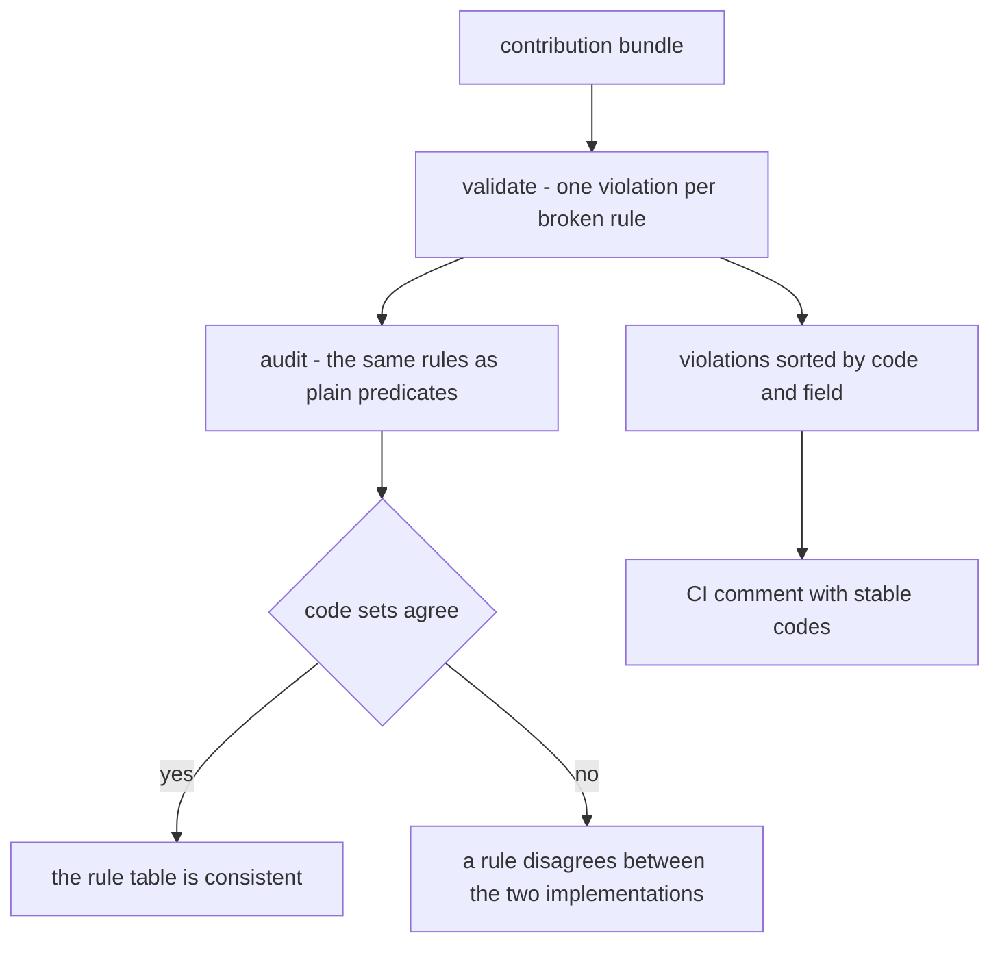
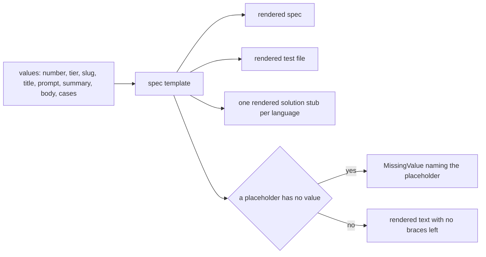
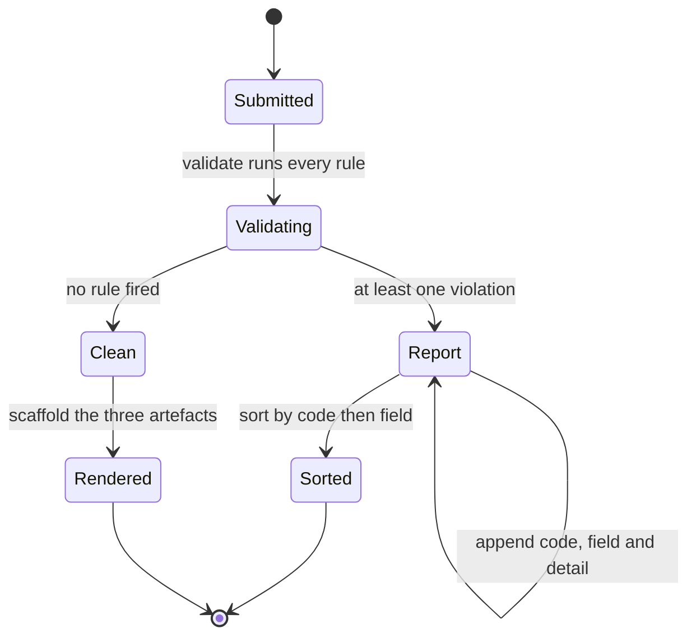
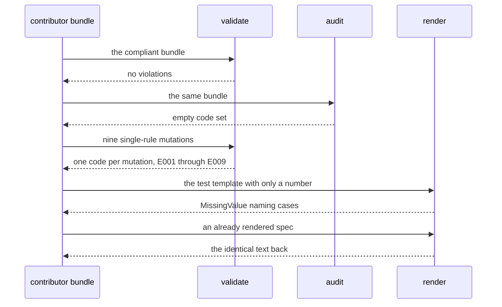

# 953 — Implement contributor guide and templates for new problems, tests, and solutions.

> **Tier:** Master · **CTCI chapter:** Beyond — Software Engineering & Tooling
> **Task spec:** [953-implement-contributor-guide-and-templates-for-new-problems-tests.md](../../../tasks/master/953-implement-contributor-guide-and-templates-for-new-problems-tests.md)
> **Solutions:** [Python](../../../solutions/python/master/953-implement-contributor-guide-and-templates-for-new-problems-tests/solution.py) ·
> [Java](../../../solutions/java/master/953-implement-contributor-guide-and-templates-for-new-problems-tests/Solution.java) ·
> [JavaScript](../../../solutions/javascript/master/953-implement-contributor-guide-and-templates-for-new-problems-tests/solution.js) ·
> [C#](../../../solutions/csharp/master/953-implement-contributor-guide-and-templates-for-new-problems-tests/Solution.cs)

## 1. Problem restatement

**The modelling contract first.** The four files make the contributor guide *executable*: the prose
rules become a `validate` function that returns one violation per broken rule, and the artifacts a
contributor submits — a spec, a solution per language, a test file — are rendered from templates. The
Python docstring names the simplifications: the "repository" is an in-memory bundle rather than a
checkout, files live in a dictionary instead of on disk, and submitted tests are *shape-checked*
(count and the presence of the check helper) rather than executed, because a guide cannot run user
code. What is real is the rule set, the naming conventions and the placeholder semantics.

**Inputs.** A bundle describing a contribution: number, tier, slug, title, README title, spec text,
a `solutions` mapping keyed by language, and a list of test cases.

**Outputs.** A list of violations, each `{code, field, detail}`, sorted by `(code, field)` — the shape
a CI comment bot posts — and the three rendered artifacts.

| Constant | Python value | Meaning |
| --- | --- | --- |
| `LANGUAGES` | `python`, `java`, `javascript`, `csharp` | a contribution must ship all four |
| `SLUG_MAX` | 64 | slug length, counted in characters |
| `MIN_SOLUTION_LINES` | 60 | minimum solution length |
| `MIN_TESTS` | 3 | minimum number of test cases |
| `RULE_CODES` | `E001` … `E009` | one code per rule |

| Code | Rule |
| --- | --- |
| `E001` | the number is an integer in `1 … 998` |
| `E002` | the slug matches `\d{3}-[a-z0-9]+(-[a-z0-9]+)*`, is at most 64 characters and starts with the zero-padded number |
| `E003` | the spec title equals the README title |
| `E004` | the spec's first line is a `# NNN - …` heading and the spec carries a `- **Tier:**` line |
| `E005` / `E006` | a language is missing / an unknown language is present |
| `E007` / `E008` | a solution is shorter than 60 lines / contains no `check(` helper |
| `E009` | fewer than three tests |

Concrete results, from the Python file's printed run and its assertions:

| Call | Result | Source of the claim |
| --- | --- | --- |
| a compliant bundle | `validate` returns `[]`; the scaffold has exactly the keys `solution`, `spec`, `test` with no `{{` left | asserted |
| nine single-rule mutations | each one fires its own code; `fired` lists `E001 … E009` | printed as `fired=['E001', …, 'E009']` |
| independent predicate audit | agrees with `validate` on every mutation and on the clean bundle (no codes) | asserted |
| slug boundary | 64 characters passes, 65 characters reports exactly `E002` | printed as `slug_lengths=64/65` |
| test boundary | exactly three cases pass, two cases report exactly `E009` | asserted |
| strict rendering | rendering the test template without `cases` raises `MissingValue` naming that placeholder; unused values are ignored | asserted |
| idempotence | re-rendering an already rendered spec returns it byte for byte | asserted |
| empty bundle | exactly `E001`, `E002`, `E004`, `E005`, `E009` — five codes, in sorted order | printed as `empty_codes=5` |
| missing-language detail | the E005 detail for a bundle without Java is the string `java` | printed as `missing_language_detail=java` |

## 2. Intuition

The naive approach is a written guide plus a reviewer with a checklist. It fails the way all prose
fails: rules drift, reviewers disagree, and the same submission passes on Monday and fails on Tuesday.
The second naive approach — a linter that only checks file names — misses everything that makes a
contribution *usable*: a solution that is three lines long, a test file with one case, a spec whose
title disagrees with the README.

The insight is that a guide is a **set of predicates over a bundle**, and every predicate deserves
three things: a stable code, a machine-readable field reference, and a mutation that proves it can
fire. The Python file implements exactly that triangle — `validate` for the ordering, `audit` as an
independently written predicate version for the semantics, and nine mutations so that "every rule is
reachable" is an assertion rather than a claim.



The second insight concerns rendering. A template with an unsubstituted `{{placeholder}}` is worse than
a failed render, because it looks like content. So rendering is **strict** — a placeholder without a
value raises and names the missing key — and **idempotent**: re-rendering an already rendered artifact
is a no-op, which is what lets a later tool rewrite one artifact without touching the others.



## 3. Algorithm

1. Render the three artifacts: `spec`, `solution` and `test`, substituting every `{{name}}`
   placeholder; before substituting, collect the placeholders that have no value and raise
   `MissingValue` listing them sorted.
2. Validate the bundle, rule by rule, appending a violation whenever a rule is broken.
3. Sort the violations by `(code, field)` so the report order is stable regardless of the rule order.
4. Cross-check with the independent `audit`, which recomputes the same nine predicates as a set of
   codes without any shared code path.
5. Mutate the compliant bundle nine times — one mutation per rule — and assert that each mutation fires
   its own code, and that the audit's code set equals `validate`'s.

```text
procedure render(template, values)
    missing = sorted set of placeholder names in template with no entry in values
    if missing is not empty then
        signal MissingValue naming the missing placeholders
    end
    return template with every placeholder replaced by its value
end

procedure scaffold(number, tier, slug, title, prompt, summary, body, cases)
    values = all of the above, with cases joined into the case lines of the template
    return map from each template name to render(template, values)
end

procedure validate(bundle)
    violations = empty list
    number = bundle.number
    slug = text of bundle.slug
    if number is not an integer in 1 to 998 then
        report E001 on field number
    end
    prefix = zero padded number followed by a dash when number is an integer
    if slug is longer than SLUG_MAX, does not match the slug pattern, or does not start with prefix then
        report E002 on field slug
    end
    if bundle.title differs from bundle.readme_title then
        report E003 on field title
    end
    if the first line of bundle.spec is not a heading for that number, or the spec has no tier line then
        report E004 on field spec
    end
    report E005 for each declared language missing from bundle.solutions
    report E006 for each key of bundle.solutions that is not a declared language
    for each declared language present in bundle.solutions do
        if the solution has fewer than MIN_SOLUTION_LINES lines then
            report E007 on solutions.language
        end
        if the solution does not contain the check helper then
            report E008 on solutions.language
        end
    end
    if bundle.tests has fewer than MIN_TESTS cases then
        report E009 on field tests
    end
    return violations sorted by code and then field
end
```



## 4. Worked example

Start from the compliant bundle: number 953, four solutions of at least 60 lines each carrying a
`check(` helper, three test cases, a spec whose first line is `# 953 - …` and a title equal to the
README title. `validate` returns `[]`, and the scaffold contains exactly three keys with no leftover
braces.

Now break exactly one thing at a time and watch the codes fire:

| Mutation | Expectation | `validate` result |
| --- | --- | --- |
| number 1200 | out of range | `E001` on `number` |
| slug `953-Implement-Guide` | uppercase and wrong shape | `E002` on `slug` |
| title changed | disagrees with the README title | `E003` on `title` |
| spec `no heading at all` | no heading, no tier line | `E004` on `spec` |
| solutions without `java` | one language missing | `E005` on `solutions`, detail `java` |
| an extra `rust` solution | unknown language | `E006` on `solutions`, detail `rust` |
| a 1-line python solution | too short | `E007` on `solutions.python` |
| 70 lines of `x = 1` with no helper | no `check(` | `E008` on `solutions.python` |
| only one test case | below the minimum | `E009` on `tests` |

Every row is also checked against `audit`, whose code *set* must equal `validate`'s — two independent
implementations of the same nine predicates, which is the guard against a rule that quietly stops
working in one of them. The union of the fired codes is exactly `E001 … E009`, so no rule is dead code.

Boundaries are where a guide usually lies, so they are pinned:

| Boundary | Value | Result |
| --- | --- | --- |
| slug | `953-` plus 60 characters = 64 | accepted, `validate` clean |
| slug | 65 characters | exactly one violation, `E002` |
| tests | exactly 3 | accepted |
| tests | 2 | exactly one violation, `E009` |
| empty bundle `{}` | — | exactly `E001`, `E002`, `E004`, `E005`, `E009`, in that sorted order, and `audit({})` agrees |

The empty-bundle row is worth reading twice: five of the nine rules fire without any submitted content,
and the other four (`E003`, `E006`, `E007`, `E008`) need content to be wrong — a rule that fired on an
empty bundle would be reporting a defect nobody made.



## 5. Complexity

Let `L` be the number of languages, `r` the number of rules, `n` the total size of the submitted text
and `p` the number of placeholders in a template.

| Measure | Bound | Why it holds |
| --- | --- | --- |
| `render` | `O(n + p)` | one scan for the placeholders, one substitution pass |
| `scaffold` | `O(n)` over three templates | constant number of artifacts, each a single substitution |
| `validate` | `O(n + L)` | one pass over the spec and one per solution, plus counting tests |
| `audit` | `O(n + L)` | the same scans with a different implementation |
| Sorting violations | `O(v log v)` for `v ≤ 9L + 4` violations | the report order is bounded by the rule count |
| Space | `O(n)` | the bundle and the rendered text are the only storage |

The limits are honesty points rather than asymptotics. The submitted tests are *shape-checked*, not
run, so a contribution with three nonsense cases passes this guide and fails a real CI — the docstring
says so. And the "repository" is a dictionary, so nothing here proves that a file was actually written
to the canonical path; the Java variant comes closest by planning paths in a tree map and asserting that
the planned and generated paths agree exactly.

## 6. Pitfalls and edge cases

- **A placeholder with no value must fail loudly.** Silently leaving `{{cases}}` in the output produces
  an artifact that looks complete; the file raises `MissingValue` and asserts the error names the
  placeholder.
- **Unused values are fine.** `render("{{number}}-{{number}}", {number: 953, unused: "x"})` returns
  `953-953`; strictness is about missing values, not about extra ones.
- **Idempotence is a real property.** Re-rendering a rendered artifact must return it unchanged,
  otherwise a second tool run would rewrite files with respect to nothing.
- **The slug prefix is zero-padded.** `1-…` is not `001-…`, and the prefix check is built from
  `f"{number:03d}-"`, so a submission numbered 1 must be named `001-…`.
- **Slug length counts characters, not words.** The boundary is exactly 64 versus 65 — the contract in
  the tutorial guidelines is the same 64, which is why the file pins it.
- **Empty bundles must not fire rules that need content.** `E003`, `E006`, `E007` and `E008` stay silent
  on `{}`; the assertion lists the five codes that must fire precisely so an over-eager rule is caught.
- **Violations must be ordered.** Sorting by `(code, field)` makes the CI comment stable; inserting a
  new rule in the middle of `validate` must not reorder the existing report lines.
- **Titles are compared, not normalised.** The spec title and the README title must be equal strings —
  trailing whitespace or a changed em dash is a violation, which is what `E003` is for.
- **The independent audit must not share code.** `audit` re-implements the predicates with plain
  expressions (`slug[:4] != prefix`, `text.count("\n") + 1 < MIN_SOLUTION_LINES`); if it called
  `validate` the cross-check would be vacuous.

## 7. Variants and follow-ups

- **Write the artifacts out.** The Java variant plans canonical paths for each language stub in a tree
  map and asserts that the planned paths and the generated ones agree exactly, which is the file-system
  half of this guide.
- **Run the tests instead of shape-checking them.** [957-implement-randomized-test-case-generator-with-oracle-checker-for.md](../../../tasks/master/957-implement-randomized-test-case-generator-with-oracle-checker-for.md)
  is what `MIN_TESTS` should eventually mean: generated cases plus an oracle that decides whether the
  submission is right.
- **Enforce the guide in CI.** [954-implement-ci-pipeline-that-runs-on-multiple-jdks-and-oses-with-r.md](../../../tasks/master/954-implement-ci-pipeline-that-runs-on-multiple-jdks-and-oses-with-r.md)
  is where these violation codes become a required job that gates a merge, including the fail-fast
  policy when the style job fails.
- **Extend the rule set to similarity.** [958-implement-plagiarism-detector-comparing-code-structure-and-logic.md](../../../tasks/master/958-implement-plagiarism-detector-comparing-code-structure-and-logic.md)
  adds the rule this guide deliberately cannot express: a contribution that is a copy of another one.
- **Publish the accepted shape.** [955-implement-canonical-solution-repository-with-multiple-language-s.md](../../../tasks/master/955-implement-canonical-solution-repository-with-multiple-language-s.md)
  is the repository-wide version of "what a good contribution looks like", with baselines attached.

## 8. Check yourself

1. Why does `validate({})` report exactly five codes, and which rules stay silent?

<details><summary>Show answer</summary>

`E001`, `E002`, `E004`, `E005` and `E009` all fire on absent content: a missing number, an empty slug,
a missing heading, all four languages missing, and zero tests. `E003`, `E006`, `E007` and `E008` cannot
fire without submitted content — there is no title to contradict, no extra language, no short solution
and no solution missing its helper — and a rule that invented a violation here would be a false alarm.

</details>

2. What does the strict-render rule protect against?

<details><summary>Show answer</summary>

A template that looks finished but still contains `{{cases}}`. By checking placeholders before
substituting and raising `MissingValue` that names the missing key, the failure is loud and points at
the right value; the assertion also verifies that extra, unused values are simply ignored.

</details>

3. Why keep both `validate` and `audit` when they implement the same nine rules?

<details><summary>Show answer</summary>

Because the rule table is the product. `validate` produces the CI-shaped report (code, field, detail,
sorted), while `audit` is a second, independently written predicate version returning a code set. The
test asserts they agree on the clean bundle and on all nine mutations, so a rule that silently stops
working in one implementation is caught by the other.

</details>

4. A slug is `953-` plus 61 lowercase characters. What happens, and why is that the interesting case?

<details><summary>Show answer</summary>

It is 65 characters, so `E002` fires — exactly one violation, and the file asserts that list rather than
"contains E002". The 64/65 pair is the boundary that separates "the pattern matched" from "the length
limit held"; a rule checking only the regular expression would accept an unbounded slug.

</details>

5. What can this guide not catch, by construction?

<details><summary>Show answer</summary>

Anything that requires running the submission: a solution that compiles but returns wrong answers, a
test file with three cases that all pass vacuously, or a copy of another contribution. Those are the
jobs of the testing and similarity tasks; this guide checks shape, naming and the presence of the
required artifacts.

</details>
