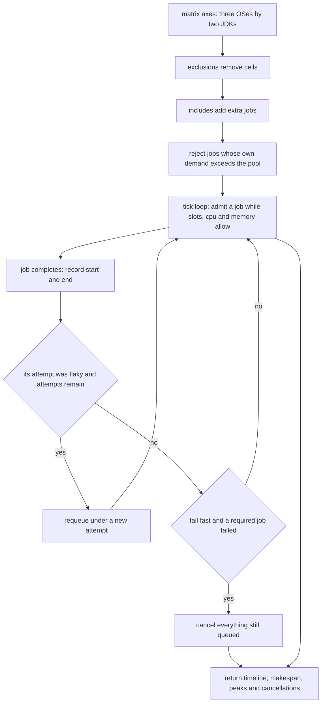
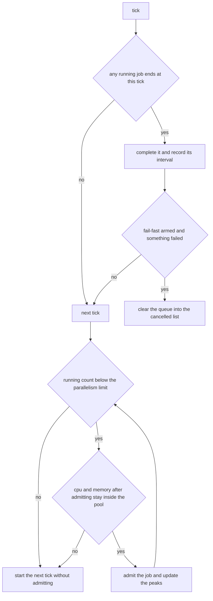
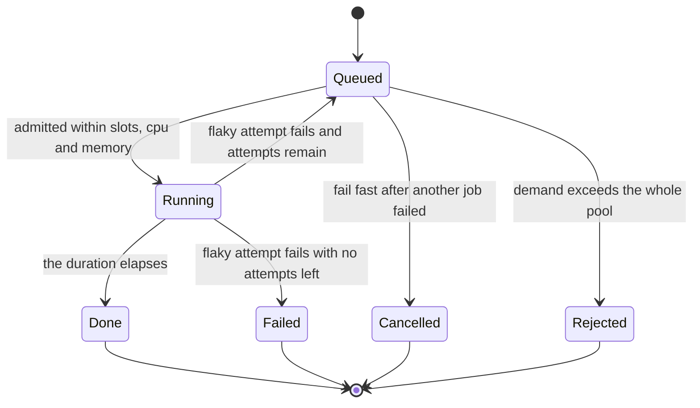
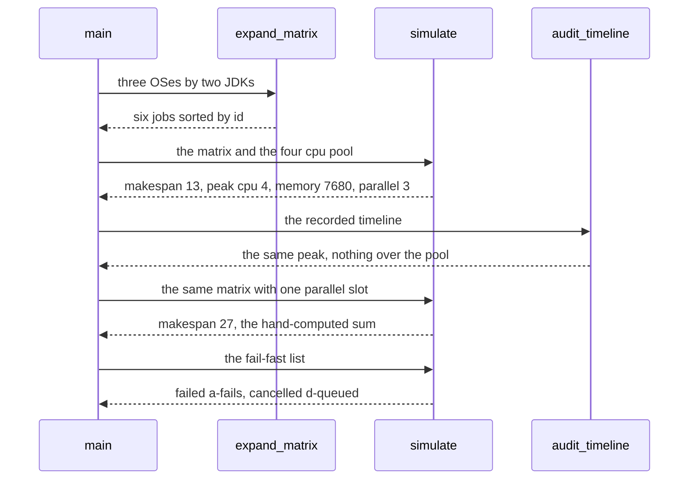

# 954 — Implement CI pipeline that runs on multiple JDKs and OSes with resource limits.

> **Tier:** Master · **CTCI chapter:** Beyond — Software Engineering & Tooling
> **Task spec:** [954-implement-ci-pipeline-that-runs-on-multiple-jdks-and-oses-with-r.md](../../../tasks/master/954-implement-ci-pipeline-that-runs-on-multiple-jdks-and-oses-with-r.md)
> **Solutions:** [Python](../../../solutions/python/master/954-implement-ci-pipeline-that-runs-on-multiple-jdks-and-oses-with-r/solution.py) ·
> [Java](../../../solutions/java/master/954-implement-ci-pipeline-that-runs-on-multiple-jdks-and-oses-with-r/Solution.java) ·
> [JavaScript](../../../solutions/javascript/master/954-implement-ci-pipeline-that-runs-on-multiple-jdks-and-oses-with-r/solution.js) ·
> [C#](../../../solutions/csharp/master/954-implement-ci-pipeline-that-runs-on-multiple-jdks-and-oses-with-r/Solution.cs)

## 1. Problem restatement

**The modelling contract first.** The four files build an *in-memory CI pipeline*: a matrix expansion
turns the `(os, jdk)` axes into jobs, and a discrete-event simulator schedules them tick by tick
against a runner pool with CPU, memory and parallelism limits. Ticks stand in for minutes, each job is
a closed-form `(cpu, memory, duration)` demand instead of a real toolchain run, and nothing is spawned —
the Python docstring says so plainly. What is *not* simplified is the set of invariants a real pipeline
configuration must keep: resources never exceed the pool, dependents wait for their prerequisites, a
failing required job cancels the queued remainder under fail-fast, and a flaky job gets a bounded
retry.

**Inputs.** Axes and matrix entries (include/exclude), a pool `{cpu, memory_mb, max_parallel}`, per-OS
demands, and per-job policy flags (`fails_until`, `attempts`). Python uses three operating systems ×
two JDKs, `POOL = {cpu: 4, memory_mb: 8192, max_parallel: 3}` and `DEMAND` of `(1, 2048, 3)` for
Ubuntu, `(2, 3072, 5)` for Windows and `(1, 2560, 4)` for macOS, with one extra tick for JDK 21.

**Outputs.** A timeline of `(start, end)` per job, the makespan, the peak resource usage, the cancelled
and failed job lists, and an independent audit that recomputes the peak from the timeline.

| File | Scheduling model | Extra guarantees checked |
| --- | --- | --- |
| Python | tick loop admitting a job while slots, CPU and memory allow | peak usage replayed per tick by `audit_timeline`; serial makespan against a hand-computed sum |
| Java | tick-driven scheduler over the same matrix | interval replay, dependents start after prerequisites succeed, a hung job killed at the time limit |
| JavaScript | the same discrete-event model | two runs produce one digest |
| C# | the same model with an in-memory registry | invariant checks over the produced schedule |

Concrete results, from the Python file's printed run and its assertions:

| Call | Result | Source of the claim |
| --- | --- | --- |
| `expand_matrix()` | 6 jobs, ids sorted, exactly the six axis combinations | asserted |
| `expand_matrix(exclude=…, include=…)` | 5 jobs after removing two cells and adding `extra-static` | asserted |
| `simulate(jobs, POOL)` | parallel makespan 13, work 38 CPU-ticks, peak `{cpu: 4, memory_mb: 7680, parallel: 3}` | printed |
| `simulate(heavy, serial_pool)` | makespan 27, the hand-computed sum of durations, parallelism 1 | printed as `serial_makespan=27` |
| makespan bounds | `≥ max duration` and `≥ ceil(work / cpu)`; the wide pool beats the serial one | asserted |
| fail-fast run | `failed = ['a-fails']`, `cancelled = ['d-queued']`, timeline holds `a-fails`, `b-ok`, `c-queued` | printed as `cancelled=['d-queued']` |
| retry run (`attempts = 2`) | `failed = []`, `a-fails` occupies `(3, 6)`, makespan 7, all four jobs scheduled | printed as `retried=[a-fails, b-ok, c-queued, d-queued]` |
| oversized job (8 CPU, 8192 MB) | rejected up front with reason `needs 8cpu/8192MB`, never scheduled | printed as `rejected=['huge']` |
| empty pipeline / single job | makespan 0 and `{}` timeline / the single job costs its duration, 5 | asserted |

## 2. Intuition

The naive pipeline is `matrix:` plus a `max-parallel:` knob, and it has three failure modes that cost
real money and real time. A matrix cell that needs more memory than any runner has sits in the queue
forever instead of failing fast. A flaky test fails the whole pipeline, so the next push re-runs
everything from scratch. And a required job that fails keeps the rest of the queue running, burning
minutes on work whose artifact nobody will use.

Each failure has a rule, and every rule is something the simulator has to *show*:

1. **Reject what can never run.** If a job's own demand exceeds the whole pool — 8 CPUs against a
   4-CPU pool — no schedule can ever admit it, so it is refused before the tick loop starts, with a
   reason string attached.
2. **Bound the retry, then fail.** `attempts = 2` means a job that fails its first attempt is requeued
   once and passes the second time; when attempts are exhausted the job is recorded as failed.
3. **Cancel the tail, not the present.** Under fail-fast the queued jobs are cancelled, but jobs already
   running finish — hence `c-queued` (already started) appears in the timeline while `d-queued` (still
   waiting) does not. Cancelling a running job would throw away work that may already have produced an
   artifact.





## 3. Algorithm

1. `expand_matrix`: cross the axes, drop the excluded cells, append the include entries, and sort by id
   so the schedule cannot depend on input order.
2. `reject_unschedulable`: move every job whose own CPU or memory exceeds the pool into a rejected list
   with a reason.
3. `simulate`: maintain a queue sorted by id and a running list. At each tick complete the jobs whose
   end has arrived, record their intervals, decide about retries, apply fail-fast, then admit as many
   queued jobs as the parallelism, CPU and memory budgets allow — updating the peak after each
   admission. The loop has a convergence guard at 500 ticks.
4. `audit_timeline`: recompute, per tick and straight from the recorded intervals, the summed CPU,
   memory and parallel usage, and report whether any of them exceeds the pool.
5. Compare the serial makespan with the hand-computed sum of durations, and the parallel one against its
   lower bounds.

```text
procedure simulate(jobs, limits, fail_fast)
    queue = sorted copies of jobs carrying attempt = 0
    running = empty list, timeline = empty map, cancelled = empty list, failed = empty list
    peak = zeros for cpu, memory and parallel
    tick = 0
    while queue is not empty or running is not empty do
        for row in the running list whose end is at or before tick do
            remove row from running
            record timeline for that job as its start and end
            if the row's attempt is flaky and another attempt remains then
                append the job to queue with attempt + 1
            else if the row's attempt is flaky then
                append the job id to failed
            end
        end
        if fail_fast and failed is not empty then
            move every queued id into cancelled
            clear the queue
        end
        for item in a copy of the queue do
            if running count is at the parallelism limit then
                break
            end
            cpu = sum of cpu of running plus the item's cpu
            memory = sum of memory of running plus the item's memory
            if cpu exceeds the pool or memory exceeds the pool then
                continue
            end
            remove item from queue
            append a running row with start tick and end tick plus its duration
            peak = element-wise maximum of peak and the cpu, memory and running count
        end
        tick = tick + 1
        if tick exceeds 500 then
            signal RuntimeError
        end
    end
    return timeline, makespan, cancelled, failed, peak
end

procedure audit_timeline(timeline, jobs, limits)
    makespan = largest end in the timeline, or zero
    peak = zeros
    for tick = 0 to makespan - 1 do
        active = jobs whose interval contains tick
        peak.cpu = maximum of peak.cpu and the summed cpu of active
        peak.memory = maximum of peak.memory and the summed memory of active
        peak.parallel = maximum of peak.parallel and the count of active
    end
    return peak, whether any component of peak exceeds the pool
end
```



## 4. Worked example

The full matrix is six jobs, with per-OS demands and one extra tick for JDK 21:

| Job | CPU | Memory (MB) | Duration | Why |
| --- | --- | --- | --- | --- |
| `macos-latest-jdk17` | 1 | 2560 | 4 | base macOS demand |
| `macos-latest-jdk21` | 1 | 2560 | 5 | one extra tick |
| `ubuntu-latest-jdk17` | 1 | 2048 | 3 | base Ubuntu demand |
| `ubuntu-latest-jdk21` | 1 | 2048 | 4 | one extra tick |
| `windows-latest-jdk17` | 2 | 3072 | 5 | base Windows demand |
| `windows-latest-jdk21` | 2 | 3072 | 6 | one extra tick |

Two statistics pin the schedule to arithmetic rather than to the simulator's opinion. The **serial**
run with `max_parallel = 1` gives makespan `3 + 4 + 5 + 6 + 4 + 5 = 27`, which is exactly the
hand-computed sum of durations, so the tick loop is not losing or duplicating time. The **work** of the
whole matrix is `Σ cpu · duration = 3 + 4 + 10 + 12 + 4 + 5 = 38` CPU-ticks, so with a 4-CPU pool the
makespan can never be below `ceil(38 / 4) = 10` — the file asserts that bound alongside
`makespan ≥ max duration = 6`.

The parallel run lands at **13** with peak usage `{cpu: 4, memory_mb: 7680, parallel: 3}`: all four CPU
slots and all three parallel slots are used, and memory peaks just under the 8192 MB pool. The file does
not trust those numbers — `audit_timeline` recomputes the same peaks tick by tick from the recorded
intervals, and the assertion is `audited == run["peak"]` with `over == false`.

Then the policies, on a four-job list (`a-fails`, `b-ok`, `c-queued`, `d-queued`):

| Run | Outcome | Why |
| --- | --- | --- |
| fail-fast, one attempt | `failed = ['a-fails']`, `cancelled = ['d-queued']`, timeline `a-fails`, `b-ok`, `c-queued` | the queue is cleared when the failure is detected; `c-queued` had already started and finishes |
| two attempts | `failed = []`, `a-fails` occupies `(3, 6)`, makespan 7, all four scheduled | the flaky job is requeued after its first attempt and passes on the second |
| oversized job added | `rejected = ['huge']` with reason `needs 8cpu/8192MB`, never in the timeline | 8 CPUs cannot fit in a 4-CPU pool at any moment |

Determinism closes the loop: `simulate` sorts the queue by id, so passing the job list in reverse order
produces the identical schedule, and the empty pipeline finishes in zero ticks with an empty timeline
while a single macOS JDK 21 job costs exactly its five ticks.



## 5. Complexity

Let `J` be the number of jobs, `D` the makespan in ticks and `R` the parallelism limit.

| Measure | Bound | Why it holds |
| --- | --- | --- |
| `expand_matrix` | `O(J log J)` | one job per axis pair, then a sort by id |
| `reject_unschedulable` | `O(J)` | one comparison of CPU and memory per job |
| `simulate` | `O(D · J log J)` | each tick scans the running list and walks the sorted queue |
| `audit_timeline` | `O(D · J)` | per tick it filters the intervals and sums their demands |
| Space | `O(J)` | queue, running list and the timeline map, and the audit needs no extra state |

The simplifications matter to these numbers. Real CI spends most of its time in *setup* — pulling
images, restoring caches, installing a JDK — which is invisible here because a job is a closed-form
demand; and real runners are not fungible, so a macOS job genuinely cannot start on an Ubuntu runner,
which this model ignores by treating slots as interchangeable integers. The repository-level task that
mirrors this one in production terms is the GitHub Actions workflow the spec describes; the simulator
checks the invariants that workflow must respect, not the wall-clock cost of respecting them.

## 6. Pitfalls and edge cases

- **A job bigger than the pool must be rejected, not queued.** Otherwise the tick loop never converges
  and the pipeline hangs at 100% queue depth; the reason string is what a human needs to fix it.
- **Fail-fast must not cancel running jobs.** `c-queued` was already running when `a-fails` failed, and
  it appears in the timeline; only `d-queued` is cancelled. Cancelling work in flight also throws away
  whatever artifact it may already have produced.
- **Retries need a bound.** `attempts = 2` means exactly one retry; a job that fails both attempts ends
  up in `failed` and can no longer be requeued. Duration arithmetic is part of the model too — JDK 21
  costs `(jdk - 17) // 4 = 1` extra tick, which is where `3/4`, `5/6` and `4/5` come from.
- **An independent audit is required.** `audit_timeline` recomputes usage from the intervals rather than
  from the simulator's bookkeeping, which is how an off-by-one in the admission check would be caught.
- **Idle slots are not a failure.** The wide pool finishes in 13 ticks where the serial one needs 27, but
  the assertion is a bound, not an exact schedule: the file checks `makespan < serial` plus the two
  lower bounds, so a differently ordered but legal schedule still passes. An empty pipeline is legal too
  — makespan 0, empty timeline, audited peak all zeros.
- **Determinism from sorting, not from luck.** The queue is sorted by id at every step, so a permuted
  input yields the same schedule — asserted by running the reversed list.

## 7. Variants and follow-ups

- **Make the pipeline gate a merge.** [953-implement-contributor-guide-and-templates-for-new-problems-tests.md](../../../tasks/master/953-implement-contributor-guide-and-templates-for-new-problems-tests.md)
  defines the violation codes; this task is where a style job that reports them becomes required, and
  where fail-fast decides what happens to the rest of the matrix.
- **Feed the pipeline real measurements.** [951-implement-end-to-end-reproducible-benchmarking-harness-for-all-e.md](../../../tasks/master/951-implement-end-to-end-reproducible-benchmarking-harness-for-all-e.md)
  produces the per-platform numbers a matrix run would compare; the digest is what makes two operating
  systems' results comparable at all.
- **Grade what the pipeline publishes.** [952-implement-autograder-that-runs-tests-measures-complexity-and-rep.md](../../../tasks/master/952-implement-autograder-that-runs-tests-measures-complexity-and-rep.md)
  turns a matrix run into per-submission verdicts, with regressions flagged against a baseline.
- **Verify the numbers end to end.** [955-implement-canonical-solution-repository-with-multiple-language-s.md](../../../tasks/master/955-implement-canonical-solution-repository-with-multiple-language-s.md)
  holds the canonical solutions and performance baselines that the matrix exists to validate.
- **Add fair-share scheduling.** Extend the admission rule from "does it fit" to a multi-tenant policy,
  which is the multi-tenant GPU scheduler task in this tier's neighbourhood: the same tick loop with a
  fairness weight per tenant instead of a global FIFO queue.

## 8. Check yourself

1. Why can the serial makespan be asserted exactly while the parallel one cannot?

<details><summary>Show answer</summary>

With `max_parallel = 1` there is only one legal order — the jobs run back to back — so the makespan is
exactly the sum of durations, 27, a number computable without the simulator. With parallelism there are
many legal schedules, so the file asserts bounds instead: `≥ max duration`, `≥ ceil(work / cpu)`, and
strictly less than the serial makespan.

</details>

2. Under fail-fast, why does `c-queued` appear in the timeline while `d-queued` does not?

<details><summary>Show answer</summary>

Because `a-fails` fails at tick 3 and `c-queued` was already admitted before that tick, so it runs to
completion and is recorded. `d-queued` was still waiting when the failure was detected, so it is moved
to `cancelled`. The policy stops *starting* work, it does not abort work in flight.

</details>

3. What does the retry run prove that the fail-fast run does not?

<details><summary>Show answer</summary>

That a transient failure is recoverable: with `attempts = 2` the flaky job is requeued, its second
attempt occupies ticks `(3, 6)`, `failed` is empty, and all four jobs end up in the timeline with a
makespan of 7. It also proves the retry is bounded — a job with no attempts left would be recorded as
failed instead.

</details>

4. Why is an 8-CPU job rejected before the tick loop rather than left in the queue?

<details><summary>Show answer</summary>

Because no schedule can ever admit it: its own demand exceeds the entire pool, so the admission check
would reject it at every tick and the loop would never drain the queue (which is why the simulator has a
500-tick guard at all). Rejecting up front turns a hang into a message — `needs 8cpu/8192MB` — that
names the required capacity.

</details>

5. Why recompute the peak usage instead of trusting the simulator's counter?

<details><summary>Show answer</summary>

Because the peak is the resource guarantee. `audit_timeline` derives CPU, memory and parallelism usage
per tick purely from the recorded `(start, end)` intervals and asserts equality with the simulated peaks
plus `no component over the pool`. Any off-by-one in the admission arithmetic — a job counted as started
one tick early, a released slot never reclaimed — shows up as a mismatch.

</details>
