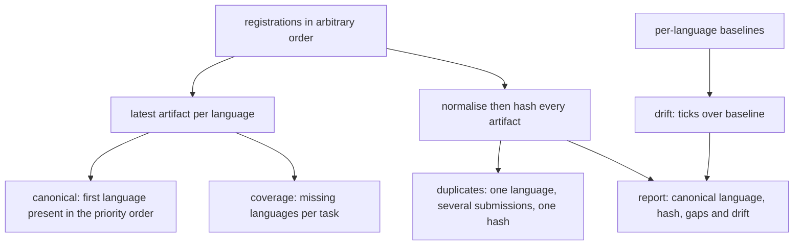
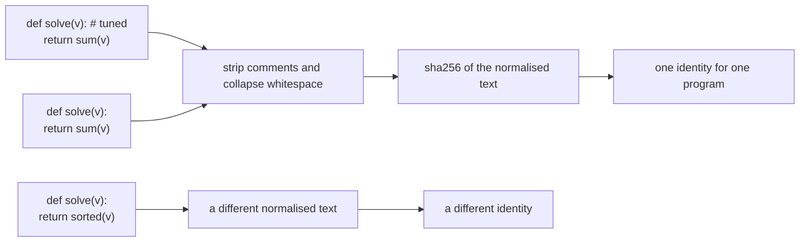
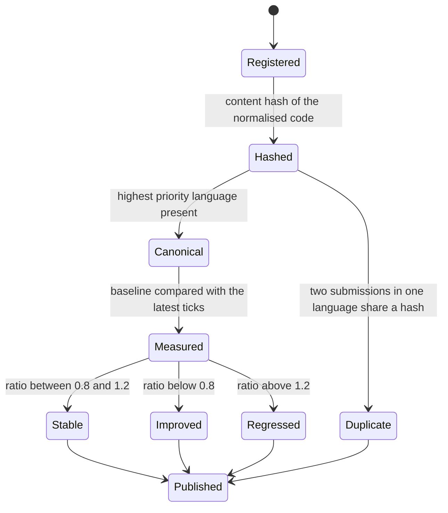

# 955 — Implement canonical solution repository with multiple language solutions and performance baselines.

> **Tier:** Master · **CTCI chapter:** Beyond — Software Engineering & Tooling
> **Task spec:** [955-implement-canonical-solution-repository-with-multiple-language-s.md](../../../tasks/master/955-implement-canonical-solution-repository-with-multiple-language-s.md)
> **Solutions:** [Python](../../../solutions/python/master/955-implement-canonical-solution-repository-with-multiple-language-s/solution.py) ·
> [Java](../../../solutions/java/master/955-implement-canonical-solution-repository-with-multiple-language-s/Solution.java) ·
> [JavaScript](../../../solutions/javascript/master/955-implement-canonical-solution-repository-with-multiple-language-s/solution.js) ·
> [C#](../../../solutions/csharp/master/955-implement-canonical-solution-repository-with-multiple-language-s/Solution.cs)

## 1. Problem restatement

**The modelling contract first.** The four files build an *in-memory canonical repository*: each
`(task, language)` pair is registered as a small code string with a declared median runtime, and the
repository derives four views from that log — the canonical artifact, per-task coverage gaps,
duplicate detection, and drift against a per-language baseline. The Python docstring is explicit about
the simplifications: the artifacts are short strings that are **neither compiled nor executed**, and
the runtimes are declared ticks rather than measurements. What is real is the *policy*: which artifact
counts as canonical, what counts as the same program, and what counts as a regression.

**Inputs.** Registrations `(task, language, code, ticks)` in any order, plus a per-task, per-language
baseline. Python fixes the priority order `("python", "java", "javascript", "csharp")`,
`DRIFT_REGRESSION = 1.2` and `DRIFT_IMPROVEMENT = 0.8`.

**Outputs.** `canonical(task)`, `coverage()`, `duplicates()`, `drift(task)` and a published `report()`
containing canonical language and hash, the missing languages, and the drift rows.

| File | Canonical policy | Identity | Comparison |
| --- | --- | --- | --- |
| Python | highest-priority language present, so registration order is irrelevant | SHA-256 of comment-stripped, whitespace-normalised text, first 16 hex characters | ratio to the baseline: `> 1.2` regressed, `< 0.8` improved |
| Java | verified beats unverified, then lower measured runtime, then the canonical language order | content digest per entry | digest drift against a snapshot plus a 20% runtime regression rule |
| JavaScript | the repository's declared order | digest | baseline comparison |
| C# | the same policy expressed over a registry | digest | baseline comparison |

Concrete results, from the Python file's printed run and its assertions:

| Call | Result | Source of the claim |
| --- | --- | --- |
| `build_repo((955, 956))` | `tasks=[955, 956]`, canonical `python` for both, no gaps, no duplicates | printed |
| coverage on a partial repository | `{1: ['java', 'javascript'], 2: ['python', 'javascript', 'csharp']}`, equal to a set-difference oracle | asserted |
| duplicate detector | flags exactly `(3, 'python')` for two identical submissions, and not the genuine java artifact | printed as `duplicates=[(3, 'python')]` |
| normalisation | a comment-free one-liner and a version with comments and extra whitespace hash identically; replacing `sum` with `sorted` does not | asserted |
| drift | `python` stable at ratio 1.20, `java` regressed at 1.21, `javascript` improved at 0.60, `csharp` stable | printed as `drift={...}` |
| content hashes | the four languages hash to the same 6-character prefix after normalisation | printed as `hashes=['396bb7', '396bb7', '396bb7', …]` |
| empty / single repository | `(None, None)`, `{}`, `{}`, `[]` / one artifact leaves three gaps | asserted |
| re-registering a non-canonical artifact | the canonical pointer stays on python, the baseline is untouched, the language becomes `improved` | asserted |

## 2. Intuition

The naive repository stores one file per task and pins "the reference" by *when* it was added: the
first submission wins. That breaks the moment someone re-registers the Python solution after a comment
tweak — the reference silently changes, and every other language is suddenly diffed against a different
program. The fix is to make the canonical choice a **pure function of the language priority order and
the set of present languages**, which is why the file's assertion is that a repository built in
*reversed* registration order produces the same canonical mapping.

The second insight is about identity. "The same program" cannot mean "the same bytes": a comment, a
blank line, or a different comment syntax would break the comparison. So identity is a hash of the
*normalised* text — comments stripped, whitespace collapsed — which makes the hash a statement about
the code rather than about the formatting. It also gives the repository a cheap duplicate detector:
two submissions in one language with equal hashes are the same program submitted twice.





## 3. Algorithm

1. `register`: reject an unknown language, compute the content hash of the normalised code, append the
   entry to an append-only registration log.
2. `artifacts(task)`: fold the log into the *latest* artifact per language.
3. `canonical(task)`: walk the priority order and return the first language present, with its entry.
4. `coverage()`: for every task, list the priority-ordered languages that are missing.
5. `duplicates()`: group registrations by `(task, language)` and report the groups where the number of
   distinct hashes is smaller than the number of registrations.
6. `drift(task)`: for each language with a baseline, compute `ticks / baseline` and label it
   `regressed` above 1.2, `improved` below 0.8, `stable` in between.
7. `report()`: publish canonical language, canonical hash, missing languages and drift rows per task.

```text
procedure normalise(code)
    return the code with comments removed and whitespace collapsed to single spaces
end

procedure content_hash(code)
    return the first 16 characters of the hexadecimal sha256 of normalise(code)
end

procedure artifacts(task)
    latest = empty map from language to entry
    for entry in the registration log where entry.task equals task do
        latest[entry.language] = entry
    end
    return latest
end

procedure canonical(task)
    present = artifacts(task)
    for language in the priority order do
        if language is in present then
            return language, present[language]
        end
    end
    return none, none
end

procedure duplicates()
    groups = registrations grouped by task and language
    return sorted keys whose number of distinct hashes is below the number of registrations
end

procedure drift(task)
    rows = empty map
    for language, artifact in sorted artifacts(task) do
        baseline = baselines[task][language]
        if baseline is missing then
            continue
        end
        ratio = artifact.ticks / baseline
        label = regressed when ratio > DRIFT_REGRESSION
                else improved when ratio < DRIFT_IMPROVEMENT
                else stable
        rows[language] = ratio and label
    end
    return rows
end
```



## 4. Worked example

Build a repository for tasks 955 and 956 with four languages each, baseline equal to the registered
ticks (`100`, `101`, `102`, `103` for python, java, javascript, csharp):

| Task | Canonical | Gaps | Duplicates | Registrations |
| --- | --- | --- | --- | --- |
| 955 | `python` | none | none | 4 |
| 956 | `python` | none | none | 4 |

Two properties are asserted rather than assumed. First, building the same repository in *reversed*
language order gives the identical canonical mapping — the choice depends on the priority tuple, not on
the log order. Second, a repository that registers `javascript` and then `java` for task 7 reports
`java` as canonical, since `java` precedes `javascript` in the priority order.

The identity rule is where the surprises live. The four artifacts of task 955 are *the same program*
after normalisation — each one is a `solve` that sums its input, and the language flavour lives only in
the comment syntax — so they hash to the same value, and the printed prefixes are identical:

| Artifact | Raw text | Normalised | Hash prefix |
| --- | --- | --- | --- |
| python | `# task 955 …` then the body | `def solve(values): return sum(values)` | `396bb7` |
| java | `// task 955 …` then the body | same | `396bb7` |
| javascript | `// task 955 …` then the body | same | `396bb7` |
| csharp, re-registered | `class Faster { /* tuned */ }` | `class Faster { }` | `83f63e` |

That is the point of normalising: a comment or a blank line cannot change an artifact's identity, while
replacing `sum` with `sorted` can — the file asserts both directions. It also means the duplicate
detector fires on *identical programs in one language*, not on identical programs across languages:

| Repository | Registrations | `duplicates()` | Why |
| --- | --- | --- | --- |
| conflicting | python twice (one with an extra comment), java once | `[(3, 'python')]` | the two python submissions normalise to the same text |
| full matrix | one artifact per language | `[]` | equality across languages is expected, not a conflict |

Drift is the third view, and its boundary is asymmetric on purpose — a 20% slowdown is a regression
while a 20% speed-up is an improvement:

| Language | Baseline | Latest ticks | Ratio | Label |
| --- | --- | --- | --- | --- |
| python | 100 | 120 | 1.20 | stable — the boundary value is inclusive |
| java | 100 | 121 | 1.21 | regressed |
| javascript | 100 | 60 | 0.60 | improved |
| csharp | 100 | 100 | 1.00 | stable |

The last invariant is the one that keeps the repository trustworthy: re-registering a *non-canonical*
artifact changes that language's drift row and never moves the canonical pointer, and the baselines are
compared before and after the mutation to prove they were untouched.

## 5. Complexity

Let `R` be the number of registrations, `T` the number of tasks and `L = 4` the language count.

| Measure | Bound | Why it holds |
| --- | --- | --- |
| `normalise` + `content_hash` | `O(len(code))` | one regular-expression pass and one hash |
| `register` | `O(len(code))` | hashing dominates; the log append is constant |
| `artifacts(task)` | `O(R)` | one scan of the append-only log |
| `canonical(task)` | `O(L)` after `artifacts` | at most four lookups in priority order |
| `coverage()` | `O(R + T · L)` | one pass per task over four language slots |
| `duplicates()` | `O(R)` | one grouping pass over the log |
| `drift(task)` | `O(L)` | one division and one comparison per language |
| `report()` | `O(T · (R + L))` | the derived views per task |
| Space | `O(R · len(code))` | the registration log plus the baselines |

The simplifications bound what the numbers mean: artifacts are never compiled, so the hash proves
*identity of text after normalisation*, not equivalence of behaviour, and `ticks` is a declared number,
so a "regression" is a comparison of claims rather than of measurements. Both are the same trade the
rest of this tier makes — the mechanism is real, the physical quantity is simulated — and the docstring
states it up front.

## 6. Pitfalls and edge cases

- **Registration order must not matter.** The canonical choice walks the priority tuple, and the file
  asserts that a reversed build agrees with the forward one; an implementation that took the first or
  last registration would fail there.
- **The latest artifact wins per language.** `artifacts` folds the log, so re-registering replaces the
  previous entry for that language while the history stays in the log for the duplicate check.
- **A missing baseline means no drift row.** Languages without a baseline are skipped rather than
  reported as stable with an undefined ratio.
- **The band boundary is inclusive.** A ratio of exactly 1.20 is still stable; only a strictly larger
  ratio is a regression — the same convention for the improvement side at 0.8.
- **Cross-language equality is normal, not a conflict.** All four languages of a task may hash
  identically; the duplicate detector keys on `(task, language)`, so it only complains about two
  submissions *in the same language*.
- **Comments carry no identity, but code does.** Replacing `sum` with `sorted` changes the hash; adding
  a comment does not, which is asserted in both directions.
- **Unknown languages are rejected loudly.** `register` raises `ValueError` for anything outside the
  four canonical names rather than growing the repository silently.
- **Empty repository.** `canonical(1)` returns `(None, None)`, `tasks()` and `report()` are empty, and
  `coverage()` is `{}` — note that no task means no gaps, which is easy to get wrong by iterating over
  the language list instead of the task list.
- **A single artifact.** One csharp entry leaves `python`, `java` and `javascript` in the gap list, and
  the canonical pointer is `csharp` even though it is last in the priority order — priority only breaks
  ties among *present* languages.

## 7. Variants and follow-ups

- **Verify before you trust a number.** [959-implement-leaderboard-with-verified-performance-metrics-and-repr.md](../../../tasks/master/959-implement-leaderboard-with-verified-performance-metrics-and-repr.md)
  is the publishing end of this repository: the baselines and drift rows here become a leaderboard,
  where reproducibility and tamper-evidence matter more than a declared tick count.
- **Measure those ticks for real.** [951-implement-end-to-end-reproducible-benchmarking-harness-for-all-e.md](../../../tasks/master/951-implement-end-to-end-reproducible-benchmarking-harness-for-all-e.md)
  produces the medians and digests that a baseline should be, instead of numbers typed into a
  dictionary by hand.
- **Enforce the shape of a contribution.** [953-implement-contributor-guide-and-templates-for-new-problems-tests.md](../../../tasks/master/953-implement-contributor-guide-and-templates-for-new-problems-tests.md)
  defines the naming and artifact rules whose *result* this repository stores, including the four
  language slots that show up here as coverage gaps.
- **Catch the copy that passes everything.** [958-implement-plagiarism-detector-comparing-code-structure-and-logic.md](../../../tasks/master/958-implement-plagiarism-detector-comparing-code-structure-and-logic.md)
  is the structural version of the duplicate detector: normalised hashing catches identical text, and
  the detector catches reordered, renamed copies.
- **Change the canonical policy.** The Java variant prefers a *verified* solution and then the lower
  measured runtime before falling back to the language order, which is what a repository does once a
  human or a verifier has actually inspected the artifacts.

## 8. Check yourself

1. Why can the canonical language never depend on the order in which artifacts were registered?

<details><summary>Show answer</summary>

Because `canonical` walks the fixed priority tuple `("python", "java", "javascript", "csharp")` and
returns the first language present, so the answer is a function of the *set* of present languages.
The file proves it by building the same repository in reversed order and asserting the two canonical
mappings are equal.

</details>

2. Two submissions in one language differ only by a comment. Are they duplicates?

<details><summary>Show answer</summary>

Yes. Normalisation strips comments and collapses whitespace before hashing, so both submissions hash to
the same value and the `(task, language)` group has fewer distinct hashes than registrations — which is
exactly how `duplicates()` reports `(3, 'python')`.

</details>

3. All four languages of task 955 hash identically. Why is that not a duplicate?

<details><summary>Show answer</summary>

Because the duplicate check groups by `(task, language)`, and each language is registered once. The
identical hashes are meaningful in the other direction: they show that the four artifacts are the same
*program* after normalisation, because the language difference lives only in the comment syntax.

</details>

4. A submission is re-registered with the same code but a worse runtime. What changes?

<details><summary>Show answer</summary>

The drift row for that language, and nothing else: the artifact's ticks change, so its ratio against
the baseline moves (for example to `regressed` at 1.21), while the canonical pointer stays where it was
because it depends on the language priority and not on the runtime. The file asserts the baseline map
is byte-for-byte unchanged after such a re-registration.

</details>

5. Why is a ratio of exactly 1.20 classified as stable?

<details><summary>Show answer</summary>

Because the drift labels are strict inequalities — `regressed` only above 1.2 and `improved` only below
0.8 — so the boundary belongs to the stable band. Pinning the boundary explicitly (`rows["python"]
["ratio"] == 1.2` and label `stable`) is what stops a later edit from flipping the comparison operator
without anyone noticing.

</details>
