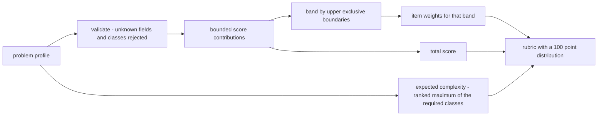
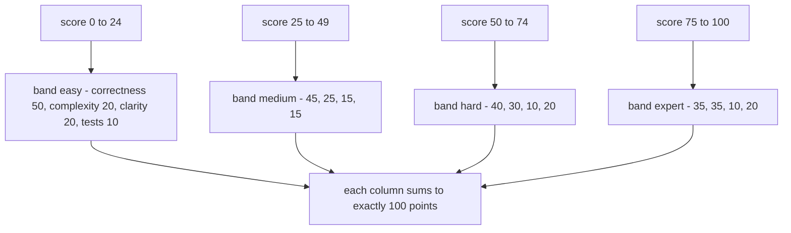
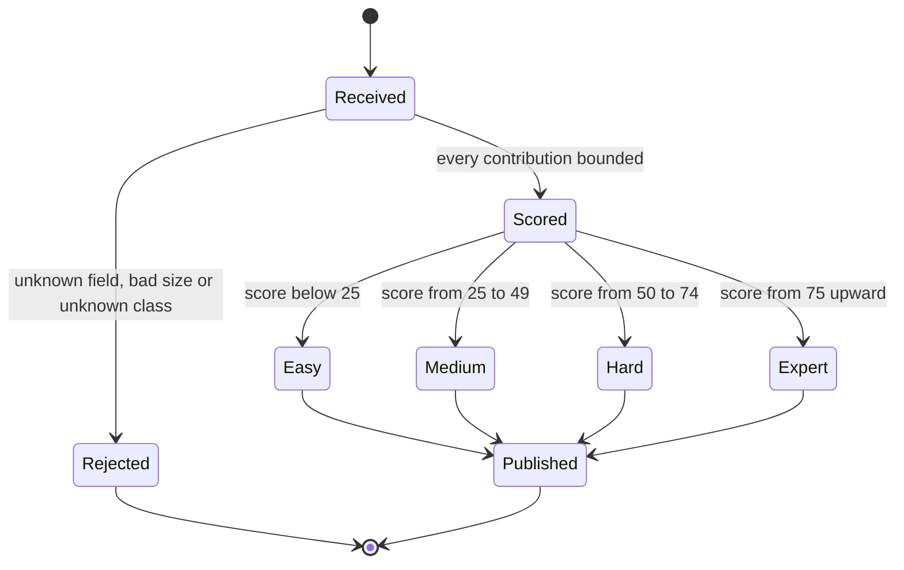
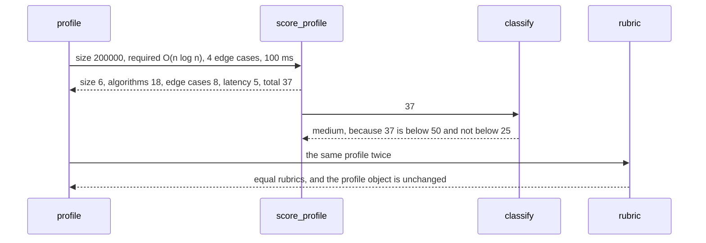

# 956 — Implement grading rubric generator that assigns difficulty and expected complexity.

> **Tier:** Master · **CTCI chapter:** Beyond — Software Engineering & Tooling
> **Task spec:** [956-implement-grading-rubric-generator-that-assigns-difficulty-and-e.md](../../../tasks/master/956-implement-grading-rubric-generator-that-assigns-difficulty-and-e.md)
> **Solutions:** [Python](../../../solutions/python/master/956-implement-grading-rubric-generator-that-assigns-difficulty-and-e/solution.py) ·
> [Java](../../../solutions/java/master/956-implement-grading-rubric-generator-that-assigns-difficulty-and-e/Solution.java) ·
> [JavaScript](../../../solutions/javascript/master/956-implement-grading-rubric-generator-that-assigns-difficulty-and-e/solution.js) ·
> [C#](../../../solutions/csharp/master/956-implement-grading-rubric-generator-that-assigns-difficulty-and-e/Solution.cs)

## 1. Problem restatement

**The modelling contract first.** The four files build an in-memory *rubric generator*: a problem
profile is scored with a fixed points table, the score selects a difficulty band, the highest-ranked
required complexity class becomes the expected complexity, and the band selects the item weights. There
is no NLP, no static analysis and no clock — the Python docstring says the profile is *supplied* rather
than extracted. What is real is the arithmetic: bounded contributions, exact band boundaries, a
conserved 100-point distribution and a pure function from profile to rubric.

**Inputs.** A profile of six fields — `size`, `required` (a set of complexity classes), `has_proof`,
`has_system_design`, `edge_cases`, `judge_latency_ms`.

**Outputs.** A rubric with the score breakdown, the total score, the band, the expected complexity, the
total points and the weighted items.

| Constant | Python value | Meaning |
| --- | --- | --- |
| `CLASS_ORDER` | `O(1)`, `O(log n)`, `O(n)`, `O(n log n)`, `O(n^2)`, `O(2^n)` | growth ranking |
| `N_THRESHOLDS` | `(10 000, 2)`, `(100 000, 6)`, `(10 000 000, 12)`, `(1 000 000 000, 20)` | size points, capped at 20 |
| `BANDS` | `easy < 25`, `medium < 50`, `hard < 75`, `expert < 101` | upper-exclusive bands |
| `RUBRIC_WEIGHTS` | four items per band, summing to 100 | the published point distribution |

Score contributions: size (0–20), algorithms (`6 × class rank`), proof (`+10`), system design (`+12`),
edge cases (`2 × min(count, 4)`, so ≤ 8) and latency (`+5` when `0 < latency ≤ 100`).

| File | Profile features | Difficulty model | Extras |
| --- | --- | --- | --- |
| Python | six fields, including a required-class set | score → four bands with upper-exclusive boundaries | expected complexity is the ranked maximum; items sum to 100 per band |
| Java | five integer features `0…3` plus an algorithm class | weighted score → difficulty `1…5` | effort estimate in minutes and the two largest contributors as rationale |
| JavaScript | the same field set | the same band arithmetic | item weights per band |
| C# | the same field set | the same band arithmetic | item weights per band |

Concrete results, from the Python file's printed run and its assertions:

| Call | Result | Source of the claim |
| --- | --- | --- |
| profile `{size: 200 000, required: (O(n log n),), edge_cases: 4, judge_latency_ms: 100}` | score 37, band `medium`, items `correctness`, `complexity`, `clarity`, `tests` | printed as `band=medium score=37` |
| score breakdown | `{size: 6, algorithms: 18, proof: 0, system_design: 0, edge_cases: 8, latency: 5}` | printed |
| boundary sweep | 24 → easy, 25 → medium, 49 → medium, 50 → hard, 74 → hard, 75 → expert, 100 → expert | printed as `boundaries={…}` |
| monotone profiles | scores strictly increase and the bands go `easy → hard → expert` | asserted |
| reachability | 24 generated profiles reach all four bands, each with `total_points == 100` | printed as `bands_reachable=['easy', 'expert', 'hard', 'medium']` |
| letters | scores `0, 24, 25, 49, 50, 74, 75, 90` give `D, D, C, C, B, B, A, A` | printed |
| size alone | a profile with `size = 10^12` and nothing else is still `easy` | printed as `size_only_band=easy` |
| malformed profiles | `{size: 0}`, `{size: -5}`, `{required: (O(n!),)}`, `{difficulty: 'easy'}` all raise `ValueError` | asserted |
| empty profile | score 0, band `easy`, expected complexity `O(1)`, identical to the explicit floor profile | asserted |

## 2. Intuition

The naive rubric is a lookup table: "problems with matrices are hard". It produces two failures that
matter. It is not *monotone* — adding a proof obligation to a problem can lower its difficulty if the
table is written carelessly — and it is not *complete*: a rubric whose item weights sum to 90 leaves an
unspecified 10% of a grade.

The insight is to separate three questions that people usually conflate:

1. **How hard is it?** A bounded score. Every feature contributes a capped amount, so the total lives
   in a known range and the bands can be upper-exclusive and exact. Size alone is capped at 20 points —
   deliberately below the 25-point `medium` boundary — so a huge input can never make a problem hard by
   itself.
2. **What complexity is expected?** Not the score, but the *slowest* class the intended solution must
   handle: the ranked maximum of the required set, `O(1)` when nothing is required. Two problems with
   the same score can therefore expect different asymptotics.
3. **How are the points distributed?** A per-band weight vector that sums to exactly 100: correctness
   dominates in `easy` (50), while `expert` splits 35/35 between correctness and complexity. The vector
   is data, not a formula, which makes the "sums to 100" property checkable for every band.





## 3. Algorithm

1. `validate_profile`: reject unknown fields, a non-positive or non-integer `size`, and unknown
   complexity classes; coerce the booleans and integers of the remaining fields.
2. `size_points`: the largest threshold not exceeded by `size`, capped at 20; zero below 10 000.
3. `expected_complexity`: the highest-ranked member of the required set, `O(1)` when it is empty.
4. `score_profile`: sum the six bounded contributions — size, `6 × class rank`, proof, system design,
   `2 × min(edge_cases, 4)`, latency.
5. `classify`: the first band whose upper bound exceeds the score; bands are upper-exclusive.
6. `rubric`: publish the breakdown, the score, the band, the expected complexity and the item weights of
   that band, whose points sum to 100.

```text
procedure score_profile(profile)
    clean = validate_profile(profile)
    return size points for clean.size,
           6 times the rank of expected_complexity(clean.required),
           10 when clean.has_proof else 0,
           12 when clean.has_system_design else 0,
           2 times the minimum of clean.edge_cases and 4,
           5 when clean.judge_latency_ms is above 0 and at most 100 else 0
end

procedure classify(score)
    for band, upper in BANDS do
        if score < upper then
            return band
        end
    end
    return the last band
end

procedure rubric(profile)
    breakdown = score_profile(profile)
    score = sum of the breakdown values
    band = classify(score)
    items = the item names and weights of that band
    return score, breakdown, band,
           expected_complexity(validate_profile(profile).required),
           sum of the item points, items
end
```



## 4. Worked example

Take the profile `{size: 200 000, required: (O(n log n),), edge_cases: 4, judge_latency_ms: 100}` and
compute one contribution at a time:

| Feature | Value | Contribution | Why |
| --- | --- | --- | --- |
| size | 200 000 | 6 | `200 000 ≥ 100 000`, the second threshold, capped at 20 |
| algorithms | `O(n log n)` | 18 | rank 3 of `CLASS_ORDER`, times 6 |
| proof | absent | 0 | optional feature |
| system design | absent | 0 | optional feature |
| edge cases | 4 | 8 | `2 × min(4, 4)`, at the cap |
| latency | 100 ms | 5 | inside `(0, 100]`, the inclusive upper bound |
| total | — | **37** | printed as `score=37` |

Band lookup: 37 is not below 25 and is below 50, so the band is `medium` and the items are
`correctness 45`, `complexity 25`, `clarity 15`, `tests 15` — 100 points in total, which the file
checks for every reachable band.

The boundary sweep is the part worth memorising, because the bands are upper-exclusive:

| Score | 24 | 25 | 49 | 50 | 74 | 75 | 100 |
| --- | --- | --- | --- | --- | --- | --- | --- |
| Band | easy | medium | medium | hard | hard | expert | expert |
| Letter | D | C | C | B | B | A | A |

Monotonicity is asserted on three nested profiles rather than argued: `small` (`size 500`, `O(n)`, one
edge case) scores below `bigger` (`size 2·10⁹`, `{O(n), O(n log n)}`, proof) which scores below
`biggest` (adds `O(n^2)`, a fourth edge case, system design and 50 ms of latency) — and the bands move
`easy → hard → expert` with them. The expected complexity moves with the ranked maximum too: adding
`O(n^2)` to a profile that already requires `O(n log n)` raises the expected class, even though the
score only moves by one rank.

Two negative checks keep the model honest. First, size alone can never make a problem hard: the
contribution is capped at 20 and a profile of `{size: 10^12}` lands in `easy`. Second, malformed
profiles are rejected rather than silently defaulted — an unknown field, a zero or negative size, or a
class outside `CLASS_ORDER` such as `O(n!)` raises `ValueError` naming the offender.



## 5. Complexity

Let `f` be the number of profile fields and `c` the number of required classes.

| Measure | Bound | Why it holds |
| --- | --- | --- |
| `validate_profile` | `O(f + c)` | one pass over the fields and one class-membership check |
| `size_points` | `O(1)` with the fixed table | at most four threshold comparisons |
| `expected_complexity` | `O(c)` | a ranked maximum over the required set |
| `score_profile` | `O(f + c)` | the six contributions are constant time each |
| `classify` | `O(1)` with four bands | a linear scan over the band table |
| `rubric` | `O(f + c)` | pure assembly, no search or iteration over problems |
| Space | `O(f + c)` | the normalised profile plus the item list |

The honest limits are that the score is a *heuristic* and the features are supplied: nothing here reads
a task description, so two people can profile the same problem differently and get different bands. The
value the code adds is consistency — the same profile always yields the same rubric, the bands have
exact boundaries, and every reachable band hands out exactly 100 points. The Java variant makes the same
trade visible from the other side: it adds an effort estimate in minutes and a rationale naming the two
largest contributors, both derived from the same weighted score.

## 6. Pitfalls and edge cases

- **Bands are upper-exclusive.** A score of exactly 25 is `medium`, not `easy`; the assertion pins all
  seven boundary values, because moving one comparison operator shifts a whole band.
- **Size is capped on purpose.** Its contribution maxes out at 20 points, so `size = 10^12` alone stays
  `easy`. Removing the cap would let a big input cross the `medium` boundary with no algorithmic
  content at all.
- **Expected complexity is not the score.** It is the ranked maximum of the required classes, and the
  default for an empty set is `O(1)` — the file asserts both `(())` and `(O(1),)`.
- **Edge cases saturate at four.** `2 × min(count, 4)` means five and fifty edge cases score the same;
  the cap is what keeps the total inside the band arithmetic.
- **Latency is a range, not a scale.** `+5` only for `0 < latency ≤ 100`; a 500 ms judge scores zero
  instead of more, since a slow judge is a property of the harness rather than of the problem.
- **Unknown fields are errors, not ignored.** `{difficulty: 'easy'}` raises, which is how a typo in a
  grader's profile is caught instead of silently scoring the default.
- **Empty profile equals the explicit floor.** `rubric({})` and a profile with every feature at its
  minimum produce the same rubric — score 0, band `easy`, complexity `O(1)`.
- **Item weights must sum to 100 in *every* band.** The file walks 24 generated profiles to reach all
  four bands and asserts `total_points == 100` in each, plus the same property of the weight table.
- **Purity.** Generating a rubric never mutates the profile (compared against a snapshot) and repeated
  calls are equal, so a grader can regenerate a rubric without wondering what changed.
- **Letters are derived, not stored.** `letter(score)` goes through `classify`, and an independently
  written mapping is compared against it for eight scores — a small oracle for a small function.

## 7. Variants and follow-ups

- **Grade the submissions, not the problems.** [952-implement-autograder-that-runs-tests-measures-complexity-and-rep.md](../../../tasks/master/952-implement-autograder-that-runs-tests-measures-complexity-and-rep.md)
  fits the *measured* complexity of a submission; this task predicts the expected one, and the
  interesting comparison is where the two disagree.
- **Enforce the contribution shape.** [953-implement-contributor-guide-and-templates-for-new-problems-tests.md](../../../tasks/master/953-implement-contributor-guide-and-templates-for-new-problems-tests.md)
  is where a new problem's metadata is validated, which is what makes a profile machine-readable in the
  first place.
- **Publish the rubric with the baseline.** [955-implement-canonical-solution-repository-with-multiple-language-s.md](../../../tasks/master/955-implement-canonical-solution-repository-with-multiple-language-s.md)
  stores the canonical solution and the performance baseline; a rubric is only meaningful next to the
  artifact it grades.
- **Generate the cases the rubric promises.** [957-implement-randomized-test-case-generator-with-oracle-checker-for.md](../../../tasks/master/957-implement-randomized-test-case-generator-with-oracle-checker-for.md)
  turns "four edge cases" into an actual batch, including the boundary kinds a rubric counts.
- **Make difficulty empirical.** Replace the declared profile with features extracted from a
  submission's measured step curve, so the band reflects what the implementation does rather than what
  the problem claims.

## 8. Check yourself

1. Why is the size contribution capped at 20 points?

<details><summary>Show answer</summary>

Because the `medium` band starts at 25. With the cap, size alone — however large — cannot push a
problem out of `easy`, which the file asserts with `size = 10^12`. Difficulty is meant to come from the
algorithmic content, not from the input size.

</details>

2. A problem requires `O(log n)`. What is its expected complexity, and what if it also requires
   `O(n^2)`?

<details><summary>Show answer</summary>

`O(log n)` in the first case — the ranked maximum of a one-element set. Adding `O(n^2)` makes the
expected complexity `O(n^2)` because it ranks above `O(log n)`, and the score also rises by
`6 × (rank difference)`; the file cross-checks the ranked maximum against a sorted-index oracle.

</details>

3. How can two problems with the same score have different expected complexity?

<details><summary>Show answer</summary>

Because the score sums several features while the expected complexity reads only the required set. A
profile with a large input and no heavy class requirement can score the same as a smaller profile that
requires `O(n^2)`; the first expects `O(1)` or `O(n)`, the second expects `O(n^2)`.

</details>

4. What goes wrong if the item weights for one band sum to 90?

<details><summary>Show answer</summary>

The published rubric would be incomplete: 10% of the grade would be unspecified, and a grader following
it could not total a score. The file asserts `total_points == 100` for every reachable band *and* that
each row of the weight table sums to 100, so the defect cannot survive a run.

</details>

5. Is the generated difficulty a measurement or a prediction?

<details><summary>Show answer</summary>

A prediction. The features are supplied rather than extracted, and the arithmetic is a fixed heuristic —
which is why the docstring calls the profile an input. Its value is consistency and the exposed
breakdown: every profile maps deterministically to a band and a complete point distribution, and the
per-feature contributions show exactly why.

</details>
