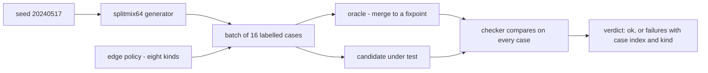
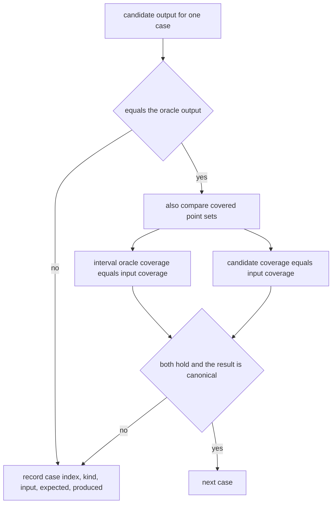
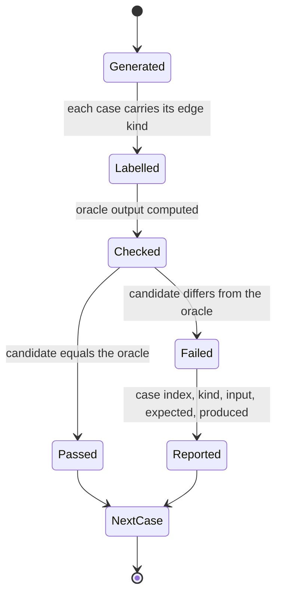
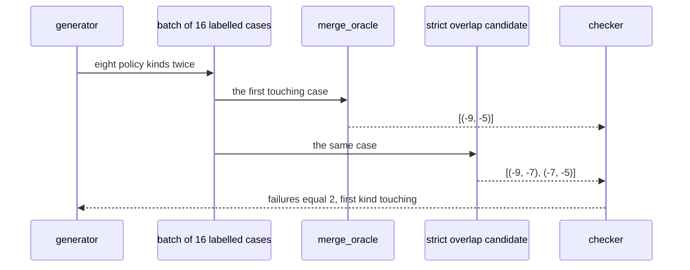

# 957 — Implement randomized test-case generator with oracle checker for each problem.

> **Tier:** Master · **CTCI chapter:** Ch 11 — Testing
> **Task spec:** [957-implement-randomized-test-case-generator-with-oracle-checker-for.md](../../../tasks/master/957-implement-randomized-test-case-generator-with-oracle-checker-for.md)
> **Solutions:** [Python](../../../solutions/python/master/957-implement-randomized-test-case-generator-with-oracle-checker-for/solution.py) ·
> [Java](../../../solutions/java/master/957-implement-randomized-test-case-generator-with-oracle-checker-for/Solution.java) ·
> [JavaScript](../../../solutions/javascript/master/957-implement-randomized-test-case-generator-with-oracle-checker-for/solution.js) ·
> [C#](../../../solutions/csharp/master/957-implement-randomized-test-case-generator-with-oracle-checker-for/Solution.cs)

## 1. Problem restatement

**The modelling contract first.** The four files build an in-process *randomized test-case generator
plus oracle checker*. A fixed-seed splitmix64 stream emits a batch of cases under a declared **edge
policy**, an independently written oracle computes the expected answer, and the checker runs a
candidate against that oracle on every case and reports the first failures with their case index and
kind. The Python docstring names the simplification: cases live in memory rather than in a corpus file
and only one problem family is wired up. What is real is the machinery — generator bounds, oracle
checking and the edge policy — and the Java variant shows the same machinery on a different problem
(counting inversions) with a delta-debugging shrinker on top.

**Inputs.** A seed, a case count, and the declared bounds: coordinate span `LOW = -20 … HIGH = 20`, at
most six intervals per case, at most `2 × 8 = 16` cases per batch.

**Outputs.** A batch of `(kind, intervals)` cases, a candidate verdict `{ok, failures, checked}` where
each failure carries case index, kind, input, expected and produced output, and — in the Java variant —
a minimal reproducer for a failure.

The problem family in Python is *merging touching or overlapping closed intervals*, and the edge policy
is chosen so that the two classic bugs are guaranteed to be caught:

| Kind | Shape | The bug it catches |
| --- | --- | --- |
| `empty` | no intervals | a merge that dereferences a missing first element |
| `single` | one interval | a result that must be returned unchanged |
| `disjoint` | two separated intervals, in either order | a merge that joins on distance rather than overlap |
| `nested` | an interval inside an interval, plus a duplicate of its start | forgetting to extend the end |
| `touching` | `(s, s+2)`, `(s+2, s+4)` | merging only *strict* overlaps |
| `duplicate` | one interval three times | a merge that keeps duplicates |
| `unsorted` | `(5,7), (1,3), (2,4)` | a merge that never sorts |
| `random` | one to six random intervals in the span | everything else |

Concrete results, from the Python file's printed run and its assertions:

| Call | Result | Source of the claim |
| --- | --- | --- |
| `batch(20240517)` | 16 cases, the eight kinds twice, first eight in policy order | printed as `cases=16`; asserted |
| the same seed / a different seed | identical batch / a different batch | asserted |
| bounds | every interval satisfies `-20 ≤ start ≤ end ≤ 20`, at most six per case | asserted |
| correct candidate | passes all 16 cases in one check | printed as `correct_verdict=ok` |
| strict-overlap bug | caught on exactly the two `touching` cases, first failure at the touching index | printed as `touching_failures=2` |
| unsorted bug | caught with five failing cases, including the `unsorted` kind | printed as `unsorted_failures=5` |
| first failure of the strict bug | input `((-9, -7), (-7, -5))`, produced `[(-9, -7), (-7, -5)]` — left unmerged | printed as `first_failure=…` |
| two oracles | the interval oracle and the integer point-set oracle agree on coverage for every case, and every merged result is in canonical form | asserted |
| boundaries | empty merges to `[]`, a single interval is returned unchanged, three copies of one interval collapse to one | asserted |
| purity | the batch is byte-identical after checking with either candidate, and a repeat check gives the same verdict | asserted |

## 2. Intuition

The naive test suite is a handful of examples written by hand. It passes for the wrong reasons: it
covers the shapes the author happened to think about, and it never grows. Randomized testing fixes the
growth but introduces a new failure mode — random inputs are *boring*. A uniform random set of
intervals almost never contains two that touch exactly, so the classic off-by-one `start < end`
comparison survives thousands of random cases.

The insight is an **edge policy**: a declared list of shapes the batch must contain, generated
side by side with the random cases. Each kind is a targeted counterexample for a specific bug class,
so the suite catches the bug *because of its design* rather than by luck. And because each case is
labelled with its kind, a failure report says which policy item caught it:

```text
touching: (start, start + 2), (start + 2, start + 4)
```

Two intervals that share exactly one point. Any candidate using `start < end` leaves them apart;
the correct `start <= end` merges them. The file asserts precisely that: the strict-overlap candidate
fails exactly the two `touching` cases, and its *first* failure is a touching case.



The second insight is that the oracle must be written *differently* from the candidate. The candidate
sorts and scans once; the oracle merges any overlapping-or-touching pair until nothing changes, with no
sorting at all. On top of that the file keeps a third, completely different check — a point-set oracle
that compares the *covered integer positions* of the input and the merged output. Agreement between an
interval-level algorithm and a set-level one is much stronger evidence than either one passing alone.



## 3. Algorithm

1. Generate the batch: for each kind in the policy, build the targeted case shape; then append random
   cases; every interval is drawn with `START ≤ END` inside the span.
2. Label each case with its kind so a failure report is actionable.
3. `merge_oracle`: repeatedly merge any pair that overlaps *or touches* until a full pass changes
   nothing; return the sorted result. This is deliberately `O(n²)` per merge and does not sort the
   input first.
4. `checker(candidate, cases)`: for each case compute the expected output and the produced output,
   compare, and record a failure object with index, kind, input, expected and produced.
5. Cross-check with the point-set oracle: both the input and each merged result must cover exactly the
   same integer positions, and the result must be in canonical form (sorted, strictly increasing
   starts, non-degenerate intervals).
6. Assert the batch was not mutated by the candidates and that a repeated check gives the same verdict.

```text
procedure make_case(rng, kind)
    when kind is empty then return no intervals
    when kind is single then return one random interval
    when kind is disjoint then return two well separated intervals, possibly swapped
    when kind is nested then return an outer interval, a random middle interval and its duplicate start
    when kind is touching then return (start, start + 2) and (start + 2, start + 4)
    when kind is duplicate then return the same interval three times
    when kind is unsorted then return (5, 7), (1, 3), (2, 4)
    otherwise return one to six random intervals
end

procedure merge_oracle(intervals)
    work = copies of intervals
    changed = true
    while changed do
        changed = false
        for i and j in every pair with i different from j do
            if work[i] overlaps or touches work[j] then
                merged = the union of the two
                work = work without those two, plus merged
                changed = true
                stop scanning
            end
        end
    end
    return work sorted
end

procedure checker(candidate, cases)
    failures = empty list
    checked = 0
    for index, kind and intervals in cases do
        expected = merge_oracle(intervals)
        produced = candidate(intervals)
        checked = checked + 1
        if produced differs from expected then
            append index, kind, intervals, expected, produced to failures
        end
    end
    return whether failures is empty, failures, checked
end
```



## 4. Worked example

Take the first failing case of the strict-overlap bug — the batch's first `touching` case, whose input
prints as `((-9, -7), (-7, -5))`. The two intervals share exactly the point `-7`:

| Step | Oracle (merge to a fixpoint) | Strict candidate (`start < end`) |
| --- | --- | --- |
| start | work `[(-9,-7), (-7,-5)]` | sorted input `[(-9,-7), (-7,-5)]` |
| compare | `-9 ≤ -5` and `-7 ≤ -7`, so the pair overlaps or touches → merge to `(-9,-5)` | first interval becomes the result, so far `[(-9,-7)]` |
| scan | second interval: `-7 ≤ -5` and `-9 ≤ -5` → already merged, loop ends | `-7 < -7` is false, so `(-7,-5)` is appended as a separate interval |
| result | `[(-9,-5)]` | `[(-9,-7), (-7,-5)]` |

The verdict records exactly that, which is why the printed line reads
`first_failure=((-9, -7), (-7, -5)) -> [(-9, -7), (-7, -5)]`. One point of contact is the whole
difference between the two candidate behaviours, and no uniform random case would have found it: the
policy had to ask for a touching pair.

The other bug is caught by a different policy item. The unsorted candidate never sorts, so
`(5,7), (1,3), (2,4)` merges into `[(5,7), (1,3)]`-style nonsense; the file's check is only that the
`unsorted` kind is *among* the failures, because the random cases also fail for a candidate that cannot
recover from arbitrary order:

| Candidate | Failing cases | Kinds hit | First failure |
| --- | --- | --- | --- |
| `merge_candidate` (sort, then `start <= end`) | 0 of 16 | — | none; verdict `ok` |
| `merge_buggy_strict` (`start < end`) | 2 | `touching` | the touching case above |
| `merge_buggy_unsorted` (no sort) | 5 | `unsorted` and random cases | an unsorted or random case |

The strongest check is the one that does not use the interval oracle's own output at all: for every
case, `coverage_points(merge_oracle(intervals))` and `coverage_points(merge_candidate(intervals))` must
both equal `coverage_points(intervals)`, the set of integers the input covers, and the merged result
must be canonical — sorted with strictly increasing, non-degenerate intervals. A candidate that split an
interval would still cover the same points, which is why the canonical-form check sits beside it.



## 5. Complexity

Let `c` be the case count, `n` the intervals in one case and `K = 8` the number of policy kinds.

| Measure | Bound | Why it holds |
| --- | --- | --- |
| `batch` | `O(c · n)` | one generator draw per interval, `n ≤ 6` |
| `make_case` | `O(1)` per kind | each shape is built from a constant number of draws |
| `merge_oracle` | `O(n³)` worst case | each merge removes one interval and rescans the pairs |
| `merge_candidate` | `O(n log n)` | one sort plus one scan |
| `checker` | `O(c · n³)` | the oracle dominates per case |
| `coverage_points` | `O(n · span)` | every integer in every interval is inserted |
| Space | `O(c · n + span)` | the batch plus the point sets |

The oracle is deliberately the slow one. It is `O(n²)` *per merge* and unsorted, which is the opposite
of the candidate's shape, and that contrast is what makes agreement meaningful; a fast oracle written
the same way as the candidate would mostly test the author's habits. The costs are bounded because the
cases are tiny — at most six intervals in a 41-point span — so the `O(n³)` never matters, while the
verdict structure stays a plain data value that can be serialised into a report.

## 6. Pitfalls and edge cases

- **Uniform random cases are not enough.** Touching intervals need to be *requested*; that is the entire
  reason an edge policy exists, and the file proves it by catching the strict-overlap bug on exactly
  the two touching cases.
- **The oracle must not share the candidate's shape.** Sorting first and merging once is the candidate;
  the oracle merges pairs to a fixpoint without sorting, so a bug in the candidate's sort-and-scan
  cannot be mirrored by the oracle.
- **Touching is overlap for closed intervals.** `(s, s+2)` and `(s+2, s+4)` cover the shared point
  `s+2`, so they must merge; the correct comparison is `start <= last_end`.
- **Empty input.** `merge_oracle(())` and the candidate both return `[]`; the file asserts it rather
  than letting a candidate raise on the empty list.
- **A single interval is returned unchanged**, not wrapped or re-sorted into a different structure.
- **Duplicates collapse.** Three copies of one interval merge to one interval — a candidate that keeps
  duplicates is wrong even though its coverage matches.
- **The batch must be immutable.** Checking with a buggy candidate first and then with the correct one
  must give the same verdict, and the batch must compare equal to a snapshot taken beforehand.
- **Bounds are invariants, not suggestions.** Every generated interval satisfies `start ≤ end` and lies
  inside the span, which stops a generator bug from producing "impossible" inputs that make the
  candidate look broken.
- **Seed sensitivity.** The same seed must reproduce the batch exactly and a different seed must change
  it; without that, a failure cannot be re-run.
- **De-duplicating by coverage is insufficient.** Two different interval sets can cover the same points
  — one merged, one split — so canonical form is checked separately.

## 7. Variants and follow-ups

- **Shrink the failure to a reproducer.** The Java variant removes elements and halves values until the
  failing case is irreducible, which is what turns "case 7 of 16 failed" into a minimal report a human
  can act on.
- **Feed the batch to a grader.** [952-implement-autograder-that-runs-tests-measures-complexity-and-rep.md](../../../tasks/master/952-implement-autograder-that-runs-tests-measures-complexity-and-rep.md)
  consumes cases exactly like these and grades a submission on them, with per-case verdicts and
  exception isolation.
- **Make the corpus a repository artifact.** [955-implement-canonical-solution-repository-with-multiple-language-s.md](../../../tasks/master/955-implement-canonical-solution-repository-with-multiple-language-s.md)
  is where generated batches and their oracle outputs would be stored and versioned alongside the
  canonical solutions.
- **Test a different family with the same machinery.** The same policy-plus-oracle structure applies to
  anything with a brute-force reference; the count-inversions family in the Java file and the interval
  family in Python are two instances of one pattern.
- **Check the shape of the candidate before running it.** [953-implement-contributor-guide-and-templates-for-new-problems-tests.md](../../../tasks/master/953-implement-contributor-guide-and-templates-for-new-problems-tests.md)
  validates that a contribution *has* test cases and a check helper, which is the static half of what
  this task does dynamically.

## 8. Check yourself

1. Why does the strict-overlap candidate fail exactly two cases?

<details><summary>Show answer</summary>

Because only the two `touching` cases contain a pair that shares exactly one endpoint. In those cases
`start < last_end` is false (the start equals the previous end), so the pair is not merged, while the
oracle — which merges on `start <= end` — returns the union. Every other kind either overlaps strictly
or is disjoint.

</details>

2. What does the `unsorted` kind test that the random kind cannot guarantee?

<details><summary>Show answer</summary>

That the candidate sorts, or at least recovers from any input order. A random case *may* happen to be
sorted, so failing to sort might go unnoticed; the fixed `(5,7), (1,3), (2,4)` shape guarantees the
order that breaks a single left-to-right scan, which is why the file asserts that this kind is among
the failures.

</details>

3. The point-set oracle agrees with a candidate that never merges. Why is that not enough to accept it?

<details><summary>Show answer</summary>

Because covered points are not the answer: `[(-9,-7), (-7,-5)]` and `[(-9,-5)]` cover the same integers,
but only the second is the merge. That is exactly why the file also checks canonical form — sorted,
strictly increasing starts, no touching neighbours — so coverage equality must be paired with a shape
invariant.

</details>

4. Why is the oracle written to be slower than the candidate?

<details><summary>Show answer</summary>

Because the oracle's job is to be *independent*, not fast. It merges any overlapping pair to a fixpoint
and never sorts, which is the opposite of the candidate's sort-and-scan. A shared implementation would
let a systematic misunderstanding pass both sides; that is the failure mode a paired oracle exists to
prevent.

</details>
