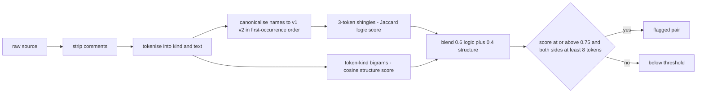
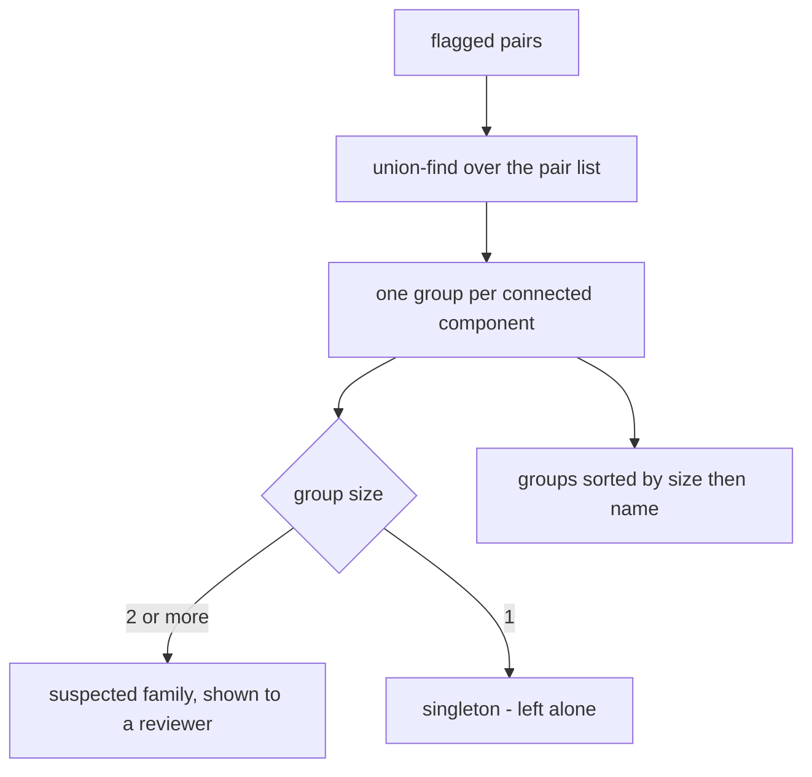
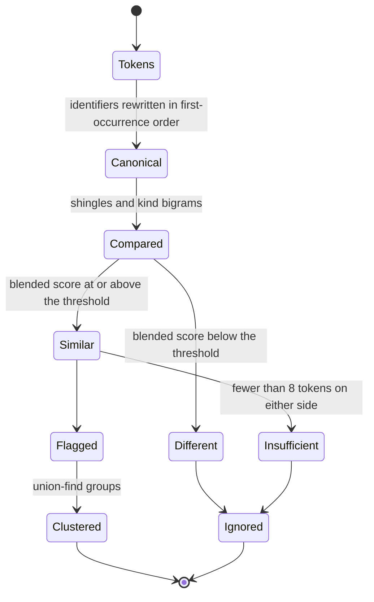
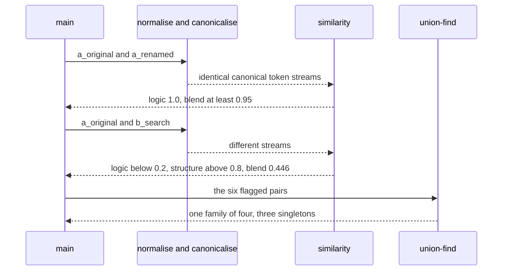

# 958 — Implement plagiarism detector comparing code structure and logic patterns.

> **Tier:** Master · **CTCI chapter:** Ch 11 — Testing
> **Task spec:** [958-implement-plagiarism-detector-comparing-code-structure-and-logic.md](../../../tasks/master/958-implement-plagiarism-detector-comparing-code-structure-and-logic.md)
> **Solutions:** [Python](../../../solutions/python/master/958-implement-plagiarism-detector-comparing-code-structure-and-logic/solution.py) ·
> [Java](../../../solutions/java/master/958-implement-plagiarism-detector-comparing-code-structure-and-logic/Solution.java) ·
> [JavaScript](../../../solutions/javascript/master/958-implement-plagiarism-detector-comparing-code-structure-and-logic/solution.js) ·
> [C#](../../../solutions/csharp/master/958-implement-plagiarism-detector-comparing-code-structure-and-logic/Solution.cs)

## 1. Problem restatement

**The modelling contract first.** The four files build an in-process *similarity detector*: a
submission is normalised — comments dropped, identifiers canonicalised by first-occurrence order — and
then compared on two axes, a **logic** axis (Jaccard over token shingles) and a **structure** axis
(cosine over token-kind bigrams). A blended score above a threshold flags the pair, and a union-find
pass groups flagged pairs into the clusters a human reviewer inspects. The Python docstring names the
simplifications: the corpus is a handful of short pseudo-programs, the tokeniser is a hand-written
regular expression, and no control-flow graph is built.

**Inputs.** A mapping from source name to code text, plus the constants `SHINGLE = 3`,
`LOGIC_WEIGHT = 0.6`, `STRUCTURE_WEIGHT = 0.4`, `THRESHOLD = 0.75` and `MIN_TOKENS = 8`.

**Outputs.** A score per unordered pair, a flagged list, and clusters of suspected copies — plus the
`insufficient evidence` verdict for sources with too few tokens to judge.

| Axis | Definition | What it ignores | What it sees |
| --- | --- | --- | --- |
| Logic | Jaccard over 3-token shingles of the canonicalised stream | identifier names, comments, whitespace | the actual sequence of operations |
| Structure | cosine over bigrams of token *kinds* (`KEYWORD`, `NAME`, `NUMBER`, `OP`, `STRING`) | everything about identities | shape: loops, branches, call patterns |

| File | Axes | Threshold |
| --- | --- | --- |
| Python | 3-token shingle Jaccard (0.6) + token-kind bigram cosine (0.4) | 0.75, applied only when both sides have at least 8 tokens |
| Java | 4-token shingles, token histogram cosine, control-flow keyword bigrams | a fixed blended threshold |
| JavaScript | shingles plus kind bigrams | the same blend |
| C# | shingles plus kind bigrams | the same blend |

Concrete results, from the Python file's printed run and its assertions:

| Call | Result | Source of the claim |
| --- | --- | --- |
| 7 sources | 21 unordered pairs, 6 flagged | printed as `sources=7 pairs=21 flagged=6` |
| a refactored copy versus the original | score 0.758, above the threshold | printed as `refactored=0.758` |
| an unrelated program versus the original | score 0.446, below the threshold | printed as `unrelated=0.446` |
| a renamed copy | logic score exactly 1.0 while the raw token streams differ | asserted |
| a reformatted copy (comments, missing spaces) | score exactly 1.0 — formatting is invisible | asserted |
| unrelated pair, axis by axis | logic below 0.2 while structure is above 0.8 | asserted |
| clustering | `[a_original, a_refactored, a_renamed, a_style]` in one cluster; `b_search`, `c_empty`, `d_empty` as singletons | printed as `clusters=[…]` |
| threshold boundary | a pair scoring exactly the threshold is flagged; the same score plus `1e-9` is not | asserted |
| empty sources | two empty sources score 1.0 against each other, 0.0 against a program, and are never reported as a copy | asserted |

## 2. Intuition

The naive detector hashes the file and compares hashes. It catches byte-identical copies only — which
is the one case nobody submits, because the trivial evasion is to rename a variable or add a comment.

The insight is that a copy survives renaming but not *reordering*, and that the two axes capture
different parts of that difference:

1. **Canonicalisation defeats renaming.** Before any comparison, every identifier is rewritten to
   `v1`, `v2`, … in first-occurrence order. A renamed copy therefore becomes the *same* token stream as
   the original, and the logic score reaches exactly 1.0 — the file asserts that the raw streams differ
   while the shingle score is 1.0, which is the whole argument for normalising.
2. **Shingles capture logic, kinds capture shape.** The logic axis works on 3-token windows, so it is
   sensitive to the actual sequence of operations: a refactor that changes `enumerate` to
   `range(len(...))` loses many shingles and scores 0.758 — flagged, but visibly less than a copy. The
   structure axis works on *kinds*, which is coarse: two unrelated loop-shaped programs still score
   above 0.8 structurally. That asymmetry is why the blend weights logic at 0.6 and why the file asserts
   the unrelated pair's logic score is below 0.2 while its structure score is above 0.8.





## 3. Algorithm

1. Tokenise: drop comments, then match strings, identifiers, numbers, operators and keywords; label each
   token with its kind.
2. Canonicalise: rewrite every `NAME` token to `v1`, `v2`, … in first-occurrence order, leaving
   keywords, numbers and operators untouched.
3. Logic score: build the set of 3-token shingles of the canonicalised stream and take the Jaccard index;
   two empty sides score 1.0 and exactly one empty side scores 0.0.
4. Structure score: build the multiset of token-kind bigrams and take the cosine similarity.
5. Blend: `0.6 × logic + 0.4 × structure`.
6. Flag: keep pairs at or above the threshold where **both** sides have at least `MIN_TOKENS` tokens.
7. Cluster: union-find over the flagged pairs, then sort the groups by decreasing size and by name.

```text
procedure tokenize(code)
    without_comments = code with comments removed
    return the list of (kind, text) for each token of without_comments
end

procedure kind(text)
    when text starts with a quote then return STRING
    when text is a keyword then return KEYWORD
    when text starts with a digit then return NUMBER
    when text starts with a letter or underscore then return NAME
    otherwise return OP
end

procedure canonical_names(tokens)
    mapping = empty map, canonical = empty list
    for token_kind and text in tokens do
        if token_kind is NAME then
            if text is not in mapping then
                mapping[text] = "v" followed by the number of mappings plus one
            end
            text = mapping[text]
        end
        append (token_kind, text) to canonical
    end
    return canonical
end

procedure token_jaccard(left, right)
    first = shingles(canonical_names(tokenize(left)))
    second = shingles(canonical_names(tokenize(right)))
    if both are empty then return 1.0
    if exactly one is empty then return 0.0
    return size of the intersection divided by size of the union
end

procedure structure_cosine(left, right)
    first = counts of token-kind bigrams in left
    second = counts of token-kind bigrams in right
    if both are empty then return 1.0
    if exactly one is empty then return 0.0
    return dot product divided by the product of the two norms
end

procedure flagged(sources, threshold)
    return every unordered pair whose blended score is at least the threshold
           and whose two sources each have at least MIN_TOKENS tokens
end

procedure clusters(sources, threshold)
    join every flagged pair with union-find over the source names
    return the groups sorted by decreasing size, then by name
end
```



## 4. Worked example

The corpus is seven sources: four versions of one two-sum program (original, renamed, reformatted,
refactored), one unrelated binary search, and two empty strings. All 21 pairs are scored; six clear the
threshold.

| Pair | Logic score | Structure score | Blend | Flagged |
| --- | --- | --- | --- | --- |
| original vs renamed | 1.000 | ~1.000 | ≥ 0.95 | yes |
| original vs reformatted | 1.000 | 1.000 | 1.000 | yes |
| original vs refactored | — | — | 0.758 | yes |
| original vs binary search | < 0.2 | > 0.8 | 0.446 | no |
| empty vs empty | 1.0 (both sides empty) | 1.0 | 1.0 | no — below `MIN_TOKENS` |
| empty vs any program | 0.0 | 0.0 | 0.0 | no |

Three rows deserve attention. The **renamed** copy scores exactly 1.0 on the logic axis even though the
raw token streams differ — that is canonicalisation doing its job, and the file asserts both halves of
that contrast. The **reformatted** copy scores exactly 1.0 because whitespace and comments never reach
the metrics. The **unrelated** pair is the most instructive: its structure score is above 0.8, because
both programs are loops with a comparison and a return, so a structure-only detector would flag them —
only the logic axis, weighted at 0.6, keeps the blend at 0.446.

The refactored copy is the honest middle ground. Rewriting `enumerate(nums)` as
`range(len(values))` plus an explicit `number = values[position]` changes the token sequence enough to
drop the blend to 0.758 — above the 0.75 threshold, so it is still flagged, but by a margin of eight
thousandths. That number is printed, not estimated, and the assertion is `refactored >= THRESHOLD`.

Clustering turns the pairwise verdicts into a review queue:

| Cluster | Members | Reading |
| --- | --- | --- |
| 1 | `a_original`, `a_refactored`, `a_renamed`, `a_style` | four versions of one program — one investigation |
| 2 | `b_search` | singleton: nothing similar enough |
| 3 | `c_empty` | singleton |
| 4 | `d_empty` | singleton, and never paired with the other empty source |

Union-find matters here: `a_refactored` is only similar to the original, but transitivity through the
flagged pairs puts all four in one group, which is what a reviewer needs — the *family*, not just the
pairs. The empty sources show the guard at work: their blended score is 1.0, yet they are never
reported, because a pair needs at least `MIN_TOKENS = 8` tokens on both sides to mean anything.



## 5. Complexity

Let `n` be the total number of tokens across both sources, `p` the number of sources, and `s = 3` the
shingle size.

| Measure | Bound | Why it holds |
| --- | --- | --- |
| `tokenize` | `O(len(code))` | one regular-expression pass over the comment-stripped text |
| `canonical_names` | `O(n)` | one pass with a dictionary lookup per name |
| `shingles` | `O(n · s)` | one window per position, each joined from `s` tokens |
| `token_jaccard` | `O(n)` expected | set intersection and union over the shingle sets |
| `structure_cosine` | `O(n)` | one pass for bigram counts, one for the dot product and norms |
| `pairs` | `O(p² · n)` | every unordered pair is scored |
| `flagged` | `O(p² · n)` | the threshold and token-count guards are constant per pair |
| `clusters` | `O(p² α(p))` plus sorting | union-find with path compression over the flagged pairs |
| Space | `O(n + p)` per pair, `O(p²)` for the pair table | shingle sets and the union-find parent map |

Two honest limits. The metrics are computed on *token streams*, so a semantic rewrite — replacing a hash
map with a sorted array and a binary search — can evade both axes entirely; a real detector adds
control-flow or data-flow comparison, which the docstring lists as omitted. And the weights and
threshold are calibrated on this planted corpus rather than learned from data, so the printed 0.758 and
0.446 are evidence about *these* sources, not general accuracy figures.

## 6. Pitfalls and edge cases

- **Renaming must not help a plagiarist.** Canonicalisation by first-occurrence order is what makes the
  renamed copy score 1.0; the file asserts the raw streams differ while the logic score does not.
- **Comment and whitespace edits must not move the score.** A reformatted copy scores exactly 1.0, and
  the assertion also checks that the comment is really gone after stripping.
- **Structure alone is too coarse.** Two unrelated loop-shaped programs score above 0.8 structurally, so
  a structure-only detector would flag half the repository; the blend and the weighting are what keep
  the unrelated pair at 0.446.
- **The threshold is inclusive.** A pair scoring exactly `refactored` is flagged, and the same score
  plus `1e-9` is not — a floating-point boundary the file pins deliberately.
- **Empty sources are a trap.** Two empty sources are "identical" (1.0) and an empty source is
  unrelated to everything (0.0); both facts are asserted, and the `MIN_TOKENS` guard keeps the first
  case out of the report.
- **Comment-only code counts as empty.** `# just a comment` and a blank line score 1.0 against each
  other, because both tokenise to nothing after comment stripping.
- **The reported pair count is part of the contract.** Seven sources give 21 unordered pairs, and the
  flagged list is asserted to be sorted, so a detector that double-counts ordered pairs fails loudly.
- **Determinism and order independence.** The dictionaries are walked in sorted-name order, so two runs
  and a reversed insertion order give the same flagged list and the same clusters, and the cluster order
  itself is stable because groups sort by decreasing size and then by member name.

## 7. Variants and follow-ups

- **Catch the copy the metric misses.** [955-implement-canonical-solution-repository-with-multiple-language-s.md](../../../tasks/master/955-implement-canonical-solution-repository-with-multiple-language-s.md)
  uses the normalised *hash* for exact identity; that catches byte-level copies that differ only in
  comments, while this detector catches renames and refactors that hashing cannot see.
- **Decide whether the copy is *correct*.** [952-implement-autograder-that-runs-tests-measures-complexity-and-rep.md](../../../tasks/master/952-implement-autograder-that-runs-tests-measures-complexity-and-rep.md)
  grades behaviour; a plagiarism verdict and a correctness verdict answer different questions and are
  reported side by side in a real course.
- **Police the contribution instead of the copy.** [953-implement-contributor-guide-and-templates-for-new-problems-tests.md](../../../tasks/master/953-implement-contributor-guide-and-templates-for-new-problems-tests.md)
  validates the shape of a submission, which is the static rule set this detector complements.
- **Add a structural axis that is not token kinds.** Compare control-flow graphs or data dependencies —
  the docstring's first simplification — to close the semantic-rewrite gap.
- **Calibrate the weights.** Replace the hand-set 0.6/0.4 split and the 0.75 threshold with values
  learned from a labelled corpus of known copies, and report precision and recall instead of raw scores.

## 8. Check yourself

1. Why does a renamed copy score exactly 1.0 on the logic axis?

<details><summary>Show answer</summary>

Because canonicalisation rewrites every identifier to `v1`, `v2`, … in first-occurrence order *before*
shingles are built. A renaming that preserves first-occurrence order therefore produces the identical
canonical token stream, so the shingle sets coincide and the Jaccard index is 1.0 — while the raw token
strings, which the file also compares, are different.

</details>

2. Two unrelated programs score above 0.8 on the structure axis. Is the metric broken?

<details><summary>Show answer</summary>

No — the axis is deliberately coarse. It compares sequences of token *kinds*, and two loop-and-return
functions have very similar kind bigrams regardless of what they compute. That is precisely why the
logic axis carries 0.6 of the blend, and the file asserts both facts together: logic below 0.2,
structure above 0.8, blended score 0.446 below the threshold.

</details>

3. Two empty sources are reported as identical but never flagged. Why both?

<details><summary>Show answer</summary>

The metrics are defined to return 1.0 when both sides are empty, so the score exists and is 1.0; the
`flagged` guard then requires at least `MIN_TOKENS = 8` tokens on *both* sides, so nothing is reported.
The pair is meaningless as evidence, and the code says so in two different places.

</details>

4. What does union-find add over the flagged pair list?

<details><summary>Show answer</summary>

The family. `a_refactored` is similar to the original, and the original to the renamed and reformatted
versions, so transitivity groups all four into one cluster — which is the unit a reviewer investigates.
Without it you would get six overlapping pairs and have to do the grouping by hand.

</details>

5. A student rewrites a hash-map solution as a sorted array with binary search. Is it caught?

<details><summary>Show answer</summary>

Probably not: the token sequence changes substantially, so the logic score drops, and the structure
score is too coarse to compensate. That is the documented semantic-rewrite gap — closing it needs a
control-flow or data-flow comparison, and the docstring lists that omission explicitly.

</details>
