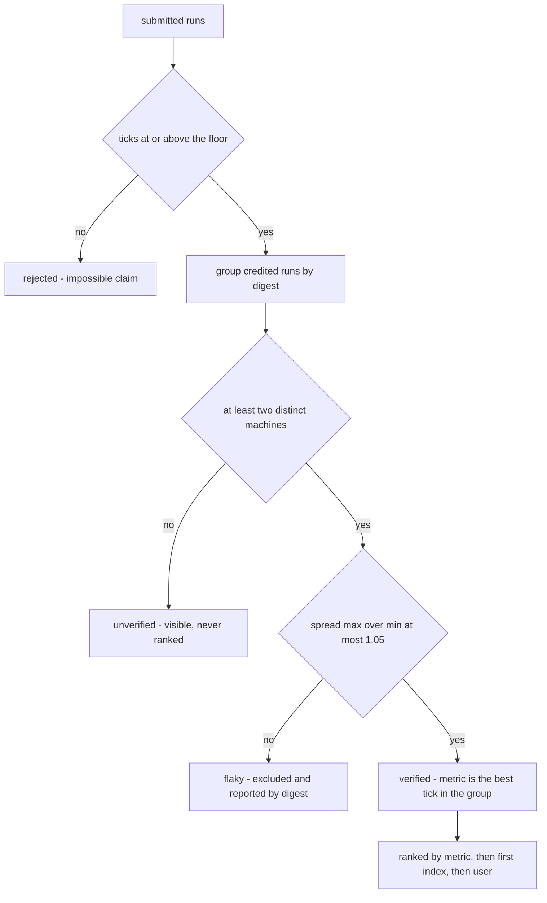
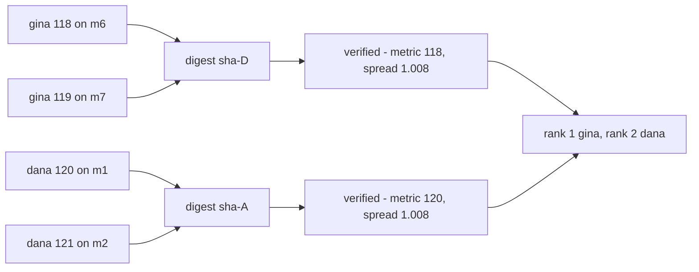
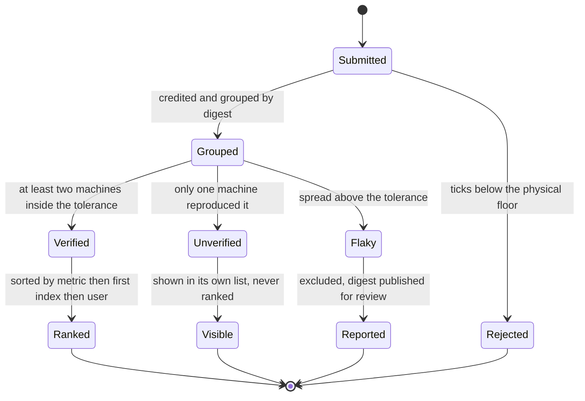
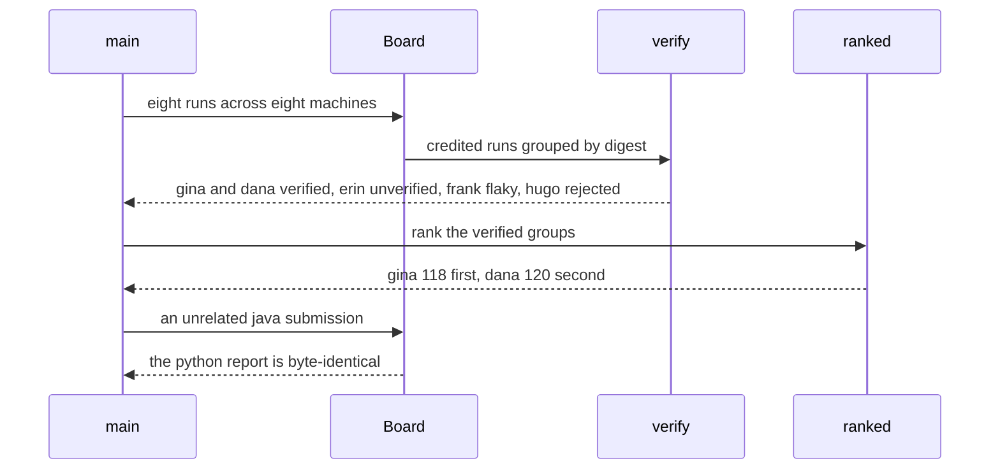

# 959 — Implement leaderboard with verified performance metrics and reproducible runs.

> **Tier:** Master · **CTCI chapter:** Beyond — Software Engineering & Tooling
> **Task spec:** [959-implement-leaderboard-with-verified-performance-metrics-and-repr.md](../../../tasks/master/959-implement-leaderboard-with-verified-performance-metrics-and-repr.md)
> **Solutions:** [Python](../../../solutions/python/master/959-implement-leaderboard-with-verified-performance-metrics-and-repr/solution.py) ·
> [Java](../../../solutions/java/master/959-implement-leaderboard-with-verified-performance-metrics-and-repr/Solution.java) ·
> [JavaScript](../../../solutions/javascript/master/959-implement-leaderboard-with-verified-performance-metrics-and-repr/solution.js) ·
> [C#](../../../solutions/csharp/master/959-implement-leaderboard-with-verified-performance-metrics-and-repr/Solution.cs)

## 1. Problem restatement

**The modelling contract first.** The four files build an in-memory *leaderboard with verification*: a
submission is a run `(user, task, language, ticks, digest, machine)`, and a run counts only when at
least **two independent machines** reproduce the same digest with ticks that agree inside a spread
tolerance. The Python docstring is explicit about the simulation: ticks are declared integers rather
than measurements, digests are opaque strings, and "machines" are labels. What is real is the policy —
what verification means, what gets ranked, what is shown but not ranked, and what is rejected outright.

**Inputs.** Submitted runs plus two constants: `FLOOR_TICKS = 1` (a physical floor, below which a claim
is impossible) and `SPREAD_TOLERANCE = 1.05` (the maximum `max / min` ratio inside one verified group).

**Outputs.** Four buckets — `ranked` (verified, best-of-group, with rank numbers), `flaky` (verified
machines but too wide a spread, reported by digest), `unverified` (visible, never ranked) and
`rejected` (below the floor) — plus a per-language `report()` and a `bucket()` conservation check.

| File | Verification rule | Ranking |
| --- | --- | --- |
| Python | ≥ 2 distinct machines on one digest and spread ≤ 1.05; metric is the best tick in the group | verified rows by metric, then first submission index, then user |
| Java | re-runs a deterministic workload (a fixed-seed fold) and compares digests, so only reproducible runs count | metric ascending with the contestant name as tie-break |
| JavaScript | digest agreement across runs | metric ascending |
| C# | digest agreement across runs | metric ascending |

Concrete results, from the Python file's printed run and its assertions:

| Call | Result | Source of the claim |
| --- | --- | --- |
| the seeded board (8 runs) | `ranked=[(1, 'gina', 118), (2, 'dana', 120)]` | printed |
| `erin` (999 ticks, one machine) | stays in `unverified`, never ranked — a *slower* verified time outranks it | printed as `unverified=['erin']` |
| `frank` (130 and 205 on the same digest) | spread 1.577 > 1.05, so the group is flaky and unranked | printed as `flaky=['sha-C']`, `spread=1.577` |
| `hugo` (0 ticks) | rejected, below the physical floor | printed as `rejected=['hugo']` |
| `dana` (120 and 121) | verified, metric 120, spread `121/120` | asserted |
| independent re-verification | the verified digests recomputed from the raw runs agree with `verify` | asserted |
| bucket conservation | all 8 runs appear in exactly one bucket | asserted |
| empty board / single run | no keys, empty report / one run can never be verified | asserted |
| another language's submission | the python ranking is byte-identical before and after | asserted |

## 2. Intuition

The naive leaderboard sorts by the submitted number. It is trivially gameable: a claimed time of 999 is
just a string, and a claimed time of 0 is not a measurement at all. The naive fix — trust only times
above a floor — is not enough either, because a single fast machine proves nothing about reproducibility.

The insight is to make **reproducibility the entry ticket** and the measured number only a rank inside
that ticket:

1. **Two machines, one digest.** A group is the set of runs sharing a digest. If it spans fewer than two
   distinct machines, it is unverified — *visible*, because hiding an unverified claim looks like
   censorship, but never ranked. That is what makes a slower verified time (120) beat a faster claim
   (999).
2. **Agreement has a tolerance.** Two machines rarely report the same integer, so a group is accepted
   while its spread `max / min` stays at or below 1.05. Beyond that the group is not "a bit noisy" but
   *flaky*, and a flaky group is excluded entirely rather than ranked by its best tick — 130 versus 205
   is a 1.58 spread, which is not a measurement of the same thing twice.
3. **A floor is a rejection, not a de-ranking.** A tick below 1 is impossible, so it is rejected with a
   reason instead of quietly sorted to the top.





## 3. Algorithm

1. `submit`: append a run with its submission index, which is what makes tie-breaking deterministic.
2. `credited`: keep the runs at or above the floor; the rest are `rejected`.
3. `groups`: bucket the credited runs by digest, preserving submission order inside each group.
4. `verify`: for each digest group, collect the distinct machines. Fewer than two machines means
   unverified. Otherwise compute `spread = max(ticks) / min(ticks)`; above the tolerance the group is
   flaky, at or below it the group is verified with `metric = min(ticks)` and `first_index` as the
   earliest submission in the group.
5. `ranked`: sort the verified rows by `(metric, first_index, user)` and attach rank numbers.
6. `report` and `bucket`: publish the four buckets per `(task, language)` and assert that every run
   appears in exactly one of them.

```text
procedure verify(task, language)
    verified = empty list, flaky = empty list, unverified = empty list
    for digest in sorted groups(task, language) do
        runs = the group of runs with that digest
        machines = the distinct machines across runs
        if number of machines < 2 then
            append every run to unverified
            continue
        end
        ticks = the ticks of the runs
        spread = maximum of ticks divided by minimum of ticks when the minimum is positive
                 otherwise infinity
        row = digest, runs, metric = minimum of ticks,
              spread, user of the fastest run, earliest index in the group
        if spread > SPREAD_TOLERANCE then
            append row to flaky
        else
            append row to verified
        end
    end
    return verified sorted by metric then earliest index, flaky sorted by digest, unverified
end

procedure ranked(task, language)
    rows = verify(task, language).verified
    ordered = sort rows by metric, then earliest index, then user
    return one row per entry with its rank, user, ticks, digest and spread
end

procedure report()
    for each task and language pair present in the runs:
        publish the ranked rows, the flaky digests,
                the unverified users sorted and the rejected users sorted
end
```



## 4. Worked example

The seeded board has eight python runs for task 959, all on distinct machine labels except none shared:

| User | Ticks | Digest | Machine | Bucket | Why |
| --- | --- | --- | --- | --- | --- |
| gina | 118 | `sha-D` | m6 | verified, metric 118 | second run 119 on m7, spread 119/118 ≈ 1.008 |
| gina | 119 | `sha-D` | m7 | verified (same group) | within the tolerance |
| dana | 120 | `sha-A` | m1 | verified, metric 120 | second run 121 on m2, spread ≈ 1.008 |
| dana | 121 | `sha-A` | m2 | verified (same group) | within the tolerance |
| erin | 999 | `sha-B` | m3 | unverified | one machine only — a claim, not a reproduction |
| frank | 130 | `sha-C` | m4 | flaky | spread 205/130 ≈ 1.577, far above 1.05 |
| frank | 205 | `sha-C` | m5 | flaky (same group) | excluded from the ranking |
| hugo | 0 | `sha-E` | m8 | rejected | below `FLOOR_TICKS = 1` |

The resulting ranking is `1 gina 118`, `2 dana 120` — and note what the policy does to the tempting
alternatives: `erin`'s 999 would have been first on a naive board, and `frank`'s 130 would have been
third; verification keeps the top two honest, and the two excluded runs stay visible in their own
lists. The flaky group's spread is printed as `1.577`, and the assertion is just `spread >
SPREAD_TOLERANCE` plus the digest `sha-C`, so a reviewer can look at that machine pair.

Tie-breaking is a second experiment, and it is where most leaderboards become non-reproducible:

| Board | Runs | Ranking | Why |
| --- | --- | --- | --- |
| `tie` | zoe 100 on d1 (m1, m2), amy 100 on d2 (m3, m4) | zoe then amy | equal metrics fall back to the earliest submission index |
| `swapped` | the same, with machines m1/m2 swapped | zoe then amy — identical | the machine order inside a group is irrelevant |
| synthetic rows | equal metric and index, users `zoe` and `amy` | amy then zoe | the final tie-break is the user name |

Bucket conservation is asserted as well: `bucket(959, "python")` returns all eight users exactly once,
which is how a run that silently fell out of every bucket — a credited run with an odd digest, or a
rejected run counted twice — is caught.



## 5. Complexity

Let `r` be the number of runs for one `(task, language)`, `g` the number of digest groups and `d` the
number of distinct digests.

| Measure | Bound | Why it holds |
| --- | --- | --- |
| `entries` | `O(r)` | one filter over the run store |
| `credited` | `O(r)` | a floor comparison per run |
| `groups` | `O(r)` | one dictionary insertion per credited run, order preserved |
| `verify` | `O(r + g log g)` | one pass per group plus the digest sort |
| `ranked` | `O(g log g)` | one sort of the verified rows |
| `report` | `O(k · (r + g log g))` over `k` task-language pairs | the derived views per pair |
| `bucket` | `O(r)` | every run is placed once |
| Space | `O(r)` | the run store plus the derived buckets |

The simulated quantities matter to the reading. `ticks` is not a measurement, so a "verified" group
proves that two machines *agree on a claim*, not that the program is fast; in the Python model that is
as far as reproducibility can go, and the docstring says so. The Java variant closes part of that gap by
re-running a deterministic fixed-seed workload and comparing digests, which is what makes the
verification bound to the program rather than to a submitted string.

## 6. Pitfalls and edge cases

- **A fast unverified claim must never outrank a slow verified run.** 999 against 120 is the whole point
  of the seeded board, and the unverified bucket exists so the claim is still visible.
- **One machine is not a reproduction.** A single run — however plausible — goes to `unverified`; the
  file asserts that a lone submission produces an empty ranking.
- **The spread is a ratio, not a difference.** 120 versus 121 is fine (1.008), 130 versus 205 is not
  (1.577); a difference-based rule would be scale-dependent and would accept the second pair on a slow
  benchmark.
- **Flaky groups are excluded, not de-ranked.** Ranking by the best tick of a flaky group would reward
  exactly the noise the group is telling you about.
- **The floor is about physics, not reproducibility.** A tick of 0 is rejected even if two machines
  agree on it, because agreement on an impossible value is not evidence.
- **Division by zero in the spread.** A group whose minimum tick is 0 would divide by zero; those runs
  are already rejected by the floor, and the code still guards with an infinity spread.
- **Tie-breaking must be total.** Metric, then earliest submission index, then user name; the file
  checks the documented key on synthetic rows *and* that swapping machines inside a group changes
  nothing.
- **Empty board.** `keys()` and `report()` are empty rather than containing an empty ranking.
- **Language isolation.** A java submission must not touch the python report; the file compares the
  report before and after to prove it.
- **Determinism of the whole view.** The report is recomputed and compared with itself, and the
  digests of the flaky groups are published in sorted order so two runs of the same board are identical.

## 7. Variants and follow-ups

- **Make the baseline trustworthy.** [951-implement-end-to-end-reproducible-benchmarking-harness-for-all-e.md](../../../tasks/master/951-implement-end-to-end-reproducible-benchmarking-harness-for-all-e.md)
  produces the medians and digests that a leaderboard should accept as evidence, with warm-up, trimmed
  medians and a suite digest.
- **Store the canonical artifacts.** [955-implement-canonical-solution-repository-with-multiple-language-s.md](../../../tasks/master/955-implement-canonical-solution-repository-with-multiple-language-s.md)
  keeps the solutions and per-language baselines the runs are compared against, including the drift rows
  that a leaderboard's history is made of.
- **Measure in the matrix.** [954-implement-ci-pipeline-that-runs-on-multiple-jdks-and-oses-with-r.md](../../../tasks/master/954-implement-ci-pipeline-that-runs-on-multiple-jdks-and-oses-with-r.md)
  is where multiple machines genuinely exist; a matrix run is the natural producer of the two
  independent runs verification asks for.
- **Reward the effort, not just the rank.** [960-implement-gamification-layer-with-badges-for-completing-tiers-an.md](../../../tasks/master/960-implement-gamification-layer-with-badges-for-completing-tiers-an.md)
  turns completion into badges and streaks, which is the participation layer the ranking deliberately
  is not.
- **Verify by re-execution.** Follow the Java variant: derive the digest by running the contestant's
  program on a fixed-seed workload, so a claimed digest cannot be forged without actually producing the
  output.

## 8. Check yourself

1. Why is `erin` unverified even though 999 is a plausible time?

<details><summary>Show answer</summary>

Because only one machine ever produced digest `sha-B`. Verification asks whether the *same result* was
reproduced somewhere else, not whether the number is plausible; with a single machine there is no
evidence, so the run goes to the unverified bucket and the ranking is left to runs two machines agree
on.

</details>

2. What exactly makes `frank`'s group flaky rather than verified?

<details><summary>Show answer</summary>

Two machines did reproduce digest `sha-C`, but with 130 and 205 ticks — a spread of `205 / 130 ≈ 1.577`,
above the 1.05 tolerance. The group is well-formed but not consistent, so it is excluded from the
ranking and its digest is published for a reviewer to investigate.

</details>

3. `hugo` submitted 0 ticks on digest `sha-E`. Is that unverified or rejected?

<details><summary>Show answer</summary>

Rejected — it never reaches the grouping stage, because `0 < FLOOR_TICKS = 1`. The distinction is
deliberate: rejection is about the claim being physically impossible, while verification is about
whether it reproduces.

</details>

4. Two users tie at 100 ticks in different groups. How is the order decided?

<details><summary>Show answer</summary>

By the earliest submission index in each group, and then by user name if the indices also tie. The file
demonstrates this with the `tie` and `swapped` boards (index order decides, machine order inside a group
does not) and with synthetic rows where equal indices fall through to the name.

</details>

5. What does the `bucket()` conservation check protect against?

<details><summary>Show answer</summary>

A run falling out of every bucket or landing in two. `bucket` collects the users of the verified, flaky,
unverified and rejected rows and the assertion compares the multiset with the submitted runs — so a
credited run with an unusual digest, or a rejected run counted twice, cannot disappear unnoticed.

</details>
