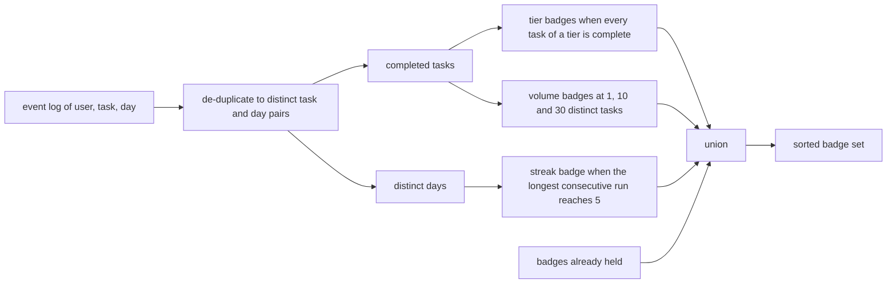
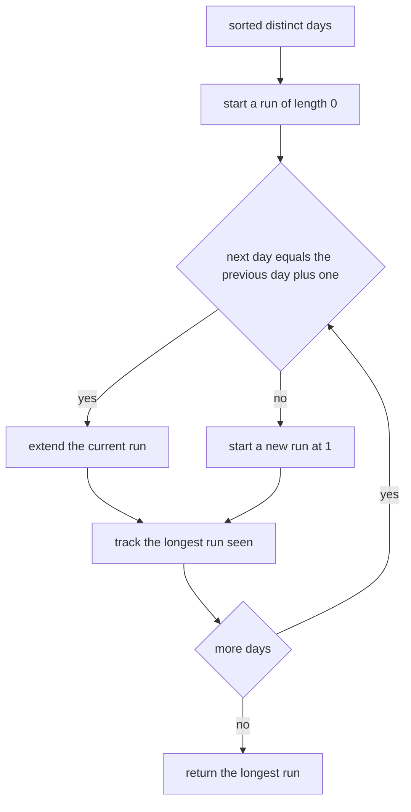
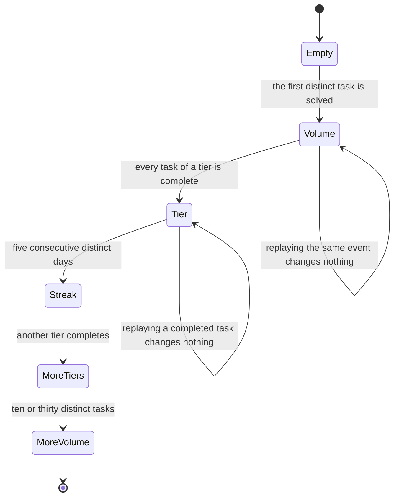
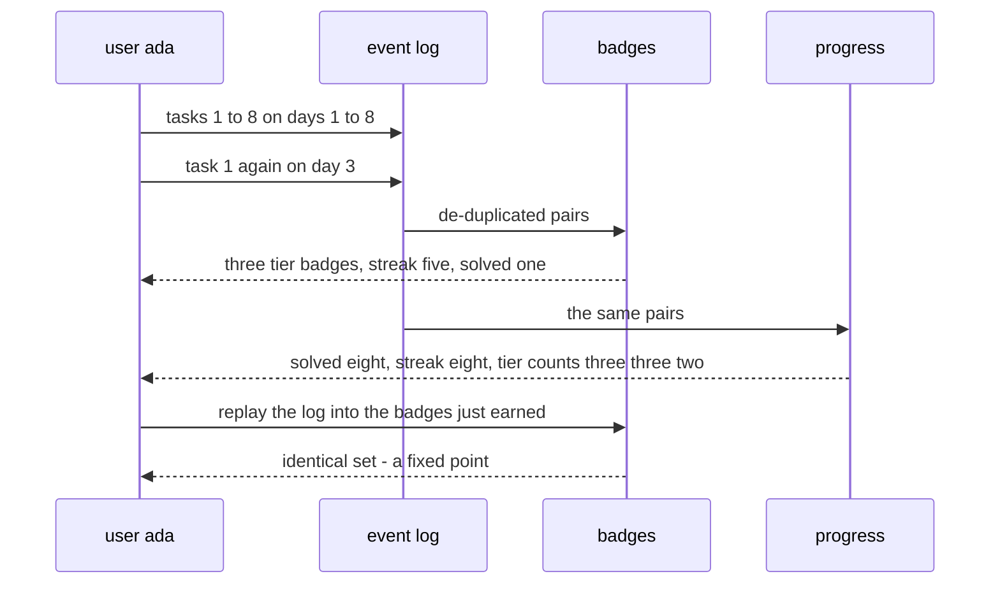

# 960 — Implement gamification layer with badges for completing tiers and streaks.

> **Tier:** Master · **CTCI chapter:** Beyond — Software Engineering & Tooling
> **Task spec:** [960-implement-gamification-layer-with-badges-for-completing-tiers-an.md](../../../tasks/master/960-implement-gamification-layer-with-badges-for-completing-tiers-an.md)
> **Solutions:** [Python](../../../solutions/python/master/960-implement-gamification-layer-with-badges-for-completing-tiers-an/solution.py) ·
> [Java](../../../solutions/java/master/960-implement-gamification-layer-with-badges-for-completing-tiers-an/Solution.java) ·
> [JavaScript](../../../solutions/javascript/master/960-implement-gamification-layer-with-badges-for-completing-tiers-an/solution.js) ·
> [C#](../../../solutions/csharp/master/960-implement-gamification-layer-with-badges-for-completing-tiers-an/Solution.cs)

## 1. Problem restatement

**The modelling contract first.** The four files build an in-memory *gamification layer*: an event log
of `(user, task, day)` completions feeds three rule families — tier badges when every task of a tier is
complete, a streak badge when the longest run of consecutive distinct days reaches a threshold, and
volume badges for distinct tasks solved. The Python docstring names the simplifications: `day` is an
integer the caller supplies rather than a timestamp, the catalogue is a handful of tasks, and the reward
layer is decoupled from the submission pipeline. What is real — and asserted — is the semantics:
idempotence, monotonicity, and exact thresholds.

**Inputs.** An event log, a user name, optionally the badges already held, and three tables:
`TIER_TASKS = {"beginner": (1, 2, 3), "intermediate": (4, 5, 6), "master": (7, 8)}`,
`STREAK_THRESHOLD = 5`, `VOLUME_THRESHOLDS = (1, 10, 30)`.

**Outputs.** The sorted badge list, the display order, and a progress summary
`{solved, streak, tiers}`.

| File | Streak unit | Rule families |
| --- | --- | --- |
| Python | distinct integer days, longest consecutive run | tier completeness, streak thresholds, volume thresholds |
| Java | distinct day indices, idempotent per task and day | the same three families over a small fixed catalogue |
| JavaScript | distinct days | the same three families |
| C# | distinct days | the same three families |

Concrete results, from the Python file's printed run and its assertions:

| Call | Result | Source of the claim |
| --- | --- | --- |
| `badges(ada_events(), "ada")` | `tier:beginner`, `tier:intermediate`, `tier:master`, `streak:5`, `solved:1` — nothing else | printed as `ada_badges=[…]` |
| `progress(ada_events(), "ada")` | `{solved: 8, streak: 8, tiers: {beginner: 3, intermediate: 3, master: 2}}` | printed |
| the same log for `bob` | `['solved:1']` — one catalogued-away task, streak 1 | asserted |
| streak boundary | 4 consecutive days earn nothing, 5 earn `streak:5`, and a duplicate event on a repeated day does not stretch it | printed as `streak_five=5` |
| gap | days `1, 2, 3, 4, 10` give a longest streak of 4 | asserted |
| tier completeness | two of three beginner tasks earn nothing; the third earns the badge | asserted |
| idempotence | replaying the log into the badge set it just produced is a fixed point | asserted |
| monotonicity over prefixes | badge counts per prefix are `[0, 1, 1, 2, 2, 3, 4, 4, 5]` — never decreasing | printed as `ladder_sizes=[…]` |
| volume boundary | 9 tasks earn no `solved:10`, 10 do; 29 earn no `solved:30`, 30 do | printed as `volume30=True` |
| empty log / single event | `[]` / `['solved:1']` | asserted |

## 2. Intuition

The naive implementation updates badges *as events arrive*: increment a counter, compare to a threshold,
award. It produces a class of bugs that are painful precisely because they are invisible until a user
complains: a re-delivered event double-counts a day and inflates a streak; a badge lost during a
migration is never re-awarded; and two workers processing the same event disagree about the result.

The insight is to make awarding a **pure function of the log plus the badges already held**, never a
mutation:

```text
badges = f(events, user, previous)
```

Three properties follow immediately, and all three are asserted:

1. **Idempotence.** `f(log, u, f(log, u)) == f(log, u)` — replaying the log into the badge set it just
   produced changes nothing, so a re-delivered event is harmless.
2. **Monotonicity.** Every prefix of the log yields a subset of the badges of any longer prefix, so
   badges are never revoked and a growing log only grows the set.
3. **Order independence.** The log is a *set* of `(task, day)` pairs after de-duplication, so shuffling
   the events cannot change the outcome.





## 3. Algorithm

1. `completions`: de-duplicate the log to distinct `(task, day)` pairs for one user, sorted by day then
   task. This is the step that makes repeated events harmless.
2. `days_of`: the distinct days of that user.
3. `longest_streak`: scan the sorted days, extending a run while each day is exactly the previous plus
   one, and keep the maximum.
4. `badges`: start from the previous badge set, add one `tier:<name>` per fully completed tier, add
   `streak:<threshold>` when the longest streak reaches it, and add `solved:<n>` for every volume
   threshold at or below the distinct solved count. Return the sorted set.
5. `badge_rank`: display order — tiers in catalogue order, then streaks by threshold, then volumes by
   threshold.
6. `progress`: the UI summary — solved count, streak, and per-tier completion counts.

```text
procedure completions(events, user)
    return the sorted set of (task, day) pairs whose user matches
end

procedure days_of(events, user)
    return the sorted set of days appearing in completions(events, user)
end

procedure longest_streak(days)
    best = 0, current = 0, previous = none
    for day in days do
        if previous is not none and day equals previous plus one then
            current = current + 1
        else
            current = 1
        end
        best = maximum of best and current
        previous = day
    end
    return best
end

procedure badges(events, user, previous)
    completed = the set of tasks in completions(events, user)
    earned = a copy of previous
    for tier and tasks in TIER_TASKS do
        if every task of the tier is in completed then
            add the tier badge to earned
        end
    end
    if longest_streak(days_of(events, user)) is at least STREAK_THRESHOLD then
        add the streak badge to earned
    end
    for threshold in VOLUME_THRESHOLDS do
        if number of completed tasks is at least threshold then
            add the solved badge to earned
        end
    end
    return earned sorted
end

procedure badge_rank(badge)
    split the badge into family and value
    if the family is tier then return 0 and the catalogue index of the value
    if the family is streak then return 1 and the numeric value
    return 2 and the numeric value
end
```



## 4. Worked example

Ada's log has eight catalogued tasks on days 1 to 8, plus a duplicate of task 1 on day 3 (a re-delivered
event) and Bob's event, which must not leak in. De-duplication and the streak scan give:

| Step | Input | Result |
| --- | --- | --- |
| `completions(events, "ada")` | 9 ada events | 8 distinct `(task, day)` pairs |
| `days_of` | those pairs | `{1, 2, 3, 4, 5, 6, 7, 8}` — the duplicate day 3 collapses |
| `longest_streak` | the day set | 8, printed as `streak: 8` |
| tier rules | tasks 1–8 | `beginner` (1, 2, 3) ✓, `intermediate` (4, 5, 6) ✓, `master` (7, 8) ✓ |
| streak rule | 8 ≥ 5 | `streak:5` |
| volume rules | 8 distinct tasks | `solved:1` only; 8 < 10 |
| result | — | `tier:beginner`, `tier:intermediate`, `tier:master`, `streak:5`, `solved:1` |

The duplicate event is the interesting part: day 3 appears twice in the log, and the streak is 8 rather
than 9 — because a streak counts *distinct days*, which is exactly what the assertion about
idempotence is protecting.

Thresholds are pinned on both sides, since a badge rule that fires one event early is a support ticket:

| Rule | Just below | At the threshold |
| --- | --- | --- |
| streak | days `1, 2, 3, 4` (and `1, 2, 3, 4, 10`) → longest 4, no badge | days `1…5` → `streak:5` |
| tier | two of three `beginner` tasks → no badge | task 3 also done → `tier:beginner` |
| volume | 9 tasks → no `solved:10`; 29 tasks → no `solved:30` | 10 → `solved:10`; 30 → `solved:30` |

Monotonicity is checked over *every prefix* of a growing log, and the printed ladder of badge counts
shows the three families arriving in a natural order:

| Prefix length | 0 | 1 | 2 | 3 | 4 | 5 | 6 | 7 | 8 |
| --- | --- | --- | --- | --- | --- | --- | --- | --- | --- |
| Badges | 0 | 1 | 1 | 2 | 2 | 3 | 4 | 4 | 5 |
| What arrived | — | `solved:1` | — | `tier:beginner` | — | `streak:5` | `tier:intermediate` | — | `tier:master` |

The jump at prefix 5 is the streak badge: the log's first five events are on consecutive days. The
flat steps in between are the tasks that complete a tier only later, which is what "monotone, not
increasing at every step" means in practice.



## 5. Complexity

Let `e` be the number of log entries, `u` the entries of one user, `d` the distinct days and `c` the
number of catalogued tasks.

| Measure | Bound | Why it holds |
| --- | --- | --- |
| `completions` | `O(e + u log u)` | one filter pass plus a sort of the de-duplicated pairs |
| `days_of` | `O(u log u)` | the distinct days of the sorted pair list |
| `longest_streak` | `O(d)` | one scan with a running counter |
| `badges` | `O(e + u log u + t)` with `t` tiers plus volume thresholds | de-duplication dominates; the rules are constant-time lookups |
| `badge_rank` and the display sort | `O(b log b)` for `b` badges | the comparator is `O(1)` |
| `progress` | `O(e + u log u + c)` | the per-tier intersection sizes |
| Space | `O(u + c)` | the deduplicated set and the catalogue |

The simulation limits are worth stating as part of the cost model. Days are integers supplied by the
caller, so no time zone, no wall clock and no holiday calendar leaks in — which is what makes the streak
reproducible — but it also means the layer knows nothing about *when* a day was, only that it was
distinct from its neighbours. The catalogue is small enough to intersect directly; a real platform would
count per tier incrementally and store the counts, trading memory for the linear scan.

## 6. Pitfalls and edge cases

- **A repeated event must not stretch a streak.** The log's duplicate of day 3 collapses in
  `completions`, so the streak stays 8; without de-duplication it would count nine distinct day
  occurrences and could award a streak nobody earned.
- **A streak counts distinct days, not events.** Two tasks completed on the same day are one day of
  streak — otherwise a busy user could farm the badge in a single sitting.
- **A gap breaks the run, however long the rest is.** Days `1, 2, 3, 4, 10` give 4, not 5.
- **Tier badges need the *whole* catalogue.** Two of three `beginner` tasks earn nothing, which is why
  `progress` reports per-tier counts — the UI can show "2 of 3" without awarding anything.
- **Volume thresholds are cumulative, not exclusive.** Ten distinct tasks earn `solved:1` *and*
  `solved:10`; the file asserts the badge set rather than a single badge.
- **Empty log.** `badges([], "nobody") == []`, `days_of([], …) == []` and `longest_streak([]) == 0` — the
  empty day set is the case that makes a naive streak scan report 1.
- **Other users' events must not leak.** Bob's event leaves Ada's badges untouched and `bob` earns only
  `solved:1` for a task that is not in any tier.
- **A missing task id is still a solved task.** Bob's task 99 is outside the catalogue, so it earns no
  tier badge but still counts toward volume — the two rule families read different sets.
- **Order independence.** The printed ladder is identical for a shuffled log, because every rule reads
  sets, never sequences.
- **Display order is not award order.** `badge_rank` orders tiers by catalogue order, then streaks, and
  only then volumes, so the rendered list is stable regardless of when each badge was earned.

## 7. Variants and follow-ups

- **Decouple awarding from arrival.** The Java variant derives everything from an append-only log with
  idempotent per-day events; that is what lets the same engine run offline over a replayed history.
- **Rank on verified results instead.** [959-implement-leaderboard-with-verified-performance-metrics-and-repr.md](../../../tasks/master/959-implement-leaderboard-with-verified-performance-metrics-and-repr.md)
  is the competitive counterpart: badges reward participation and persistence, the leaderboard ranks
  reproducible performance, and neither should be used as a proxy for the other.
- **Check that the tasks exist.** [953-implement-contributor-guide-and-templates-for-new-problems-tests.md](../../../tasks/master/953-implement-contributor-guide-and-templates-for-new-problems-tests.md)
  validates problem metadata, which is what makes `TIER_TASKS` a reliable catalogue rather than a guess.
- **Keep the canonical artifacts.** [955-implement-canonical-solution-repository-with-multiple-language-s.md](../../../tasks/master/955-implement-canonical-solution-repository-with-multiple-language-s.md)
  holds the problems and baselines the completion events refer to, so "tier complete" has a definition
  outside the badge engine.
- **Add decay, levels or teams.** The same pure-function shape extends to seasonal badges (window the
  log by day range) and to streaks that tolerate a single skipped day (scan with one allowed gap); both
  keep idempotence and monotonicity as the design constraints worth preserving.

## 8. Check yourself

1. Ada's log contains nine events but the streak is 8. Why?

<details><summary>Show answer</summary>

Because one event is a duplicate of task 1 on day 3, and `completions` de-duplicates to *distinct*
`(task, day)` pairs. The distinct day set is `{1 … 8}`, so the longest consecutive run is 8. Counting
events instead of days would have produced 9 and let a re-delivered event inflate the streak.

</details>

2. What does `badges(events, "ada", previous=once) == once` demonstrate?

<details><summary>Show answer</summary>

Idempotence. Awarding is a pure function of the log plus the badges already held, so replaying the log
into the badge set it just produced is a fixed point. That is what makes a retried delivery, a
backfill, or a re-run after a crash safe: no duplicate badges and nothing revoked.

</details>

3. The printed ladder is `[0, 1, 1, 2, 2, 3, 4, 4, 5]`. What are the steps where nothing is added?

<details><summary>Show answer</summary>

Prefixes 2, 4, 7 and 8 add no badge: at prefix 2 only one beginner task is done, at prefix 4 the
beginner tier is already complete and the intermediate tier still misses task 6, at prefix 7 the master
tier still misses task 8, and at prefix 8 only the volume count changes — from 8 to 8, since the tenth
task is far away. Monotonicity only requires that the sets never shrink.

</details>

4. Why does Bob earn `solved:1` for a task that is in no tier?

<details><summary>Show answer</summary>

Because the rule families read different sets. Tier badges require *every* task of a tier, so a task
outside the catalogue contributes nothing there; volume badges count *distinct tasks solved*, so any
task counts. Bob's single event also gives a streak of 1, which is below the threshold of 5.

</details>

5. Where would a time zone leak into this design, and why can it not?

<details><summary>Show answer</summary>

If `day` were a timestamp, the same completion could map to different calendar days on different
machines, and a streak would become non-reproducible. Here `day` is an integer the caller supplies, so
the engine only sees distinct day *indices* and the streak is a property of the log rather than of the
clock — the docstring lists that as the deliberate simplification.

</details>
