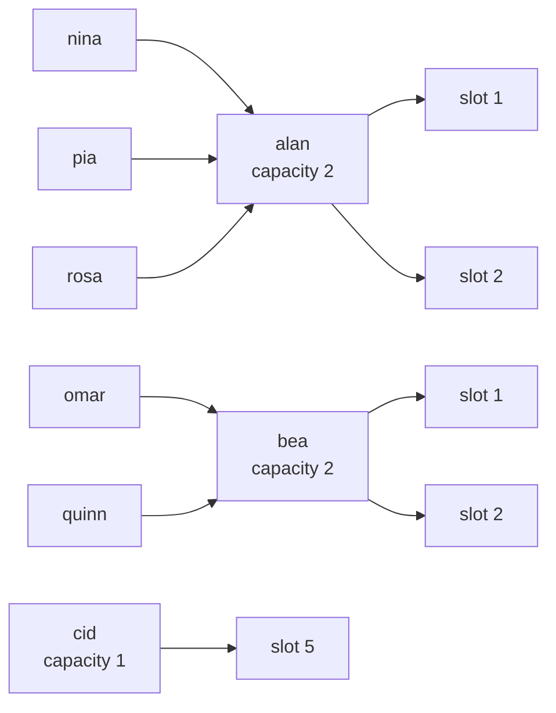
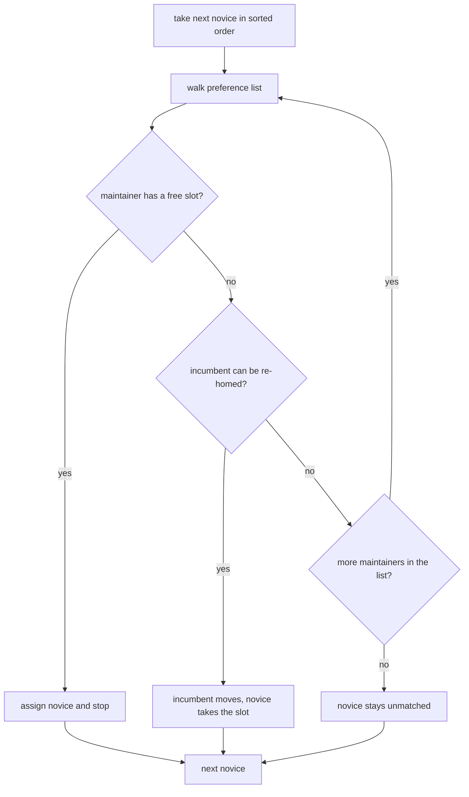
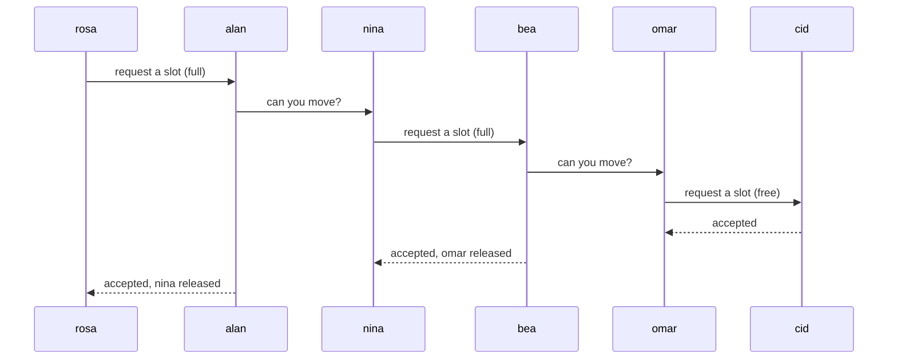

# 961 — Implement mentoring workflow pairing novices with maintainers for PR review.

> **Tier:** Master / Challenge · **CTCI chapter:** Beyond — Software Engineering & Tooling
> **Task spec:** [961-implement-mentoring-workflow-pairing-novices-with-maintainers-fo.md](../../../tasks/master/961-implement-mentoring-workflow-pairing-novices-with-maintainers-fo.md)
> **Solutions:** [Python](../../../solutions/python/master/961-implement-mentoring-workflow-pairing-novices-with-maintainers-fo/solution.py) ·
> [Java](../../../solutions/java/master/961-implement-mentoring-workflow-pairing-novices-with-maintainers-fo/Solution.java) ·
> [JavaScript](../../../solutions/javascript/master/961-implement-mentoring-workflow-pairing-novices-with-maintainers-fo/solution.js) ·
> [C#](../../../solutions/csharp/master/961-implement-mentoring-workflow-pairing-novices-with-maintainers-fo/Solution.cs)

## 1. Problem restatement

**Input:** a set of *novices* — each with the `areas` they want to work in and an optional ordered
`wants` tuple naming the gap they most care about — and a set of *maintainers* — each with the
`areas` they can review and an integer `capacity`.

**Output:** an assignment from novice to maintainer (novices left out of the map are unmatched), a
per-maintainer review load, and a per-maintainer report that groups the paired novices.

This is a Master-tier *production-grade* task, so the solution is not a live GitHub bot: it is the
**deterministic in-process model** of one. The modelling contract is stated in the file headers:

- affinities are a small closed-form score over the declared `areas` (no review history, no calendar);
- capacities are plain integers, and a negative one is a configuration error rather than a silent zero;
- the assignment is *verified*, not trusted — an independently written check (a brute-force oracle in
  Python and C#, a blocking-pair scan in Java and JavaScript) re-derives the claim.

The Python file fixes the scoring constants and the load arithmetic:

```text
REVIEWS_PER_PAIRING = 2
WANT_BONUS          = 3
affinity(novice, mentor) = 2 * |novice.areas ∩ mentor.areas|
                         + (3 when novice.wants is non-empty and wants[0] ∈ mentor.areas else 0)
```

Concrete behaviour asserted by the shipped fixtures:

| Scenario | Result | Asserted by |
| --- | --- | --- |
| 5 novices, 3 maintainers (capacity 2 + 2 + 1 = 5) | every novice paired; loads `{alan: 2, bea: 2, cid: 1}` | `main` check 1 |
| 5 novices, capacity 2 + 1 = 3 | 3 pairs; unmatched `["quinn", "rosa"]`, matched `["nina", "omar", "pia"]` | `main` check 4 |
| empty novice set, or a maintainer pool of `{}` | `{}` | `main` check 7 |
| one maintainer with capacity `0` and no areas | `{}` | `main` check 7 |
| maintainer with capacity `-1` | raises `ValueError` containing `negative capacity` | `main` check 9 |
| review load | `sum(loads) == 2 * len(pairing)`, `loads["alan"] == 4`, `loads["cid"] == 2` | `main` check 6 |

The four files share the contract (capacity-respecting assignment, deterministic tie-breaks,
unmatched report, independent verification) but differ in the matching engine, and the headers say
so explicitly: the Python file runs **Kuhn augmenting-path matching** over the capacity-expanded
graph, while the Java, JavaScript and C# files run **capacitated deferred acceptance (Gale-Shapley)**
— novices propose down their preference list and a full maintainer displaces its least preferred
holder — which the Java/C# blocking-pair scan certifies as stable. Java scores pairs by shared areas
plus a comfort-level distance; JavaScript scores by language overlap, timezone proximity and a
seniority-gap penalty; C# uses shared interest areas alone.

## 2. Intuition

The naive idea is a greedy scan: sort every (novice, maintainer) pair by score and hand out the best
pair whose maintainer still has room.

```text
for (novice, mentor) in all pairs in descending affinity order do
    if capacity(mentor) is not used up then
        pair novice with mentor
    end
end
```

It is linear-ish and it looks fair, but it is not optimal. A high-affinity novice grabs the last slot
of a popular maintainer, and the only novice who *could* have used that maintainer is left stranded,
even though re-routing the first novice to their second choice would have paired both. Greedy is
*safe* (it never breaks capacity) but it is not cardinality-maximal — and pairing as many novices as
possible is the number the programme is judged on.

The key insight is that the problem is a **bipartite matching with capacities**, and capacity is not a
new obstacle: a maintainer with `capacity = k` is nothing more than `k` identical slots. Once you see
that, the classic augmentation idea applies — a novice is allowed to *take* an occupied slot if the
novice in it can be re-homed somewhere worse-but-acceptable, recursively. Searching for such a chain
(augmenting path) is what turns "no room" into "room, after a shuffle".



Every edge is a legal pairing because every novice is acceptable to every maintainer in this fixture;
the numbers on the edges (the affinity) decide only the *order* in which a novice tries them. That
"complete bipartite graph, weighted, sorted access" shape is exactly what makes the cardinality
formula `min(novices, total capacity)` reachable, and it is what the Python file asserts.

## 3. Algorithm

The augmenting-path variant (Python) in numbered form:

1. Normalise both sides: `areas`/`wants` become tuples, `capacity` becomes an `int`, and a negative
   capacity raises immediately.
2. Build each novice's preference list: all maintainers sorted by `(-affinity, mentor_name)`. The name
   is the tie-break, which is what makes the result independent of dictionary order.
3. Start with the empty matching; each maintainer holds a list of at most `capacity` novices.
4. Process novices in sorted name order and try to `augment` each one.
5. `augment(novice, visited)`: walk the novice's preference list. If the maintainer has a free slot,
   take it and succeed. Otherwise, for each incumbent of that maintainer, recursively try to re-home
   the incumbent (marking the maintainer visited so no mentor is retried inside one search). If a
   re-homing works, the incumbent leaves and the new novice takes the slot.
6. If no maintainer in the list can be made to work, the novice stays unmatched.
7. Convert the per-maintainer holder lists back into a novice → maintainer map.

```text
procedure match(novices, mentors)
    order ← empty map
    for novice in sorted(novices) do
        order[novice] ← mentors sorted by (-affinity(novice, mentor), mentor name)
    end
    assigned ← map mentor -> empty list
    for novice in sorted(novices) do
        augment(novice, empty set)
    end
    return map novice -> mentor built from assigned
end

function augment(novice, visited)
    for mentor in order[novice] do
        if mentor in visited then continue end
        visited.add(mentor)
        if length(assigned[mentor]) < capacity(mentor) then
            assigned[mentor].append(novice)
            return true
        end
        for displaced in copy of assigned[mentor] do
            if augment(displaced, visited) then
                assigned[mentor].remove(displaced)
                assigned[mentor].append(novice)
                return true
            end
        end
    end
    return false
end
```

The deferred-acceptance variant the Java, JavaScript and C# files implement reaches the same shape
from the other direction — nobody is ever re-homed, the *maintainer* decides:

```text
procedure deferred_acceptance(novices, mentors)
    proposals ← map mentor -> empty list
    while some novice is free and has an untried mentor on their list do
        pick such a novice, take their next mentor
        proposals[mentor].append(novice)
        while length(proposals[mentor]) > capacity(mentor) do
            reject the incumbent with the worst rank on that mentor's list
            the rejected novice becomes free again
        end
    end
    return tentative proposals as the final matching
end
```

The difference is what the answer is optimal *for*: augmenting paths maximise the pair count, while
deferred acceptance guarantees that no novice/maintainer pair would both rather have each other
(stability) — and, as the Java and C# headers note, it still yields `min(novices, total capacity)`
pairs when capacity is scarce.



## 4. Worked example

The fixture in the Python solution: novices `nina` (graphs, wants graphs), `omar` (parsing, wants
parsing), `pia` (graphs + parsing), `quinn` (math), `rosa` (graphs); maintainers `alan` (graphs,
capacity 2), `bea` (parsing + math, capacity 2), `cid` (systems, capacity 1).

Affinity first, because it drives every preference list (`2 * overlap + 3` when the top want is
covered):

| Novice | `alan` | `bea` | `cid` | preference order |
| --- | --- | --- | --- | --- |
| `nina` | 2·1 + 3 = **5** | 0 | 0 | alan, bea, cid |
| `omar` | 0 | 2·1 + 3 = **5** | 0 | bea, alan, cid |
| `pia` | 2·1 = **2** | 2·1 = **2** | 0 | alan, bea, cid |
| `quinn` | 0 | 2·1 = **2** | 0 | bea, alan, cid |
| `rosa` | 2·1 = **2** | 0 | 0 | alan, bea, cid |

`pia`'s tie between `alan` and `bea` is broken by the mentor name, so her list is alphabetical.

Now the augmentation trace, in sorted novice order:

| Step | Novice | State before | Action | State after (`maintainer: holders`) |
| --- | --- | --- | --- | --- |
| 1 | `nina` | all slots free | alan has a slot | `alan: [nina]` |
| 2 | `omar` | bea free | bea has a slot | `bea: [omar]` |
| 3 | `pia` | alan 1/2, bea 1/2 | alan has a slot (2 > 2 is false) | `alan: [nina, pia]` |
| 4 | `quinn` | alan full, bea 1/2 | bea has a slot | `bea: [omar, quinn]` |
| 5 | `rosa` | alan 2/2, bea 2/2, cid 0/1 | alan is full → try to re-home `nina` | `alan: [nina, pia]` |
| 5a | `nina` (recursion) | alan visited, bea full | bea is full → try to re-home `omar` | unchanged |
| 5b | `omar` (recursion) | bea, alan visited | cid has a free slot | `cid: [omar]` |
| 5c | back in `nina` | bea frees one holder | `nina` takes it, bea drops `omar` | `bea: [quinn, nina]` |
| 5d | back in `rosa` | alan frees `nina` | `rosa` takes alan's slot | `alan: [pia, rosa]` |

Final pairing: `{nina: bea, omar: cid, pia: alan, quinn: bea, rosa: alan}` — five pairs out of five,
loads `{alan: 2, bea: 2, cid: 1}` (all within capacity) and total affinity `0 + 0 + 2 + 2 + 2 = 6`.
The point of step 5 is the whole algorithm: `rosa` never had a free slot available, but a chain of
three re-homings made one appear.



The two other fixtures pin down the boundaries. Under scarcity (`alan` capacity 2, `bea` capacity 1,
`cid` absent) the very same walk stops after three novices: `quinn` and `rosa` each exhaust their
lists, so the file asserts `len(match(NOVICES, scarce)) == 3` with matched
`["nina", "omar", "pia"]` and unmatched `["quinn", "rosa"]` — equal to
`min(novices, total capacity) = min(5, 3)`. On the tiny instance (`a`, `b`, `c` against `m1`
capacity 2 and `m2` capacity 1) the file additionally compares against `brute_force_best`, an
exhaustive search over every legal assignment that maximises the pair `(count, total affinity)`, and
the two agree.

## 5. Complexity

Let `N` be the number of novices, `M` the number of maintainers, `K = Σ capacity` the total review
slots, and `E = N·M` the acceptances in the (here complete) bipartite graph.

| Phase | Time | Space | Why |
| --- | --- | --- | --- |
| Build preference lists | `O(N · M log M)` | `O(N · M)` | every novice sorts all maintainers by affinity, once |
| Augmenting-path matching (Python) | `O(N · E) = O(N² · M)` worst case | `O(N · M)` | `N` augment searches; each visits a maintainer at most once (`visited`) and recurses along currently matched novices |
| Deferred acceptance (Java, JS, C#) | `O(N · M)` proposals | `O(N · M)` | each novice walks their list at most once; maintainer displacement is a single pass over the held ranks |
| Load/report construction | `O(N + M log M)` | `O(N + M)` | one scan of the pairing plus a sorted grouping |
| Brute-force oracle (verification only) | `O((M + 1)^N)` | `O(N + M)` | every novice is either unmatched or sent to one of `M` maintainers |

Best case is the same as the worst case for this input shape: the graph is complete, so there is no
early "no edges" exit to exploit, and the cost is dominated by the number of augmentation attempts
rather than by sparsity. The comparison that matters is *quality*, not speed: greedy is `O(E log E)`
to sort and then linear, an order of magnitude cheaper than augmenting paths, but it can leave pairs
on the table that `min(N, K)` would otherwise fill — which is why the solutions pay for the matching
step and then prove the pair count with a formula and an oracle.

The reported load arithmetic is `O(N)`: `REVIEWS_PER_PAIRING = 2` reviews per pair, so
`sum(loads) == 2 · len(pairing)` and, with `capacity` at most 2 everywhere in the fixture, no
maintainer can exceed `2 · capacity = 4` reviews — the file asserts exactly `loads["alan"] == 4` and
`loads["cid"] == 2`.

## 6. Pitfalls and edge cases

- **Negative capacity is a configuration error.** The Python file raises `ValueError("mentor ... has
  negative capacity ...")` and the check asserts the message contains `negative capacity` — clamping
  to zero would hide a scheduling bug.
- **Zero capacity is legal.** A maintainer with `capacity = 0` (and even no areas) matches nobody and
  the whole pool then pairs `{}`; likewise an empty novice set or empty mentor set returns `{}` with
  no crash.
- **Ties must be broken explicitly.** `(-affinity, name)` is a strict total order; without the name
  half, `pia`'s list would depend on dictionary iteration order and the file's determinism check
  (reversed input dictionaries must produce the same pairing) would fail.
- **Unmatched novices are deterministic.** The tail is the sorted remainder — `["quinn", "rosa"]`,
  not "whichever novice happened to be last in a dict".
- **Cardinality, not total affinity, is the guarantee.** `min(N, K)` is asserted by formula; the
  exhaustive oracle only runs on the tiny instance (where it also confirms the affinity total). Do
  not claim the augmenting-path walk maximises affinity on the larger fixture — it does not
  (`nina` ends on `bea` with affinity 0 while her best is 5, in exchange for five pairs).
- **Stability is a property of the other three files.** If you port the Python greedy-order walk to
  production and a maintainer's preference list is not the reverse of the novice's, the assignment
  need not be stable; the Java/C# blocking-pair scan is the check that catches that.

## 7. Variants and follow-ups

- **Weights on the objective.** If total affinity must be maximised instead of the pair count, the
  augmenting-path walk becomes a min-cost-max-flow / assignment problem: the same slot expansion,
  but with costs and successive shortest augmenting paths.
- **General graphs.** When maintainers can also be paired with each other (mentor-of-mentor chains),
  the bipartite assumption breaks and blossom-style matching is needed — see
  [456](../../../tasks/advanced/456-implement-matchings-in-general-graph-edmonds-blossom-outline.md)
  and [534](../../../tasks/advanced/534-implement-matching-in-general-graphs-improved-heuristics-edmonds.md).
- **Faster bipartite matching.** For large pools, Hopcroft-Karp replaces one-augment-at-a-time with a
  BFS/DFS phase that finds a maximal set of shortest augmenting paths —
  [275](../../../tasks/intermediate/275-maximum-bipartite-matching-hopcroft-karp-outline.md).
- **Real workflow around the pairing.** The reviewers-to-PRs assignment feeds a quality-review
  workflow with negotiation and escalation —
  [998](../../../tasks/master/998-implement-community-moderation-tools-and-quality-review-workflow.md).
## 8. Check yourself

<details><summary>Show answer</summary>

**Q1. Why can the greedy scan pair fewer novices than `min(N, K)`, and what does augmentation add?**

Greedy never undoes a decision, so a novice holding the last slot of a popular maintainer blocks a
later novice who had no other acceptable maintainer. Augmentation adds exactly one thing: the right
to *displace* an incumbent, provided the incumbent can be re-homed. That keeps the pair count rising
by one per successful search, which is what reaches `min(N, K)`.
</details>

<details><summary>Show answer</summary>

**Q3. Why is `(-affinity, name)` used as the sort key instead of affinity alone?**

Because affinity ties are extremely common in this small closed-form score (`pia` scores 2 against
both `alan` and `bea`). A tie-break on the name makes every preference list a strict total order, so
the result does not depend on dictionary iteration order — the file's "reversed dictionaries give the
same pairing" check exists precisely to catch that class of bug.
</details>

<details><summary>Show answer</summary>

**Q4. The Python file and the Java file both produce a capacity-feasible assignment. Where do they differ?**

Python returns a maximum-cardinality matching found with Kuhn augmenting paths (it never claims
stability). Java/C#/JS run capacitated deferred acceptance, which is stable — no novice and
maintainer both prefer each other to their current situation — and is certified by an independent
blocking-pair scan. The Python file's independent certificate is the exhaustive `brute_force_best`
oracle on a tiny instance plus the `min(novices, capacity)` formula.
</details>
