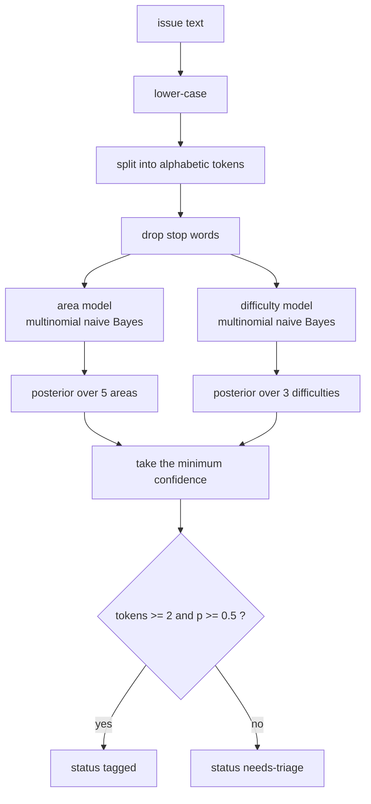
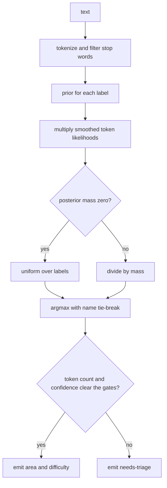
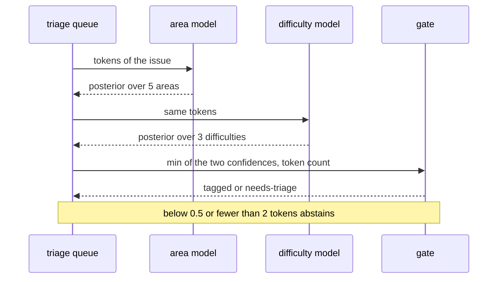

# 962 — Implement automated issue triage using NLP to tag difficulty/area.

> **Tier:** Master / Challenge · **CTCI chapter:** Beyond — Software Engineering & Tooling
> **Task spec:** [962-implement-automated-issue-triage-using-nlp-to-tag-difficulty-are.md](../../../tasks/master/962-implement-automated-issue-triage-using-nlp-to-tag-difficulty-are.md)
> **Solutions:** [Python](../../../solutions/python/master/962-implement-automated-issue-triage-using-nlp-to-tag-difficulty-are/solution.py) ·
> [Java](../../../solutions/java/master/962-implement-automated-issue-triage-using-nlp-to-tag-difficulty-are/Solution.java) ·
> [JavaScript](../../../solutions/javascript/master/962-implement-automated-issue-triage-using-nlp-to-tag-difficulty-are/solution.js) ·
> [C#](../../../solutions/csharp/master/962-implement-automated-issue-triage-using-nlp-to-tag-difficulty-are/Solution.cs)

## 1. Problem restatement

**Input:** the text of an issue (a title, in the shipped corpus) plus a labelled training corpus of
`(area, difficulty, text)` triples.

**Output:** a triage record with a `status`, an `area`, a `difficulty`, the confidence of the weakest
of the two decisions, and the retained tokens:

| Field | Value |
| --- | --- |
| `status` | `"tagged"` or `"needs-triage"` |
| `area` | one of `parsing`, `graphs`, `dp`, `math`, `systems`, or `None` when abstaining |
| `difficulty` | one of `easy`, `medium`, `hard`, or `None` when abstaining |
| `confidence` | `min(area_confidence, difficulty_confidence)`, rounded to 6 decimals |
| `tokens` | the lower-cased, stop-word-filtered alphabetic tokens |

This is a production-grade task modelled **in process**: the headers are explicit that a small
hand-written corpus stands in for a trained model, there is no stemming, and the two labels are two
independent one-vs-rest problems rather than a joint model. What *is* real is the machinery around
the classifier — smoothing, abstention, determinism, and a verification oracle.

The Python file fixes the contract with named constants:

```text
AREAS           = parsing, graphs, dp, math, systems
DIFFICULTIES    = easy, medium, hard
ABSTAIN_THRESHOLD = 0.5     # a winning posterior below this is not acted on
MIN_TOKENS        = 2
TRAIN             = 15 labelled documents
HOLDOUT           = 4 labelled documents
```

Concrete results asserted by the shipped checks:

| Scenario | Result | Asserted by |
| --- | --- | --- |
| 4 hold-out issues | all `tagged`; all 4 areas correct; 3 of 4 difficulties correct | `main` check 1 |
| label accuracy | `labels_right == 7`, i.e. `7 / 8 == 0.875` labels | `main` check 2 |
| the single miss | the ambiguous hold-out, which is also the **lowest-confidence** row | `main` check 2 |
| empty text / `"graph"` (1 token) | `needs-triage`, `area is None` | `main` check 3 |
| threshold boundary | `decide(0.5, 2) == "tagged"` but `decide(0.5 - 1e-9, 2) == "needs-triage"` | `main` check 3 |
| posterior | sums to 1 within `1e-12`, `0 ≤ p ≤ 1`, and the argmax equals the prediction | `main` checks 4, 5 |
| unseen vocabulary | `"zzyzx quux frobnicate"` → `needs-triage`; a one-class model returns that class with confidence `1.0` | `main` check 6 |
| shuffled training order | identical counts, vocabulary and predictions | `main` check 7 |
| token accounting | per-label totals sum to the retained token count; vocabulary `> 20` | `main` check 8 |

The four files implement the same contract with different estimators, and each header names its own:
Python trains **two multinomial naive Bayes classifiers** (Laplace-smoothed) and re-derives the
posterior with exact `Fraction` arithmetic as its oracle; Java also trains two multinomial NB models
but evaluates **leave-one-out** (every document scored by a model that never saw it) with a softmax
over class scores; JavaScript scores in **log space** (probabilities are the softmax of summed
log-likelihoods) and derives difficulty from a **keyword rule set** instead of a model; C# uses
**TF-IDF nearest centroid** for the area (unigrams plus four-character shingles, smoothed `idf` for
unseen words) and a **weighted keyword lexicon** for difficulty, with every fourth document held out.

## 2. Intuition

The naive idea is keyword matching: a dictionary of terms per area, plus a handful of "hard" words,
and the first dictionary that fires wins.

```text
function triage(text)
    for area in areas do
        if some keyword of area appears in text then
            return (area, "medium")
        end
    end
    return ("unknown", "medium")
end
```

That is the shape most home-grown triage bots start with, and it fails in all the ways the
production task cares about: it has no notion of *evidence* (one shared word fires as loudly as five),
it cannot say "I do not know" (it always returns the first match, so it never escalates to a human),
it is not comparable across labels (nothing to threshold on), and it is order-dependent (the area
list decides the answer, not the text).

The key insight is that both questions — *which area?* and *how hard?* — are **classification with a
calibrated score**, and the cheapest calibrated score that survives a small corpus is naive Bayes:
count the tokens per label, smooth the zeros, multiply the per-token likelihoods with the class
prior, and normalise. Multiplying probabilities underflows fast, so the implementations work with
sums of log-likelihoods or with exact rationals; either way the number you get at the end is a
distribution you can compare against a threshold.



The second half of the insight is the **abstention gate**. A classifier that must always answer is
worse than useless on a triage queue, because a confident wrong tag is invisible while an explicit
`needs-triage` is a work item. So the model is deliberately allowed to refuse, on two independent
grounds: not enough evidence (fewer than `MIN_TOKENS = 2` tokens), or a winning posterior below
`ABSTAIN_THRESHOLD = 0.5`. Both the empty string and the single token `"graph"` are refused, which
the Python file asserts directly.

## 3. Algorithm

Numbered steps for the Python (naive Bayes) variant:

1. Tokenise: lower-case the text, keep alphabetic runs with `[a-z]+`, drop stop words.
2. Fit the area model on `(area, text)` and the difficulty model on `(difficulty, text)` — the same
   `NaiveBayes` class, two instances.
3. Fitting accumulates, per label: the document count, the per-word counts, the total retained token
   count, and the shared vocabulary.
4. Score a text: start from the class prior `documents[label] / total_documents`, then multiply
   `(count[label][word] + 1) / (totals[label] + |vocabulary|)` for every token. The `+1` numerator and
   the vocabulary-sized denominator are Laplace smoothing, which is why an unseen token shifts the
   evidence instead of zeroing the product.
5. Normalise the scores into a posterior by dividing by their sum; if the mass is zero (only possible
   for a degenerate model), fall back to the uniform distribution `1 / |labels|`.
6. Predict the label with the largest posterior, breaking ties by label name so the answer is
   deterministic.
7. Decide: `tagged` only when the token count is at least `MIN_TOKENS` **and** the smaller of the two
   confidences is at least `ABSTAIN_THRESHOLD`; otherwise `needs-triage` with both labels blanked.

```text
procedure fit(corpus)
    for (label, text) in corpus do
        documents[label] ← documents[label] + 1
        for word in tokenize(text) do
            counts[label][word] ← counts[label][word] + 1
            totals[label] ← totals[label] + 1
            vocabulary.add(word)
        end
    end
end

function posterior(model, text)
    size ← max(length(vocabulary), 1)
    scores ← empty map
    for label in model.labels do
        value ← prior(label)
        for word in tokenize(text) do
            value ← value * (counts[label][word] + 1) / (totals[label] + size)
        end
        scores[label] ← value
    end
    mass ← sum of scores
    return scores normalised by mass
end

function triage(area_model, difficulty_model, text)
    words ← tokenize(text)
    area, area_confidence ← predict(area_model, text)
    difficulty, difficulty_confidence ← predict(difficulty_model, text)
    confidence ← min(area_confidence, difficulty_confidence)
    if length(words) >= MIN_TOKENS and confidence >= ABSTAIN_THRESHOLD then
        return tagged record with area, difficulty, confidence, words
    end
    return needs-triage record with confidence and words
end
```

The variants differ in step 4 only, and the difference is worth knowing because it changes the
numbers: the Java file evaluates leave-one-out (the document being scored is excluded from the model
that scores it, so the reported accuracy is honest), the JavaScript file keeps the same product in log
space to avoid underflow, and the C# file replaces the area classifier with a TF-IDF nearest-centroid
model whose `idf` is smoothed so that a novel vocabulary never produces a zero vector.



## 4. Worked example

Take the fourth hold-out issue, `systems` / `medium`:
`"Thread memory exhaustion raises queue latency"`. Tokenisation lower-cases it and drops the stop
words, leaving `thread, memory, exhaustion, raises, queue, latency` — six tokens, so the length gate
(`>= 2`) passes.

The area posterior is built from the training corpus, whose `systems` documents are:

- easy — `"Small docs fix for the cache queue description"`
- medium — `"Queue latency spikes when the thread pool memory is exhausted"`
- hard — `"Optimize memory and cache latency for a large concurrent queue"`

| Area | Shared tokens with the issue | Posterior |
| --- | --- | --- |
| `systems` | `thread`, `memory`, `exhaustion`/`exhausted`, `queue`, `latency` | largest of the five |
| `parsing` | `operator`, `expression`, … none present | prior × smoothing only |
| `graphs` | `graph`, `node`, `edge` — none present | prior × smoothing only |
| `dp` | `memo`, `subproblem` — none present | prior × smoothing only |
| `math` | `modular`, `prime` — none present | prior × smoothing only |

Because every unseen token still contributes a smoothed factor, the four wrong areas do not score
zero — they score the product of priors and smoothing terms, which is exactly why the posterior is a
legitimate distribution and why the confidence can be compared to a threshold. The area wins
comfortably. The difficulty model is the interesting one: the same words appear in both a `medium`
and a `hard` training document (`memory`, `cache`, `latency`, `optimize`), so the posteriors for
`easy`, `medium` and `hard` sit close together; `medium` wins, and its confidence is the smaller of
the two decisions.

The full hold-out sweep, as asserted:

| # | Hold-out issue | Expected | Predicted area | Predicted difficulty | Status |
| --- | --- | --- | --- | --- | --- |
| 1 | `"Ambiguous operator precedence breaks the expression parser"` | parsing / hard | parsing | **medium** (miss) | tagged |
| 2 | `"Node label typo in the graph output"` | graphs / easy | graphs | easy | tagged |
| 3 | `"Optimize the memo subproblem recurrence proof"` | dp / hard | dp | hard | tagged |
| 4 | `"Thread memory exhaustion raises queue latency"` | systems / medium | systems | medium | tagged |

Eight labels (four areas + four difficulties), seven correct → `0.875`. Row 1 is the miss, and it is
also the row with `min(confidence)` over the batch — the check asserts that coupling
(`predictions[0]["confidence"] == min(row["confidence"] for row in predictions)`) because it is the
signal the abstention gate is designed to catch: an ambiguous issue that overlaps both the `medium`
and the `hard` training vocabulary scores low, and in production a lower threshold would route it to
a human instead of guessing.



## 5. Complexity

Let `D` be the number of training documents, `W` the average retained tokens per document, `V` the
vocabulary size, `L` the number of classes, and `T` the tokens in the text being scored.

| Phase | Time | Space | Why |
| --- | --- | --- | --- |
| Tokenise one text | `O(len(text))` | `O(T)` | one regex pass, one set lookup per token |
| Fit one model | `O(D · W)` | `O(V · L)` counts plus `O(V)` vocabulary | every token updates one count and one total |
| Score one text | `O(T · L)` | `O(L)` scores | per-token factor for every class |
| Triage one issue | `O(T · (L_area + L_difficulty))` | `O(L)` | two model passes; the comparison and the gate are constant |
| Full hold-out sweep | `O(H · T · L)` | `O(L)` | `H = 4` hold-out issues |

The dominant cost is fitting, and it is paid once. Scoring is linear in the text and in the number of
labels — there is no cross-validation in the hot path, which is the point of shipping the model
instead of a rule list: a keyword scan is `O(T · |keywords|)` but gives no posterior, and a
nearest-centroid or embedding model pays an extra `O(V)` dot product per class (the C# file's TF-IDF
centroid is exactly that). Leave-one-out evaluation in the Java file costs `H · fitting`, so it is
`O(D · W)` per held-out document — cheap here because `D = 15`, but it is the reason the Python file
keeps a separate four-document hold-out instead.

## 6. Pitfalls and edge cases

- **Zero probabilities kill the posterior.** Without Laplace smoothing one unseen token zeroes an
  entire class; with it, the class merely becomes unlikely. The file asserts that
  `predict("zzyzx quux")` still lands in `AREAS` and that the model does not crash on
  `"zzyzx quux frobnicate"` — it abstains because of the gate, not because of an exception.
- **Underflow.** Multiplying a dozen small probabilities may flush to zero in floating point; the
  JavaScript file sums log-likelihoods and exponentiates at the end, and the Python file uses exact
  `Fraction`s so its oracle never underflows at all.
- **The confidence is the *minimum* of the two decisions.** An issue can be a slam dunk for the area
  model and a coin flip for the difficulty model, and the gate must look at the weaker one.
- **Threshold boundaries are inclusive.** `decide(ABSTAIN_THRESHOLD, MIN_TOKENS)` is `tagged`, so the
  comparison is `>=` on both gates; `decide(ABSTAIN_THRESHOLD - 1e-9, MIN_TOKENS)` is not.
- **Empty and one-token text.** `triage("")` returns `needs-triage` with `area is None`; `"graph"`
  yields `tokens == ["graph"]`, one token, so it abstains even though the word is in the vocabulary.
- **Training-order independence.** Re-fitting on a permuted corpus must give identical counts,
  vocabulary and predictions; the check asserts the shuffled model equals the original.
- **Degenerate corpora.** A one-class model returns that class with confidence `1.0` and
  `posterior("") == 1`, and a model whose mass is zero falls back to a uniform distribution rather
  than dividing by zero.
## 7. Variants and follow-ups

- **Calibration.** A raw naive Bayes posterior is famously over-confident; a held-out reliability
  curve or Platt scaling would make the `0.5` threshold mean the same thing for every area.
- **Rubric-driven difficulty.** When difficulty must be justified rather than predicted, the score is
  built from a rubric instead of a corpus —
  [956](../../../tasks/master/956-implement-grading-rubric-generator-that-assigns-difficulty-and-e.md).
- **Calibrating against real evidence.** Predicted difficulty can later be corrected by observed
  crowd runtimes —
  [976](../../../tasks/master/976-implement-automatic-difficulty-calibration-from-crowd-sourced-ru.md).
- **Consuming the `needs-triage` queue.** Abstentions become human work items in a moderation and
  quality-review workflow —
  [998](../../../tasks/master/998-implement-community-moderation-tools-and-quality-review-workflow.md).
## 8. Check yourself

<details><summary>Show answer</summary>

**Q1. Why does the confidence gate use `min` of the two posteriors rather than the average?**

The two questions are independent and both must be answered before the tag is applied. A high average
can hide one confident and one coin-flip decision; the minimum is the conservative statement — "I am
at least this sure about every field I am about to write". The file pairs that with the empirical
observation that the single mislabelled hold-out is also the lowest-confidence row.
</details>

<details><summary>Show answer</summary>

**Q2. What exactly does Laplace smoothing change in the arithmetic?**

The likelihood of a word becomes `(count + 1) / (total_tokens + |vocabulary|)` instead of
`count / total_tokens`. Unseen words therefore contribute a small positive factor instead of zero (no
class is ever eliminated by one missing word), and every `per-label` total still sums to one over the
vocabulary.
</details>

<details><summary>Show answer</summary>

**Q3. Why is the empty string `needs-triage` even though the models can produce posteriors for it?**

Because `decide` requires `token_count >= MIN_TOKENS = 2` independently of the posterior. With no
tokens, every score degenerates to the class prior and the "winner" is whichever class is most
frequent in the training corpus — a decision made by the corpus rather than the issue, which is
exactly what abstention exists to avoid.
</details>

<details><summary>Show answer</summary>

**Q4. The Python file's oracle re-implements the posterior. Why is that an oracle at all?**

Because it is computed with exact `Fraction` arithmetic from the same count tables while the primary
path uses floats. Agreement to within `1e-12` on both the winning label and its value
(`main` check 5) proves the fast path is not the product of a rounding artefact, and the exact form
also lets the file assert `sum(posterior) == 1` without tolerance games.
</details>
