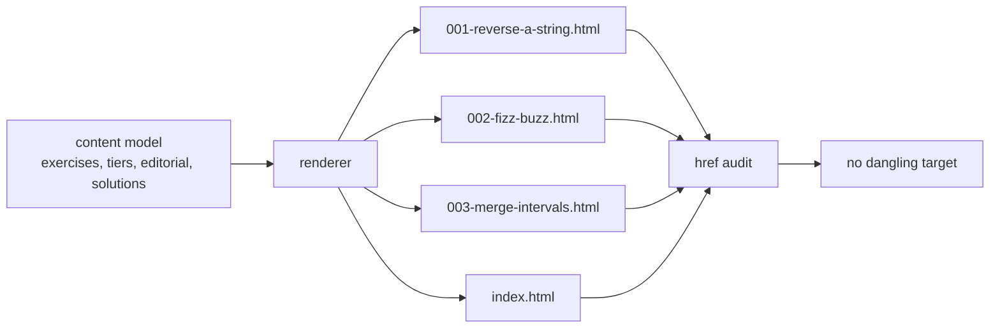
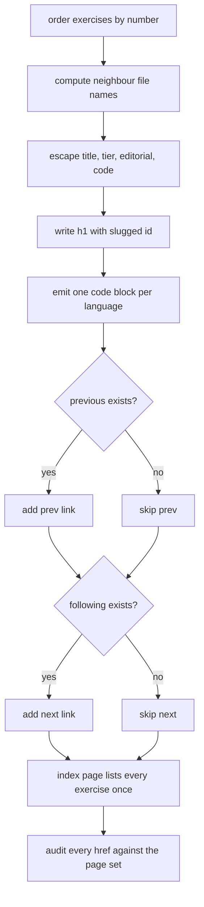
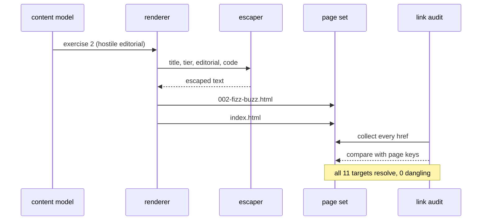

# 963 — Implement docs site generator that publishes exercises, editorial notes, and solutions.

> **Tier:** Master / Challenge · **CTCI chapter:** Beyond — Software Engineering & Tooling
> **Task spec:** [963-implement-docs-site-generator-that-publishes-exercises-editorial.md](../../../tasks/master/963-implement-docs-site-generator-that-publishes-exercises-editorial.md)
> **Solutions:** [Python](../../../solutions/python/master/963-implement-docs-site-generator-that-publishes-exercises-editorial/solution.py) ·
> [Java](../../../solutions/java/master/963-implement-docs-site-generator-that-publishes-exercises-editorial/Solution.java) ·
> [JavaScript](../../../solutions/javascript/master/963-implement-docs-site-generator-that-publishes-exercises-editorial/solution.js) ·
> [C#](../../../solutions/csharp/master/963-implement-docs-site-generator-that-publishes-exercises-editorial/Solution.cs)

## 1. Problem restatement

**Input:** a set of exercises. Each carries a `number`, a `title`, a `tier`, an `editorial` note, and
a map from language to solution source.

**Output:** a map from file name to page content — one page per exercise plus an `index.html` — with:

- the index listing every exercise exactly once, in numeric order;
- previous/next navigation between neighbouring exercises;
- one language-tagged code block per available solution;
- HTML-escaped prose and code;
- no dangling internal link, asserted by an independent audit of the generated page set.

The modelling contract is stated in the headers: an **in-memory** site model is rendered into plain
string pages (no template engine, no asset pipeline, no disk I/O), and the "deploy" step is replaced
by the part a static publish actually has to guarantee — the link audit. The Python file fixes the
constants:

```text
LANGUAGES = python, java, javascript, csharp        # the four solution languages
EXERCISES = 3 exercises                             # numbers 1, 2, 3
page_id(number, title) = "%03d-" + slugify(title)   # e.g. 002-fizz-buzz
```

Concrete results asserted by the shipped checks:

| Scenario | Result | Asserted by |
| --- | --- | --- |
| 3 exercises | `len(pages) == len(EXERCISES) + 1 == 4` file entries | `main` check 1 |
| index ordering | each title appears once, and `001-reverse-a-string` precedes `002-fizz-buzz` precedes `003-merge-intervals` | `main` check 1 |
| link audit | `dangling(pages) == []` and `len(links(pages)) == 3 · 3 + 2 == 11` | `main` check 2 |
| hostile payload | `&lt;script&gt;alert(1)&lt;/script&gt;` appears; the live `<script>` tag does not | `main` check 3 |
| code blocks | language classes are exactly `csharp, java, javascript, python`; page 1 has `4 == len(solutions)` blocks | `main` check 4 |
| navigation ends | first page has `next` and no `prev`; last has `prev` and no `next`; the middle page links both neighbours | `main` check 5 |
| anchors | no page repeats an element id; `page_id(3, "Fizz & <Buzz>") == "003-fizz-buzz"`; page 3 has exactly one id | `main` check 6 |
| empty site | `sorted(empty) == ["index.html"]`, still contains `exercise-list`, `dangling == []`, `links == [("index.html", "index.html")]`, no list items | `main` check 7 |
| slug boundaries | `"  Merge   Intervals!! " → merge-intervals`; `"Fizz & <Buzz>" → fizz-buzz`; `"!!!" → page`; `page_id(7, "A/B") == "007-a-b"` | `main` check 8 |
| determinism | rebuilding and reversing the input order both produce identical bytes | `main` check 9 |

Each of the four files satisfies that contract with its own renderer, and the headers list the
differences: Java renders **markdown strings into a `TreeMap`**, splits the index into **paginated chunks**, adds a page per chapter that anchors into each task page, and verifies **reachability** (an
index walk must reach every page; a planted orphan is detected). JavaScript implements a **markdown
subset** — front matter, ATX headings, paragraphs, bullet lists, fenced code, inline code/bold/links
— de-duplicates slugged anchors per page, builds a table of contents, and carries a **content hash**
so a rebuild can reuse unchanged pages verbatim. C# renders from a content tree where `[[NNN]]`
becomes a link to that problem's solution page, disambiguates repeated titles with `-2`/`-3` anchor
suffixes, and **fails the build** when a link does not resolve to a generated page or anchor.

## 2. Intuition

The naive generator is a concatenation: build each page by gluing strings together and write them out.

```text
for exercise in exercises do
    page ← "<html><body><h1>" + exercise.title + "</h1>"
    page ← page + "<p>" + exercise.editorial + "</p>"
    page ← page + "<pre>" + exercise.solutions["python"] + "</pre>"
    emit page
end
```

It produces pages, and that is all it produces. Three things are missing, and each of them is what
"publishes" actually means: the prose is interpolated **raw**, so an editorial note containing
`<script>` becomes live markup; the links are written by hand, so nothing detects a target that was
never generated; and the ids are derived ad hoc, so two headings can claim the same anchor id.

The key insight is to treat the site as a **two-part object**: a *content model* (exercises, tiers,
editorial prose, solutions) and a *link graph*. Every string that crosses from the first into the
second is escaped on the way in, every id is produced by a slugify-and-number function, and then the
rendered pages are audited against themselves — every `href` must exist in the page set. Rendering and
verification are separate passes over the same output, which is why the check can be written as
"`dangling(pages) == []` and 11 hrefs were examined".



The second half of the insight is **navigation is just two extra links**. The renderer receives the
previous and next exercise as parameters instead of looking them up, so the boundaries fall out for
free: the first page passes `previous = None`, the last passes `following = None`, and the pager block
renders whichever links exist. A single exercise site therefore has a pager with `no neighbours`, and
an empty site still renders an index — both of which the file asserts.

## 3. Algorithm

1. Order the exercises by `number` (the input order must not matter).
2. For each exercise, look up the previous and next neighbour in that order and compute their file
   names with `page_id(number, title) + ".html"`.
3. Render the exercise page: doctype, an `<h1>` carrying the slugified id, a tier paragraph, the
   editorial section, one `<h2>` plus a fenced code block per available language, the pager `<nav>`,
   and a link back to the index.
4. Escape every interpolated value with an HTML escaper: titles, tiers, editorial prose and code.
5. Emit the code fences as `<pre class="code"><code class="language-X">…</code></pre>` so the
   highlighter can find the language class.
6. Render `index.html` from the ordered list: one `<li>` per exercise, in order.
7. Audit: extract every `href="…"` from every page and report the ones that are neither an in-page
   anchor (starting with `#`) nor a member of the page set.

```text
procedure build_site(exercises)
    ordered ← exercises sorted by number
    pages ← empty map
    for index, exercise in enumerate(ordered) do
        previous ← neighbour at index - 1 when index > 0 else None
        following ← neighbour at index + 1 when index + 1 < length(ordered) else None
        pages[page_id(exercise.number, exercise.title) + ".html"] ←
            exercise_page(exercise, previous, following)
    end
    pages["index.html"] ← index_page(ordered)
    return pages
end

procedure exercise_page(exercise, previous, following)
    lines ← [doctype, head with escaped title, body,
             h1 carrying the slugged id, tier paragraph, editorial section]
    for language in LANGUAGES do
        code ← exercise.solutions[language]
        if code is not None then
            lines.append("Solution: " + language)
            lines.append(code_block(language, code))
        end
    end
    navigation ← links for previous and following that exist
    lines.append(pager with navigation, or "no neighbours")
    lines.append(link back to the index)
    return lines joined with newlines
end

function dangling(pages)
    return every (page, href) where href is not a fragment and href is not a key of pages
end
```

The three other files extend this skeleton rather than replace it. Java adds a paginated index and a
per-chapter page whose anchors point into task pages, then checks that a walk from the index reaches
every page — the orphan detector. JavaScript parses a markdown subset, so headings, lists and code
fences become markup, anchors are de-duplicated per page, and each page carries a content hash used to
reuse an identical page on rebuild. C# renders `[[NNN]]` references into solution-page links and
disambiguates repeated anchors with `-2`/`-3` suffixes; its link checker compares every href against
the page set **plus the anchor set**, so a link to a non-existent anchor inside an existing page is a
build failure too.



## 4. Worked example

The fixture has three exercises, and exercise 2 is deliberately hostile: its title is
`Fizz & <Buzz>` and its editorial contains `<script>alert(1)</script>`.

Naming first. `slugify` lower-cases, replaces every run of non-alphanumerics with a single dash, and
trims dashes — falling back to `page` when nothing survives:

| Input | `slugify` | `page_id` |
| --- | --- | --- |
| `"Reverse a string"` | `reverse-a-string` | `001-reverse-a-string` |
| `"Fizz & <Buzz>"` | `fizz-buzz` | `002-fizz-buzz` |
| `"Merge intervals"` | `merge-intervals` | `003-merge-intervals` |
| `"  Merge   Intervals!! "` | `merge-intervals` | — |
| `"!!!"` | `page` | — |
| `"A/B"` (number 7) | `a-b` | `007-a-b` |

Then the pages and their hrefs, which is where the `11` in the audit comes from:

| Page | hrefs it contributes | Count |
| --- | --- | --- |
| `index.html` | the three exercise links plus its own `index.html` self-link | 4 |
| `001-reverse-a-string.html` | `next` → 002, plus `index.html` | 2 |
| `002-fizz-buzz.html` | `prev` → 001, `next` → 003, plus `index.html` | 3 |
| `003-merge-intervals.html` | `prev` → 002, plus `index.html` | 2 |

`4 + 2 + 3 + 2 = 11 = 3 · 3 + 2`, and every one of them resolves to a key of the page map, so
`dangling(pages) == []`. The escaping check reads the rendered page 2 and looks for the *escaped*
form: `&lt;script&gt;alert(1)&lt;/script&gt;` is present and the raw `<script>` substring is absent,
while the index carries `&lt;Buzz&gt;` (from the escaped title) and the raw `<Buzz>` never appears.

The pager is inspected through a dedicated regex so that the word "next" appearing in prose cannot
satisfy the check:

| Page | pager contents | Reading |
| --- | --- | --- |
| `001-reverse-a-string.html` | `next` only | first page, no backwards neighbour |
| `002-fizz-buzz.html` | `prev` to 001 and `next` to 003 | middle page links both |
| `003-merge-intervals.html` | `prev` only | last page, no forward neighbour |

Finally, the degenerate site: `build_site(())` returns exactly `{index.html}`, with the
`exercise-list` element present but no `<li>` entries. Its only link is the index's self-link,
so the audit yields the single pair `("index.html", "index.html")` — an empty site is still a valid,
link-clean site.



## 5. Complexity

Let `E` be the number of exercises, `L` the number of languages (4 here), `C` the total characters of
solution code, and `H` the total number of hrefs emitted.

| Phase | Time | Space | Why |
| --- | --- | --- | --- |
| Order the exercises | `O(E log E)` | `O(E)` | one sort by number |
| Render one page | `O(len(page))` | `O(len(page))` | escaping and joining are linear in the page size |
| Render every page | `O(E · L + C)` | `O(E · L + C)` | `L` blocks per exercise, each copied once |
| Slugify and id | `O(len(title))` | `O(len(title))` | one regex substitution |
| Link audit | `O(total page bytes + H)` | `O(H)` | one href sweep, one map lookup per href |
| Whole build | `O(E log E + E · L + C + H)` | `O(E · L + C)` | dominated by the rendered bytes |

The cost is proportional to the output, which is the property a static generator needs: the audit
adds a single linear pass and no asymptotic cost, and the `O(E log E)` sort is what makes the build
independent of input order. The alternatives pay more: rendering through a general template engine
adds a parse per page, and a naive "scan the whole site for every link" audit would be `O(H · E)`
instead of `O(H)`. The JavaScript file goes one step further for large sites — the content hash turns
a rebuild into `O(changed pages)` rendering plus the same linear audit — while Java's reachability
walk is a breadth-first traversal from the index, `O(E + H)`, which is what turns "no dangling link"
into the stronger "no orphan page".

## 6. Pitfalls and edge cases

- **Unescaped interpolation is the whole bug class.** The hostile editorial must render as
  `&lt;script&gt;…` — if the generator escapes prose but not code, an exercise whose solution contains
  `<` still injects markup.
- **Slug collisions.** `"Fizz & <Buzz>"` and `"Fizz Buzz"` slugify to the same `fizz-buzz`, which is
  why C# disambiguates repeated anchors with `-2`/`-3` suffixes and the identifier carries the number
  prefix (`002-…`) to keep page-level ids unique.
- **Punctuation inside prose must not satisfy a navigation check.** Prose could mention "next"; the
  checks extract the `<nav class="pager">` block only.
- **First and last pages are the boundary cases.** A pager that always renders both links produces
  hrefs to `None`-ish neighbours; the file asserts the absence of `prev` on page 1 and of `next` on
  page 3.
- **The empty site is legal.** `build_site(())` must still emit a usable index; a generator that
  returns `{}` or crashes on zero exercises breaks incremental publishing.
- **Order independence.** Rendering the exercises in reverse must produce byte-identical pages —
  everything is derived from the sorted order, not the input order.
- **A link audit proves resolution, not usefulness.** `dangling == []` says every href exists; the
  Java file's reachability walk is the extra check that no page is stranded outside the index.
- **Anchors are part of the contract in C#.** A link to an existing page with a non-existent anchor is
  reported by the checker, and `[[999]]` (a numbered reference to a problem that does not exist) is
  the planted failure the check asserts.
## 7. Variants and follow-ups

- **Editorial content at scale.** Once the generator exists, the bottleneck is prose: an assistant
  that drafts explanations for reviewers is the natural companion —
  [994](../../../tasks/master/994-implement-editorial-writing-assistant-that-drafts-explanations-p.md).
- **Citation and provenance.** Published solutions often need references with stable formatting —
  [993](../../../tasks/master/993-implement-academic-citation-generator-for-editorial-solutions-wi.md).
- **Content migration.** Publishing a new format means migrating older problem files into it —
  [987](../../../tasks/master/987-implement-migration-tools-for-older-problem-formats-to-new-canon.md).
- **Incremental and reproducible builds.** The JavaScript file's content hash is the seed of an
  incremental publish; a reproducible build environment is the other half —
  [990](../../../tasks/master/990-implement-reproducible-docker-images-for-canonical-environment-w.md).
## 8. Check yourself

<details><summary>Show answer</summary>

**Q1. Why does the generator compute neighbour file names instead of having the renderer look up the previous/next exercise itself?**

Because passing `previous`/`following` in as parameters makes the boundary conditions explicit and
testable: `None` on the first page for `previous` and on the last page for `following`. A renderer
that resolves neighbours itself has to re-derive "am I first/last" from the same structure, and any
off-by-one there produces either a self-link or a missing pager entry.
</details>

<details><summary>Show answer</summary>

**Q2. The audit counted 11 hrefs. Show the arithmetic.**

Each of the three exercise pages links back to the index (3), the pager contributes one `next` on
page 1 and one `prev` on page 3 (2), the middle page contributes both (2), and the index carries
three exercise links plus its own self-link (4). `3 + 2 + 2 + 4 = 11`, which is `3 · 3 + 2` for this
fixture — the audit asserts the count so that a silently dropped link cannot pass as "no dangling
targets".
</details>

<details><summary>Show answer</summary>

**Q3. What does `slugify("  Merge   Intervals!! ")` produce, and why is the trim step needed?**

`merge-intervals`: every run of non-alphanumerics collapses to one dash, and the leading dashes
produced by the leading spaces and the trailing ones from `!! ` are stripped, so ids never start or
end with a dash. Without the trim you would get `-merge-intervals-` and every generated file name
would carry stray dashes.
</details>

<details><summary>Show answer</summary>

**Q4. Which check would catch a generator that emits pages but forgets to list them in the index?**

The reachability walk (Java) or the index-completeness assertion (Python: each title appears exactly
once, in numeric order). `dangling(pages) == []` would **not** catch it — an unlisted page is not a
broken link, it is an orphan, and only a traversal from the index can see the difference.
</details>

<details><summary>Show answer</summary>

**Q5. Why is byte-for-byte determinism asserted at all?**

Because a static site is published by diffing the output: a generator whose output shifts with input
order or dictionary iteration produces a full-site diff on every rebuild, which breaks caching, the
content-hash reuse that the JavaScript file implements, and any review of what actually changed. The
check rebuilds, and rebuilds from a reversed input, and requires both to equal the original map.
</details>
