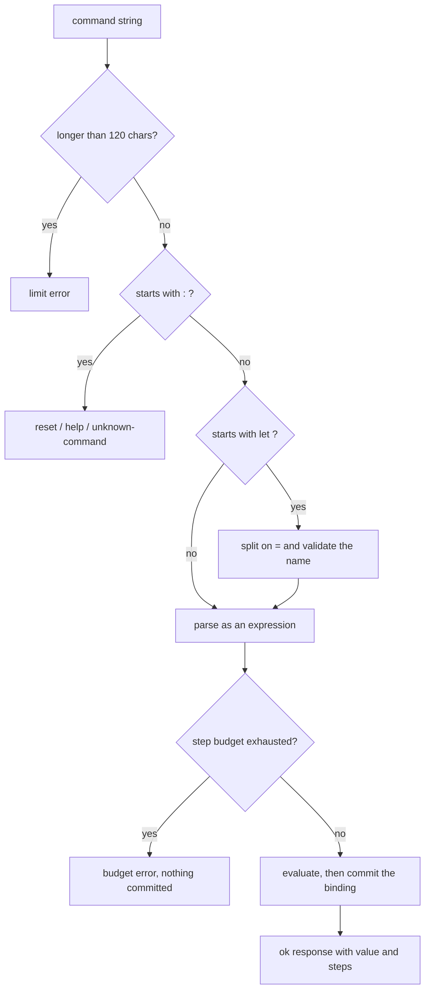
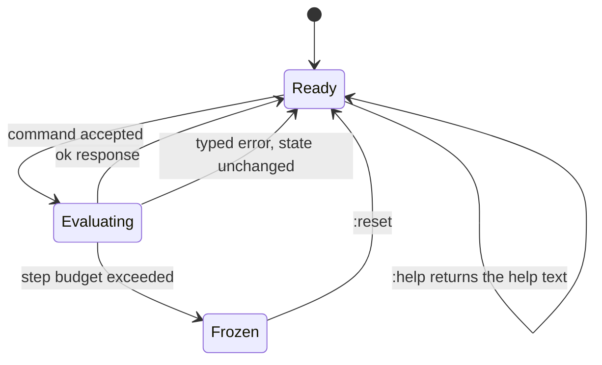
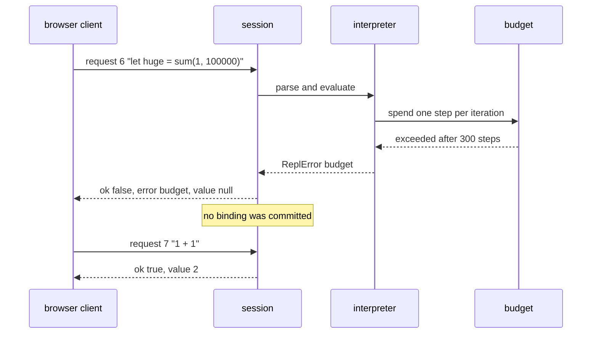

# 964 — Implement interactive REPL/web UI for running and testing problems in-browser (sandboxed).

> **Tier:** Master / Challenge · **CTCI chapter:** Beyond — Software Engineering & Tooling
> **Task spec:** [964-implement-interactive-repl-web-ui-for-running-and-testing-proble.md](../../../tasks/master/964-implement-interactive-repl-web-ui-for-running-and-testing-proble.md)
> **Solutions:** [Python](../../../solutions/python/master/964-implement-interactive-repl-web-ui-for-running-and-testing-proble/solution.py) ·
> [Java](../../../solutions/java/master/964-implement-interactive-repl-web-ui-for-running-and-testing-proble/Solution.java) ·
> [JavaScript](../../../solutions/javascript/master/964-implement-interactive-repl-web-ui-for-running-and-testing-proble/solution.js) ·
> [C#](../../../solutions/csharp/master/964-implement-interactive-repl-web-ui-for-running-and-testing-proble/Solution.cs)

## 1. Problem restatement

**Input:** a command string typed into a REPL — `let name = expr`, a bare `expr`, `:reset`, `:help`
(or the other files' `:vars`, `:quit`, `:tests`, `:submit`) — plus the session state carried over
from previous commands.

**Output:** a response object, one per request, shaped like a wire message:

| Field | Meaning |
| --- | --- |
| `id` | the request sequence number, assigned and echoed by the session |
| `ok` | whether the command was accepted |
| `value` | the value, or the assigned name for a `let` |
| `steps` | how much evaluation budget the command consumed |
| `error` | `"code: message"` when the command failed, else `None` |
| `error_position` | the token index of a parse failure, else `None` |

The modelling contract is that this is the **in-process model of a browser client talking to a
sandboxed evaluator**: the headers say there is no DOM and the "network" is a direct method call, and
that the sandbox itself is a *step counter*, not a worker thread. What is real is the protocol, the
quotas and the error taxonomy. The Python file fixes the constants:

```text
DEFAULT_BUDGET     = 300      # evaluation steps per command
MAX_COMMAND_LENGTH = 120      # characters, refused with error code "limit"
HELP_TEXT          = "let name = expr | expr | :reset | :help"
OPS                = + - * / %   with / and % as floor division / floor modulo
```

Concrete results asserted by the shipped checks:

| Scenario | Result | Asserted by |
| --- | --- | --- |
| script `2 + 3 * 4`, `let base = 7`, `base * base - 1`, `(2 + 3) * (4 - 1)`, `- 4 % 3` | values `[14, "base", 48, 15, 2]`, ids `[1, 2, 3, 4, 5]`, `variables == {"base": 7}` | `main` check 1 |
| response shape | keys exactly `error, error_position, id, ok, steps, value`; `ok` implies no error and a non-`None` value | `main` check 1 |
| oracle subset | `[7, 9, 2, 10, 2, 3]` for the six literal expressions, matching the host language, and `100 / 7 == 14` | `main` check 2 |
| step accounting | `sum(1, 50)` costs `50 + 2 + 2 = 54` steps; flat expressions cost `[1, 3, 5, 5, 5]` | `main` check 3 |
| runaway loop | `sum(1, 100000)` fails with `budget:` and leaves **no** `huge` binding | `main` check 4 |
| error taxonomy | `["division", "unknown-name", "arity", "parse"]` for `1 / 0`, `missing + 1`, `sum(1)`, `3 +` | `main` check 4 |
| atomicity | after four failures `variables` is unchanged; the session still answers `1 + 1` | `main` check 4 |
| protocol | `2 * - )` reports `parse:` at `error_position == 3`; ids keep increasing; `""` is a parse error; a 204-character command is `limit:` | `main` check 5 |
| reset/help | `:reset` clears state and `base` then fails; `:help` returns `HELP_TEXT` | `main` check 5 |
| replay | a fresh session replaying the same script returns identical responses (ids included) and shares no variables | `main` check 6 |

The four files model the same protocol with different language cores, and each header states its own
verification strategy: Python cross-checks arithmetic against **the host interpreter's own evaluation**
and re-runs the script as a replay. Java evaluates with a **shunting-yard** machine as an independent
oracle for 30 generated expressions, adds `:vars`/`:quit`, and bounds the **transcript quota** as well
as the step budget. JavaScript implements a precedence-climbing parser with right-associative `^`,
statements (`let x = e`, `x = e`, `print(e)`), arrays and whitelisted builtins — and adds the parts
that make a *browser* sandbox real: a **banned-identifier list** that rejects host objects at parse
time, an **allocation cap**, and history replay that rebuilds the environment exactly. C# keeps two
evaluators — recursive descent and a two-stack operator-precedence machine — and requires them to
agree on 60 random expressions; exceeding the budget **freezes** the session until `:reset`, and
`:submit` is gated on `:tests`.

## 2. Intuition

The naive REPL is `eval` on the user's string.

```text
function handle(command)
    return eval(command)
end
```

It is three lines and it is unusable, for reasons that have nothing to do with the arithmetic: a
single bad character raises an exception that escapes the session, so the tab is dead; `eval` can call
anything the host can call, so an untrusted submission can read the filesystem; and a loop such as
`sum(1, 1000000)` blocks the thread that draws the UI, so the "sandbox" hangs instead of refusing.

The key insight is that a REPL is a **protocol with a budget**, not an expression evaluator. Three
things have to be true before the first character is parsed:

1. *Every* command returns a response object — success or failure — so the session is always alive;
2. evaluation is metered, so expensive work is cut off rather than allowed to hang;
3. state changes are **committed only on success**, so a failed command cannot leave a half-written
   binding behind.

That third property is what makes the session trustworthy: after `let huge = sum(1, 100000)`
overruns the budget, `huge` must not exist, because the value is assigned only after the expression
has been evaluated in full. The check asserts exactly that (`"huge" not in session.variables`).



The second half of the insight is that the budget has to be charged **while parsing**, not afterwards.
In the Python interpreter a step is spent when the parser consumes a literal, a name or a binary
operator, and the looping `sum(a, b)` primitive spends one step per iteration — so the cost of a
command is knowable before it finishes, and `sum(1, 100000)` dies after 300 steps instead of after
100 000 additions. That accounting is also what gives the session a meaningful `steps` field to
report back to the UI.

## 3. Algorithm

1. Count the request: `requests += 1`, and start the response with `id = requests`, `ok = False`.
2. Reject over-long commands immediately with the error code `limit` (the Python limit is 120
   characters).
3. Dispatch on the command shape: `:reset` clears the environment and returns nothing; `:help`
   returns the help text; any other `:`-prefixed word is `unknown-command`; a `let` command is
   split into a name and an expression; anything else is a bare expression.
4. Tokenise the expression: numbers, identifiers, and the operators `+ - * / % ( ) , =`.
5. Evaluate with recursive descent and precedence: `expression` handles `+`/`-`, `term` handles
   `*`, `/`, `%`, `factor` handles unary minus, parentheses, literals, variables and the `sum(a, b)`
   call. Each operator and each operand spends one unit of budget.
6. On any failure — parse, budget, unknown name, arity, division by zero — return a typed error
   response and leave the environment untouched.
7. On success, commit the binding if there was one, then return the value and the steps consumed.

```text
procedure handle(command)
    requests ← requests + 1
    response ← new response with id = requests, ok = false
    try
        if length(command) > max_length then
            raise ReplError("limit", "command too long")
        end
        value, steps, binding ← run(command trimmed)
        response.ok ← true
        response.value ← value or binding
        response.steps ← steps
        if binding is not None then
            variables[binding] ← value
        end
    catch error of type ReplError do
        response.error ← error.code + ": " + error.message
        response.error_position ← error.position
    end
    return response
end

function run(command)
    if command is empty then raise ReplError("parse", "empty command") end
    if command equals ":reset" then variables.clear(); return (None, 0, None) end
    if command equals ":help" then return (HELP_TEXT, 0, None) end
    if command starts with ":" then raise ReplError("unknown-command", ...) end
    if command starts with "let " then
        name, expression ← split the rest on "="
        value, steps ← execute(expression, variables, budget)
        return (value, steps, name)
    end
    value, steps ← execute(command, variables, budget)
    return (value, steps, None)
end
```

The evaluator itself is the ordinary precedence ladder, and the budget is charged inside it:

```text
function factor(interpreter)
    token ← peek()
    if token is "-" then
        take()
        spend()
        return -factor(interpreter)
    end
    if token is "(" then
        take()
        value ← expression(interpreter)
        if take() is not ")" then raise ReplError("parse", "missing closing parenthesis") end
        return value
    end
    if token is a number then take(); spend(); return int(token) end
    if token is a name then
        take()
        spend()
        if peek() is "(" then return call(token) end
        if token is not in variables then raise ReplError("unknown-name", ...) end
        return variables[token]
    end
    raise ReplError("parse", "expected a number or a name")
end
```

The variants extend the same skeleton in the direction their host language makes natural. Java's
shunting-yard evaluator is used as an independent oracle for 30 generated expressions and the session
adds a transcript quota. JavaScript implements a statement grammar on top of the expression grammar
(`x = e`, `print(e)`), allows arrays and a whitelist of builtins, and rejects banned identifiers at
parse time. C# keeps two evaluators and compares them on 60 random expressions, and turns an exhausted
budget into a *freeze* that only `:reset` lifts.



## 4. Worked example

The shared script is five commands. Trace them against the session:

| # | Command | Tokens / work | `value` | `steps` | Session state after |
| --- | --- | --- | --- | --- | --- |
| 1 | `2 + 3 * 4` | literal, op, literal, op, literal | `14` | 5 | `{}` |
| 2 | `let base = 7` | name binding, one literal | `"base"` | 1 | `{base: 7}` |
| 3 | `base * base - 1` | 2 names, 2 ops, 1 literal | `48` | 5 | `{base: 7}` |
| 4 | `(2 + 3) * (4 - 1)` | 2 parens groups, 2 ops, 4 literals | `15` | 10 | `{base: 7}` |
| 5 | `- 4 % 3` | unary minus, literal, modulo, literal | `2` | 4 | `{base: 7}` |

Command 5 is the interesting one: the unary minus binds to the literal inside `factor`, so the modulo
sees `(-4) % 3`, which is `2` under floor semantics — the same convention the file's oracle uses
(`/` and `%` are floor division and floor modulo, and `100 / 7 == 14`).

Now the step accounting, which is asserted as `50 + 2 + 2 = 54` for the looping primitive:

| Counter | What it charged | Steps |
| --- | --- | --- |
| the name `sum` | one identifier | 1 |
| the call parenthesis | one call | 1 |
| the argument literals `1` and `50` | one each | 2 |
| the loop `range(1, 51)` | one per iteration | 50 |
| **total** | | **54** |

Flat expressions cost one step per operand and one per binary operator, which is where the asserted
`[1, 3, 5, 5, 5]` comes from: `1` is one literal; `1 + 2` is two literals plus one operator; and
`8 % 3 + 4`, `10 - 2 * 3`, `1 + 2 + 3` are each five steps because they are five tokens of work.

Failures are the part that proves the sandbox, and each one is a distinct code:

| Command | Error code | Effect on state |
| --- | --- | --- |
| `let huge = sum(1, 100000)` | `budget` | no `huge` binding; the session survives and answers `1 + 1` |
| `let broken = 1 / 0` | `division` | unchanged |
| `let ghost = missing + 1` | `unknown-name` | unchanged |
| `let weird = sum(1)` | `arity` | unchanged |
| `3 +` | `parse`, at the end of input | unchanged |
| `2 * - )` | `parse` at `error_position == 3` | unchanged |
| `""` | `parse` | unchanged |
| `:reset` | — | `variables == {}`, and `base` is then `unknown-name` |



## 5. Complexity

Let `n` be the number of characters in a command, `t` the number of tokens, `s` the steps a command
consumes, and `B` the step budget (`300` by default).

| Phase | Time | Space | Why |
| --- | --- | --- | --- |
| Length guard | `O(1)` | `O(1)` | the length is known without scanning |
| Tokenise | `O(n)` | `O(t)` | one regex pass producing the token list |
| Parse and evaluate | `O(t)` | `O(t)` recursion depth worst case | one visit per token, budget checked per visit |
| `sum(a, b)` iteration | `O(s)` charged steps | `O(1)` | one budget unit per iteration, aborted at `B` |
| Response construction | `O(1)` | `O(1)` | a fixed dictionary |
| Whole command | `O(min(t, B))` | `O(max(t, B))` on the counter only | the budget stops work before it can grow |

The crucial bound is the last row: the wall-clock work per command is bounded by the budget, not by
the expression, so `sum(1, 100000)` costs the same as `sum(1, 1000)` once the counter trips. That is
the difference from an unmetered evaluator, which is `O(number of operations)` with no ceiling at all.
The session's own state is `O(bindings)` and the request counter is `O(1)`, so replaying a script of
`k` commands is `O(k · min(t, B))` and a fresh session has no state to leak between clients — the
Python check asserts the replay produces identical responses, ids included.

## 6. Pitfalls and edge cases

- **A failed command must not commit anything.** `let huge = sum(1, 100000)` overruns the budget
  while the binding is still unknown, and the check asserts `"huge" not in session.variables`. Evaluate
  first, assign second — never the other way around.
- **Parse errors carry a token position.** `2 * - )` reports the failure at `error_position == 3`,
  which is the token index, not the character index — a UI that highlights characters needs the
  mapping explicitly.
- **Integer division and modulo are floor-based.** `100 / 7` is `14` and `(-4) % 3` is `2`, so the
  interpreter agrees with the host language's own evaluation over the shared integer subset. This is
  the oracle the Python check uses, and the reason `%` is not "remainder with the sign of the
  dividend".
## 7. Variants and follow-ups

- **Real isolation.** A step counter models the resource limit; actually running untrusted submissions
  with cgroups and no network is the next tier up —
  [965](../../../tasks/master/965-implement-secure-sandbox-to-run-untrusted-student-submissions-wi.md).
- **Persistence and replay.** Recorded transcripts are the input to a debugging replay system, which
  is where the deterministic `steps`/`id` fields earn their keep —
  [939](../../../tasks/master/939-implement-trace-based-replay-system-for-production-debugging.md).
## 8. Check yourself

<details><summary>Show answer</summary>

**Q1. Why must the binding be committed only after successful evaluation?**

Because a command that fails halfway has produced no value, and writing the name first would leave the
session holding a binding that never existed (`huge` after a budget error). Atomicity of the request
is the property that lets the UI treat each response as a transaction: either the state changed
exactly as reported, or it did not change at all.
</details>

<details><summary>Show answer</summary>

**Q3. What does `error_position == 3` mean for the command `2 * - )`?**

It is the index of the offending token in the token list, `[2, *, -, )]` — the closing parenthesis,
which `factor` refuses to treat as a number or a name. Reporting a token index rather than a
character offset keeps the parser simple; a UI that highlights characters has to map the index back to
a span itself.
</details>

<details><summary>Show answer</summary>

**Q5. The Python file checks its arithmetic against the host language's `eval`. What is that oracle worth, and what is it not?**

It is worth exactly what it covers: the shared integer subset with floor division and modulo, on six
literal expressions plus `100 / 7 == 14`, evaluated by an engine that was not written alongside the
interpreter. It says nothing about the sandbox properties (budget, atomicity, error codes) — those are
asserted directly — and it does not cover the JavaScript file's statement grammar or the C# file's
right-associative operators, which is why Java uses a shunting-yard machine and C# cross-checks two of
its own evaluators on 30 and 60 generated expressions respectively.
</details>
