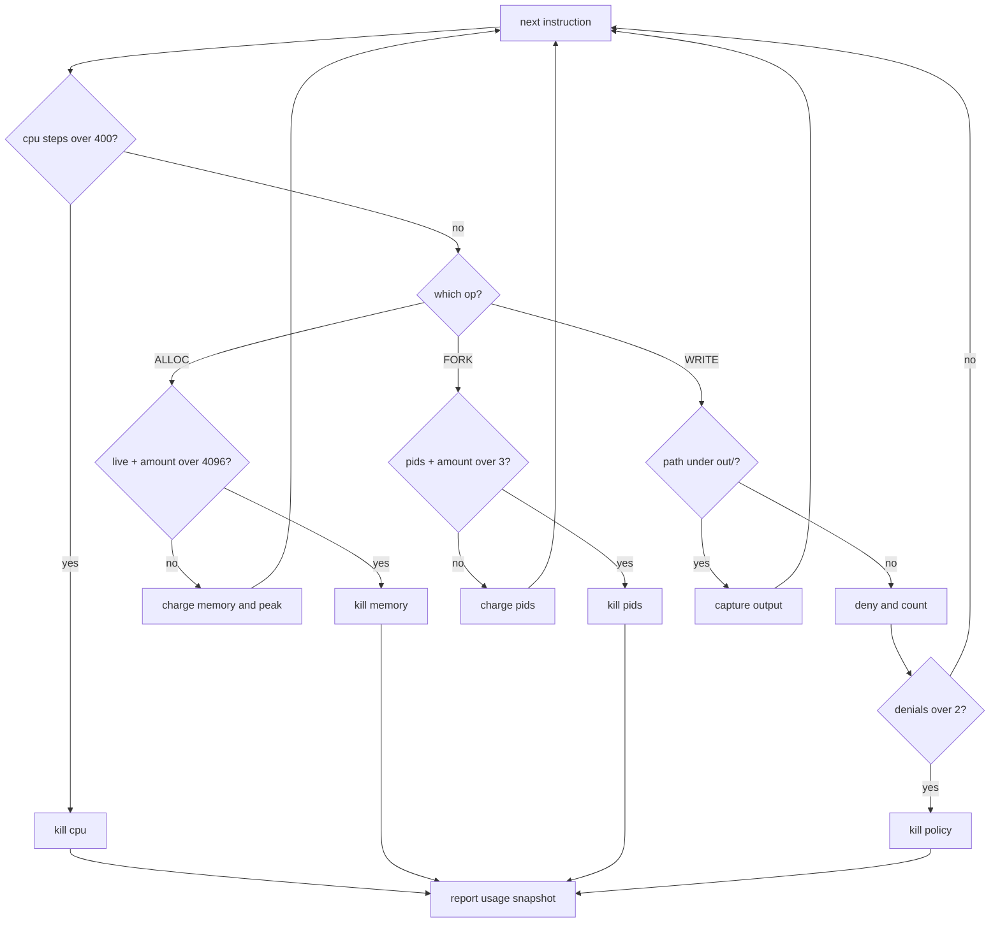
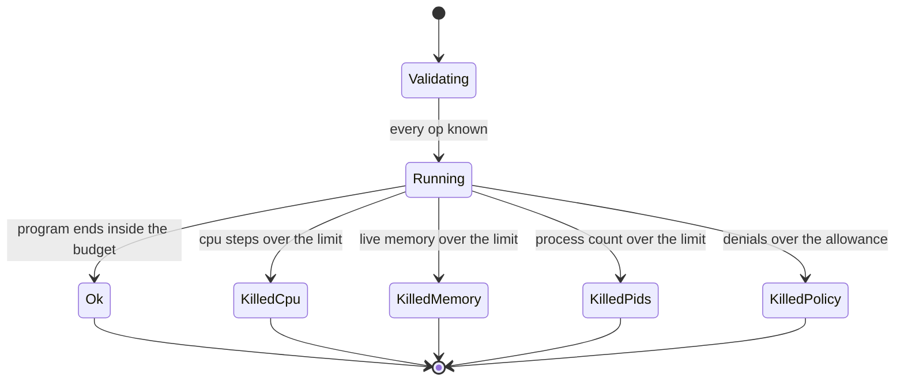
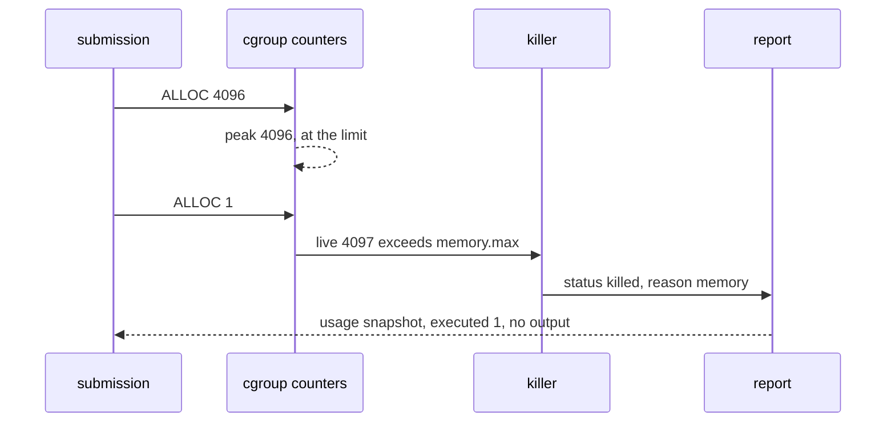

# 965 — Implement secure sandbox to run untrusted student submissions with resource cgroups.

> **Tier:** Master / Challenge · **CTCI chapter:** Beyond — Security & Privacy
> **Task spec:** [965-implement-secure-sandbox-to-run-untrusted-student-submissions-wi.md](../../../tasks/master/965-implement-secure-sandbox-to-run-untrusted-student-submissions-wi.md)
> **Solutions:** [Python](../../../solutions/python/master/965-implement-secure-sandbox-to-run-untrusted-student-submissions-wi/solution.py) ·
> [Java](../../../solutions/java/master/965-implement-secure-sandbox-to-run-untrusted-student-submissions-wi/Solution.java) ·
> [JavaScript](../../../solutions/javascript/master/965-implement-secure-sandbox-to-run-untrusted-student-submissions-wi/solution.js) ·
> [C#](../../../solutions/csharp/master/965-implement-secure-sandbox-to-run-untrusted-student-submissions-wi/Solution.cs)

## 1. Problem restatement

**Input:** a *submission* — a program in a tiny schedule language — and a *cgroup budget*: a cpu step
allowance, a memory ceiling, a process cap and a filesystem policy with a denial allowance.

**Output:** a run report: the terminal `status` (`ok` or `killed`), the machine-readable `reason`, the
usage snapshot at the moment the run ended, the captured output, the list of denied operations and how
many instructions were executed.

The modelling contract is stated in the header: a submission is "a small instruction list executed
by an interpreter that charges a cgroup-style budget", each limit is "enforced at the instant it is
crossed", and — deliberately — **root access is not required and no real process is spawned**.
Instructions stand in for a syscall trace, memory is a running total, wall time is a step count.

```text
DEFAULT_LIMITS = { cpu: 400, memory: 4096, pids: 3, denials: 2 }
INSTRUCTIONS   = ALLOC, FREE, FORK, READ, WRITE, LOOP, EMIT
TIMEOUT        = 100000          # the declared wall-clock ceiling
policy         = READ is always allowed; WRITE only under "out/"
```

Concrete results asserted by the shipped checks:

| Scenario | Result | Asserted by |
| --- | --- | --- |
| clean program (7 instructions, `LOOP 30`) | `ok`; usage `{steps: 37, memory: 1536, peak: 2048, pids: 1, denied: 0}`; `executed == 7` | `main` check 1 |
| `ALLOC 4096` then `ALLOC 1` | `killed` / `memory`, `peak == 4097`, `executed == 1` | `main` check 2 |
| `ALLOC 4096`, `FREE 4096`, `ALLOC 2048` | `ok`; `peak == 4096`, live `memory == 2048` | `main` check 3 |
| runaway `ALLOC 8` + two `LOOP 5000` | `killed` / `cpu` at `steps == 401`, no output | `main` check 4 |
| `FORK 2`, emit, `FORK 1` | `killed` / `pids` at `pids == 4`, output preserved | `main` check 5 |
| two out-of-tree writes, then emit | still `ok`; both writes denied; the emit happens | `main` check 6 |
| three out-of-tree writes | `killed` / `policy` at `denied == 3` | `main` check 6 |
| `ALLOC 100, ALLOC 200, FREE 50, ALLOC 300, FREE 100` | measured `(peak, live) == oracle == (550, 450)` | `main` check 7 |
| empty program | `ok`, all counters zero, `pids == 1`, `executed == 0` | `main` check 8 |
| unknown instruction `EXEC` | `ValueError` naming `EXEC` — a configuration error, not a skipped step | `main` check 8 |
| determinism | a fresh sandbox reproduces the report exactly; the original recorded `resets == 9` | `main` check 9 |

Each language models the same enforcement with its own vocabulary, and the headers make the
differences explicit: Java reports `OOM`, `TIMEOUT` and `PID_LIMIT` statuses and **caps reported usage
at the limit**, then reconciles the charges against an independent recomputation from the raw
schedules. JavaScript emits kernel-style signals (`SIGKILL` for resource exhaustion, `SIGSYS` for a
blocked syscall), default-**denies** unknown syscalls, models a read-only root plus a scratch mount,
and writes an **audit log in execution order** for every step, allowed or denied. C# models cgroup v2
fields directly — `memory.max`, `cpu.max` as a quota per period — so a 100 ms burst under a 40 ms/100 ms
quota **throttles exactly twice** and a zero quota makes no progress at all, with a syscall allowlist
and a rootfs path guard as the two extra killers.

## 2. Intuition

The naive "sandbox" runs the submission and checks afterwards whether it misbehaved.

```text
function run(program)
    result ← execute(program)
    if memory_used(result) > limit then
        return "too much memory"
    end
    return result
end
```

Two things make that unusable. First, "afterwards" may never arrive: a program that allocates without
bound exhausts the host before any check runs. Second, a post-hoc check cannot un-run a side effect —
if the submission wrote to `/etc/passwd` while you were measuring, the write already happened.

The key insight is that *enforcement must be charged synchronously to the counter that is about to
cross*: before a byte is allocated, add it and compare; before a fork is honoured, increment the
process count and compare; before a write is performed, ask the policy. The check happens **at the
instant of the request**, and the report is the usage snapshot from that instant, so the answer to
"what did it do before we stopped it?" is exact rather than approximate.



The second half of the insight is that a **kill needs a reason code**, not a message. `cpu`, `memory`,
`pids` and `policy` are the four different things a grader has to tell apart: "your solution is too
slow", "it allocates too much", "it forks too much" and "it tries to touch the disk outside the
scratch directory" are four different conversations with a student. The report therefore carries
`status`, `reason` and the usage at the kill point — and the clean-run check asserts the exact usage
dict so that a regression in the accounting is caught even when nothing is killed.

## 3. Algorithm

1. Validate the program before executing anything: every op must be a known instruction, and
   `ALLOC`/`FREE`/`LOOP` must carry an integer argument. An unknown op is a configuration error.
2. Initialise the usage snapshot: `steps 0`, `memory 0`, `peak 0`, `pids 1` (the submission itself),
   `denied 0`; empty output and denial lists.
3. For each instruction: charge one cpu step and check it against the cpu limit.
4. Charge the operation: `ALLOC` adds to live memory and updates the peak, then checks the memory
   limit; `FREE` subtracts (floored at zero); `FORK` adds to the process count and checks the pids
   limit; `LOOP` charges one step per iteration, checking the cpu limit each time; `EMIT` appends to
   the output.
5. For `READ`/`WRITE`, apply the policy: `READ` is allowed, `WRITE` is allowed only under `out/`.
   A refusal increments the denial counter and is recorded; exceeding the denial allowance kills the
   run with the `policy` reason. Allowed operations append their rendering to the output.
6. Record how many instructions were executed, and return the report — either at the end of the
   program (`ok`) or at the first breached limit (`killed`).

```text
procedure sandbox.run(program)
    validate(program)
    usage ← {steps: 0, memory: 0, peak: 0, pids: 1, denied: 0}
    output ← []
    denied ← []
    for index, (op, argument) in enumerate(program) do
        usage.steps ← usage.steps + 1
        if usage.steps > limits.cpu then return killed("cpu") end
        if op equals "ALLOC" then
            usage.memory ← usage.memory + argument
            usage.peak ← max(usage.peak, usage.memory)
            if usage.memory > limits.memory then return killed("memory") end
        else if op equals "FREE" then
            usage.memory ← max(0, usage.memory - argument)
        else if op equals "FORK" then
            usage.pids ← usage.pids + argument
            if usage.pids > limits.pids then return killed("pids") end
        else if op equals "LOOP" then
            repeat argument times do
                usage.steps ← usage.steps + 1
                if usage.steps > limits.cpu then return killed("cpu") end
            end
            output.append("loop " + argument)
        else if op equals "EMIT" then
            output.append(str(argument))
        else
            if op equals "WRITE" and argument does not start with "out/" then
                usage.denied ← usage.denied + 1
                denied.append((op, argument))
                if usage.denied > limits.denials then return killed("policy") end
            else
                output.append(op + " " + argument)
            end
        end
        report.executed ← index + 1
    end
    return ok report with usage, output, denied, executed
end
```

Two variants are worth calling out because they change the numbers. The **capping** variant (Java)
records the usage *at the limit* rather than at the overshoot, so no report can ever exceed the
budget; the Python file instead reports the observed peak, which is why its memory kill shows
`peak == 4097` for a 4096 limit. The **throttling** variant (C#) does not kill a cpu burst that fits
in the period — it defers the remainder to the next period, so a 100 ms burst against a 40 ms/100 ms
quota is throttled exactly twice instead of dying.



## 4. Worked example

The clean submission is seven instructions:

```text
READ input.txt, ALLOC 1024, EMIT "loaded", ALLOC 1024, FREE 512, WRITE out/result.txt, LOOP 30
```

Charged step by step (the cpu counter rises by one per instruction plus one per loop iteration):

| # | Instruction | `steps` after | `memory` / `peak` | `pids` | `denied` | output appended |
| --- | --- | --- | --- | --- | --- | --- |
| 1 | `READ input.txt` | 1 | 0 / 0 | 1 | 0 | `read input.txt` |
| 2 | `ALLOC 1024` | 2 | 1024 / 1024 | 1 | 0 | — |
| 3 | `EMIT "loaded"` | 3 | 1024 / 1024 | 1 | 0 | `loaded` |
| 4 | `ALLOC 1024` | 4 | 2048 / **2048** | 1 | 0 | — |
| 5 | `FREE 512` | 5 | 1536 / 2048 | 1 | 0 | — |
| 6 | `WRITE out/result.txt` | 6 | 1536 / 2048 | 1 | 0 | `write out/result.txt` |
| 7 | `LOOP 30` | 7 + 30 = **37** | 1536 / 2048 | 1 | 0 | `loop 30` |

Final usage `{steps: 37, memory: 1536, peak: 2048, pids: 1, denied: 0}`, `executed == 7`, four output
lines and no denials. Note that the peak (2048) is *not* the final live memory (1536): the high-water
mark is the number a cgroup reports, and it is tracked separately from the running total.

Now the hostile cases, each stopping at a different point:

| Program | Where it stopped | `status` / `reason` | Usage at the kill |
| --- | --- | --- | --- |
| `ALLOC 4096`, `ALLOC 1` | the second allocation | `killed` / `memory` | `peak 4097`, `executed 1` |
| `ALLOC 8`, `LOOP 5000`, `LOOP 5000` | 401 steps into the first loop | `killed` / `cpu` | `steps 401`, no output |
| `FORK 2`, `EMIT`, `FORK 1` | the second fork | `killed` / `pids` | `pids 4`, output `["children up"]` |
| three `WRITE /etc/...` | the third denial | `killed` / `policy` | `denied 3` |
| `ALLOC 4096`, `FREE 4096`, `ALLOC 2048` | — | `ok` | `peak 4096`, live `2048` |

The memory row is the boundary that matters: allocating *exactly* the limit is legal (`4096` is not
greater than `4096`), one byte more is not. The pid row shows the started-from-one convention — the
budget is 3 processes, `FORK 2` brings the total to 3, and the next fork tries to make it 4. The
policy row shows the denial allowance is a **budget on refusals**, not a single-strike rule: two
denials leave the run alive (`EMIT "alive"` still executes), the third kills it.

Finally the accounting oracle: over `ALLOC 100, ALLOC 200, FREE 50, ALLOC 300, FREE 100` the
independent `peak_memory` pass computes live `100 → 300 → 250 → 550 → 450` with a peak of `550`, and
the sandbox's measured `(peak, live)` equals `(550, 450)` — the two agree, which is what makes the
budget believable.



## 5. Complexity

Let `n` be the number of instructions, `L` the total loop iterations, `D` the number of denied
operations, and `K` the number of distinct limits (`4`).

| Phase | Time | Space | Why |
| --- | --- | --- | --- |
| Validation | `O(n)` | `O(1)` | one pass, one membership test per instruction |
| Execution | `O(n + L)` | `O(n + D)` | each instruction once, each loop iteration charged once, output and denial lists grow |
| Kill path | `O(1)` | `O(1)` | the check happens before the charge is applied; nothing past the limit executes |
| Report construction | `O(1)` | `O(1)` | a fixed-size snapshot plus references to the lists |
| Independent oracle | `O(n)` | `O(1)` | one pass over the allocations, no limits involved |

The bound that makes the sandbox a sandbox is that `L` is not unbounded: the cpu limit caps the
charged iterations at `400`, so a hostile `LOOP 5000` terminates after 401 steps and the total
runtime is `O(n + K_cpu)`, independent of how large the loop count is. Compare with a post-hoc
checker, which is `O(n + L)` *without* a ceiling and therefore unbounded in the submission's own
hands. The memory dimension costs nothing extra because it is a running total: `peak` is one
comparison per allocation. The space bound is the only place where a hostile submission can leave a
mark before it is killed — the denial list grows until the allowance stops it at `denials + 1`
entries, which is why the allowance is a limit and not just a counter.

## 6. Pitfalls and edge cases

- **Check before you act.** The memory comparison happens *after* the running total is updated so
  that the report shows the overshoot (`4097`), but before anything is really allocated; a design that
  checks after committing the side effect has already lost the race.
- **The limit is inclusive.** `ALLOC 4096` against `memory: 4096` is legal — the comparison is
  `> limit`, not `>= limit`. The Java and C# files both assert the at-the-limit case separately from
  one-unit-over, because off-by-one here is the difference between a working solution and a spurious
  kill.
- **Denials are budgeted, not instantly fatal.** Two refusals are tolerated and the program continues;
  the third kills it. A one-strike policy would make a legitimate submission that probes one wrong path
  fail, and an unlimited policy would let a program spam the log.
- **The peak is not the live total.** `peak` is the high-water mark a cgroup reports; reporting the
  final live memory (1536 instead of 2048) understates what the submission needed.
- **Loop iterations are charged to the cpu budget.** `LOOP 30` costs 30 extra steps, which is why the
  clean run reports 37 rather than 7; without per-iteration charging, a `LOOP` would be a free
  infinite loop.
- **Unknown instructions are configuration errors.** `EXEC /bin/sh` raises `ValueError` from
  validation and never reaches the interpreter; the JavaScript file's default-deny on unknown
  syscalls is the runtime counterpart of the same rule.
- **Empty program.** An empty instruction list is `ok` with `steps 0`, `peak 0`, `pids 1`,
  `executed 0` — a legitimate no-op submission, not an error.
- **Reason codes are part of the API.** Collapsing `cpu`, `memory`, `pids` and `policy` into one
  "killed" loses the information the grader needs; the Java file goes further and exposes
  `OOM` / `TIMEOUT` / `PID_LIMIT` as first-class statuses.
## 7. Variants and follow-ups

- **Interactive front end.** The same budget and error taxonomy drive a browser REPL where the learner
  types, and the sandbox answers —
  [964](../../../tasks/master/964-implement-interactive-repl-web-ui-for-running-and-testing-proble.md).
- **Hardening review.** A sandbox is one control among many; an end-to-end security review checklist
  is the audit side —
  [983](../../../tasks/master/983-implement-end-to-end-security-review-checklist-and-automated-sca.md).
## 8. Check yourself

<details><summary>Show answer</summary>

**Q1. Why must each limit be checked before the operation is applied, and what does the report then contain?**

Because a post-hoc check cannot undo the side effect — memory already allocated, process already
spawned, file already written. Checking first means the report can honestly describe the moment of the
kill: the Python file reports the overshoot (`peak 4097` for a 4096 ceiling), the Java file reports the
capped usage. Either way, nothing past the limit was executed.
</details>

<details><summary>Show answer</summary>

**Q2. The clean program has 7 instructions but `steps == 37`. Where do the other 30 come from?**

`LOOP 30` charges one cpu step per iteration, exactly like a real quota: the loop is not a single
instruction, it is 30 units of work. `7 + 30 = 37`, and the same charging is what stops
`LOOP 5000` after 401 steps instead of after the full count.
</details>

<details><summary>Show answer</summary>

**Q3. Why is `ALLOC 4096` allowed under a 4096 limit while `ALLOC 4097` is killed?**

The comparison is strictly greater-than, so the limit value itself is inside the budget. `4097` is the
first illegal value; the check asserts both sides of that boundary because a `>=` comparison would kill
every solution that uses its whole allowance.
</details>

<details><summary>Show answer</summary>

**Q4. What does the `denials` budget buy, and how does it differ from a hard policy violation?**

It allows a submission to stumble — probing a path that is not writable twice still lets `EMIT "alive"`
run — while still bounding how much noise a hostile program can generate. The third denial kills with
`policy`, so the refusal budget is finite but not punitive. A hard policy violation would kill on the
first denial and reject legitimate exploratory code.
</details>
