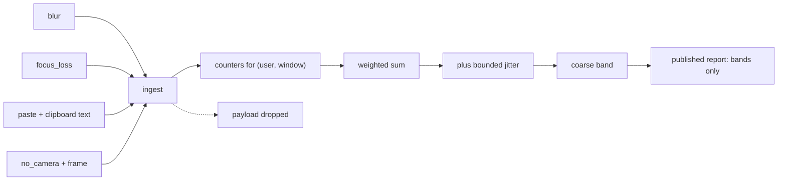
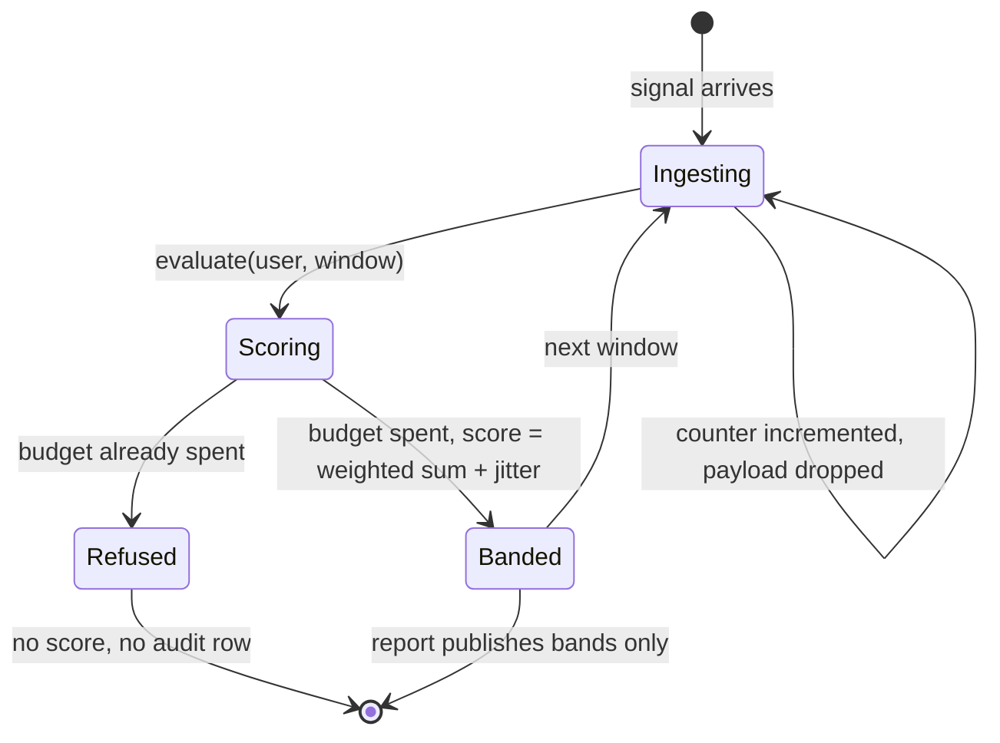
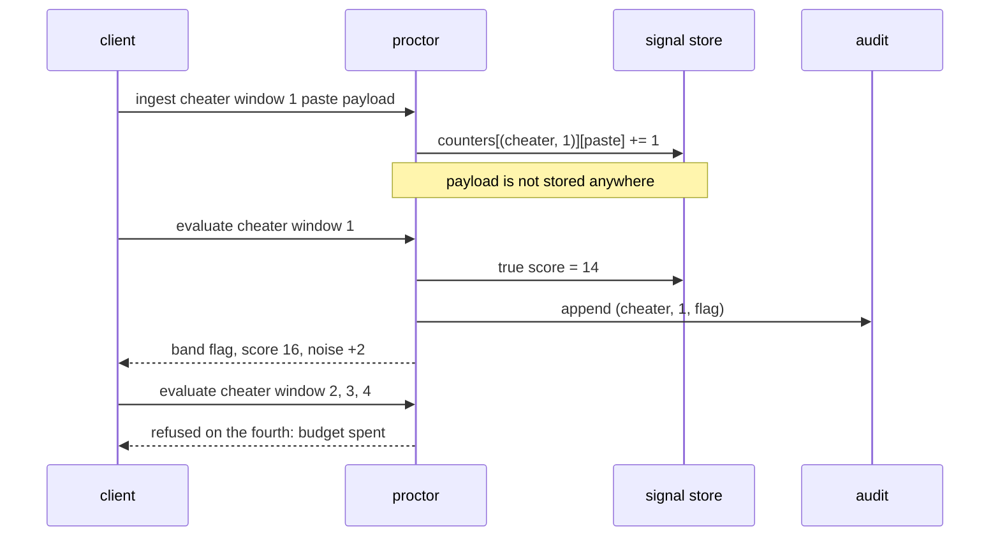

# 966 — Implement proctoring/anticheat measures for timed contests (privacy-aware).

> **Tier:** Master / Challenge · **CTCI chapter:** Beyond — Software Engineering & Tooling
> **Task spec:** [966-implement-proctoring-anticheat-measures-for-timed-contests-priva.md](../../../tasks/master/966-implement-proctoring-anticheat-measures-for-timed-contests-priva.md)
> **Solutions:** [Python](../../../solutions/python/master/966-implement-proctoring-anticheat-measures-for-timed-contests-priva/solution.py) ·
> [Java](../../../solutions/java/master/966-implement-proctoring-anticheat-measures-for-timed-contests-priva/Solution.java) ·
> [JavaScript](../../../solutions/javascript/master/966-implement-proctoring-anticheat-measures-for-timed-contests-priva/solution.js) ·
> [C#](../../../solutions/csharp/master/966-implement-proctoring-anticheat-measures-for-timed-contests-priva/Solution.cs)

## 1. Problem restatement

**Input:** a stream of behavioural signals from a timed contest — `blur`, `focus_loss`, `paste`,
`fast_paste`, `no_camera`, `keystroke` — each tagged with a user and a contest window, and each
carrying a detail payload (clipboard text, page title, thumbnail).

**Output:** per (user, window) a score and a **coarse band** — `clear`, `review` or `flag` — plus a
published per-contestant report that contains bands, windows and budget accounting only.

The modelling contract is the privacy claim, not the classifier. From the header: ingestion
"immediately reduces each signal to a weighted counter for its (user, window) and drops the payload,
so no clipboard text, page title or image ever reaches the store"; the score is the weighted counter
sum "plus bounded deterministic noise, which limits how much a single reading reveals"; and "each
window evaluation spends one unit of the contestant's privacy budget; once it is exhausted the proctor
refuses to score that contestant again". Signals are tuples with declared weights, the noise is a
seeded bounded jitter rather than a Laplace sample, and there is no camera or keylogger.

```text
KIND_WEIGHTS       = blur 1, focus_loss 2, paste 3, fast_paste 4, no_camera 5, keystroke 0
REVIEW_THRESHOLD   = 5
FLAG_THRESHOLD     = 10            # bands are open at the top
NOISE              = 2             # symmetric jitter, |noise| <= 2
BUDGET             = 3             # evaluations per contestant
seed               = 20240517
```

Concrete results asserted by the shipped checks:

| Scenario | Result | Asserted by |
| --- | --- | --- |
| `clean` (3 keystrokes + 1 blur) | true score `1`, band `clear` | `main` check 1 |
| `cheater` (paste + focus_loss + fast_paste + no_camera) | true score `3 + 2 + 4 + 5 = 14`, band `flag` | `main` check 1 |
| counter conservation | the store equals an independent recount of the ingested signals; `keystroke` count is `3`; totals sum to the `8` signals fed in | `main` check 2 |
| privacy of the store | keys are `(user, window)` pairs, values are string→int counters, the audit holds `(user, window, band)` rows, `raw_reads == 0`, no payload appears in the audit | `main` check 3 |
| bounded noise | every observed score is within `±2` of the true score, and so is `14` for the cheater | `main` check 4 |
| band boundaries | `band_for(10) == "review"`, `band_for(11) == "flag"`, `band_for(5) == "clear"`, `band_for(6) == "review"` | `main` check 5 |
| false-positive control | an honest 3-signal session (score `4`) lands in `review` with the deterministic jitter `+2`; a second seed keeps `clean` clear and `cheater` flagged | `main` check 6 |
| privacy budget | the 3rd evaluation succeeds, the 4th raises `PrivacyBudgetExceeded` mentioning `3 of 3`; the audit still holds exactly `3` rows and `spent == 3` | `main` check 7 |
| determinism | re-ingesting under the same seed reproduces the scores and the jitter; a contestant with no signals reports `{"bands": [], "windows": [], "spent": 0, "budget": 3}` | `main` check 8 |
| published report | `cheater → {"bands": ["flag"], "windows": [1], "spent": 1, "budget": 3}`, with neither `score` nor `paste` anywhere in it | `main` check 9 |

The four files implement the same privacy contract with different detectors, and the headers describe
each: Java reduces a session to **three capped signal buckets** (paste count, focus losses, largest
timing gap) inside a pseudonymous record carrying a **cohort hash** instead of the student id, and
publishes cohort aggregates only when the cohort holds at least `k` sessions. JavaScript runs **five
weighted, named rules** (paste-then-solve inside a window, tab-switch count, implausible keystroke
rate, solve with no prior input, solves synchronised across candidates) over a sanitised projection
where identifiers become salted hashes and free text is dropped, with a retention TTL that ages
events out and an appeals path that rewrites the verdict without deleting evidence. C# enforces a
per-signal weight **and a per-signal cap** so no single signal can dominate, maps `>= 60` to flagged,
`40..59` to a soft note and below `40` to clear, and stores only a hash of the session id, the
per-signal counters and the score.

## 2. Intuition

The naive proctor keeps the evidence: store every event, score it, and show the reviewer the pasted
text so they can judge.

```text
function ingest(signal)
    events.append(signal)                   # kind, user, detail, timestamp
    return score(events)
end
```

It is easy to build and it is indefensible. The clipboard text of every contestant is now a permanent
record; a reviewer with database access can read a candidate's essay; and the score itself is a
precise number derived from raw behaviour, so a single released reading reveals exactly how many
suspicious actions were attributed to one person.

The key insight is that **the reduction is the privacy mechanism**. When a signal arrives, it is
converted into a counter and the payload is thrown away *at that moment* — there is no later stage
that could strip it, because it never enters the store. Everything downstream then works on counts
that are already several steps removed from the person: `(user, window) → {kind: count}`.



The second layer is **calibrated exposure**. Even the counter sum is too sharp to publish, so a small
deterministic jitter drawn from a seeded generator is added before banding. Two bounds make it a real
mechanism rather than decoration: the jitter is *symmetric and bounded* — `|noise| ≤ 2` — and it is
derived from the seed plus the `(user, window)` key, so it is identical on every run and the
verification can assert the exact values (`-2` for `clean`, `+2` for `cheater`). Finally the output is
**banded**, and the band is open at the top: `score > 10` flags, `score > 5` reviews, everything else
is clear — so `10` is `review` and `5` is `clear`, and the boundary cases are asserted directly on the
pure function rather than through a noisy score.

## 3. Algorithm

1. `ingest(user, window, kind, detail)`: create the counter map for the key if needed, increment the
   count for `kind`, and return the new count. `detail` is accepted and deliberately ignored — the
   signature documents what is dropped.
2. `true_score(user, window)`: sum `weight[kind] × count` over the counter map. A zero-weight signal
   (`keystroke`) contributes a count but no score, which is exactly what makes the honest case
   interesting.
3. `jitter(user, window)`: hash `seed | user | window` with SHA-256, seed a splitmix64 generator from
   the first eight bytes, and draw an integer in `[-noise, +noise]`.
4. `evaluate(user, window)`: if the contestant has already spent the privacy budget, raise
   `PrivacyBudgetExceeded`; otherwise spend one unit, compute `score = true_score + jitter`, map it to
   a band, append `(user, window, band)` to the audit, and return the record.
5. `band_for(score)`: `flag` when `score > 10`, `review` when `score > 5`, else `clear`.
6. `report(users)`: for each requested contestant, publish the bands recorded so far, the windows with
   counters, the evaluations spent and the budget — never a score and never a signal kind.

```text
procedure ingest(user, window, kind, detail)
    key ← (user, window)
    counters[key][kind] ← counters[key].get(kind, 0) + 1
    return {kind: kind, count: counters[key][kind]}
end

function true_score(user, window)
    return sum of weight[kind] * count over counters[(user, window)]
end

function jitter(user, window)
    digest ← sha256(seed + "|" + user + "|" + window)
    generator ← splitmix64(first eight bytes of digest)
    return generator.ranged(-noise, +noise)
end

procedure evaluate(user, window)
    if spent[user] >= budget then
        raise PrivacyBudgetExceeded(user + " has spent " + spent[user] + " of " + budget)
    end
    spent[user] ← spent[user] + 1
    score ← true_score(user, window) + jitter(user, window)
    band ← band_for(score)
    audit.append((user, window, band))
    return {user: user, window: window, band: band, score: score, noise: jitter(user, window)}
end

function band_for(score)
    if score > FLAG_THRESHOLD then return "flag" end
    if score > REVIEW_THRESHOLD then return "review" end
    return "clear"
end
```

The variants differ in step 2, not in the privacy machinery. Java caps each bucket and adds a cohort
hash so a record cannot be re-identified, then suppresses cohort output smaller than `k` sessions.
C# caps each signal's contribution and maps the score onto three levels with a soft note in between.
JavaScript keeps five named rules with their own weights so a reviewer can see *which* rule fired, and
applies a retention TTL before scoring.



## 4. Worked example

Two contestants, four signals each, one window:

| Contestant | Signals | Weighted sum | Jitter (seed `20240517`) | Observed score | Band |
| --- | --- | --- | --- | --- | --- |
| `clean` | `keystroke`, `blur`, `keystroke`, `keystroke` | `3·0 + 1 = 1` | `-2` | `-1` | `clear` |
| `cheater` | `paste`, `focus_loss`, `fast_paste`, `no_camera` | `3 + 2 + 4 + 5 = 14` | `+2` | `16` | `flag` |

The honest contestant's observed score is **negative**, which is the honest consequence of symmetric
bounded noise on a near-zero signal: the band is unaffected (`clear`), but the exact count is not
recoverable from a single reading. The cheater's `16` is `14 ± 2`, so a reading anywhere in `[12, 16]`
is consistent with the true counter sum.

The three keystrokes are worth dwelling on: they *are* counted (`counters[("clean", 1)]["keystroke"]
== 3`) but carry weight `0`, so they contribute nothing to the score. Counting them keeps the
conservation check meaningful — the store equals an independent recount, and the counts sum to the
eight ingested signals — while the weights decide what is suspicious.

Budget exhaustion is a separate mechanism and a separate row in the trace:

| Evaluation # | Window | `spent` before | Outcome | Audit rows after |
| --- | --- | --- | --- | --- |
| 1 | 1 | 0 | scored, band `clear` | 1 |
| 2 | 2 | 1 | scored | 2 |
| 3 | 3 | 2 | scored | 3 |
| 4 | 4 | 3 | `PrivacyBudgetExceeded` mentioning `3 of 3` | **3** |

A refusal is not a decision, so it is not audited: the fourth call raises, `spent` stays at `3`, and
the audit still holds three rows. That is the property the check asserts (`len(budgeted.audit) == 3`)
— an implementation that logged refusals would leak "this person was probed four times" into the
permanent record.

The published report is the last boundary:

| Contestant | `bands` | `windows` | `spent` | `budget` | Contains a `score`? | Contains a signal kind? |
| --- | --- | --- | --- | --- | --- | --- |
| `cheater` | `["flag"]` | `[1]` | 1 | 3 | no | no |
| `nobody` (no signals) | `[]` | `[]` | 0 | 3 | no | no |

The check asserts the absence explicitly (`"score" not in repr(published)` and
`"paste" not in repr(published)`), which is the cheapest way to keep a well-meaning debugging field
from shipping a raw score to a reviewer.



## 5. Complexity

Let `E` be the number of ingested signals, `U` the number of contestants, `W` the number of evaluated
windows, `K` the number of signal kinds (here 6) and `B` the per-contestant privacy budget (here 3).

| Phase | Time | Space | Why |
| --- | --- | --- | --- |
| `ingest` | `O(1)` amortised | `O(1)` per key | one map lookup and one counter increment |
| `true_score` | `O(K)` | `O(1)` | one weighted term per kind present in the window |
| `jitter` | `O(1)` | `O(1)` | one hash of a short key plus a fixed number of splitmix64 steps |
| `evaluate` | `O(K)` | `O(1)` | scoring plus one audit append |
| `report(users)` | `O(U · (K + W))` | `O(U · (K + W))` | per contestant: the audit rows and the window set |
| Whole session | `O(E + U · B · K)` | `O(E + U · B)` | ingestion is linear; scoring is capped by the budget |

The privacy budget is what converts an unbounded audit trail into a bounded one: without it, a client
could ask for a fresh evaluation of every window forever and the audit would grow without limit, which
is both a storage problem and an exposure problem (each evaluation is one more reading of the
behavioural state). With `B = 3` per contestant, the audit holds at most `U · B` rows regardless of
how many windows exist, so the structure's space and the number of readings the system will ever
produce are both bounded in advance. That is the same shape as a DP composition budget: spend is
accounted per subject and once exhausted the mechanism refuses — the pure-DP analogue is
[943](../../../tasks/master/943-implement-composable-privacy-guarantees-across-combined-dp-mecha.md).

## 6. Pitfalls and edge cases

- **Drop the payload at ingestion, not later.** The `detail` argument is accepted and ignored in the
  same call that counts the signal, and the check asserts no payload reaches the counters or the audit.
  A design that stores events and runs a sanitizer afterwards has already created the record it meant
  to avoid.
- **Bands are open at the top.** `band_for(10) == "review"` and `band_for(5) == "clear"`: the
  threshold value belongs to the *lower* band. Switching to `>=` silently reclassifies every boundary
  case, which is why the file tests `band_for` directly on `0, 5, 6, 10, 11`.
- **Noise must be bounded and reproducible.** `|noise| ≤ 2` and the same key always yields the same
  value; an unseeded `random()` would make the audit non-reproducible and the checks impossible.
- **Zero-weight signals still count.** `keystroke` has weight `0` but its counters are stored, so
  conservation holds and the honest contestant's `1` comes only from the blur.
- **Noise pushes near-threshold cases across.** The honest session scores `4` (clear by a point) but
  its jitter is `+2`, so the observed band is `review`. That is intended — the band is a request for a
  human look, not a verdict — and the check asserts it so nobody "fixes" it by lowering the threshold.
- **False positives are asymmetric in cost.** A `review` verdict costs a reviewer a minute; a missed
  cheater costs the contest its integrity. The thresholds (`5`, `10`) encode that asymmetry, and the
  file asserts a legitimate three-signal session is not `flag`ged even though it is `review`ed.
- **A refusal is not a decision.** The fourth evaluation raises without appending to the audit;
  logging it would leak the fact that the person was probed.
- **Publish bands only.** The report contains bands, windows, spent and budget; the check asserts the
  string `score` never appears in it, because a raw score is a reusable reading while a band is not.
- **Empty log.** A contestant with no signals reports empty bands and windows with `spent == 0` — the
  boundary must not crash the dashboard.
- **Seeds change scores, not well-separated bands.** Re-running with `seed = 99` changes the jitter
  (`+1` for `clean`, `-1` for `cheater`) but keeps `clear` and `flag`; only the near-threshold cases
  are seed-sensitive, which is the honest limit of the mechanism.
- **What is not modelled.** No camera, no keylogger, no real telemetry, and a hand-rolled deterministic
  jitter rather than a Laplace sample — the reductions, the budget and the bands are the real
  mechanics.

## 7. Variants and follow-ups

- **Exam-level integration.** Proctoring wired into a certification exam generator, where the band
  becomes a review queue entry —
  [979](../../../tasks/master/979-implement-certification-exam-generator-and-proctoring-integratio.md).
- **DP accounting.** Turning the refusal-after-budget rule into a real composition budget —
  [943](../../../tasks/master/943-implement-composable-privacy-guarantees-across-combined-dp-mecha.md).
- **Legal and policy compliance.** Retention, deletion and consent are the other half of the privacy
  argument —
  [984](../../../tasks/master/984-implement-legal-privacy-compliance-checks-for-user-data-handling.md).
- **Analytics without re-identification.** The same banding instinct at dashboard scale —
  [912](../../../tasks/master/912-implement-end-to-end-pipeline-for-privacy-preserving-analytics-w.md).
- **Aggregate-only reporting.** Cohort aggregates with suppression rules, so no individual can be
  singled out from a small group —
  [970](../../../tasks/master/970-implement-analytics-dashboard-tracking-learner-progress-and-drop.md).

## 8. Check yourself

<details><summary>Show answer</summary>

**Q1. Why is the payload dropped inside `ingest` rather than by a later sanitising pass?**

Because "later" is a permanent record with a cleanup step attached. Reducing to
`(user, window) → {kind: count}` at the moment of arrival means the clipboard text, page title or image
never exists anywhere in the system, so there is nothing to leak, nothing to retain and nothing to
delete. The check asserts the store's shape (tuples of strings and ints) and that no payload appears.
</details>

<details><summary>Show answer</summary>

**Q2. `clean` has four signals and `keystroke` weight 0. Why is its true score 1 rather than 0 or 4?**

Only the three keystrokes have weight `0`; the single `blur` has weight `1`, so the weighted sum is
`1`. The keystrokes still increment their counter (conservation requires it), which is why the score
and the count are deliberately different numbers.
</details>

<details><summary>Show answer</summary>

**Q3. What stops a client from shrinking the noise by asking for many evaluations?**

The privacy budget. Each evaluation of a window spends one unit, and after `BUDGET = 3` the proctor
refuses to score that contestant at all (`PrivacyBudgetExceeded`), so an adversary gets at most three
readings of the behavioural state — and the refusals themselves are not audited, so the attempt leaves
no trace in the record.
</details>

<details><summary>Show answer</summary>

**Q4. The honest session's true score is 4, which is `clear`, but the check expects `review`. Why?**

Because the band is computed from the *noisy* score: `4 + 2 = 6`, and `6 > 5` is `review`. This is
intentional. A score one point under the threshold is exactly the case where a single reading is
unreliable, and the outcome is a low-cost human look rather than a flag. Asserting it prevents a
future "fix" that lowers the threshold and turns near-threshold honest sessions into flags.
</details>
