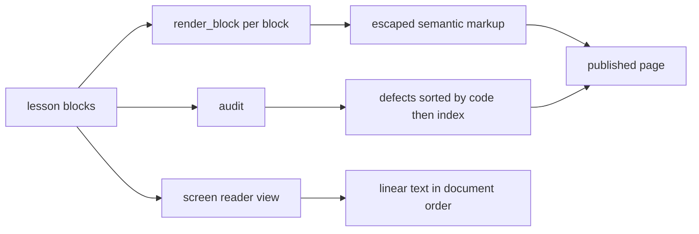
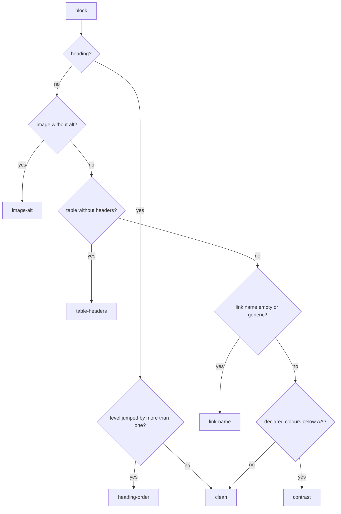
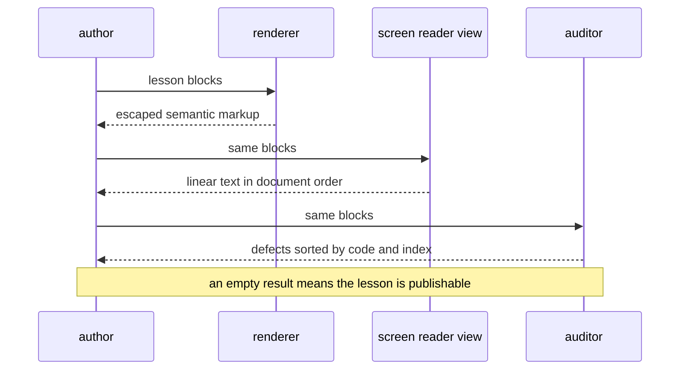

# 967 — Implement accessibility features for lesson content (screen-reader friendly).

> **Tier:** Master / Challenge · **CTCI chapter:** Beyond — Software Engineering & Tooling
> **Task spec:** [967-implement-accessibility-features-for-lesson-content-screen-reade.md](../../../tasks/master/967-implement-accessibility-features-for-lesson-content-screen-reade.md)
> **Solutions:** [Python](../../../solutions/python/master/967-implement-accessibility-features-for-lesson-content-screen-reade/solution.py) ·
> [Java](../../../solutions/java/master/967-implement-accessibility-features-for-lesson-content-screen-reade/Solution.java) ·
> [JavaScript](../../../solutions/javascript/master/967-implement-accessibility-features-for-lesson-content-screen-reade/solution.js) ·
> [C#](../../../solutions/csharp/master/967-implement-accessibility-features-for-lesson-content-screen-reade/Solution.cs)

## 1. Problem restatement

**Input:** a lesson — an ordered list of typed content blocks: `heading`, `paragraph`, `image`,
`table`, `list`, `code`, `link`.

**Output:** two things at once.

1. **Semantic markup** per block: real heading levels, `alt` text on images, `<th scope="col">` header
   cells, list semantics, language-tagged code, accessible link names — with every interpolated value
   escaped.
2. **An audit** of the authoring defects that a rendering step cannot fix on its own, sorted by
   `(code, block index)`, plus a linear plain-text "screen reader" view in document order.

The modelling contract is in the header: markup is a string, not a DOM, there is no ARIA live-region
handling, and the audit "checks the authoring rules a rendering step cannot fix on its own". The
Python file fixes the constants and the rule list:

```text
NORMAL_TEXT, LARGE_TEXT = 4.5, 3.0                     # WCAG AA thresholds
GENERIC_LINK_TEXT = click here, here, link, read more, more
rules = heading-order, image-alt, table-headers, table-shape, empty-list, code-language,
        link-name, contrast
note   = an image with alt="" is decorative and accepted, not a defect
```

Concrete results asserted by the shipped checks:

| Scenario | Result | Asserted by |
| --- | --- | --- |
| clean 9-block lesson | `audit(good) == []`; `rendered[0] == "<h1>Two pointers</h1>"`; alt text, `th scope`, `<ul>`, `class="language-python"`, `aria-label` all present | `main` check 1 |
| escaping | `"<p>Walk from both ends &amp; compare 1 &lt; 2.</p>"` in the markup and the raw text in the linear view | `main` check 2 |
| heading order | `h1` then `h3` reports `heading-order`; `h1, h2, h3` is clean | `main` check 3 |
| one rule per defect | six mutations each produce exactly their own code: `image-alt`, `table-headers`, `empty-list`, `code-language`, `link-name`, `contrast` | `main` check 4 |
| rescued cases | `alt=""` (decorative) and a generic link text saved by `aria-label` are clean; whitespace-only link text is `("link-name", 0, "")` | `main` check 5 |
| contrast oracle | darkest failing grey `4.4781` vs lightest passing grey `4.5422`; `#777777` on white `4.4781`; an independently written formula agrees within `1e-12`; `meets_contrast(3.0, large=True)` is true and `2.99` is false | `main` check 6 |
| reading order | the 9-line linear view matches document order exactly | `main` check 7 |
| boundaries | empty lesson audits and renders clean; a single paragraph is clean; an empty list renders `<ul></ul>` | `main` check 8 |
| determinism | rendering and auditing twice are identical and issue order is stable | `main` check 9 |

The four files enforce the same contract with different emphasis, as their headers describe: Java's
auditor adds a **missing level-one heading** rule, **icon buttons without an accessible name**, and
tables without a header row, and reports the contrast references (black on white is exactly `21:1`,
white on white is `1:1`). JavaScript's renderer gives headings **stable ids**, labels code with an
`aria-label`, accepts `role="presentation"` for decorative images, resolves a widget's accessible name
through `aria-labelledby` **only when the target id exists**, and requires a table caption plus scoped
headers. C# enforces exactly one `h1`, meaningful alt text, descriptive link text and a code language,
scores the two published grey boundaries at `4.54` and `4.48`, asserts contrast is **symmetric and
never below 1**, and checks that the outline matches an independently projected rendering.

## 2. Intuition

The naive renderer emits markup that looks right.

```text
function render(block)
    if block.type == "heading" then return "<h2>" + block.text + "</h2>" end
    if block.type == "image" then return '' end
    if block.type == "paragraph" then return "<p>" + block.text + "</p>" end
end
```

A sighted reader sees a title, a picture and a paragraph. A screen-reader user hears "image" with no
description, no way to know whether the title is the page heading or a section heading, and — for the
paragraph shown above — markup that a `<` can turn into injected HTML. The naive renderer is not
merely incomplete, it is *silently* wrong, because the failure is invisible to the person who built it.

The key insight is that accessibility splits into **two jobs that need different machinery**. Some
things can be fixed mechanically at render time: escaping, real heading tags, `scope` on header cells,
a language class on a code block. Other things are *authoring* facts that no renderer can invent — a
heading level that jumps from `h1` to `h3` because the author skipped a section, an image with no alt
text because the author never wrote one, a link whose text is "click here". Those have to be reported
back to the author, which is why the module renders **and** audits.



The second half of the insight is that the audit's rules are **independent invariants**, not a score.
Each defect is reported with a code and the index of the block that caused it, so a fix is a specific
edit in a specific place: `("image-alt", 2, "ends.svg")` means block 2 needs an alt attribute. And
each rule must be able to fire *alone* — the file mutates a clean lesson once per rule and asserts
that exactly the matching code appears, which is the cheapest way to catch a rule that only works when
another rule has already tripped.

## 3. Algorithm

1. `render_block(block)`: dispatch on `type`. Clamp a heading level into `1..6`. Emit a `style`
   attribute for a paragraph only when both `color` and `background` are declared. Emit `alt` as the
   empty string when absent (decorative). Emit `<th scope="col">` for table headers and `<td>` for
   cells. Choose `ol` or `ul` from `ordered`. Emit the code fence with
   `class="language-<language>"`. Emit a link with `aria-label` falling back to its text. Escape every
   interpolated value; an unknown block type raises.
2. `screen_reader_view(lesson)`: produce one line per block in document order, naming what the element
   *is*: `heading level 1: …`, `image: …`, `table with C columns and R rows`,
   `bullet list of N items`, the paragraph's text, `link: …`, `code: <language>`.
3. `audit(lesson)`: walk the blocks with a running `expected_level`.
   - heading: if `level > expected_level + 1`, report `heading-order`; then set `expected_level`.
   - image without an `alt` key: `image-alt`.
   - table: no headers → `table-headers`; a row whose width differs from the header width →
     `table-shape`.
   - list with no items: `empty-list`.
   - code with no language: `code-language`.
   - link whose accessible name is empty or in the generic set: `link-name`.
   - paragraph with both colours where the contrast ratio is below the threshold: `contrast`.
4. Sort the issues by `(code, index)` so the report is stable and grouping by rule is possible.
5. `contrast_ratio(fg, bg)`: WCAG relative luminance (sRGB linearisation with the `0.03928` knee and
   the `1.055` gamma), then `(lighter + 0.05) / (darker + 0.05)`.
6. `meets_contrast(ratio, large)`: compare against `3.0` for large text and `4.5` otherwise, inclusive.

```text
procedure audit(lesson)
    issues ← []
    expected_level ← 0
    for index, block in enumerate(lesson) do
        if block.type is "heading" then
            if block.level > expected_level + 1 then
                issues.append(("heading-order", index, ...))
            end
            expected_level ← block.level
        else if block.type is "image" and "alt" is not a key of block then
            issues.append(("image-alt", index, block.src))
        else if block.type is "table" then
            if block has no headers then issues.append(("table-headers", index, ...))
            else if some row width differs from the header width then
                issues.append(("table-shape", index, ...))
            end
        else if block.type is "list" and block has no items then
            issues.append(("empty-list", index, 0))
        else if block.type is "code" and block has no language then
            issues.append(("code-language", index, ""))
        else if block.type is "link" then
            name ← (block.aria_label or block.text) trimmed and lower-cased
            if name is empty or name in GENERIC_LINK_TEXT then
                issues.append(("link-name", index, name))
            end
        else if block.type is "paragraph" and block has color and background then
            ratio ← contrast_ratio(block.color, block.background)
            if not meets_contrast(ratio, block.large) then
                issues.append(("contrast", index, round(ratio, 2)))
            end
        end
    end
    return issues sorted by (code, index)
end

function contrast_ratio(foreground, background)
    first ← luminance(foreground)
    second ← luminance(background)
    lighter ← max(first, second)
    darker ← min(first, second)
    return (lighter + 0.05) / (darker + 0.05)
end
```

The rendering variants differ in *how much* semantics they emit, not in the rules. JavaScript resolves
an accessible name through `aria-labelledby` and therefore also verifies that the referenced id exists
in the same document; Java adds an outline projection and the icon-button rule; C# adds the
exactly-one-`h1` rule and re-derives the outline from a second, independent projection.



## 4. Worked example

The fixture lesson has nine blocks and audits clean:

| # | Block | Rendered as | Spoken as |
| --- | --- | --- | --- |
| 0 | heading level 1 `Two pointers` | `<h1>Two pointers</h1>` | `heading level 1: Two pointers` |
| 1 | paragraph `Walk from both ends & compare 1 < 2.` | `<p>Walk from both ends &amp; compare 1 &lt; 2.</p>` | the raw text |
| 2 | image `ends.svg`, alt `Two arrows moving towards the middle` | `` | `image: Two arrows moving towards the middle` |
| 3 | heading level 2 `Complexity` | `<h2>Complexity</h2>` | `heading level 2: Complexity` |
| 4 | table headers `Case, Time`, rows `best/O(n)`, `worst/O(n)` | `<th scope="col">Case</th>` … | `table with 2 columns and 2 rows` |
| 5 | unordered list `low, high` | `<ul><li>low</li><li>high</li></ul>` | `bullet list of 2 items` |
| 6 | code, language `python` | `<pre><code class="language-python">…</code></pre>` | `code: python` |
| 7 | link `notes.html`, text `Read the invariant proof` | `<a href="notes.html" aria-label="Read the invariant proof">` | `link: Read the invariant proof` |
| 8 | paragraph `Strong text.`, `#000000` on `#ffffff` | `<p style="color:#000000;background:#ffffff">` | `Strong text.` |

The heading walk is what makes `heading-order` meaningful: `expected_level` starts at `0`, so the
first heading of level `1` satisfies `1 > 0 + 1` being false. Block 3 is level `2` and
`2 > 1 + 1` is false, so it is clean too. Replace block 3 with a level-3 heading and the same walk
reports `("heading-order", 1, "h1 then h3")` — a *skip*, which is exactly the defect a renderer cannot
detect on its own because each block looks fine in isolation.

The rule mutations each fire alone, which is the property the file asserts:

| Mutation (single block) | Reported code |
| --- | --- |
| `{"type": "image", "src": "x.svg"}` | `image-alt` |
| `{"type": "table", "rows": ((1, 2),)}` | `table-headers` |
| `{"type": "list", "items": ()}` | `empty-list` |
| `{"type": "code", "text": "pass"}` | `code-language` |
| `{"type": "link", "href": "a.html", "text": "click here"}` | `link-name` |
| `{"type": "paragraph", "color": "#cccccc", "background": "#ffffff"}` | `contrast` |

The contrast rule is the only one with real arithmetic, so it gets an oracle. Sweeping every grey
`#010101 … #ffffff` against white and splitting on `4.5` gives `4.4781` for the darkest failing grey
and `4.5422` for the lightest passing one — a gap smaller than `0.1`, which is why the boundary has to
be sampled rather than guessed. `#777777` on white lands at `4.4781` (it fails), and an independently
written formula re-derives that value to within `1e-12`. The large-text threshold is checked
separately: `meets_contrast(3.0, large=True)` is true, `2.99` is not.



## 5. Complexity

Let `n` be the number of blocks, `C` the characters in the lesson's text, `R` the total table cells,
and `G = 256` the grey ramp used by the contrast sweep (verification only).

| Phase | Time | Space | Why |
| --- | --- | --- | --- |
| `render_block` per block | `O(len(block text))` | `O(len(block text))` | escaping and interpolating are linear |
| Render the lesson | `O(C + R)` | `O(C)` | every character and every cell once |
| `screen_reader_view` | `O(n + C)` | `O(C)` | one line per block, text copied once |
| `audit` | `O(n + R)` | `O(issues)` | constant work per block, one width check per row |
| Contrast per paragraph | `O(1)` | `O(1)` | two luminances and one division |
| Contrast sweep (verification) | `O(G)` | `O(G)` | sample every grey against white |
| Whole pipeline | `O(n + C + R)` | `O(C + issues)` | dominated by the lesson's size |

Everything is a single pass, and the audit is `O(1)` per block because the rules are local: the
heading counter is one integer carried through the walk, not a search. The contrast sweep is the only
super-linear-looking item, and it is verification, not production: `G = 256` samples exist to pin the
boundary, not to run per lesson. The alternative — auditing the *rendered markup* by parsing it — would
cost `O(C)` to parse plus the same rules, and would lose the block indices that make the report
actionable.

## 6. Pitfalls and edge cases

- **Rule independence.** Each rule must be able to fire alone; mutating a clean lesson once per rule
  is how the file proves it. A rule that only triggers when another defect is present is invisible in
  practice.
- **`alt` absent vs `alt` empty.** `alt=""` is a *decorative* image and is clean; a missing `alt` key
  is the defect. Conflating the two either flags every decorative spacer or accepts every undescribed
  chart.
- **Accessible names can be rescued.** A generic link text of `click here` becomes clean when an
  `aria-label` describes the destination, and the name is resolved from the label first, then the
  text. Whitespace-only text normalises to `""` and is reported as `("link-name", 0, "")`.
- **Heading order is a running comparison.** The rule is `level > previous + 1`, so `h1 → h2 → h3` and
  `h1 → h1` are both fine while `h1 → h3` is not. Java and C# additionally require a level-one
  heading to exist at all, and C# requires exactly one.
- **Levels are clamped, not trusted.** `render_block` clamps to `1..6`, so an author writing `level 9`
  gets `<h6>` rather than a tag that does not exist — but the audit still sees the original level,
  which is why clamping must not silently fix the input it reports on.
- **Table shape is a separate defect.** A table with headers whose rows are the wrong width is
  `table-shape`, not `table-headers`; header cells give the reader a column name, and a mismatched row
  breaks the association.
- **Contrast thresholds are inclusive and text-size dependent.** `4.5` passes normal text, `3.0`
  passes large text, and `2.99` does not. The "large" flag is declared by the author rather than
  measured from CSS — a documented simplification.
- **Escaping is not optional decoration.** `&` and `<` in prose must be escaped in the markup and
  still readable in the linear view — the two outputs disagree by design, and the check asserts both
  forms.
- **Empty and single-block lessons.** An empty lesson renders `""`, speaks `[]` and audits clean; a
  lone paragraph is clean. A crash here would break every draft page.
## 7. Variants and follow-ups

- **Richer renderings.** The same block model feeding an interactive step-through visualiser, where
  each frame must also be described —
  [995](../../../tasks/master/995-implement-interactive-visualization-generator-for-algorithm-step.md).
- **Editorial tooling.** Helping authors write the alt text and link names the auditor demands —
  [994](../../../tasks/master/994-implement-editorial-writing-assistant-that-drafts-explanations-p.md).
- **Offline packaging.** Accessible content is also content that must work without a network —
  [989](../../../tasks/master/989-implement-offline-mode-packaging-so-learners-can-download-proble.md).
- **Publishing pipeline.** Where these pages are generated and link-checked in bulk —
  [963](../../../tasks/master/963-implement-docs-site-generator-that-publishes-exercises-editorial.md).
## 8. Check yourself

<details><summary>Show answer</summary>

**Q1. Why does the module render *and* audit instead of only rendering semantically correct markup?**

Because several of the rules describe authoring facts that markup cannot carry: a missing alt text, an
`h1` that jumps to `h3`, the text "click here". A renderer can only emit what it is given, so the
defects have to be reported back to the author with a code and a block index. The two outputs are
complementary — the renderer produces the page, the auditor produces the fix list.
</details>

<details><summary>Show answer</summary>

**Q2. `audit` starts `expected_level` at 0. What does that buy?**

It makes the first heading a level-1 heading by construction: `level 1 > 0 + 1` is false, so `h1` is
accepted, while a lesson that starts at `h2` reports `heading-order` immediately. Starting the counter
at `1` would let a lesson begin at `h2` and never notice the missing top-level heading.
</details>

<details><summary>Show answer</summary>

**Q3. The contrast check sampled `4.4781` and `4.5422` for neighbouring greys. Why is sampling the ramp worth doing?**

Because the WCAG formula is not a linear function of the channel value — the `0.03928` knee and the
`2.4` exponent bend the curve — so the exact grey where a 4.5 threshold flips cannot be reasoned about
by hand. Sweeping the ramp finds the darkest failing and lightest passing grey, and the fact that they
differ by less than `0.1` is the evidence that the threshold is being applied at the right place.
</details>

<details><summary>Show answer</summary>

**Q4. Why is `alt=""` accepted while a missing alt is a defect?**

The empty alt is the standard way to say "this image is decorative; skip it" — the screen-reader view
renders it as `image: decorative`. A missing alt means the author never decided, so a reader hears
"image" plus the file name, which is the defect the rule exists to catch.
</details>
