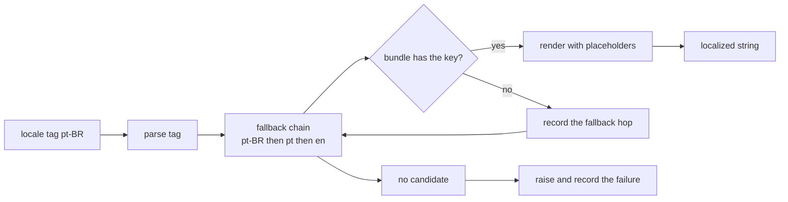
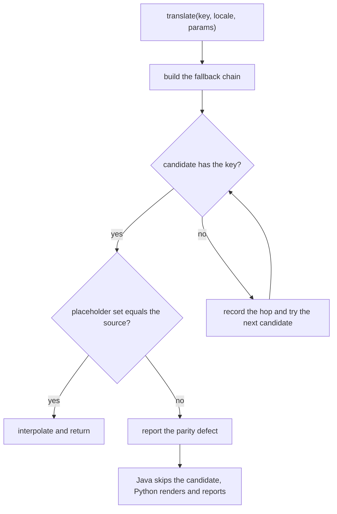
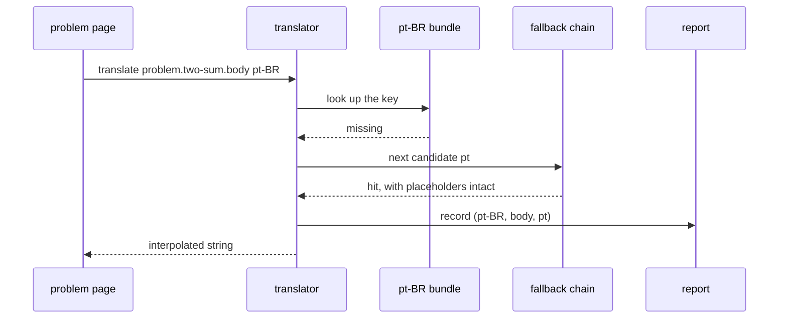

# 968 — Implement localization pipeline to translate problems into multiple languages.

> **Tier:** Master / Challenge · **CTCI chapter:** Beyond — Software Engineering & Tooling
> **Task spec:** [968-implement-localization-pipeline-to-translate-problems-into-multi.md](../../../tasks/master/968-implement-localization-pipeline-to-translate-problems-into-multi.md)
> **Solutions:** [Python](../../../solutions/python/master/968-implement-localization-pipeline-to-translate-problems-into-multi/solution.py) ·
> [Java](../../../solutions/java/master/968-implement-localization-pipeline-to-translate-problems-into-multi/Solution.java) ·
> [JavaScript](../../../solutions/javascript/master/968-implement-localization-pipeline-to-translate-problems-into-multi/solution.js) ·
> [C#](../../../solutions/csharp/master/968-implement-localization-pipeline-to-translate-problems-into-multi/Solution.cs)

## 1. Problem restatement

**Input:** a *source catalog* of keyed problem strings (including one pluralized message) in the source
locale, *locale bundles* holding translations, and a *locale tag* such as `pt-BR`, `ru` or `ja`.

**Output:** for each lookup, a rendered string; and, as a pipeline product, a report of per-locale
coverage, every fallback that was taken, and every translation whose placeholder set disagrees with the
source.

The modelling contract is stated in the header: this is an **in-memory** message-catalog pipeline —
no files, no gettext/Fluent, no gender or ordinal categories — and it models the three real mechanics:
the fallback chain, placeholder parity, and CLDR-style plural category selection.

```text
SOURCE_LOCALE    = "en"
CATALOG          = 5 keys (problem.two-sum.title/body/hint, ui.attempts, ui.progress)
BUNDLES          = en, de, pt, pt-BR, ru          # pt-BR is deliberately partial
PLURAL_FORMS     = en (one, other), ru (one, few, many, other), ja (other)
EXTRACTED_KEYS   = 5 keys a problem page actually references
fallback_chain("pt-BR") == ["pt-BR", "pt", "en"]
fallback_chain("ja")    == ["ja", "en"]
fallback_chain("xx-YY") == ["xx-YY", "xx", "en"]
```

Concrete results asserted by the shipped checks:

| Scenario | Result | Asserted by |
| --- | --- | --- |
| direct hit | `translate("ui.progress", "pt", solved=3, total=7) == "Resolveste 3 de 7 problemas."`; `fallbacks == []` | `main` check 1 |
| fallback order | `pt-BR` body resolves through `pt`; `pt-BR` hint resolves through `en`; the recorded list is `[("pt-BR", "problem.two-sum.body", "pt"), ("pt-BR", "problem.two-sum.hint", "en")]` | `main` check 2 |
| unknown locale | `translate("problem.two-sum.title", "xx-YY") == "Two Sum"` — the chain ends at the source locale | `main` check 3 |
| unknown key | raises `KeyError` and is recorded as `("de", "problem.does-not-exist")` | `main` check 3 |
| interpolation | a missing parameter raises `KeyError`; unbalanced braces raise `ValueError`; `interpolate("{a}+{b}", {a: 2, b: 3}) == "2+3"` | `main` check 4 |
| plural categories | Russian over `(0, 1, 2, 5, 11, 21, 22, 25, 101)` is `["many", "one", "few", "many", "many", "one", "few", "many", "one"]`; English `(0, 1, 2)` is `["other", "one", "other"]`; Japanese `1` is `other`; Russian `-1` is `one` | `main` check 5 |
| plural rendering | `en 1 → "You passed 1 test"`, `en 2 → "You passed 2 tests"`, `ru 22 → "Пройдено 22 теста"`, `ja 5 → "5件のテストに合格しました"` | `main` check 5 |
| placeholder parity | exactly one defect in the fixture: `("de", "problem.two-sum.body", ("target",), ())` | `main` check 6 |
| coverage | `en → (5, 5, 1.0)`, `pt → 3/5`, `de → 3/5`, `pt-BR → 1/5`, `ru → 3/5`; translated counts sum to `15` | `main` check 7 |
| key hygiene | `unused == ["ui.attempts"]`, `unknown == ["problem.passed"]` | `main` check 8 |
| pseudo-localization | bracketed, non-ASCII, `≥ 30%` longer than the source, placeholders preserved, idempotent; `pseudo_localize("") == "[····]"` | `main` check 9 |
| empty catalogs | `coverage({}, …) == ({}, {})`, `placeholder_parity({}, CATALOG) == []`, re-running the report reproduces it | `main` check 10 |

The four files implement the same pipeline with different strictness, as their headers say: Java makes
parity a **gate** — a candidate is accepted only if its placeholder set equals the source's, "so a
translation can never silently drop or invent a slot" — and degrades a missing plural category to
`other` and an unrunnable message to the source locale. JavaScript parses **ICU-style templates**
(`{count, plural, one{..} other{..}}`), reports provenance for every key, and audits **text expansion**
against a per-locale budget, building `en-XA` locally. C# parses a BCP-47 tag, appends the resolved
plural category to the key (`items.one`, `items.few`), verifies English/Russian/Polish against a
hand-written CLDR table plus a seeded random cross-check over `40` counts, and defines the negative
path as "return the key itself when nothing matches".

## 2. Intuition

The naive localizer is a dictionary lookup with a default.

```text
function translate(key, locale)
    return bundles[locale][key] or source[key]
end
```

It renders something for every key, which is exactly why it is dangerous. A partial `pt-BR` bundle
falls back silently, so nobody notices that a third of the page is still English — and worse, a
translation that *drops* a placeholder renders perfectly while losing the number the sentence was
about. The failure is invisible in the output and only shows up in a bug report from a learner.

The key insight is that localization is not a lookup, it is a **resolution with provenance**. Two
mechanisms make it honest:

1. **The fallback chain is ordered and recorded.** `pt-BR → pt → en` is a list, not a default value,
   and every hop that was taken is added to a report — so "which strings are still English in the
   Brazilian edition?" is a query, not a guess. The chain is derived from the tag (region, then
   language, then source), which is why `pt-BR`, `pt` and `xx-YY` all have well-defined chains.
2. **Placeholder parity is checked structurally.** The source template's `{…}` set is the contract; a
   translation whose set differs has either lost a slot (`target` missing in German) or invented one,
   and both are reported with the locale, the key, the missing set and the extra set.



The third mechanism is **plurals**, and it is the part people get wrong because it looks like a
language detail when it is a grammar of counts. English needs two forms; Japanese needs one; Russian
needs four, selected by rules that look at both `count % 10` and `count % 100` — so `21` is `one`,
`22` is `few` and `11` is `many`. Getting `22` right ("22 теста") requires implementing the category
function, not the sentence.

## 3. Algorithm

1. `parse_locale(tag)`: drop the `@` extension, fold `_` to `-`, split, take the first part as the
   language (lower-cased) and the first two-character part after it as the region (upper-cased).
2. `fallback_chain(tag)`: `[language-region]` when a region exists, then `[language]`, then `[source]`
   if the language is not the source locale.
3. `placeholders(template)`: the set of names matched by `\{([^{}]*)\}`; `interpolate(template, params)`
   refuses unbalanced braces and raises `KeyError` when a placeholder has no value.
4. `Translator._body(key, locale, via_plural)`: walk the chain; at each candidate consult the bundle,
   and — when the key is a plural message — also the plural forms of that candidate's language. The
   first hit wins, and every hop that was not the requested locale is recorded in `fallbacks`. Nothing
   resolves → record the failure and raise `KeyError`.
5. `translate(key, locale, **params)`: resolve, then interpolate.
6. `translate_plural(key, locale, count, **params)`: resolve the plural message, pick the template for
   `plural_category(language, count)`, falling back to the `other` entry, then interpolate with
   `count` added to the parameters.
7. `plural_category(language, count)`: Russian implements the `one`/`few`/`many`/`other` rules above;
   every other shipped language is English-like (`one` when `abs(count) == 1`) except Japanese, which
   is always `other`.
8. `placeholder_parity(bundles, catalog)`: report `(locale, key, missing, extra)` for every
   translation whose placeholder set differs from the source's.
9. `coverage(bundles, keys, plural_forms)`: a key counts as translated when it is in the locale's
   bundle or available through that language's plural forms; report `(translated, total, ratio)` plus
   the sorted missing keys.
10. `key_hygiene(catalog, extracted)`: `unused` keys (in the catalog, referenced by nothing) and
    `unknown` keys (referenced, absent from the catalog).
11. `pseudo_localize(text)`: accents, bracket padding and `≥ 30%` expansion, with placeholders
    preserved.

```text
function fallback_chain(tag)
    language, region ← parse_locale(tag)
    chain ← []
    if region is not empty then chain.append(language + "-" + region) end
    chain.append(language)
    if language is not SOURCE_LOCALE then chain.append(SOURCE_LOCALE) end
    return chain
end

procedure resolve(key, locale, via_plural)
    for candidate in fallback_chain(locale) do
        language ← parse_locale(candidate).language
        body ← bundles[candidate][key]
        if body is missing and via_plural and candidate equals language then
            body ← plural_forms[language][key]
        end
        if body is present then
            if candidate is not locale then fallbacks.append((locale, key, candidate)) end
            return body
        end
    end
    failures.append((locale, key))
    raise KeyError(key is not available for locale)
end

function plural_category(language, count)
    mod10 ← abs(count) % 10
    mod100 ← abs(count) % 100
    if language equals "ru" then
        if mod10 equals 1 and mod100 is not 11 then return "one" end
        if mod10 is between 2 and 4 and mod100 is not between 12 and 14 then return "few" end
        if mod10 equals 0 or mod10 is between 5 and 9 or mod100 is between 11 and 14 then
            return "many"
        end
        return "other"
    end
    if language equals "ja" or abs(count) is not 1 then return "other" end
    return "one"
end
```

The variants change one step each. Java moves the parity check *into* resolution (a candidate with
mismatched placeholders is skipped, so a broken translation degrades to the next locale instead of
rendering). JavaScript parses ICU plural branches from the template itself rather than keeping a
separate forms table, and adds a per-locale expansion budget because German and Russian text is
materially longer than English. C# keys the plural form off the category (`items.few`) and returns the
key itself when nothing matches, which is the classic "visible in QA" negative path.



## 4. Worked example

Take `problem.two-sum.body` in `pt-BR`:

```text
source (en) : "Return the indices of the two numbers in {array} summing to {target}."
pt          : "Devolve os indices dos dois numeros em {array} com soma {target}."
```

`pt-BR` has only the title, so resolution walks the chain:

| Candidate | In the bundle? | Action | Recorded |
| --- | --- | --- | --- |
| `pt-BR` | no | continue | — |
| `pt` | yes | render, interpolate `{array}` and `{target}` | `("pt-BR", "problem.two-sum.body", "pt")` |
| `en` | not reached | — | — |

`translate(..., array="[2,7,11]", target=9)` yields
`"Devolve os indices dos dois numeros em [2,7,11] com soma 9."` — the same numbers, the same slot
count. Now the same call for `problem.two-sum.hint`: `pt-BR` no, `pt` no, `en` yes →
`("pt-BR", "problem.two-sum.hint", "en")`, and the string starts with `Hash`. Two hops through one
chain, two recorded entries, and the English result is visible as an *untranslated* key rather than a
silent default.

Placeholder parity catches the planted defect in the German bundle:

| Locale | Key | Source placeholders | Translation placeholders | Reported |
| --- | --- | --- | --- | --- |
| `de` | `problem.two-sum.body` | `{array}`, `{target}` | `{array}` | `("de", "problem.two-sum.body", ("target",), ())` |

The missing set is `("target",)` and the extra set is empty: the German sentence no longer says what
the sum should reach. Rendering it still "works", which is precisely why the structural scan has to
run as a build step.

Plural selection is the third axis, and Russian is where the rules earn their keep:

| `count` | `count % 10` | `count % 100` | Category | Rendered |
| --- | --- | --- | --- | --- |
| 1 | 1 | 1 | `one` | `Пройден 1 тест` |
| 2 | 2 | 2 | `few` | `Пройдено 2 теста` |
| 5 | 5 | 5 | `many` | `Пройдено 5 тестов` |
| 11 | 1 | 11 | `many` | `Пройдено 11 тестов` |
| 21 | 1 | 21 | `one` | `Пройден 21 тест` |
| 22 | 2 | 22 | `few` | `Пройдено 22 теста` |
| 101 | 1 | 1 | `one` | `Пройден 101 тест` |
| `-1` | 1 | 1 | `one` | sign ignored via `abs` |

English treats `1` as `one` and everything else as `other`; Japanese is always `other`, so
`translate_plural("problem.passed", "ja", 5)` renders `"5件のテストに合格しました"` with no plural
agreement at all. Coverage is the accounting view of the same data:

| Locale | Translated | Total | Ratio | Missing keys |
| --- | --- | --- | --- | --- |
| `en` | 5 | 5 | 1.0 | — |
| `de` | 3 | 5 | 0.6 | `problem.passed`, `problem.two-sum.hint` |
| `pt` | 3 | 5 | 0.6 | `problem.passed`, `problem.two-sum.hint` |
| `pt-BR` | 1 | 5 | 0.2 | `problem.passed`, `problem.two-sum.body`, `problem.two-sum.hint`, `ui.progress` |
| `ru` | 3 | 5 | 0.6 | `problem.two-sum.body`, `problem.two-sum.hint` |

`3 + 5 + 3 + 1 + 3 = 15` translated strings across the five locales, which is the conservation
assertion for the report.



## 5. Complexity

Let `K` be the number of keys, `L` the number of locales, `P` the number of placeholders in a
template, `B` the number of bundles, and `C` the number of plural counts in a verification sweep.

| Phase | Time | Space | Why |
| --- | --- | --- | --- |
| `parse_locale` | `O(len(tag))` | `O(1)` | one split plus a small scan |
| `fallback_chain` | `O(len(tag))` | `O(1)` | at most three candidates |
| `placeholders` | `O(len(template))` | `O(P)` | one regex pass |
| `interpolate` | `O(len(template))` | `O(len(template))` | two brace counts plus one substitution pass |
| `translate` | `O(chain · (len + P))` | `O(P)` | at most three lookups, then one interpolation |
| `translate_plural` | `O(chain + len)` | `O(P)` | one category computation plus interpolation |
| `placeholder_parity` | `O(B · K · P)` | `O(defects · P)` | compare placeholder sets per locale and key |
| `coverage` | `O(L · K)` | `O(L · K)` | membership tests only, no template work |
| Plural sweep (verification) | `O(C)` | `O(1)` | one category computation per sampled count |

Every hot-path operation is bounded by the string being rendered, not by the catalog: a lookup walks
at most three candidates and interpolates once. The catalog-wide operations — parity, coverage, key
hygiene — are `O(L · K)` or worse, which is why they belong to a build step rather than to request
handling. The verification sweeps are deliberately exhaustive: the plural category function is
evaluated over the boundary counts `0, 1, 2, 5, 11, 21, 22, 25, 101` (and `-1` for the sign rule)
because those are exactly the values where modulo-based rules go wrong, and the C# file extends the
same idea to a seeded random sweep over `40` counts against a hand-written CLDR table.

## 6. Pitfalls and edge cases

- **Silent fallback is the failure mode.** A missing key that quietly degrades to English looks fine
  in production; recording every hop is what makes the gap actionable. The fixture's `pt-BR` bundle is
  deliberately partial so the chain has work to do.
- **Plural keys live outside the string catalog.** `problem.passed` is *unknown* to `CATALOG` (it only
  exists in `PLURAL_FORMS`), which is why `key_hygiene` reports `unknown == ["problem.passed"]` while
  `unused == ["ui.attempts"]` — the unused UI string really is dead inventory.
- **Pseudo-localization must preserve placeholders.** The expansion wraps and pads the text, but
  `{count}` and `{learner}` survive as placeholders, which is the check that catches a transform that
  mangles format strings; the empty string still produces `"[····]"`.
## 7. Variants and follow-ups

- **Publishing the localized pages.** Bundle resolution is the input half of the docs generator —
  [963](../../../tasks/master/963-implement-docs-site-generator-that-publishes-exercises-editorial.md).
- **Authoring help.** The editorial assistant that drafts explanations has the same problem of
  producing text in a target language —
  [994](../../../tasks/master/994-implement-editorial-writing-assistant-that-drafts-explanations-p.md).
- **Accessibility.** Localized lesson text must still meet the heading, link-name and contrast rules —
  [967](../../../tasks/master/967-implement-accessibility-features-for-lesson-content-screen-reade.md).
## 8. Check yourself

<details><summary>Show answer</summary>

**Q1. Why is the fallback chain built from the tag rather than configured per locale?**

Because the tag already contains the information: `pt-BR` implies the region-specific bundle, then the
language, then the source locale. Deriving the chain means every tag — including one nobody configured,
like `xx-YY` — has a defined resolution order, and `fallback_chain("ja") == ["ja", "en"]` versus
`fallback_chain("pt-BR") == ["pt-BR", "pt", "en"]` falls out of the same rule.
</details>

<details><summary>Show answer</summary>

**Q3. Why does Russian need both `count % 10` and `count % 100`?**

Because the `11..14` range is exceptional: `11` ends in `1` but takes `many`, while `21` ends in `1` and
takes `one`. A rule using only the last digit classifies `11` as `one` and produces the wrong noun; a
rule using only the full number cannot generalise over `21`, `31`, `101`. The file asserts the boundary
list `0, 1, 2, 5, 11, 21, 22, 25, 101` for exactly this reason.
</details>

<details><summary>Show answer</summary>

**Q5. What does pseudo-localization verify, and why must placeholders survive it?**

It renders a locale (`en-XA`) whose strings are accented, bracketed and at least 30% longer than the
source, which exposes hard-coded widths, truncation and untranslated literals before any translator
work happens. Placeholders must pass through unchanged — the check asserts
`placeholders(pseudo) == placeholders(sample)` — because a transform that corrupts `{count}` breaks
every interpolation at runtime, which is exactly the bug a test locale is supposed to catch early.
</details>
