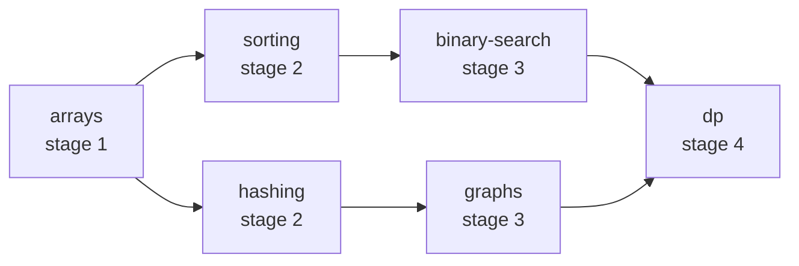
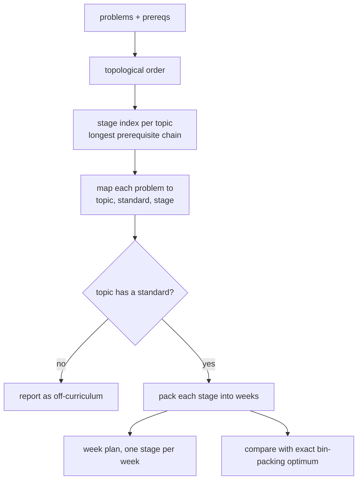
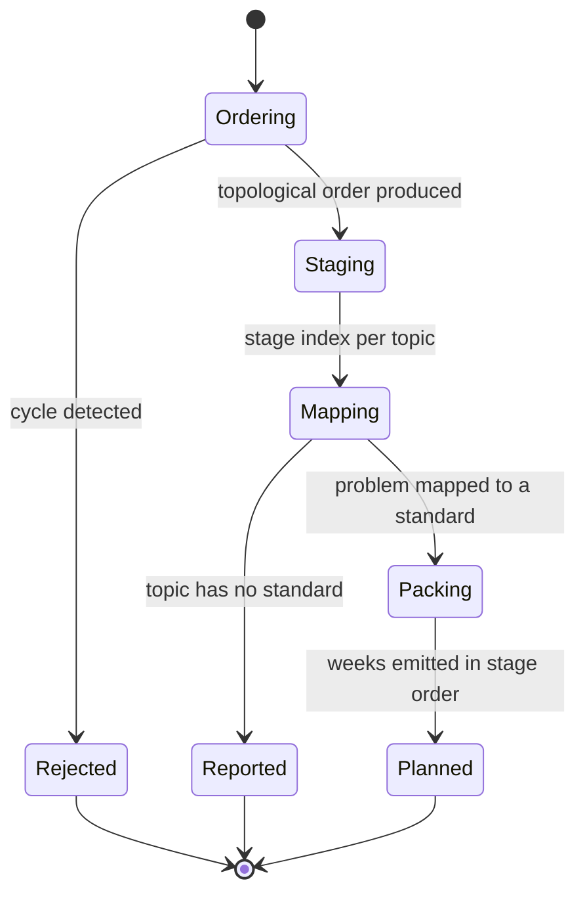
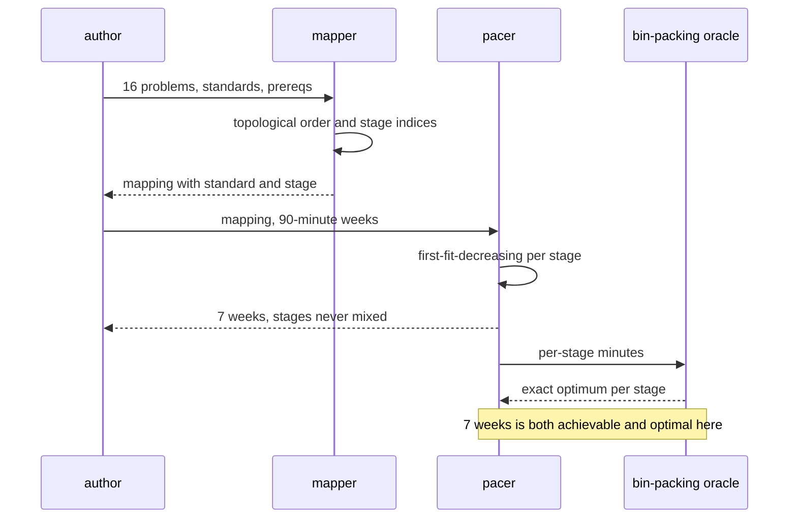

# 969 — Implement curriculum mapping to academic topics and pacing suggestions.

> **Tier:** Master / Challenge · **CTCI chapter:** Beyond — Software Engineering & Tooling
> **Task spec:** [969-implement-curriculum-mapping-to-academic-topics-and-pacing-sugge.md](../../../tasks/master/969-implement-curriculum-mapping-to-academic-topics-and-pacing-sugge.md)
> **Solutions:** [Python](../../../solutions/python/master/969-implement-curriculum-mapping-to-academic-topics-and-pacing-sugge/solution.py) ·
> [Java](../../../solutions/java/master/969-implement-curriculum-mapping-to-academic-topics-and-pacing-sugge/Solution.java) ·
> [JavaScript](../../../solutions/javascript/master/969-implement-curriculum-mapping-to-academic-topics-and-pacing-sugge/solution.js) ·
> [C#](../../../solutions/csharp/master/969-implement-curriculum-mapping-to-academic-topics-and-pacing-sugge/Solution.cs)

## 1. Problem restatement

**Input:** a problem set (number, topic, expected minutes), an academic standard per topic
(`CS.DS.x`), and a prerequisite relation over the topics.

**Output:** three views of the same curriculum: the mapping (problem → topic → standard → stage), the
paced plan (study weeks holding only one stage at a time), and the coverage report (off-curriculum
problems, stage population).

The modelling contract is in the header: a stage index is "the length of the longest prerequisite
chain ending at" a topic, so an academic unit never contains a topic whose prerequisites are taught
later; problems on topics without a standard are **reported** as off-curriculum rather than silently
dropped; pacing packs each stage into weeks of a fixed minute budget "without ever mixing two stages
in one week". The simplifications are equally explicit — one global weekly budget, no teacher or room
constraints, no spacing of individual problems across weeks.

```text
STANDARDS   = arrays CS.DS.1, hashing CS.DS.2, sorting CS.DS.3, binary-search CS.DS.4,
              graphs CS.DS.5, dp CS.DS.6
PREREQS     = arrays→hashing, arrays→sorting, sorting→binary-search, hashing→graphs,
              binary-search→dp, graphs→dp
PROBLEMS    = 16 problems over those six topics, 10..50 minutes each
WEEK_BUDGET = 90 minutes
```

Concrete results asserted by the shipped checks:

| Scenario | Result | Asserted by |
| --- | --- | --- |
| topological order | `['arrays', 'hashing', 'graphs', 'sorting', 'binary-search', 'dp']`, a permutation where every prerequisite precedes its dependent | `main` check 1 |
| stage indices | `{arrays: 0, hashing: 1, sorting: 1, binary-search: 2, graphs: 2, dp: 3}`, matching a memoised-recursion oracle | `main` check 2 |
| cycles | `dp → arrays` raises; the self-loop `a → a` raises; empty and single-topic inputs are accepted | `main` check 3 |
| mapping | all `16` problems mapped; `unmapped == []`; adding `(117, "strings", 20)` yields `unmapped == [(117, "strings")]` with the mapping unchanged | `main` check 4 |
| paced plan | `7` weeks totalling `450` minutes, one stage per week, minutes conserved | `main` check 5 |
| optimality | per-stage first-fit-decreasing weeks equal an exact bitmask-DP bin-packing optimum: `stage1: 1w, stage2: 2w, stage3: 2w, stage4: 2w` | `main` check 6 |
| standards | every curriculum topic has one unique standard; stages `1..4` are all populated | `main` check 7 |
| boundaries | empty curriculum → no mapping, no plan, no weeks; a single problem → one week | `main` check 8 |
| determinism | the mapping, the order and the week plan reproduce exactly | `main` check 9 |

The four files share this contract and differ in what they pack and how they certify it, as their
headers say: Java maps problems onto topics carrying a study **cost**, orders them, places each topic
in the **earliest week that starts after every prerequisite** (`week(topic) > week(prereq)`), and adds
pacing suggestions — practice problems plus one review problem from topics already covered. JavaScript
uses integer study hours over a **52-week** calendar and certifies the schedule against a
**critical-path (longest path) makespan lower bound**. C# fills fixed-minute buckets along the Kahn
order and verifies with a **prefix-closure oracle**, a relaxation-based **level oracle** and five
seeded input shuffles.

## 2. Intuition

The naive scheduler sorts the problems by topic name and fills weeks in that order.

```text
function pace(problems, budget)
    weeks, current ← [], []
    for problem in problems sorted by topic do
        if sum(current) + problem.minutes <= budget then
            current.append(problem)
        else
            weeks.append(current)
            current ← [problem]
        end
    end
    return weeks
end
```

It produces weeks that respect the minute budget and it is completely wrong pedagogically: a learner
can be asked to study `dp` before `binary-search`, and a week can mix half of one unit with half of
another, so the "unit" boundary stops meaning anything.

The key insight is that **ordering and packing are two separate problems, and the order must be
solved first**. The prerequisite relation is a DAG; a topological order resolves it, and the *stage* —
the length of the longest prerequisite chain ending at a topic — is the label that tells a teacher
which topics may be taught in parallel. With `arrays` at stage 0 and `dp` at stage 3, the rule "one
stage per week" is easy to state and impossible to violate accidentally.



The second half of the insight is that **packing is a bin-packing problem**, and a good greedy is
usually optimal on small instances but provably so only when compared against an exact optimum. The
Python file therefore runs first-fit-decreasing per stage *and* an exact bitmask-DP bin count, and
asserts they agree — which is what lets the pace be published as "7 weeks" rather than "about 7
weeks". A topic with a cost above the weekly budget is not splittable here, so the plan allows a
single-problem week to exceed the budget and says so.



## 3. Algorithm

1. `all_topics`: the union of prerequisites' two sides.
2. `topo_order`: Kahn's algorithm with a **sorted ready set** — successors are visited in sorted order
   and the ready queue is re-sorted after each pop — so the order never depends on dictionary
   iteration. If the output is shorter than the topic set, a cycle exists and a `ValueError` is raised.
3. `stage_index`: walk the topological order and set `depth[topic] = 0` for a root, else
   `1 + max(depth[pre])` over its predecessors. A memoised-recursion oracle re-derives the same numbers
   by plain recursion.
4. `map_curriculum`: for each problem in sorted order, emit `(number, topic, standard, stage, minutes)`
   when the topic has a standard, and `(number, topic)` in the off-curriculum list when it does not.
5. `pack_stage`: first-fit-decreasing for one stage — process problems by descending minutes (ties by
   number) and drop each into the first week with room, opening a new week otherwise.
6. `build_pacing`: group the mapping by stage, pack each stage independently, and emit the weeks in
   stage order, so no week can hold two stages.
7. `min_weeks`: the exact oracle — a bitmask DP over subsets that tracks the fewest open bins and the
   load of the last bin, with the tie-break "prefer the fuller bin".

```text
function topo_order(topics, prereqs)
    successors, indegree ← adjacency and in-degree from prereqs
    ready ← sorted topics with in-degree 0
    order ← []
    while ready is not empty do
        topic ← ready.pop(0)
        order.append(topic)
        for successor in sorted(successors[topic]) do
            indegree[successor] ← indegree[successor] - 1
            if indegree[successor] equals 0 then ready.append(successor) end
        end
        sort ready
    end
    if length(order) is not length(topics) then
        raise ValueError("prerequisite cycle detected")
    end
    return order
end

function stage_index(topics, prereqs)
    depth ← empty map
    for topic in topo_order(topics, prereqs) do
        chain ← predecessors of topic
        depth[topic] ← 0 when chain is empty else 1 + max(depth[pre] for pre in chain)
    end
    return depth
end

function pack_stage(items, budget)
    weeks ← []
    for (number, minutes) in items sorted by descending minutes then number do
        for week in weeks do
            if week.minutes + minutes <= budget then
                week.numbers.append(number)
                week.minutes ← week.minutes + minutes
                break
            end
        end
        if nothing was chosen then weeks.append([[number], minutes]) end
    end
    return [(week.numbers, week.minutes) for week in weeks]
end
```

The variants pack different units with different guarantees: Java packs *topics* by their study cost
and enforces `week(dependent) > week(prerequisite)` rather than only "one stage per week"; JavaScript
packs study hours into a 52-week calendar and adds a critical-path lower bound on the makespan; C#
fills buckets along the Kahn order and checks the schedule against a prefix-closure oracle.



## 4. Worked example

The topic graph in the fixture, with stages computed by longest prerequisite chain:

| Topic | Predecessors | Stage (0-based) | Stage (1-based) | Standard |
| --- | --- | --- | --- | --- |
| `arrays` | — | 0 | 1 | CS.DS.1 |
| `sorting` | arrays | 1 | 2 | CS.DS.3 |
| `hashing` | arrays | 1 | 2 | CS.DS.2 |
| `binary-search` | sorting | 2 | 3 | CS.DS.4 |
| `graphs` | hashing | 2 | 3 | CS.DS.5 |
| `dp` | binary-search, graphs | 3 | 4 | CS.DS.6 |

The topological order is `arrays, hashing, graphs, sorting, binary-search, dp` — note that it is *not*
alphabetical and not unique in general; the sorted-ready-set rule is what makes this particular order
reproducible. `dp` lands at stage 4 because the longest chain into it is `arrays → sorting →
binary-search → dp` (three edges), not the shorter `arrays → hashing → graphs → dp`.

Now the pacing. Minutes per stage, packed with a 90-minute week:

| Stage | Problems (minutes) | Stage total | Weeks | Week loads |
| --- | --- | --- | --- | --- |
| 1 | 101 (20), 102 (15), 103 (10), 104 (30) | 75 | 1 | 75 |
| 2 | 105 (25), 106 (40), 107 (15), 108 (30), 109 (20) | 130 | 2 | 90 + 40 |
| 3 | 110 (25), 111 (35), 112 (45), 113 (20) | 125 | 2 | 80 + 45 |
| 4 | 114 (50), 115 (40), 116 (30) | 120 | 2 | 90 + 30 |

`1 + 2 + 2 + 2 = 7` weeks, `75 + 130 + 125 + 120 = 450` minutes — both asserted, and the minutes are
conserved because every problem appears in exactly one week. The exact bitmask-DP oracle confirms each
stage's week count is the bin-packing optimum, so no stage could be shortened by a cleverer packing;
the greedy is optimal here, and the check says exactly that rather than assuming it.

Boundaries round the picture out:

| Input | Behaviour |
| --- | --- |
| extra problem `(117, "strings", 20)` | `unmapped == [(117, "strings")]`, the mapping of the other 16 is unchanged |
| `prereqs + [("dp", "arrays")]` | `ValueError` — a cycle cannot be ordered |
| `stage_index(["a"], [("a", "a")])` | `ValueError` — a self-loop is a cycle |
| empty curriculum | `([], [])`, `build_pacing([])` empty, `min_weeks([], budget) == 0` |
| single problem `(1, arrays, 20)` | one week: `[(1, (1,), 20)]` |



## 5. Complexity

Let `T` be the number of topics, `E` the number of prerequisite edges, `P` the number of problems, and
`B` the number of weeks in one stage's packing.

| Phase | Time | Space | Why |
| --- | --- | --- | --- |
| `topo_order` | `O((T + E) log T)` | `O(T + E)` | Kahn plus a re-sort of the ready set per pop |
| `stage_index` | `O(T + E)` | `O(T)` | one pass over the order, one max per predecessor list |
| Memoised oracle | `O(T + E)` | `O(T)` | each topic visited once through memoisation |
| `map_curriculum` | `O(P log P)` | `O(P)` | one sort of the problems |
| `pack_stage` | `O(P_s · B)` worst case | `O(P_s + B)` | each problem scans the open weeks for room |
| `min_weeks` | `O(2^k · k)` | `O(2^k)` | bitmask DP over the `k` problems of one stage |
| Whole pipeline | `O((T + E) log T + P log P + Σ 2^k)` | `O(T + E + P)` | the exact oracle dominates |

The `O(2^k · k)` oracle is only tractable because it runs per stage, where `k` is the number of
problems in that stage (three to five here) rather than the whole problem set: over all 16 problems it
would be `O(2^16 · 16)`. That is also why the file computes the optimum per stage and sums it — the
stage-separated plan is what makes an exact optimality claim affordable at all.

## 6. Pitfalls and edge cases

- **A cycle is a hard failure, not a warning.** Kahn's algorithm detects it by producing fewer topics
  than expected, and both the multi-topic cycle and the self-loop raise `ValueError`; a scheduler that
  silently drops the unorderable topics would publish a curriculum with a hole in it.
- **Stages are longest chains, not shortest.** `dp` is stage 3 (0-based) because the *longest* path into
  it has three edges; using the shortest path would put `dp` in a week alongside topics it still
  depends on.
- **Off-curriculum topics are reported, not dropped.** The mapping keeps every problem and lists the
  ones with no standard in a separate list — the check adds `(117, "strings", 20)` and asserts that the
  other 16 entries are unchanged.
- **One stage per week.** The assertion `len({stage_of[number] for number in numbers}) == 1` over every
  week is what makes "unit" meaningful; mixing stages silently is the mistake the design prevents.
- **Minutes are conserved.** `sum(week minutes) == sum(problem minutes) == 450`; no problem is
  scheduled twice (`len(scheduled) == len(set(scheduled))`) and none is lost.
- **An oversized problem gets its own week.** The check allows `minutes > WEEK_BUDGET` only when the
  week holds a single problem; splitting a problem across weeks is out of scope, and the C# file reports
  the oversized-topic case as its own boundary.
- **Greedy optimality is asserted, not assumed.** First-fit-decreasing is compared with the exact
  bitmask optimum per stage, so the claim "7 weeks" is a proof for this instance rather than a hope.
- **Determinism is a property of the ordering.** Kahn with a sorted ready set is what makes the plan
  reproducible; a plain stack-based DFS order would vary with insertion order.

## 7. Variants and follow-ups

- **Closing the feedback loop.** A published pace is a hypothesis; the loop that revises it from real
  outcomes is the next step —
  [980](../../../tasks/master/980-implement-continuous-feedback-loop-for-curriculum-improvement-fr.md).
- **Difficulty-aware sequencing.** Minutes are a proxy for difficulty; calibrating them from runtimes —
  [976](../../../tasks/master/976-implement-automatic-difficulty-calibration-from-crowd-sourced-ru.md).
- **Adaptive delivery.** Fixed weekly buckets versus a test that adapts to the learner —
  [978](../../../tasks/master/978-implement-adaptive-test-generator-that-adjusts-difficulty-to-tar.md).
## 8. Check yourself

<details><summary>Show answer</summary>

**Q1. Why is the stage index the *longest* chain rather than the shortest?**

Because a topic is only teachable once *every* prerequisite is done. The longest chain into `dp` is
`arrays → sorting → binary-search → dp` (three edges), so `dp` cannot be taught until stage 4; the
shortest chain (`arrays → hashing → graphs → dp`) would place it one stage earlier, alongside topics it
still depends on.
</details>

<details><summary>Show answer</summary>

**Q2. The order printed is not alphabetical. Where does it come from, and why does that matter?**

It is Kahn's algorithm with the ready set kept sorted: after `arrays` is emitted, `hashing` and
`sorting` both become ready and are appended in sorted order, and the queue is re-sorted on every pop.
The consequence is reproducibility — the same input always yields the same plan, which is what the
determinism check asserts.
</details>

<details><summary>Show answer</summary>

**Q3. What would a cycle in the prerequisites do to the plan, and how is it caught?**

The topics involved could never be ordered, so no week could be assigned without violating a
prerequisite. Kahn's algorithm detects it structurally: the emitted order is shorter than the topic
set, and `topo_order` raises `ValueError` instead of quietly returning a partial order. Both the
two-topic cycle (`dp → arrays`) and the self-loop are tested.
</details>

<details><summary>Show answer</summary>

**Q4. Why run an exact bin-packing oracle when the greedy already produces a plan?**

Because "the greedy produced 7 weeks" and "7 weeks is optimal" are different claims. The bitmask DP
computes the fewest weeks possible for each stage's minutes, and the check asserts the greedy matches
it per stage — so the published pace is certified rather than merely feasible. Running the oracle per
stage instead of over all 16 problems is what keeps it affordable.
</details>
