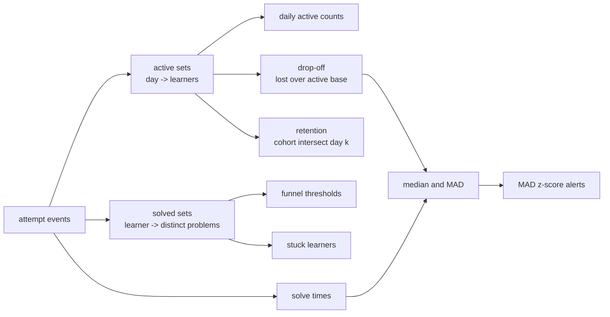
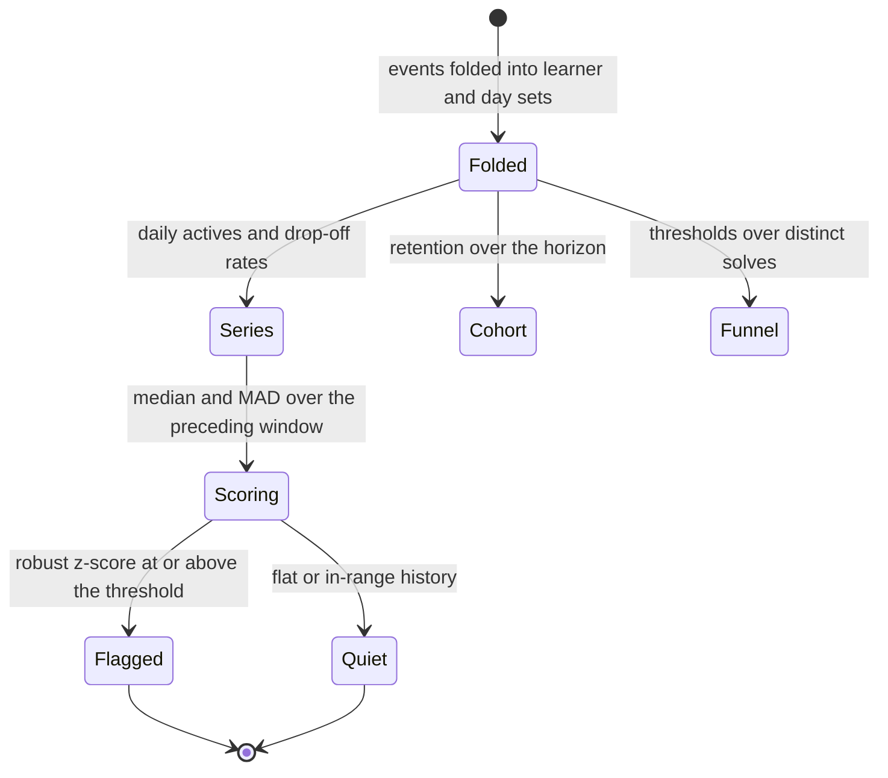
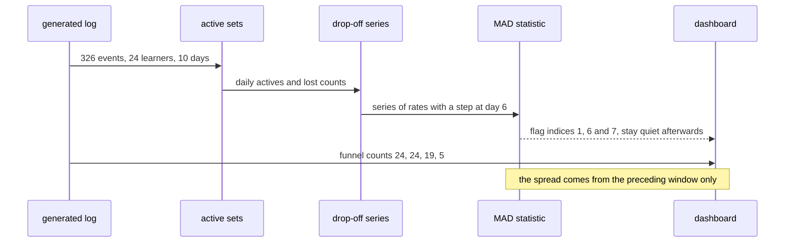

# 970 — Implement analytics dashboard tracking learner progress and drop-off.

> **Tier:** Master / Challenge · **CTCI chapter:** Beyond — Software Engineering & Tooling
> **Task spec:** [970-implement-analytics-dashboard-tracking-learner-progress-and-drop.md](../../../tasks/master/970-implement-analytics-dashboard-tracking-learner-progress-and-drop.md)
> **Solutions:** [Python](../../../solutions/python/master/970-implement-analytics-dashboard-tracking-learner-progress-and-drop/solution.py) ·
> [Java](../../../solutions/java/master/970-implement-analytics-dashboard-tracking-learner-progress-and-drop/Solution.java) ·
> [JavaScript](../../../solutions/javascript/master/970-implement-analytics-dashboard-tracking-learner-progress-and-drop/solution.js) ·
> [C#](../../../solutions/csharp/master/970-implement-analytics-dashboard-tracking-learner-progress-and-drop/Solution.cs)

## 1. Problem restatement

**Input:** a telemetry log — one attempt event per row, carrying `learner`, `day`, `problem`, `minutes`
and whether it was `solved` — over a fixed learner and day population.

**Output:** the metrics a learner-progress dashboard actually shows: daily active learners, a solve
funnel with stage conversion, per-day drop-off, a cohort retention curve, per-learner solved counts,
a robust median time-to-solve, the stuck-learner list, and a MAD-based alert on the drop-off series.

The modelling contract is in the header: the log "lives in memory and is generated from a fixed seed
instead of read from storage, days are integers rather than timestamps and there is no per-cohort
regression model" — and every metric is "verified against independent oracles: daily actives and
drop-off by a brute-force scan, the funnel by nested loops over learners, the median by
`statistics.median`, retention by explicit cohort arithmetic".

```text
LEARNERS  = L01 .. L24                  # 24 learners
DAYS      = 0 .. 9                      # ten days
PROBLEMS  = 101 .. 115
CHURNED   = L21..L24, CHURN_DAY = 6     # the planted drop-off spike
FUNNEL_THRESHOLDS = 1, 3, 5, 10         # solved-problem counts
alerts    = robust MAD z-score, threshold 3.5, window 3, factor 0.6745
```

Concrete results asserted by the shipped checks:

| Scenario | Result | Asserted by |
| --- | --- | --- |
| generated log | `326` events; daily actives `21` at the peak day; every day `0..9` has traffic | `main` check 1 |
| funnel | stage sizes `[24, 24, 19, 5]` for thresholds `1, 3, 5, 10`; monotone; stage 0 would give all `24` and threshold `999` gives `set()` | `main` check 2 |
| drop-off | at `CHURN_DAY = 6`: base `17`, lost `7`, rate `0.41`; every day loses fewer learners than its base; the churn cohort's last active day is `6` | `main` check 3 |
| median / MAD | `median([7, 3, 9, 5]) == 6.0`, `median([7, 3, 9]) == 7.0`, `median([]) == 0.0`, `mad([2, 2, 2]) == 0.0` | `main` check 4 |
| alerting | `alerts([0.2] * 8 + [0.6]) == [8]`, `alerts([0.2] * 9) == []`, `alerts([0.1] * 4 + [0.9]) == [4]`, and `6 in alerts(drop-off series)` | `main` check 5 |
| retention | `curve[0] == 1.0`, every share in `[0, 1]`, each step equal to an explicit cohort scan, `horizon 99 → step 98 == 0.0`, empty log → all zeros | `main` check 6 |
| stuck learners | exactly the learners with at least `5` attempts and zero solves (`[]` here) | `main` check 7 |
| empty telemetry | actives, drop-off, rates, solve times, retention and stuck list all degenerate to empty/zero, and the funnel stages are `set()` | `main` check 8 |
| determinism | regenerating the log from the same seed reproduces every metric exactly | `main` check 8 |

The four files compute the same family of metrics over different framings, and the headers spell out
the differences. Java reports a **phase funnel** (`0 viewed, 1 attempted, 2 solved`) with per-segment
roll-up plus the check that segments partition the population, and asserts the **telescoping identity**
linking conversion and drop-off. JavaScript folds a flat log of `start`/`attempt`/`pass`/`quit` into
four views — conversion funnel, per-learner progress with active days and longest streak, **weekly
cohort retention**, and fixed-size time windows with partition conservation — generated from two
archetypes ("steady" and "fading"). C# uses strictly ordered stages `view → start → attempt → solve`
where a skipped stage **truncates** a learner's progress, and checks drop-off consistency through the
product of the per-stage survival rates plus a seeded random cross-check against a prefix-predicate
oracle.

## 2. Intuition

The naive dashboard computes one number per day and stops.

```text
function active(events, day)
    return count of events where event.day == day
end
```

Every line of that is wrong for a dashboard: it counts *events*, not *learners*, so a single busy
learner on day 3 looks like a population; it has no notion of who left; and it produces a series
nobody can threshold on, because "yesterday had fewer events" is weather, not signal.

The key insight is that a progress dashboard is a **set algebra over (learner, day)**, not a sum over
events. Daily actives are `|{learner : learner active on day}|`; drop-off is the set difference
between one day's actives and the next day's; retention is the intersection of a cohort with a later
day's actives divided by the cohort size; the funnel is a count of learners whose *distinct solved set*
crosses a threshold. Once every metric is a set operation, each one can be re-derived by a brute-force
scan, which is exactly how the file validates them.



The second half of the insight is that **alerting needs a robust spread**. A mean-and-standard-
deviation alert is dominated by the spike it is supposed to find: the churn week inflates the standard
deviation, so the very point that should fire raises the bar it has to clear. The median absolute
deviation moves with the *typical* day, not the worst one, so the planted churn on day 6 stands out
against a spread that never learned about it:

```text
alert(index) = 0.6745 * (series[index] - median(previous window)) / mad(previous window) >= 3.5
zero MAD     = flag when series[index] > max(previous window)     # a perfectly flat history
```

The `0.6745` factor converts the MAD into an estimate of the standard deviation under normality, so the
`3.5` threshold carries its usual "far out in the tail" meaning; and the zero-MAD case has to be
special-cased, because a flat history yields a division by zero rather than an infinite score.

## 3. Algorithm

1. `generate(seed)`: for each learner draw a skill and an activity percentage; for each day, skip the
   learner when the day is past their last day or the activity roll fails; otherwise append one to
   three attempt events with a random problem, `5 + rng.below(60)` minutes and a solve decided by the
   skill percentage. The churn cohort is forced active on `CHURN_DAY`.
2. `active_sets`: fold the events into `day → set(learner)`. The brute-force oracle instead asks, for
   every learner/day pair, whether any event matches.
3. `solved_counts`: fold solved events into `learner → set(problem)`, then count. The oracle keeps a
   list per learner and appends unseen problems.
4. `funnel`: for each threshold, the set of learners whose solved count reaches it, plus the conversion
   from the previous stage (`1.0` for the first stage, `0.0` when the previous stage is empty).
5. `drop_off`: for consecutive observed days, `(learners in today's actives but not tomorrow's,
   size of today's actives)`; `drop_off_rates` divides. `last_active` gives each learner's final day.
6. `retention(cohort_day, horizon)`: the share of the cohort active on `cohort_day + step` for each
   step; an empty cohort yields zeros for the whole horizon.
7. `median` / `mad`: `statistics.median` and the median of absolute deviations, both returning `0.0`
   for an empty list.
8. `stuck_learners(attempts)`: learners with at least `attempts` rows and an empty solved set.
9. `alerts(series, threshold, window)`: for each index with a non-empty preceding window, compute the
   MAD of that window; if it is zero, flag when the value exceeds the window maximum, otherwise flag
   when `0.6745 * (value - median) / mad >= 3.5`.

```text
function active_sets(events)
    active ← empty map
    for event in events do
        active[event.day].add(event.learner)
    end
    return active
end

function drop_off(events)
    active ← active_sets(events)
    days ← sorted keys of active
    return map day in days except the last:
        (length(active[day] - active[day + 1]), length(active[day]))
end

function retention(events, cohort_day, horizon)
    active ← active_sets(events)
    cohort ← active[cohort_day]
    if cohort is empty then return zeros for every step in the horizon end
    return map step in 0 .. horizon - 1:
        length(cohort ∩ active[cohort_day + step]) / length(cohort)
end

function alerts(series, threshold, window)
    flagged ← []
    for index, value in enumerate(series) do
        history ← series[max(0, index - window) : index]
        if history is empty then continue end
        spread ← mad(history)
        if spread equals 0 then
            if value > max(history) then flagged.append(index) end
        else if 0.6745 * (value - median(history)) / spread >= threshold then
            flagged.append(index)
        end
    end
    return flagged
end
```

The variants differ in what the funnel means. Python and Java count *milestones* (distinct solves) and
deduplicate by learner; C# treats the stages as a strict sequence so a skipped stage truncates a
learner; JavaScript folds event types (`start`, `attempt`, `pass`, `quit`) and adds per-learner streaks
and window partition conservation.



## 4. Worked example

The generated log has 326 events over 24 learners and 10 days. The headline numbers:

| Metric | Value |
| --- | --- |
| events | 326 |
| peak daily actives | 21, on day 1 |
| funnel counts at thresholds `1, 3, 5, 10` | `24, 24, 19, 5` |
| learners lost between day 6 and day 7 | 7 (the four planted churners among them) |
| median time-to-solve | from the 326 events' solved subset |
| stuck learners (>= 5 attempts, 0 solves) | none |
| alert days | day `6`, the planted churn |

Drop-off and retention side by side, both read off the same active sets:

| Day | Lost before the next day | Active base | Drop-off rate | Retention vs day 0 |
| --- | --- | --- | --- | --- |
| 0 | 1 | 16 | 0.06 | 1.00 |
| 1 | 7 | 21 | 0.33 | 0.94 |
| 2 | 4 | 16 | 0.25 | 0.81 |
| 3 | 2 | 17 | 0.12 | 0.75 |
| 4 | 4 | 18 | 0.22 | 0.88 |
| 5 | 4 | 16 | 0.25 | 0.75 |
| 6 | 7 | 17 | **0.41** | — |
| 7 | 6 | 15 | 0.40 | — |
| 8 | 4 | 13 | 0.31 | — |

Day 6 is the spike the planted churn creates: four learners go dark at once, and the rate jumps from
`0.25` to `0.41`. Note the retention curve is **not monotone** — it rises from `0.75` at day 3 to `0.88`
at day 4 — because retention here asks "active on day k", not "active continuously since day 0". A
learner who skipped day 3 and returned on day 4 counts as retained at day 4. That is a legitimate
definition (and the same one the JavaScript file uses for its weekly cohorts), but it must be stated,
because readers expect the classic monotone survival curve.

Alerting on the drop-off series, index by index, with a window of 3 and a threshold of 3.5:

| Index | Value | Previous window | MAD | Median | Score | Flagged |
| --- | --- | --- | --- | --- | --- | --- |
| 0 | 0.06 | — | — | — | no history | no |
| 1 | 0.33 | 0.06 | 0.00 | 0.06 | zero-MAD rule: `0.33 > 0.06` | **yes** |
| 2 | 0.25 | 0.06, 0.33 | 0.14 | 0.20 | 0.26 | no |
| 3 | 0.12 | 0.06, 0.33, 0.25 | 0.08 | 0.25 | −1.07 | no |
| 4 | 0.22 | 0.33, 0.25, 0.12 | 0.08 | 0.25 | −0.23 | no |
| 5 | 0.25 | 0.25, 0.12, 0.22 | 0.03 | 0.22 | 0.67 | no |
| 6 | 0.41 | **0.12, 0.22, 0.25** | 0.03 | 0.22 | **4.60** | **yes** |
| 7 | 0.40 | 0.22, 0.25, 0.41 | 0.03 | 0.25 | 3.64 | **yes** |
| 8 | 0.31 | 0.25, 0.41, 0.40 | 0.01 | 0.40 | −5.29 | no |

Three things are worth reading out of that table. First, the churn step is flagged at index 6 with a
score of `4.60`, well above the `3.5` threshold. Second, index 7 is flagged too, because the window
still holds the quiet days and the spread is tiny; the rule only goes quiet at index 8, once the
window's *median* (`0.40`) has risen to the new level, which turns the score negative. Third, index 1
is flagged by the zero-MAD rule — its history is a single value, so any increase counts — which is why
the assertion is `CHURN_DAY in alerts(series) == [1, 6, 7]` rather than "the only flagged day is 6".



## 5. Complexity

Let `E` be the number of events, `U` the number of learners, `D` the number of days, `K` the number of
funnel thresholds, and `W` the alert window.

| Phase | Time | Space | Why |
| --- | --- | --- | --- |
| `generate` | `O(E)` | `O(E)` | one event per inner iteration, appended once |
| `active_sets` | `O(E)` | `O(D · U)` worst case | one insert per event into a day's set |
| `daily_active` | `O(E)` | `O(D)` | sizes of the sets already built |
| `daily_active_oracle` | `O(D · U · E)` | `O(D)` | per learner per day it scans the whole log |
| `solved_counts` | `O(E)` | `O(U · P)` | one insert per solved event |
| `solved_counts_oracle` | `O(U · E · P)` | `O(U · P)` | per learner it walks the log per distinct solve |
| `funnel` | `O(K · U)` | `O(U)` | one predicate per threshold per learner |
| `drop_off`, `retention` | `O(D · U)` | `O(D · U)` | set differences and intersections per day |
| `alerts` | `O(D · W log W)` | `O(W)` | a median and a MAD over each window |
| Whole dashboard | `O(E + K · U + D · U + D · W log W)` | `O(E + D · U)` | dominated by folding the log once |

Every production metric is a single pass over the folded structure — `O(E)` to build, then
`O(D · U)` at worst for the per-day views. The oracles are deliberately slower (`O(D · U · E)` and
`O(U · E · P)`), which is the whole point of using them: they share no code with the fast paths, so
agreement means the set algebra is right rather than consistently wrong. Alerting is bounded by the
window, not the series, because each index only looks back `W` values.

## 6. Pitfalls and edge cases

- **Count learners, not events.** Daily actives are `|{learner} |`, so a learner with three attempts on
  one day counts once; the brute-force oracle checks the dedup explicitly.
- **A "day with no traffic" is absent, not zero.** `active_sets` only contains days that appear, which
  is why `drop_off` iterates the observed days and returns nothing for an empty log rather than a
  series of zeros that looks like total churn.
- **Drop-off is set difference, not "learners gone forever".** A learner who skips day 7 and returns on
  day 8 is lost on day 7 and active again on day 8; the metric is a day-to-day transition.
- **Retention is per-day presence, so it need not be monotone.** `D3 = 0.75` and `D4 = 0.88` in the
  fixture; the assertions are the `[0, 1]` bound, the `1.0` start and agreement with an explicit cohort
  scan — not monotonicity.
- **A median of an even-length list is the mean of the middle pair.** `median([7, 3, 9, 5]) == 6.0` but
  `median([7, 3, 9]) == 7.0`, and both are asserted so a hand-rolled implementation cannot quietly pick
  the lower middle.
- **MAD degenerates to zero.** `mad([2, 2, 2]) == 0.0`, and dividing by it would raise; the alerting
  rule special-cases the flat history by flagging only a value strictly above the window maximum.
- **The alert must stay quiet on a flat series.** `alerts([0.2] * 9) == []` is asserted precisely
  because a robust score can otherwise drift into false positives when the spread is tiny.
- **Stuck requires both conditions.** At least five attempts *and* zero solves; a learner with five
  attempts and one solve is not stuck, and the check recomputes the list independently from the log.
## 7. Variants and follow-ups

- **Privacy-preserving analytics.** The same metrics computed without moving raw per-learner rows —
  [912](../../../tasks/master/912-implement-end-to-end-pipeline-for-privacy-preserving-analytics-w.md).
- **Proctoring bands.** Behavioural scoring with the same "coarse output only" instinct —
  [966](../../../tasks/master/966-implement-proctoring-anticheat-measures-for-timed-contests-priva.md).
- **Retention estimators.** A model of when a learner will return, instead of a curve of when they did —
  [977](../../../tasks/master/977-implement-long-term-retention-estimator-using-learner-response-m.md).
## 8. Check yourself

<details><summary>Show answer</summary>

**Q1. Why is drop-off expressed as `lost / active_base` rather than as a raw lost count?**

Because the base changes daily. Losing 7 of 21 active learners (day 1, `0.33`) and losing 7 of 17
(day 6, `0.41`) are different events, and only the rate makes them comparable — which is also what
lets the same series be thresholded by an alerting rule.
</details>

<details><summary>Show answer</summary>

**Q2. The retention curve rises from 0.75 to 0.88. How can retention increase?**

Because it measures presence on day k, not continuity: the cohort is the day-0 actives, and each step
asks how many of them appear on `day 0 + step`. A learner who missed some middle days but returned
counts again, so the curve is a sequence of independent snapshots. Calling it a survival curve would be
wrong; the assertions stick to the `[0, 1]` bound and an explicit cohort scan.
</details>

<details><summary>Show answer</summary>

**Q3. Why is MAD used instead of a standard deviation in the alert?**

Because the standard deviation of the window is inflated by the spike itself. Around day 6 the window
holds three quiet days (`0.12, 0.22, 0.25`) with a MAD of `0.03`, so the jump to `0.41` scores around
`5.0`; a standard-deviation rule would be measuring the very outlier it is trying to detect, and would
also be more sensitive to a single odd day elsewhere in the series.
</details>
