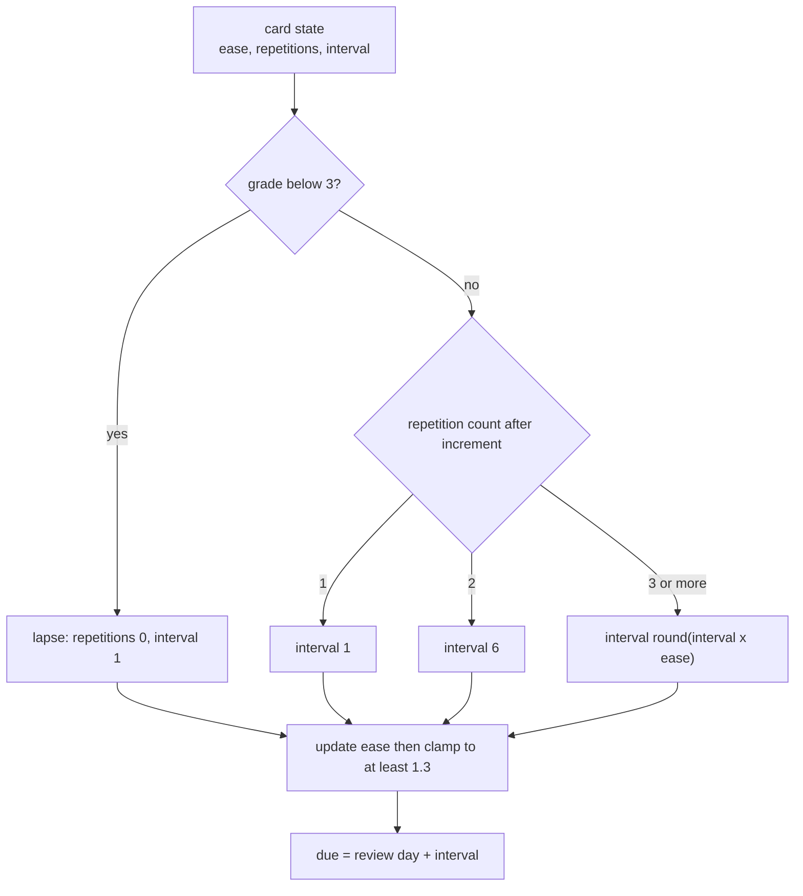
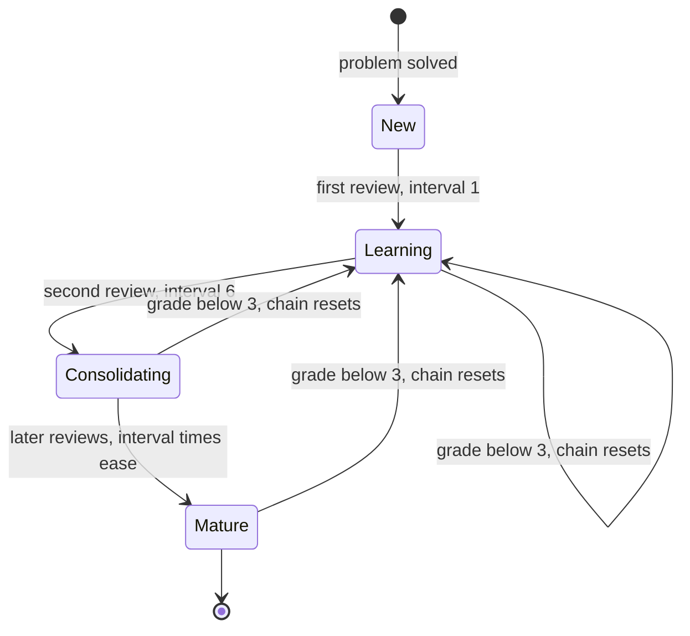
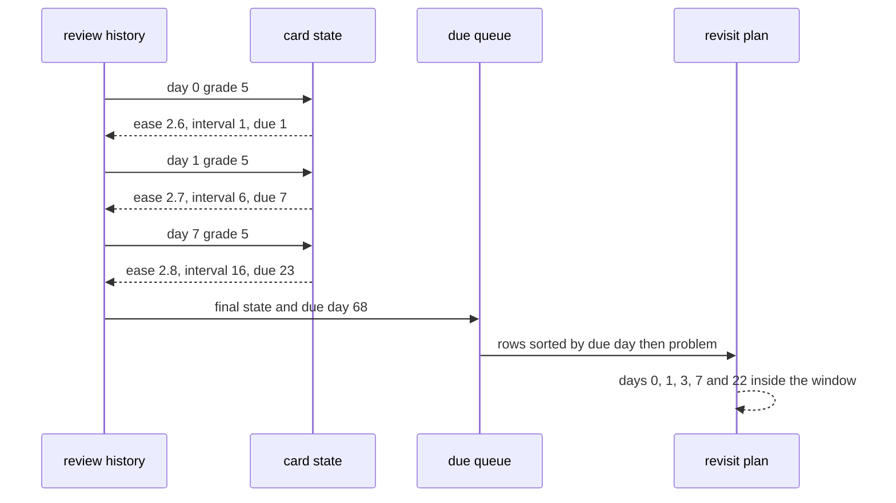

# 971 — Implement spaced-repetition scheduling for problem revisit recommendations.

> **Tier:** Master / Challenge · **CTCI chapter:** Beyond — Software Engineering & Tooling
> **Task spec:** [971-implement-spaced-repetition-scheduling-for-problem-revisit-recom.md](../../../tasks/master/971-implement-spaced-repetition-scheduling-for-problem-revisit-recom.md)
> **Solutions:** [Python](../../../solutions/python/master/971-implement-spaced-repetition-scheduling-for-problem-revisit-recom/solution.py) ·
> [Java](../../../solutions/java/master/971-implement-spaced-repetition-scheduling-for-problem-revisit-recom/Solution.java) ·
> [JavaScript](../../../solutions/javascript/master/971-implement-spaced-repetition-scheduling-for-problem-revisit-recom/solution.js) ·
> [C#](../../../solutions/csharp/master/971-implement-spaced-repetition-scheduling-for-problem-revisit-recom/Solution.cs)

## 1. Problem restatement

**Input:** a history per solved problem — a sequence of `(day, grade)` reviews with grades on `0..5` —
plus a review window.

**Output:** a due queue (`due day, problem, state`) ordered by due day then problem, a revisit plan
mapping each day inside the window to the problems due that day, and an overdue list relative to a
"today".

The modelling contract is SM-2 as the header defines it: each card keeps an ease factor (default
`2.5`, floor `1.3`), a repetition count and an interval, and one review moves all three. The stated
simplifications matter for anyone porting this: no learning steps, no fuzz, no lapse counter and no
per-learner priors — one deterministic SM-2 chain per problem.

```text
DEFAULT_EF = 2.5
MIN_EF     = 1.3
WINDOW     = 40 days
grade < 3  -> repetitions = 0, interval = 1
otherwise  -> repetitions += 1; interval = 1, then 6, then round(interval * ease)
ease       -> max(1.3, ease + 0.1 - (5 - q) * (0.08 + 0.02 * (5 - q)))
due        -> review day + interval
```

Concrete results asserted by the shipped checks:

| Scenario | Result | Asserted by |
| --- | --- | --- |
| reference chain (four grade-5 reviews) | intervals `[1, 6, 16, 45]`, due days `[1, 7, 23, 68]`, ease `[2.6, 2.7, 2.8, 2.9]`, repetitions `[1, 2, 3, 4]` | `main` check 1 |
| rational oracle | four grade sequences (`[5,5,5,5]`, `[5,4,5,3,5]`, `[3,3,3]`, `[4,0,5,2,5,5]`) agree with exact-fraction arithmetic using half-up rounding | `main` check 2 |
| failure | a first review of grade `2` gives repetitions `0`, interval `1`, due `1`, ease `2.18`; six grade-0 reviews floor the ease at exactly `1.3`; a grade `5` leaves a higher ease than a grade `3` | `main` check 3 |
| brand-new card | no history → no trace; `grade_card(FRESH, 5, 0) == ((2.6, 1, 1), 1)`; `due_queue({107: ()}) == [(0, 107, FRESH)]` | `main` check 4 |
| due queue | due days `[0, 1, 3, 7, 7, 22, 68]` for problems `[107, 104, 106, 103, 105, 102, 101]`; `overdue(queue, 8)` has `5` rows | `main` check 5 |
| window plan | `{0: (107,), 1: (104,), 3: (106,), 7: (103, 105), 22: (102,)}`, equal to a day-by-day scan oracle | `main` check 6 |
| perfect chain | the due day after `1..4` consecutive grade-5 reviews is `1, 7, 23, 68`, matching the rational prefix sum | `main` check 7 |
| monotonicity | better grades give a longer final due day and a strictly higher ease, and intervals never shrink across reviews | `main` check 8 |
| determinism | replaying, queueing and planning twice are byte-identical | `main` check 9 |

The four files implement the same recurrence with different extras, and the headers record them:
Java tracks a **lapse count** and drops the ease by `0.8` on a lapse (floored at `1.3`), drives a
120-day loop that reviews exactly the due cards ordered by `(due, id)` and checks per-mutation
invariants (`interval >= 1`, `ease >= 1.3`, `due == day + interval`). JavaScript drops the ease by
`0.2` on a lapse, clamps the ease to `[1.3, 2.8]`, and orders the recommendation view by
**overdue-ness** before card id, with a daily review budget. C# verifies a hand-computed
`1/6/17/49/147` pure-success ladder against an independent table oracle, re-checks the ease floor after
every one of `30` mutations, replays `24` seeded grades through an independently written reference
scheduler, and rejects out-of-range grades.

## 2. Intuition

The naive revisit policy is a fixed calendar: every solved problem comes back seven days later.

```text
function due(problem)
    return solved_day(problem) + 7
end
```

It is simple and it wastes the schedule: a problem solved in ten seconds on the first attempt and a
problem that took three failed attempts both return on day 7, so the learner spends the same effort on
material they clearly know and material they clearly do not.

The key insight is that the interval should **grow with demonstrated recall**, and that the growth
rate itself should adapt. SM-2 does this with two variables. The repetition count picks the rung of a
ladder — `1` day, `6` days, then `interval × ease` — and the ease factor, nudged by the grade, decides
how steep the ladder is from then on. A perfect recall is `+0.1` ease; a barely-passing recall is
`−0.14`; a failure does not merely shorten the interval, it **resets the chain**, so the problem starts
again from day one.



The second half of the insight is that the *queue* is a different object from the *state*. The state
answers "when is this problem due again?"; the recommendation feature needs "what is due today, in
what order, and what did the learner miss?" — so the pipeline keeps the due day per problem, sorts by
`(due day, problem)` for a deterministic queue, and derives the plan by filtering that queue into a
window. Overdue items are not a separate structure either: they are the queue filtered by `due <
today`, which is why the plan and the overdue list can never disagree.

## 3. Algorithm

1. `grade_card(state, grade, day)`: apply the recurrence above and return the new state plus the due
   day. A grade below `3` zeroes the repetition count and sets the interval to `1`; otherwise the
   repetition count increments and the interval takes the ladder rung for that count, using the ease
   factor *before* the update.
2. The ease update always runs, for passing and failing grades alike: `ease + 0.1 − (5 − q) ×
   (0.08 + 0.02 × (5 − q))`, clamped from below at `1.3`.
3. `replay(history)`: fold a card's history into a trace of `(ease, repetitions, interval, due)` rows,
   one per review, so the scheduling decision at every step is inspectable.
4. `due_queue(histories)`: fold each problem's history to its final state and due day, then sort by
   `(due day, problem)`.
5. `plan(histories, start, horizon)`: group the queue's rows whose due day falls inside
   `[start, start + horizon)` by day.
6. `overdue(queue, today)`: the rows with `due < today`.
7. `interval_oracle(grades)`: the same recurrence in exact `Fraction` arithmetic with explicit
   half-up rounding — an independent implementation of the rounding rule, which is where float and
   integer implementations usually diverge.

```text
function grade_card(state, grade, day)
    ease, repetitions, interval ← state
    if grade < 3 then
        repetitions ← 0
        interval ← 1
    else
        repetitions ← repetitions + 1
        if repetitions equals 1 then interval ← 1
        else if repetitions equals 2 then interval ← 6
        else interval ← round(interval * ease)
        end
    end
    ease ← max(MIN_EF, ease + 0.1 - (5 - grade) * (0.08 + 0.02 * (5 - grade)))
    return (ease, repetitions, interval), day + interval
end

function replay(history)
    state ← FRESH
    trace ← []
    for (day, grade) in history do
        state, due ← grade_card(state, grade, day)
        trace.append(state + (due,))
    end
    return trace
end

function due_queue(histories)
    queue ← []
    for number in sorted(histories) do
        state ← FRESH
        due ← 0
        for (day, grade) in histories[number] do
            state, due ← grade_card(state, grade, day)
        end
        queue.append((due, number, state))
    end
    return queue sorted by due day then number
end

function plan(histories, start, horizon)
    days ← empty map
    for (due, number, _state) in due_queue(histories) do
        if start <= due and due < start + horizon then
            days[due].append(number)
        end
    end
    return days with tuples of numbers, sorted by day
end
```

Two implementation choices are worth naming because they change the trace without changing the
contract. Python and Java update the ease **after** computing the interval, so the third review uses
the ease that the second review produced; the JavaScript file's clamp is `[1.3, 2.8]` rather than
`[1.3, ∞)`, which caps runaway ease growth; and the C# file's ladder reaches `1/6/17/49/147` because
each rung uses the ease accumulated so far.



## 4. Worked example

The reference chain is four grade-5 reviews on days `0, 1, 7, 23` for problem 101:

| Review | Day | Grade | Repetitions | Interval | Ease | Due day |
| --- | --- | --- | --- | --- | --- | --- |
| 1 | 0 | 5 | 1 | 1 | 2.6 | 1 |
| 2 | 1 | 5 | 2 | 6 | 2.7 | 7 |
| 3 | 7 | 5 | 3 | `round(6 × 2.7) = 16` | 2.8 | 23 |
| 4 | 23 | 5 | 4 | `round(16 × 2.8) = 45` | 2.9 | 68 |

Intervals `[1, 6, 16, 45]`, due days `[1, 7, 23, 68]` and ease `[2.6, 2.7, 2.8, 2.9]` — the published
SM-2 reference sequence, which is why the file asserts all four columns rather than just the due days.
The fractional rungs are where the rounding rule matters: `6 × 2.7 = 16.2` becomes `16`, and the
rational oracle re-derives that with `half_up` instead of `round`, so a language whose built-in
rounding is banker's rounding is caught.

Now the whole fixture, folded to one queue row per problem:

| Problem | History `(day, grade)` | Final ease / reps / interval | Due day |
| --- | --- | --- | --- |
| 107 | — | `2.5 / 0 / 0` (untouched) | **0** |
| 104 | `(0, 4)` | `2.5 / 1 / 1` | **1** |
| 106 | `(0, 2), (1, 2), (2, 2)` | ease decays, reps stay `0` | **3** |
| 103 | `(0, 3), (1, 3)` | `2.22 / 2 / 6` | **7** |
| 105 | `(0, 5), (1, 5)` | `2.7 / 2 / 6` | **7** |
| 102 | `(0, 5), (1, 4), (7, 3), (21, 2)` | ease `2.14`, chain reset by the grade `2` | **22** |
| 101 | `(0, 5), (1, 5), (7, 5), (23, 5)` | `2.9 / 4 / 45` | **68** |

Sorted by `(due day, problem)`, that is due days `[0, 1, 3, 7, 7, 22, 68]` for problems
`[107, 104, 106, 103, 105, 102, 101]` — the asserted queue, one row per problem, and the tie at day 7
resolved by the problem number. Problem 102 is the instructive row: it reached interval `16` and ease
`2.46`, then a grade `2` on day 21 reset the chain and dropped the ease to `2.14`, so its next review is
the very next day rather than five weeks later.

Filtering that queue gives the 40-day plan and the overdue view:

| View | Result |
| --- | --- |
| plan days inside `[0, 40)` | `{0: (107,), 1: (104,), 3: (106,), 7: (103, 105), 22: (102,)}` |
| problems due within a week (`due <= 8`) | `107, 104, 106, 103, 105` |
| overdue at day 8 | `(0, 107), (1, 104), (3, 106), (7, 103), (7, 105)` — `5` rows |
| excluded from the plan | 101, due on day 68 |

Note that problem 107 has an empty history and is due on day `0`: a brand-new card is due immediately
with the default ease, which is the boundary the file pins
(`due_queue({107: ()}) == [(0, 107, FRESH)]`).



## 5. Complexity

Let `R` be the number of reviews over all problems, `N` the number of problems, `W` the window length
in days, and `K` the length of one grade sequence used in the oracle checks.

| Phase | Time | Space | Why |
| --- | --- | --- | --- |
| `grade_card` | `O(1)` | `O(1)` | a fixed number of arithmetic operations |
| `replay` | `O(R)` | `O(R)` | one state transition per review |
| `due_queue` | `O(R + N log N)` | `O(N)` | fold every history once, then sort the rows |
| `plan` | `O(N log N + W)` | `O(N)` | reuse the queue's order and bucket by due day |
| `overdue` | `O(N)` | `O(N)` | one comparison per queue row |
| `interval_oracle` | `O(K)` big-rational terms | `O(K)` | exact fractions, no float drift |
| Whole pipeline | `O(R + N log N)` | `O(R + N)` | dominated by the histories |

The scheduling itself is constant time per review, which is what makes the whole thing cheap enough to
run for every problem on every request — the only sorting is over problems, not reviews. The oracle is
costlier *per operation* because exact fractions grow their denominators, which is exactly why it is
kept out of the hot path and used only on short grade sequences.

## 6. Pitfalls and edge cases

- **A lapse resets the chain, it does not shorten it.** A grade below `3` sets repetitions to `0` and
  the interval to `1`; problem 102 jumps from interval `16` to interval `1` and is due the next day.
- **The ease update runs on failures too.** A grade `2` lowers the ease to `2.18` on a fresh card, and
  six consecutive grade-0 reviews floor it at exactly `1.3` — the file asserts both the value and the
  floor.
- **The floor is a `max`, not a clamp on the delta.** `max(1.3, …)` is applied after the formula, so a
  very bad grade cannot push the ease below the floor even cumulatively.
- **Intervals are rounded, and the rounding rule is part of the contract.** `round(6 × 2.7)` is `16`;
  the rational oracle uses half-up rounding via `Fraction(1, 2)` so a host with banker's rounding would
  disagree and be caught.
- **The ease used for the ladder is the one from the previous review.** The third review multiplies by
  `2.7` (the ease after review two), not by the `2.8` it is about to produce.
- **A brand-new card is due on day 0.** No history means the default state and an immediate revisit —
  not "never due", and not an error.
- **Empty inputs are legal everywhere.** `replay([]) == []`, `due_queue({}) == []`, `plan({}) == {}`
  and `overdue([], 5) == []`.
- **Queue ties break on the problem number.** Two problems due on day 7 are ordered `103` then `105`,
  which is what keeps the recommendation list stable between runs.
- **Overdue is a view, not a state change.** `overdue(queue, 8)` reports five rows without mutating any
  card; the scheduler never rewrites history to catch up.
- **What is not modelled.** No learning steps for a first exposure, no fuzz/randomisation of intervals,
  no lapse counter and no per-learner priors — Anki and FSRS add all four, and porting this code needs
  them added deliberately rather than assumed.

## 7. Variants and follow-ups

- **Retention modelling.** SM-2 is a schedule, not a model of memory; estimating the probability of
  recall from response data is the next step —
  [977](../../../tasks/master/977-implement-long-term-retention-estimator-using-learner-response-m.md).
- **Adaptive delivery.** Revisit scheduling decides *when*, an adaptive test decides *what* —
  [978](../../../tasks/master/978-implement-adaptive-test-generator-that-adjusts-difficulty-to-tar.md).
## 8. Check yourself

<details><summary>Show answer</summary>

**Q1. Why does a failed review reset the repetition count instead of just reducing the interval?**

Because the ladder's rungs encode "how many times in a row has this been recalled successfully". A
failure breaks the streak, so the next success is a first success again — interval `1`, then `6`, then
multiplicative. Reducing the interval but keeping the count would let a card with a long failure history
climb straight back to a five-week interval after one lucky answer.
</details>

<details><summary>Show answer</summary>

**Q2. The four rungs are `1, 6, 16, 45`. Where does `16` come from, and why is the ease column asserted too?**

`16` is `round(6 × 2.7)`: the previous interval times the ease after the second review. The ease column
is asserted alongside because the intervals alone cannot distinguish "correct intervals from correct
ease" from "correct intervals from a compensating rounding error" — the ease `[2.6, 2.7, 2.8, 2.9]` and
the repetition counts `[1, 2, 3, 4]` pin the whole state.
</details>

<details><summary>Show answer</summary>

**Q3. What is the independent oracle doing differently from the implementation?**

It replays the same recurrence in exact `Fraction` arithmetic with an explicit half-up rounding rule.
Floating point accumulates error in `ease` over many reviews and language roundings differ on `.5`
boundaries, so exact agreement of the interval sequences is evidence that the schedule is the published
SM-2 one rather than a near miss.
</details>

<details><summary>Show answer</summary>

**Q4. Problem 106 has three reviews and an interval of 1 each time. Is that a bug?**

No — all three grades are `2`, which is below the passing threshold. Each review resets the chain, so
the interval stays `1` and the card is due the next day every time. The reported due day `3` is simply
the day after the last review on day `2`.
</details>
