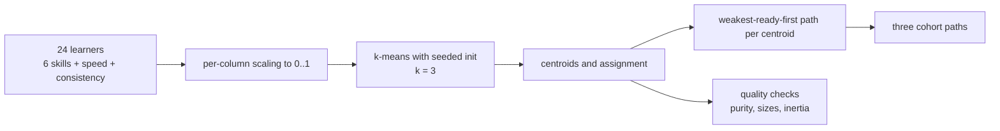
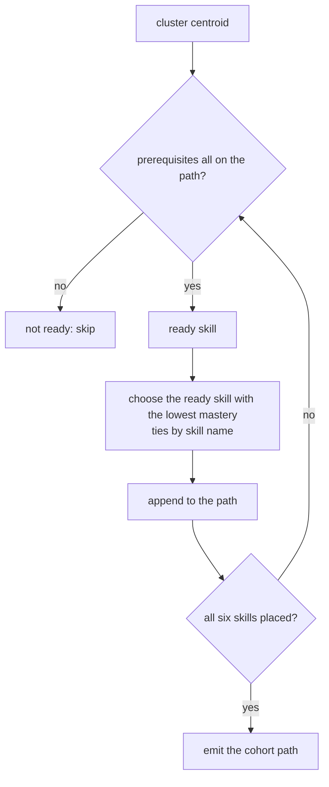
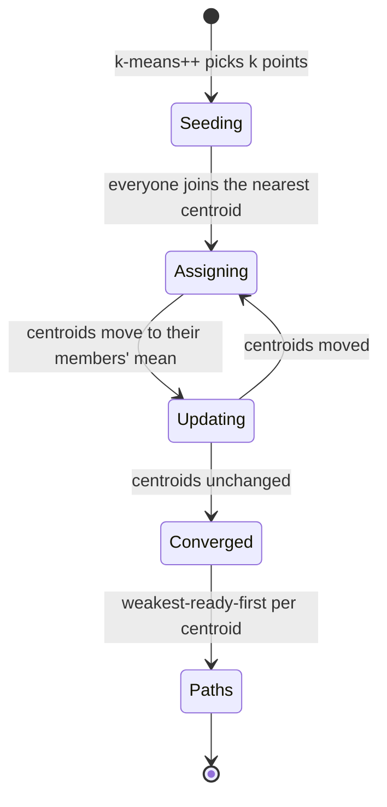
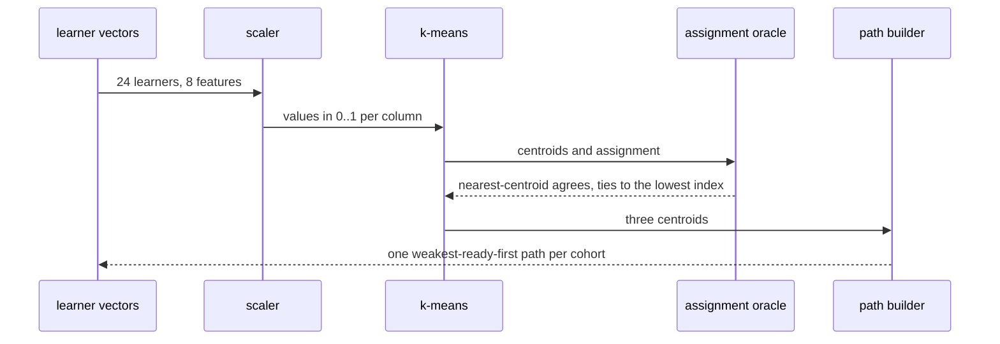

# 972 — Implement personalized learning paths using performance clustering.

> **Tier:** Master / Challenge · **CTCI chapter:** Beyond — Software Engineering & Tooling
> **Task spec:** [972-implement-personalized-learning-paths-using-performance-clusteri.md](../../../tasks/master/972-implement-personalized-learning-paths-using-performance-clusteri.md)
> **Solutions:** [Python](../../../solutions/python/master/972-implement-personalized-learning-paths-using-performance-clusteri/solution.py) ·
> [Java](../../../solutions/java/master/972-implement-personalized-learning-paths-using-performance-clusteri/Solution.java) ·
> [JavaScript](../../../solutions/javascript/master/972-implement-personalized-learning-paths-using-performance-clusteri/solution.js) ·
> [C#](../../../solutions/csharp/master/972-implement-personalized-learning-paths-using-performance-clusteri/Solution.cs)

## 1. Problem restatement

**Input:** one mastery vector per learner — a value per skill — plus pacing features, and a target
cluster count `k`.

**Output:** a cluster assignment per learner, the cluster centroids, and one **personalized path** per
cluster: an ordering of the skills that starts from what that cohort is weakest at while still
respecting the prerequisite graph.

The modelling contract is explicit in the header: learners are points in mastery space, features are
scaled to `[0, 1]`, k-means runs with deterministic seeding and Lloyd iterations with ties broken
towards the lowest cluster index, and each path is "the *ready* skill (every prerequisite already on
the path) with the lowest cluster mastery". The declared simplification is a production gap worth
knowing: one path per cluster rather than per learner, no dimensionality reduction and no collaborative
filtering.

```text
SKILLS     = arrays, hashing, sorting, binary-search, graphs, dp
PREREQS    = arrays→hashing, arrays→sorting, sorting→binary-search, hashing→graphs,
             binary-search→dp, graphs→dp
PROFILES   = foundation (20 ± 12), core (55 ± 12), advanced (85 ± 10)
CLUSTERS, LEARNER_COUNT, SEED = 3, 24, 99
features   = 6 mastery values + solve speed + consistency   # 8 dimensions
```

Concrete results asserted by the shipped checks:

| Scenario | Result | Asserted by |
| --- | --- | --- |
| scaling | every scaled feature in `[0, 1]`, every column maxing at `1.0`, an all-zero column collapsing to `0.0`, `scale([]) == []` | `main` check 1 |
| assignment oracle | every point's own centroid is the brute-force nearest one, with ties to the lowest index | `main` check 2 |
| inertia | the Lloyd history is non-increasing, `history[0] > history[-1] > 0`, and the final value is re-derived independently | `main` check 3 |
| cluster quality | sizes `{0: 8, 1: 8, 2: 8}`, no empty cluster, purity `1.00` against the latent profiles (asserted `>= 0.75`) | `main` check 4 |
| boundaries | three coincident points plus four coincident points with `k = 3` leave exactly one empty cluster; `k = n` gives singletons with inertia `~0`; `k > n` raises `ValueError`; `k = 1` puts everything in cluster 0 | `main` check 5 |
| paths | each path is a permutation of the six skills, respects every prerequisite, and equals a brute-force optimum over all valid topological orders | `main` check 6 |
| personalization | a cohort weak in `hashing` starts `arrays, hashing`; a cohort weak in `sorting` starts `arrays, sorting`; both end at `dp` | `main` check 7 |
| determinism | regenerating learners, re-seeding, re-clustering and re-deriving paths reproduces centroids, assignment, inertia history and paths | `main` check 8 |

The four files cluster the same learners with different geometry and read the clusters out
differently, as their headers describe: Java uses **farthest-point seeding**, drops empty clusters from
the report while carrying their centroid over, and builds each path from the **`length` weakest topics
ordered by the prerequisite subgraph induced on that set**. JavaScript uses **k-means++ seeding** over
five-dimensional mastery with monotone SSE *per iteration and per k*, and checks the `k = 1` and
duplicate-point boundaries. C# models three dimensions (accuracy, speed, persistence) with
**farthest-first seeding** and ranks the clusters by mean accuracy so a learner is routed to a
**track** — rank 1 remedial, top rank advanced — verified against an independent mean ordering and a
pairwise partition oracle.

## 2. Intuition

The naive personalizer hand-writes a path per learner: "if mastery in graphs is low, do graphs next".

```text
function next_skill(learner)
    weakest ← skill with the lowest mastery for that learner
    return weakest
end
```

It fails on both ends. The answer is unstable — mastery values move every session, so the "weakest
skill" flips constantly and the learner sees a different plan each day. And it can be illegal: the
weakest skill may be `dp`, which cannot be taught before `binary-search` and `graphs`.

The key insight is to **cluster first and personalize per cluster**. A cluster is a cohort whose
weakness is stable, so a path derived from a centroid changes only when the cohort's behaviour does —
and the path is meaningful to a teacher ("this group needs sorting before binary search") rather than
to one learner's noisy vector. Everything downstream is then deterministic: the same learners and the
same seed produce the same cohorts.



The second half of the insight is that the **path must be a topological order restricted by weakness**,
not a plain sort. The rule "take the ready skill with the lowest cluster mastery, repeat" produces a
sequence that is a valid topological order of the prerequisite DAG — and, stronger, it is the
lexicographically smallest mastery sequence among all valid orders, which the file proves by brute force
over every permutation that respects the prerequisites. Groups weak in `hashing` therefore start
`arrays, hashing`, groups weak in `sorting` start `arrays, sorting`, and both converge to `dp` last
because it depends on everything.



## 3. Algorithm

1. `make_learners`: for each of `24` learners, pick a latent profile by index modulo `3`, draw six
   mastery values around its base (clamped to `0..100`), then a solve speed and a consistency value
   that both lean on the profile.
2. `scale`: divide each column by its maximum, so every feature lands in `[0, 1]`; an all-zero column
   collapses to `0.0` instead of dividing by zero.
3. `kmeans_plus_plus`: seed with point `0`, then repeatedly draw an index proportional to its squared
   distance from the nearest chosen seed, using the deterministic generator. If all remaining points
   coincide (`total <= 0`), take the next unused index instead.
4. `lloyd`: iterate assign-then-update until the centroids stop moving or `50` iterations pass, keeping
   the inertia history.
5. `assign`: nearest centroid by squared Euclidean distance, ties going to the lowest cluster index.
6. `update`: each non-empty cluster moves to the mean of its members; an empty cluster **keeps its
   centre** and is reported in `empties`.
7. `kmeans`: reject `k < 1` or `k > n` with `ValueError`, then return centroids, assignment, history and
   empties.
8. `greedy_path(mastery)`: repeatedly pick the ready skill — one whose prerequisites are all already on
   the path — with the lowest mastery, breaking ties by skill name.
9. `lexicographic_oracle(mastery)`: the independent oracle — enumerate every permutation, keep the
   valid topological orders, and take the minimum of the mastery tuples in path order.
10. `purity`: for each cluster, the largest number of learners sharing one latent label, summed and
    divided by the population.

```text
function scale(rows)
    maxima ← per-column maximum
    return rows with each value divided by its column maximum, or 0.0 when that maximum is 0
end

procedure lloyd(points, centroids)
    history ← [inertia(points, centroids, assign(points, centroids))]
    current ← centroids
    while length(history) <= 50 do
        moved ← update(points, current, assign(points, current))
        history.append(inertia(points, moved, assign(points, moved)))
        if moved equals current then break end
        current ← moved
    end
    return current, assign(points, current), history
end

function greedy_path(mastery, prereqs)
    done ← empty set
    path ← []
    while length(path) < number of skills do
        ready ← skills not in done whose prerequisites are all in done
        chosen ← the ready skill with the smallest (mastery, name)
        path.append(chosen)
        done.add(chosen)
    end
    return path
end

function lexicographic_oracle(mastery, prereqs)
    valid ← every permutation of the skills that respects every prerequisite edge
    return the smallest tuple of mastery values taken in path order
end
```

Two properties come out of that loop structure rather than being enforced by checks: an empty cluster
never triggers a division by zero, because `update` keeps the old centre; and the path is always total,
because a DAG always has a ready node while skills remain — a cyclic prerequisite set would leave
`ready` empty and loop forever, which is why the prerequisite relation is fixed data here.



## 4. Worked example

The generated population has `24` learners over `8` features, and the reported result is:

| Metric | Value |
| --- | --- |
| learners / features / clusters | `24` / `8` / `3` |
| cluster sizes | `{0: 8, 1: 8, 2: 8}` |
| purity against the latent profiles | `1.00` |
| final inertia | `0.716` |

Purity `1.00` means every cluster is made up entirely of learners from one latent profile — the
planted structure is recovered exactly, and the check only demands `>= 0.75`, so the assertion leaves
room for noise rather than encoding the observed value as a requirement.

Scaling is worth seeing concretely, because it is where silent bugs live. For the column
`(5, 3), (5, 9), (5, 0)` the maximum is `9`, so column 0 becomes `1.0, 1.0, 1.0` (a constant column
scales to all-ones, not to zeros) and column 1 becomes `1/3, 1.0, 0.0`. For `(0, 2), (0, 4)` the
step speed column is all-zero and collapses to `0.0` rather than raising a division by zero.

The three paths are the output a teacher sees:

| Cluster | Path |
| --- | --- |
| 0 | `arrays > sorting > binary-search > hashing > graphs > dp` |
| 1 | `arrays > hashing > graphs > sorting > binary-search > dp` |
| 2 | `arrays > sorting > hashing > graphs > binary-search > dp` |

All three start at `arrays` (the only skill with no prerequisites) and end at `dp` (whose prerequisites
are `binary-search` and `graphs`), and the difference between clusters 0 and 1 is the order the
mid-level skills appear in: a cohort weak in `sorting` gets `sorting` immediately after `arrays`, a
cohort weak in `hashing` gets `hashing`. The direct personalization check makes the same point with
hand-written vectors:

| Cohort | Weakest values | First two skills | Last skill |
| --- | --- | --- | --- |
| `weak_hashing` | hashing `5`, arrays `10` | `arrays`, `hashing` | `dp` |
| `weak_sorting` | sorting `5`, arrays `10` | `arrays`, `sorting` | `dp` |

`arrays` always comes first even though it is not the weakest skill, because `hashing` and `sorting`
both depend on it — that is the prerequisite constraint doing its job, and it is exactly what a naive
"sort by mastery" implementation would violate.



## 5. Complexity

Let `n` be the number of learners, `d` the number of features, `k` the number of clusters, `I` the
number of Lloyd iterations, and `s` the number of skills in the prerequisite graph.

| Phase | Time | Space | Why |
| --- | --- | --- | --- |
| `make_learners` | `O(n · d)` | `O(n · d)` | one bounded draw per feature |
| `scale` | `O(n · d)` | `O(n · d)` | one max and one division per cell |
| `kmeans_plus_plus` | `O(k · n · d)` | `O(k · d)` | each of `k` seeds scores every point |
| `assign` | `O(n · k · d)` | `O(n)` | every point against every centroid |
| `update` | `O(n · d)` | `O(k · d)` | one pass accumulating member sums |
| `lloyd` | `O(I · n · k · d)` | `O(n + k · d + I)` | assignment and update per iteration, plus the inertia history |
| `greedy_path` | `O(s²)` | `O(s)` | each step scans the ready set for the weakest skill |
| `lexicographic_oracle` | `O(s! · s)` | `O(s)` | every permutation is validated against the prerequisites |
| Whole pipeline | `O(I · n · k · d + k · s² + s!)` | `O(n · d)` | dominated by the Lloyd iterations |

The factor that matters is `k`: assignment compares each point to each centroid, so the cost is linear
in the number of cohorts and would only change character if `k` grew with `n`. The brute-force oracle
is factorial in the skill count, which is why it is tractable at all here — `s = 6` gives `720`
permutations, and the same idea would be unusable for a forty-skill curriculum, where a proper
topological sort with a priority rule is the only option.

## 6. Pitfalls and edge cases

- **Constant columns scale to ones, not zeros.** `(5, 3), (5, 9), (5, 0)` keeps column 0 at `1.0`
  everywhere; the special case is only for an all-zero column, which would otherwise divide by zero.
- **Empty clusters keep their centroid.** `update` never divides by a member count of zero, and the
  emptiness is reported in `empties` rather than hidden — three coincident points plus four coincident
  points with `k = 3` leave exactly one empty cluster and the assignment `[0, 0, 0, 1, 1, 1, 1]`.
- **`k > n` is rejected.** `ValueError` rather than an empty cluster per excess `k`; `k = n` is legal
  and produces singletons with inertia `~0`; `k = 1` puts everyone in cluster `0`.
- **Ties in assignment go to the lowest cluster index.** Two equidistant centroids must not produce a
  result that depends on iteration order, which is why the tie-break is explicit in both the
  implementation and the oracle.
- **Inertia must not increase.** Lloyd's two steps both weakly improve it, so the history is
  non-increasing and `history[0] > history[-1] > 0` in the fixture; the final value is re-derived from
  the returned centroids and assignment rather than read off the history.
- **Purity is bounded above by the largest latent group.** With three profiles of eight learners each,
  the maximum achievable purity is `1.0`; the assertion is `>= 0.75` so noise does not make the test
  brittle, and `1.00` is the observed result rather than a requirement.
- **A path is a permutation, never a subset.** Every path contains all six skills exactly once, which
  the check asserts before testing the prerequisite order.
- **Prerequisites beat weakness.** `arrays` leads every path even when it is not the weakest skill; the
  rule is "weakest *ready* skill", and `ready` is the constraint that makes the path legal.
- **Determinism spans the whole pipeline.** The generator's draws, the k-means++ seeding, the Lloyd
  iterations and the path rule all have to be reproducible for the check to pass, and it re-runs every
  stage rather than only the clustering.

## 7. Variants and follow-ups

- **Different geometry.** Spectral and density-based clustering change what "cohort" means without
  changing the path rule — [500](../../../tasks/advanced/500-implement-spectral-clustering-small-example-eigen-decomposition.md)
  and [499](../../../tasks/advanced/499-implement-dbscan-clustering-grid-based-accelerate.md).
- **Per-learner paths.** Drop the cluster step and order by individual mastery, which trades stability
  for precision —
  [971](../../../tasks/master/971-implement-spaced-repetition-scheduling-for-problem-revisit-recom.md).
- **Curriculum-level pacing.** The same prerequisite DAG scheduled into study weeks rather than into a
  path —
  [969](../../../tasks/master/969-implement-curriculum-mapping-to-academic-topics-and-pacing-sugge.md).
## 8. Check yourself

<details><summary>Show answer</summary>

**Q1. Why cluster at all, instead of personalizing each learner's path directly?**

Two reasons. Stability: a per-learner path recomputed from noisy mastery values changes daily, while a
centroid moves slowly, so the cohort sees a coherent plan. Interpretability: "this group needs sorting
first" is actionable for a teacher, and purity against latent profiles is a checkable claim about the
clusters — there is no equivalent single-learner assertion.
</details>

<details><summary>Show answer</summary>

**Q2. `arrays` is not the weakest skill in either hand-written cohort, yet both paths start with it. Why?**

Because the rule picks the weakest **ready** skill, and `hashing` and `sorting` both depend on `arrays`.
Taking either of them first would produce a path that violates a prerequisite — exactly the failure mode
of a plain mastery sort. The oracle over all valid topological orders confirms this is not just legal
but lexicographically optimal.
</details>

<details><summary>Show answer</summary>

**Q3. What happens when a cluster ends up with no members?**

`update` skips it and keeps its previous centroid, and the index is recorded in `empties`. Nothing
divides by zero, and the emptiness is visible in the report. The duplicate-point fixture forces exactly
this case with seven points and `k = 3`.
</details>

<details><summary>Show answer</summary>

**Q4. Why is the inertia history asserted to be non-increasing, and what does the last value prove?**

Because Lloyd's algorithm alternates two steps that each weakly decrease the sum of squared distances:
assignment picks the nearest centroid for each point, and the update moves each centroid to the mean of
its members. A history that rises means one of the two steps is wrong. The last entry is additionally
re-derived from the returned centroids and assignment, so the number in the report is the inertia of
the result rather than a leftover from an earlier iteration.
</details>
