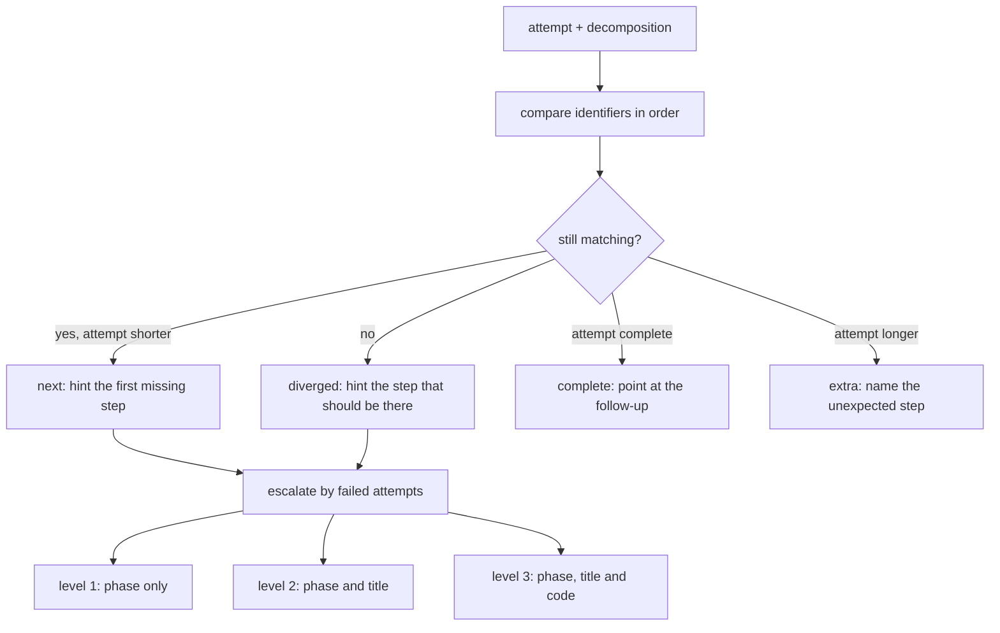
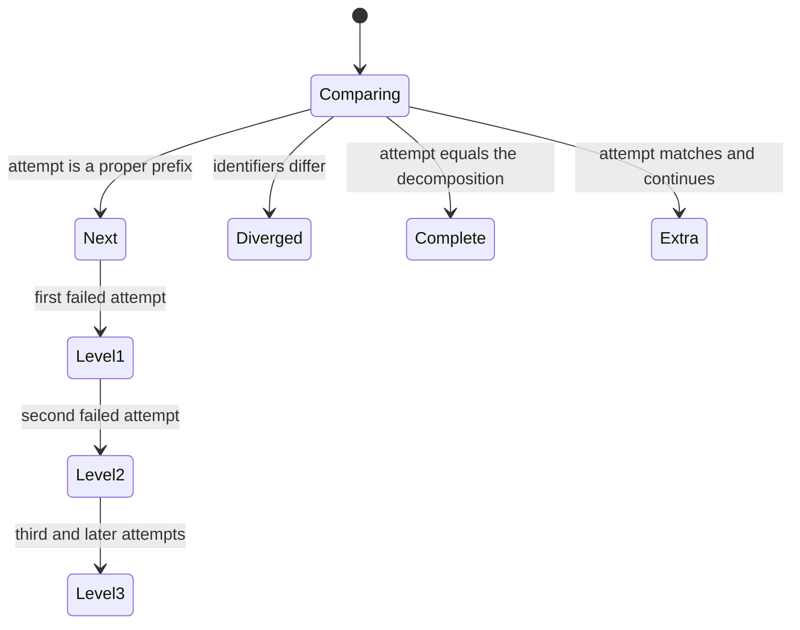
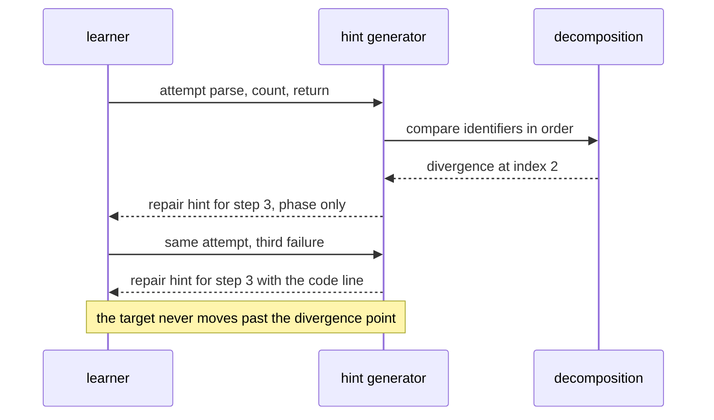

# 973 — Implement automated hint generator using solved-solution decomposition.

> **Tier:** Master / Challenge · **CTCI chapter:** Beyond — Software Engineering & Tooling
> **Task spec:** [973-implement-automated-hint-generator-using-solved-solution-decompo.md](../../../tasks/master/973-implement-automated-hint-generator-using-solved-solution-decompo.md)
> **Solutions:** [Python](../../../solutions/python/master/973-implement-automated-hint-generator-using-solved-solution-decompo/solution.py) ·
> [Java](../../../solutions/java/master/973-implement-automated-hint-generator-using-solved-solution-decompo/Solution.java) ·
> [JavaScript](../../../solutions/javascript/master/973-implement-automated-hint-generator-using-solved-solution-decompo/solution.js) ·
> [C#](../../../solutions/csharp/master/973-implement-automated-hint-generator-using-solved-solution-decompo/Solution.cs)

## 1. Problem restatement

**Input:** a canonical solution stored as an **ordered decomposition into named steps** — each with a
step identifier, a teaching phase (`setup`, `core`, `return`), a prose title and the concrete code line
— plus the learner's attempt (the step identifiers already produced) and the number of failed attempts.

**Output:** one hint about **the first step the learner still has to produce**, escalating with the
number of failed attempts: level 1 names only the phase, level 2 adds the step's title, level 3 quotes
the code line.

The modelling contract is stated in the header: hints come from a hand-written step decomposition
rather than AST/PDG analysis, and there is no per-learner learning of which hint helped. The
guarantees it does make are exact:

```text
CANONICAL = 7 steps: parse(setup) count(setup) sort(core) scan(core) check(core) update(core)
                          return(return)
LEVELS    = phase, title, code          # level = min(max(attempts_made, 1), 3)
classify  = next(prefix) | diverged(index) | complete | extra(len(canonical))
rule      = the hint always targets the FIRST unproduced step, never a later one
```

Concrete results asserted by the shipped checks:

| Scenario | Result | Asserted by |
| --- | --- | --- |
| longest common prefix | equals an oracle that tests candidate lengths from the longest down, over a corpus of `14` attempts | `main` check 1 |
| classification | equals an independent linear-scan oracle; `dev → complete`, `finn → extra(7)`, `eve → diverged(2)` | `main` check 2 |
| target discipline | for every proper prefix, the hint names `CANONICAL[length]` and its text mentions `Step length + 1` but never `Step length + 2` | `main` check 3 |
| escalation | levels `[1, 2, 3]` for the same step ident; phase text at level 1, title at level 2, code only at level 3; `hint(…, 9)` still yields level 3 | `main` check 4 |
| no leak | no level-1 or level-2 hint contains any canonical code line or the whole solution; the three levels render three distinct texts | `main` check 5 |
| repair hint | `eve` gets "Step 3 should be 'sort', not 'return'" | `main` check 6 |
| terminals | solved attempt → "matches the canonical"; overshoot → "Unexpected step"; empty attempt targets step 1 (`setup`); no decomposition → a `none` hint; empty canonical classifies as `complete` | `main` check 7 |
| coverage | the corpus's hint targets are exactly the seven step identifiers, and all `14` attempts produce a three-level sequence | `main` check 8 |
| determinism | two independently built corpora produce identical prefix, classification and hint sequences | `main` check 9 |

The four files decompose the same idea with different structures and different leak filters, as their
headers describe: Java's steps carry a category (`init`/`loop`/`branch`/`update`/`return`), the
identifiers they touch and an operation kind, with level 1 as a single **strategy** hint (technique,
step count, invariant), level 2 one hint per step, and level 3 adding the operation verb so that
**level 2's tokens are a strict subset of level 3's**, plus a validator rejecting unknown categories.
JavaScript stores the solution as a **DAG** with explicit prerequisites, topologically orders it, and
makes level 3 a **code skeleton with the secret tokens blanked out**, requiring the prose levels to
contain zero secret occurrences and the skeleton to account for every code line. C# levels the DAG by
**longest-path relaxation**, builds the ladder as the steps sorted by `(level, id)`, and unlocks the
first `min(k, steps)` entries for `k` failed attempts — asserting the prefix property and the safety
property that no hint exposes a step whose dependencies are still hidden.

## 2. Intuition

The naive hint generator looks up a canned hint per problem.

```text
function hint(problem, attempts)
    if attempts == 1 then return problem.hint1 end
    if attempts == 2 then return problem.hint2 end
    return problem.solution
end
```

It is easy to write and it is wrong in two independent ways. It ignores *where the learner is*: a
learner who has already produced four correct steps gets the same first hint as one who has produced
none. And its last level hands over the answer, which turns practice into copying.

The key insight is that a hint is a function of **the divergence point**, not of the attempt count
alone. Comparing the attempt with the decomposition yields four cases — still on track (`next`), off
script (`diverged`), finished (`complete`), or past the end (`extra`) — and each case gets a different
answer. That is also what makes the "first unproduced step" rule exact: the hint can never point at a
step the learner has already completed, and it can never skip ahead.



The second half of the insight is the **leak budget**. Escalation is only meaningful if the lower
levels cannot be mined for the answer, so the levels are ordered by information content — phase,
title, code — and the no-leak property is asserted directly over the corpus: no level-1 or level-2
hint may contain any canonical code line, or the whole solution. That is what turns "give a hint" into
a design with a stated guarantee rather than a best effort.

## 3. Algorithm

1. `corpus`: the named attempts plus **every proper prefix** of the canonical solution, so each step
   becomes the target of some hint. The fixture has `7` named attempts and `7` prefixes, `14` in total.
2. `progress(attempt)`: walk both sequences in lockstep and count the longest common prefix; report the
   divergence index when the walk stops before either end, and an overshoot flag when the attempt is
   longer than the decomposition while still matching all of it.
3. `classify(attempt)`: express the four cases in a common vocabulary — `("diverged", index)`,
   `("extra", len(canonical))`, `("complete", None)` or `("next", prefix)`.
4. `hint(attempt, attempts_made)`: classify, then compute `level = min(max(attempts_made, 1), 3)` and
   render the target step at that level. A diverged attempt gets a **repair** lead naming both the
   expected and the produced identifier.
5. `hint_sequence(attempt, attempts)`: the three consecutive hints a learner would see.
6. Terminals short-circuit before the level logic: a solved attempt points at the follow-up, an overshoot
   names the unexpected step, and an absent decomposition returns a `none` hint.

```text
function progress(attempt, canonical)
    prefix ← 0
    while prefix < length(attempt) and prefix < length(canonical)
          and attempt[prefix] equals canonical[prefix].ident do
        prefix ← prefix + 1
    end
    divergence ← prefix when prefix < length(attempt) and prefix < length(canonical) else None
    extra ← length(attempt) > length(canonical) and prefix equals length(canonical)
    return prefix, divergence, extra
end

function classify(attempt, canonical)
    prefix, divergence, extra ← progress(attempt, canonical)
    if divergence is not None then return ("diverged", divergence) end
    if prefix equals length(canonical) then
        if extra then return ("extra", length(canonical)) end
        return ("complete", None)
    end
    return ("next", prefix)
end

function hint(attempt, attempts_made, canonical)
    if canonical is empty then return (1, "none", "no canonical decomposition") end
    kind, index ← classify(attempt, canonical)
    level ← min(max(attempts_made, 1), 3)
    if kind is "complete" then return (level, "none", "already matches the canonical solution") end
    if kind is "extra" then return (level, "none", "unexpected step after the solution is complete") end
    step ← canonical[index]
    lead ← "Step " + (index + 1) + " (" + step.ident + ")"
    if kind is "diverged" then lead ← "Step " + (index + 1) + " should be " + step.ident end
    if level equals 1 then return (level, step.ident, lead + ": focus on the " + step.phase) end
    if level equals 2 then return (level, step.ident, lead + ": " + step.title) end
    return (level, step.ident, lead + ": " + step.code)
end
```

The variants harden different ends of the same skeleton. Java adds a validator for step categories and
a leak filter that refuses to emit any declared secret or verbatim canonical body line. JavaScript
requires the level-3 skeleton to account for **every** code line (verbatim or as a blanked hole) and
forbids prose from quoting the solution at all. C# turns the ladder into a length-`k` prefix of a
`(level, id)`-sorted list, which makes "a learner with more attempts has seen a superset of the hints"
a structural property.



## 4. Worked example

The decomposition, and where each named attempt stands:

| Attempt | Identifiers produced | Longest prefix | Class | Hint target (level 3) |
| --- | --- | --- | --- | --- |
| `cleo` | *(none)* | 0 | `next` | step 1, `parse` (`setup`) |
| `bob` | `parse` | 1 | `next` | step 2, `count` (`setup`) |
| `gus` | `parse count` | 2 | `next` | step 3, `sort` (`core`) |
| `ada` | `parse count sort scan` | 4 | `next` | step 5, `check` (`core`) |
| `eve` | `parse count return` | 2 | **`diverged`** | step 3, `sort` — repair hint |
| `dev` | all seven | 7 | `complete` | none: points at the follow-up |
| `finn` | all seven + `extra` | 7 | **`extra`** | none: names the unexpected `extra` |

`eve` is the interesting row: the first two steps are right, so the prefix is `2`, and the third
identifier (`return`) does not match the third step (`sort`). The classification is therefore
`("diverged", 2)` and the hint becomes a repair rather than a skip-ahead: *"Step 3 should be 'sort', not
'return': Sort the distinct values."* A naive generator would have hinted step 3 as if nothing were
wrong, and the learner would have added a correct step *after* an incorrect one — leaving an attempt
that can never match.

Escalation for `gus` (prefix length `2`, so the target is `sort`):

| Failed attempts | Level | Hint text |
| --- | --- | --- |
| 1 | 1 | `Step 3 (sort): focus on the core phase next.` |
| 2 | 2 | `Step 3 (sort): Sort the distinct values.` |
| 3 | 3 | `Step 3 (sort): keys = sorted(counts)` |
| 9 | 3 | identical to level 3 — the level is capped, not unbounded |

Level 1 names neither the title nor the code, level 2 names the title but not the code, and only level
3 quotes `keys = sorted(counts)`. The no-leak check runs that comparison over every attempt in the
corpus, including the diverged and terminal ones, and additionally asserts that the three levels render
three distinct texts — so a level-1 hint that accidentally equals level 2 is caught.

The corpus coverage check closes the loop: the set of hint targets over all `14` attempts is exactly
`{parse, count, sort, scan, check, update, return}`, so every step of the canonical solution is
practised by *some* learner state, and no step is unreachable.



## 5. Complexity

Let `n` be the number of steps in the decomposition, `a` the length of the attempt, and `A` the number
of attempts in the corpus.

| Phase | Time | Space | Why |
| --- | --- | --- | --- |
| `progress` | `O(min(n, a))` | `O(1)` | one lockstep walk |
| Prefix oracle | `O(min(n, a)²)` worst case | `O(1)` | tries every candidate length from the longest down |
| `classify` | `O(min(n, a))` | `O(1)` | reuses the prefix walk |
| `hint` | `O(1)` beyond classification | `O(len(text))` | one step lookup plus a formatted string |
| `hint_sequence` | `O(3 · (min(n,a)))` | `O(1)` | three classifications of the same attempt |
| Whole corpus | `O(A · n)` | `O(A · n)` | classification per attempt plus oracle agreement |

The hint itself is constant work once the divergence point is known, and the divergence point is a
single walk over at most `n` identifiers — so hint generation is dominated by comparing the attempt,
not by searching the solution. The prefix oracle is quadratic in the same quantity because it tests
candidate lengths independently; that is the price of an oracle that shares no code with the walk.

## 6. Pitfalls and edge cases

- **Hint the first unproduced step, never a later one.** The check asserts that the hint text mentions
  `Step length + 1` and never `Step length + 2` for every prefix attempt; skipping ahead is the failure
  mode that turns help into spoilers.
- **A divergent attempt needs a repair, not a next-step hint.** `eve` produced `count` then `return`, so
  the answer must name `sort` as the thing that should be there; telling the learner about step 3 without
  addressing the wrong step 2 leaves a permanently unmatched attempt.
- **Level clamping is required.** `hint(attempt, 9)` is level 3, and `hint(attempt, 0)` is level 1 —
  `min(max(attempts_made, 1), 3)` handles both ends, and both are asserted.
- **The no-leak property is checked, not assumed.** No level-1 or level-2 hint may contain a canonical
  code line or the whole solution; the check sweeps the entire corpus at both levels.
- **Three levels must be three distinct texts.** Otherwise escalation is cosmetic.
- **The phase vocabulary is what level 1 exposes.** Level 1 says "focus on the `core` phase next", which
  narrows the search without naming the step's title or code.
- **Overshoot is not success.** An attempt matching all seven steps *and* continuing is classified
  `extra` rather than `complete`, so the hint names the unexpected identifier instead of congratulating
  the learner.
- **An empty attempt is a valid state.** `cleo` with no steps targeted step 1 with the `setup` phase in
  the text, and `progress(())` is `(0, None, False)`.
- **An absent decomposition is not a crash.** With no steps, the hint is level 1, ident `none`, and
  explains that there is nothing to hint at; `classify(())` is `complete` because an empty attempt
  trivially equals an empty solution.
- **Decomposition quality bounds hint quality.** A step that bundles two ideas produces a hint for two
  ideas; the fixture's seven steps are the granularity the whole mechanism depends on.
- **What is not modelled.** No AST or program-dependence slicing, and no learning from which hint the
  learner acted on — the decomposition is hand-written data, which is exactly the simplification the
  header declares.

## 7. Variants and follow-ups

- **Explaining rather than hinting.** The same decomposition rendered as a full walkthrough with values —
  [974](../../../tasks/master/974-implement-step-by-step-solution-explainer-generator-using-ast-of.md).
- **Practice diversity.** Generating new *statements* for the same problem so the hint generalises —
  [975](../../../tasks/master/975-implement-natural-language-problem-paraphrasing-generator-for-di.md).
- **Reference implementations for testing.** Randomised cases with a checked oracle, which is what makes
  a decomposition verifiable —
  [957](../../../tasks/master/957-implement-randomized-test-case-generator-with-oracle-checker-for.md).
- **Visual explanations.** The same step model driving an interactive visualisation —
  [995](../../../tasks/master/995-implement-interactive-visualization-generator-for-algorithm-step.md).

## 8. Check yourself

<details><summary>Show answer</summary>

**Q1. Why is the longest common prefix the right primitive here, rather than an edit distance?**

Because the attempt is a *sequence of steps in order*: the learner is expected to produce them
left-to-right, so the first mismatch is the only position that matters for a hint. Edit distance would
tolerate reordering and find the cheapest repair, which is not the pedagogical model — a step produced
out of order is the divergence the repair hint has to name.
</details>

<details><summary>Show answer</summary>

**Q2. What exactly does the level describe, and why cap it at three?**

The level is the amount of information released: phase, phase plus title, phase plus title plus code.
It is driven by `min(max(attempts_made, 1), 3)` so a learner sees the same escalation regardless of how
the "failed attempts" counter is incremented between calls, and the cap prevents a fourth level that
would be the answer itself.
</details>

<details><summary>Show answer</summary>

**Q3. The corpus check asserts `len(attempts) == len(ATTEMPTS) + len(CANONICAL)`. Why does that matter?**

Because the named attempts alone do not exercise every step: `ada` stops at step 5, so steps 6 and 7
would never be a hint target. Adding one attempt per prefix length (`0..6`) guarantees each of the seven
steps becomes the first unproduced step somewhere in the corpus, which is what makes the coverage
assertion (`targets == the seven identifiers`) meaningful.
</details>

<details><summary>Show answer</summary>

**Q4. An attempt is classified `extra` rather than `complete`, even though it matches all seven steps. Why?**

Because it also produced an eighth identifier that the canonical solution does not contain. Reporting
`complete` would leave that step unexplained; the hint names it as unexpected instead. The distinction
is exactly the difference between "done" and "done, plus something I did not expect".
</details>

<details><summary>Show answer</summary>

**Q5. Which parts of the design would break if the decomposition had only three coarse steps?**

The escalation would still work, but a level-2 hint ("Sort the distinct values") would cover several
sub-decisions at once, and level 1 would narrow the search to a third of the solution. The hint targets
would also collapse from seven to three, so most learner states would map to the same hint — the corpus
coverage assertion makes that visible immediately, which is the point of measuring coverage over the
decomposition.
</details>
