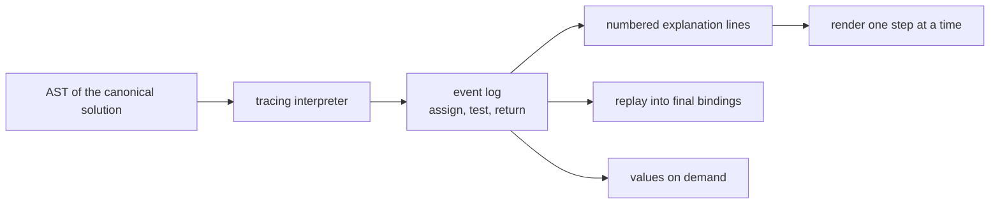
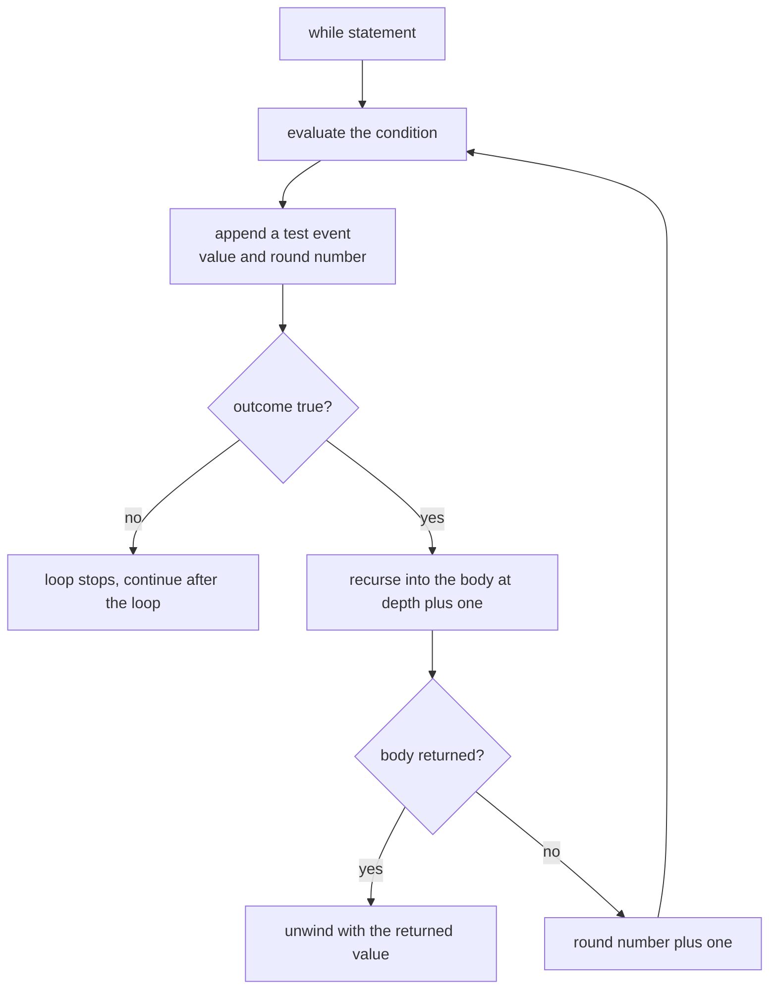
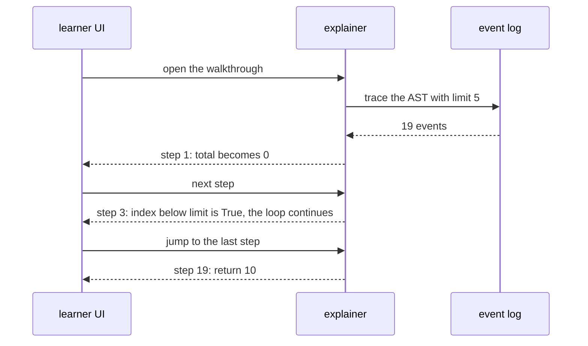

# 974 — Implement step-by-step solution explainer generator using AST of canonical solution.

> **Tier:** Master / Challenge · **CTCI chapter:** Beyond — Software Engineering & Tooling
> **Task spec:** [974-implement-step-by-step-solution-explainer-generator-using-ast-of.md](../../../tasks/master/974-implement-step-by-step-solution-explainer-generator-using-ast-of.md)
> **Solutions:** [Python](../../../solutions/python/master/974-implement-step-by-step-solution-explainer-generator-using-ast-of/solution.py) ·
> [Java](../../../solutions/java/master/974-implement-step-by-step-solution-explainer-generator-using-ast-of/Solution.java) ·
> [JavaScript](../../../solutions/javascript/master/974-implement-step-by-step-solution-explainer-generator-using-ast-of/solution.js) ·
> [C#](../../../solutions/csharp/master/974-implement-step-by-step-solution-explainer-generator-using-ast-of/Solution.cs)

## 1. Problem restatement

**Input:** a canonical solution represented as an **abstract syntax tree** of a tiny imperative language
— assignments, `while` loops and `return`, over expressions of numbers, variables and binary operators —
plus the initial bindings.

**Output:** a numbered **walkthrough**: one line per executed node, quoting the node and the values that
justify the step, renderable one step at a time.

The modelling contract is in the header: the canonical solution is "an AST literal rather than parsed
source, with no type inference and no data-flow slicing"; expression sub-nodes are not traced
individually, and the language covers only what the canonical programs need. What is real is
statement-level tracing, the replayed state, and aborting on a fault.

```text
SYMBOLS = add +, sub -, mul *, floordiv //, lt <, gt >, eq ==, le <=, ge >=
Event   = (kind, detail, value, depth, iteration)     kind in assign, test, return
rule    = one event per executed node; one event per loop-condition evaluation
```

Concrete results asserted by the shipped checks:

| Scenario | Result | Asserted by |
| --- | --- | --- |
| sum program with `limit = 5` | result `10`, env `{total: 10, index: 5, limit: 5}`, `19` explanation lines, last line `"19. Step 19: return 10."` | `main` check 1 |
| second interpreter oracle | agrees on `limit=7 → 21`, `limit=0 → 0`, the nested program `rows=4, cols=3 → 12`, and `6 * 7 → 42` | `main` check 2 |
| trace composition | `12` assigns, `6` tests and `1` return; the first two assigns bind `total` then `index`; the last event is the return; test values are `[True] × 5 + [False]` | `main` check 3 |
| nested loops | `34` assigns and `21` tests, max depth `2`, test depths `{0, 1}`, return depth `{0}`, result `12` | `main` check 4 |
| boundaries | `limit = 0` gives exactly `["assign", "assign", "test", "return"]` and 4 lines; an empty program traces nothing and returns `None` | `main` check 5 |
| rejected programs | unknown variable, unknown operator, division by zero and an unknown statement all raise | `main` check 6 |
| fidelity | `replay(trace)` rebuilds the bindings; assigns hold `int`s and tests hold `bool`s; steps `1..19` re-render identically; out-of-range steps raise `IndexError` | `main` check 7 |
| determinism | a second run reproduces trace, explanation and environment, and the oracle is stable | `main` check 8 |

The four files build the same walkthrough over differently shaped trees, as their headers say: Java's
AST adds `if`, array-element expressions, equality comparisons and a **runtime fault path** (an index out
of range aborts the trace with an `error:` line instead of emitting a bogus result). JavaScript
**tokenises and parses** the language (so the AST comes from source rather than a literal) and executes
it twice — a plain evaluator that returns only the environment, and a tracing interpreter that records,
**per executed statement, a deep copy of the variable state**. C# walks the tree **pre-order**, numbers
every node from `1` and indents by two spaces per nesting level, and verifies against three independent
oracles: an explicit-stack pre-order traversal, a breadth-first depth map and a recursive height.

## 2. Intuition

The naive explainer prints the source with comments.

```text
function explain(solution)
    return solution_source + "  # does the algorithm"
end
```

It explains nothing about *this* run: the reader cannot see that `total` was `6` when the third
iteration started, or that the loop exited because `index` reached `5` rather than because the body
failed. The explanation is a description of the code, not a record of an execution.

The key insight is that an explanation is a **trace of executed nodes**, not a rendering of the
program. Do not print the source; instrument an interpreter so every node that actually runs appends
one event carrying its own values — the current bindings for an assignment, the condition and its
outcome for a loop test, the value for a return. The resulting log is both the walkthrough and a
faithful record that can be replayed to reconstruct the final state.



The second half of the insight is that a loop test must be an event **per evaluation**, not per
statement. The fixture's sum program evaluates its condition six times for five iterations — five
`True` and one `False` — and that final `False` is the step that explains why the loop stopped. Without
it, a learner sees five iterations appear from nowhere; with it, the exit condition is explicit and the
step count is checkable in closed form.

## 3. Algorithm

1. `evaluate(expr, env)`: dispatch on the node kind — a `num` returns its value, a `var` looks up the
   environment (raising on an unknown name), anything else must be a known operator (raising otherwise),
   then evaluate both sides recursively, guard floor division by zero, and apply the operator.
2. `describe(expr)`: render an expression back to readable text, used in test events and explanations.
3. `run(program, env, trace, depth, iteration)`: walk the statement list in order.
   - `assign`: evaluate the expression, bind the name, append an `assign` event.
   - `while`: loop forever — evaluate the condition, append a `test` event with the outcome and the
     current round number, stop when it is false, otherwise recurse into the body with `depth + 1`.
   - `return`: evaluate the expression, append a `return` event and unwind with `("returned", value)`.
   - anything else: raise.
4. `interpret(program, env)`: a second interpreter with a different control structure (it exits the block
   by raising a private `Returned` exception) and no tracing at all — the oracle for step 2's claim that
   the trace is *correct* rather than merely complete.
5. `explain(trace)`: one numbered sentence per event — for an assignment, the name and its new value plus
   the loop level and iteration; for a test, the condition, its outcome and whether the loop continues;
   for a return, the value.
6. `explain_step(trace, number)`: render a single step of an existing walkthrough, with a range check so
   a UI cannot ask for step `20` of a `19`-step trace.
7. `replay(trace)`: rebuild the final bindings from the `assign` events alone.

```text
procedure run(program, env, trace, depth, iteration)
    for statement in program do
        if statement.kind is "assign" then
            value ← evaluate(statement.expr, env)
            env[statement.name] ← value
            trace.append(Event("assign", statement.name, value, depth, iteration))
        else if statement.kind is "while" then
            rounds ← 0
            loop
                outcome ← evaluate(statement.cond, env)
                trace.append(Event("test", describe(statement.cond), outcome, depth, rounds))
                if not outcome then break end
                result ← run(statement.body, env, trace, depth + 1, rounds)
                if result is not None then return result end
                rounds ← rounds + 1
            end
        else if statement.kind is "return" then
            value ← evaluate(statement.expr, env)
            trace.append(Event("return", "result", value, depth, iteration))
            return ("returned", value)
        else
            raise ValueError("unknown statement")
        end
    end
    return None
end

procedure explain(trace)
    lines ← []
    for number, event in enumerate(trace, start = 1) do
        if event.kind is "assign" then
            lines.append(number + ". " + event.detail + " becomes " + event.value
                         + " (loop level " + event.depth + ", iteration " + (event.iteration + 1) + ")")
        else if event.kind is "test" then
            lines.append(number + ". the condition " + event.detail + " is " + event.value
                         + ", so the loop continues or stops")
        else
            lines.append(number + ". return " + event.value)
        end
    end
    return lines
end
```

The variants change what a "step" contains. Java traces statements with concrete values and **aborts on
a runtime fault**, producing an `error:` line rather than a wrong answer. JavaScript snapshots the whole
environment per statement, so a UI can show the variable panel at any point. C# attaches prose to each
node and derives indentation from the depth, which makes the walkthrough a pre-order rendering of the
tree — verified against an explicit-stack traversal of the same tree.



## 4. Worked example

The sum program binds `total = 0` and `index = 0`, then loops while `index < limit` adding `index` to
`total` and incrementing `index`. With `limit = 5` the trace is `19` events:

| # | Event kind | Detail | Value | Depth | Iteration |
| --- | --- | --- | --- | --- | --- |
| 1 | assign | `total` | 0 | 0 | 0 |
| 2 | assign | `index` | 0 | 0 | 0 |
| 3 | test | `index < limit` | `True` | 0 | 1 |
| 4–5 | assign | `total`, `index` | 0, 1 | 1 | 0 |
| 6 | test | `index < limit` | `True` | 0 | 2 |
| 7–8 | assign | `total`, `index` | 1, 2 | 1 | 1 |
| … | … | … | … | … | … |
| 15 | test | `index < limit` | `True` | 0 | 5 |
| 16–17 | assign | `total`, `index` | 10, 5 | 1 | 4 |
| 18 | test | `index < limit` | `False` | 0 | 6 |
| 19 | return | `result` | 10 | 0 | 0 |

The asserted composition is `12` assignments (`total`/`index` once each, plus two per round for five
rounds), `6` tests (five `True`, then the `False` that ends the loop) and exactly one `return` — and the
final explanation line is `"19. Step 19: return 10."` with the environment left as
`{total: 10, index: 5, limit: 5}`. The closed form `0 + 1 + 2 + 3 + 4 = 10` is the independent check on
the result, and the second interpreter re-derives it without any tracing.

Nested loops are where the depth field earns its place. For `rows = 4, cols = 3`:

| Quantity | Value | Where it comes from |
| --- | --- | --- |
| result | `12` | `rows × cols` |
| assigns | `34` | `2` setup plus `rows × (2 + 2 × cols)` — `outer = 0`, then per row `inner = 0`, `hits += 1`, `inner += 1`, `outer += 1` |
| tests | `21` | `(rows + 1)` outer tests plus `rows × (cols + 1)` inner tests |
| max depth | `2` | the body of the inner loop |
| test depths | `{0, 1}` | outer conditions at depth 0, inner at depth 1 |
| return depth | `{0}` | the return is a top-level statement |

The step counts are exact because the trace is built from executed nodes only: no event is emitted for a
statement that never ran, which is why the `limit = 0` case is `["assign", "assign", "test", "return"]`
— four events, the loop condition tested once and immediately false.



## 5. Complexity

Let `S` be the number of statements executed, `L` the number of loop-condition evaluations, `D` the
maximum loop nesting depth, and `E` the number of expression nodes evaluated.

| Phase | Time | Space | Why |
| --- | --- | --- | --- |
| `evaluate` | `O(E)` per expression | `O(D_expr)` | one recursive visit per node |
| `run` | `O(S + L)` | `O(S + L + D)` | one event per executed statement and per condition test |
| `interpret` (oracle) | `O(S + L)` | `O(bindings)` | same walk, no log, different control structure |
| `explain` | `O(S + L)` | `O(total text)` | one formatted line per event |
| `explain_step` | `O(S + L)` as written | `O(total text)` | the file regenerates the list and indexes it |
| `replay` | `O(S)` | `O(bindings)` | one assignment per event |

The walkthrough is proportional to the *executed* program, which is the property that makes it useful:
a `19`-step explanation of five iterations is not a rendering of a fixed-size source, it is a record of
the run. `explain_step` is written the simple way — it re-renders the explanation and indexes into it —
which is `O(S + L)` per drill-down; a UI that scrubs a slider would precompute the list once and index
into it, trading `O(total text)` of memory for `O(1)` lookups. The oracle doubles the constant factor of
an explanation at most, and it shares no code with the traced path, which is the point of running it.

## 6. Pitfalls and edge cases

- **Trace executed nodes, not source statements.** A statement in a skipped loop body produces no event;
  the `limit = 0` trace is exactly `["assign", "assign", "test", "return"]`.
- **A loop condition is an event per evaluation.** Five iterations plus the exit test is `6` events, and
  the last one carries `False` — the value that explains why the loop stopped.
- **Depth and iteration are different fields.** Depth is the loop nesting level; iteration is the round
  number within that loop, and the recorded value is zero-based while the explanation shows
  `iteration + 1`.
- **A `return` inside a nested body must unwind the whole walk.** The traced `run` propagates the
  sentinel out of the recursion, and the oracle uses a thrown `Returned` exception for the same purpose;
  swallowing it would continue executing statements after the return.
- **Bad programs must fail loudly.** An unknown variable, an unknown operator (`mod` is not in the table),
  division by zero and an unknown statement kind all raise; a division by zero is guarded before the
  operator is applied, so the error is deterministic rather than host-dependent.
- **The trace must be replayable.** Rebuilding the bindings from the `assign` events alone reproduces the
  final environment (minus the initial `limit`), which is what makes the log a faithful record rather
  than decoration.
- **Types are part of the contract.** Assignment events always carry `int`s (and never `bool`s, which are
  `int`s in Python), test events always carry booleans — so a stray condition value cannot pass as data.
- **An empty program is legal.** No statements, no events, no lines, `result is None` and `env == {}`.
- **Step indices are 1-based and range-checked.** `explain_step(trace, len(trace) + 1)`, step `0` and any
  step of an empty trace all raise `IndexError` naming the size of the walkthrough.
- **The second interpreter is an oracle, not a duplicate.** It differs in control flow (exception-based
  exit instead of a sentinel return) and does no tracing, so agreement on value and environment is
  evidence about the trace's correctness, not a restatement of it.
- **Only statements are traced.** Expression sub-nodes are not individual steps, and the language has no
  functions or nested loop bodies beyond one level in the fixture — both documented simplifications.
- **A runtime fault aborts the trace.** The Java file's index-out-of-range path appends an `error:` line
  instead of a result, which is the honest behaviour for an explainer: explaining an aborted run.

## 7. Variants and follow-ups

- **Hints instead of walkthroughs.** The same decomposition, revealed progressively rather than all at
  once —
  [973](../../../tasks/master/973-implement-automated-hint-generator-using-solved-solution-decompo.md).
- **Visual walkthroughs.** Turning the event log into an animated visualisation of the algorithm —
  [995](../../../tasks/master/995-implement-interactive-visualization-generator-for-algorithm-step.md).
- **Prose around the steps.** An assistant that drafts the surrounding explanation text —
  [994](../../../tasks/master/994-implement-editorial-writing-assistant-that-drafts-explanations-p.md).
- **Running the code yourself.** The same AST view inside a browser REPL, where the learner edits rather
  than reads —
  [964](../../../tasks/master/964-implement-interactive-repl-web-ui-for-running-and-testing-proble.md).

## 8. Check yourself

<details><summary>Show answer</summary>

**Q1. Why trace an interpreter rather than pretty-print the AST?**

Because the interesting content of an explanation is the *values at the moment a node ran*, which only an
execution produces. A pretty-printed AST is identical for every input; a trace of `19` events is specific
to `limit = 5`, and it can be replayed into the final environment, which the printer cannot.
</details>

<details><summary>Show answer</summary>

**Q2. The sum program has five iterations but six test events. Why?**

The condition is evaluated once per iteration (five times, all `True`) plus once more when it evaluates
to `False` and ends the loop. That sixth event is the only place the trace records *why* the loop
stopped, and the check asserts the exact pattern `[True] × 5 + [False]`.
</details>

<details><summary>Show answer</summary>

**Q3. What do `depth` and `iteration` distinguish in the nested program?**

`depth` is how many loops enclose the statement: the outer condition tests at depth `0` and the inner
ones at depth `1`, with `2` as the maximum depth of any event. `iteration` is the zero-based round number
inside the loop that owns the statement, which is what lets a UI group "round 3 of the inner loop" without
recounting.
</details>

<details><summary>Show answer</summary>

**Q4. Why is `interpret` a fair oracle if it uses the same `evaluate` helper?**

Because the disagreement it can catch is structural rather than arithmetic: it exits the program by
raising an exception instead of returning a sentinel through the recursion, so a bug in how `run`
propagates a return out of a nested body shows up as a different environment or result. Both paths share
the expression evaluator, so a bug there would be invisible to the comparison — which is a deliberately
stated limit of the oracle, not an oversight.
</details>

<details><summary>Show answer</summary>

**Q5. What would break if the explainer inferred steps from the source text instead of the AST?**

Every property that makes the walkthrough trustworthy: there would be no executed-node semantics (so a
skipped loop body could still be "explained"), no depths, no per-evaluation condition events, and no
replayable log. The `limit = 0` boundary is the sharpest test — from the source alone it is impossible to
know that the body produced no events, while the AST trace makes it four events long.
</details>
