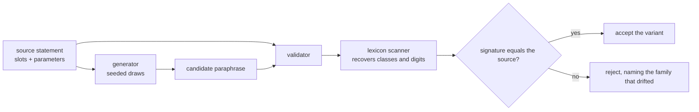
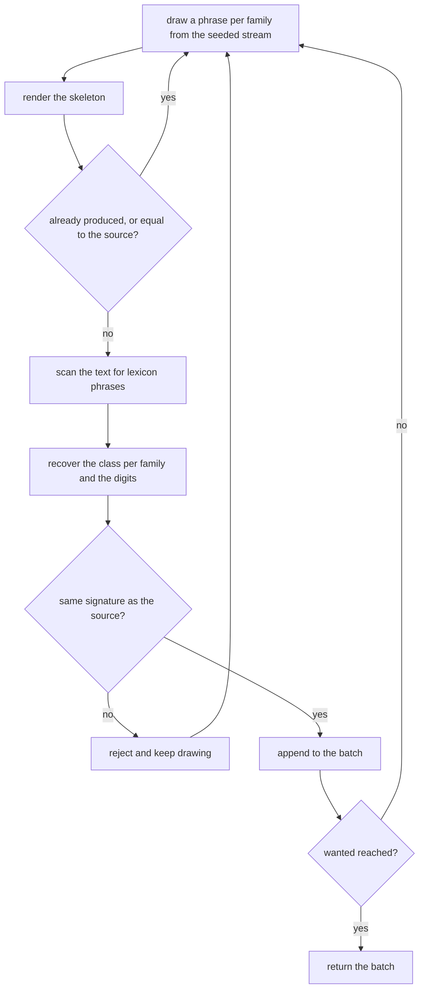
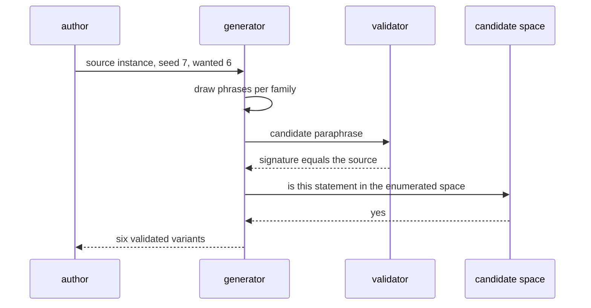

# 975 — Implement natural-language problem paraphrasing generator for diverse practice.

> **Tier:** Master / Challenge · **CTCI chapter:** Beyond — Software Engineering & Tooling
> **Task spec:** [975-implement-natural-language-problem-paraphrasing-generator-for-di.md](../../../tasks/master/975-implement-natural-language-problem-paraphrasing-generator-for-di.md)
> **Solutions:** [Python](../../../solutions/python/master/975-implement-natural-language-problem-paraphrasing-generator-for-di/solution.py) ·
> [Java](../../../solutions/java/master/975-implement-natural-language-problem-paraphrasing-generator-for-di/Solution.java) ·
> [JavaScript](../../../solutions/javascript/master/975-implement-natural-language-problem-paraphrasing-generator-for-di/solution.js) ·
> [C#](../../../solutions/csharp/master/975-implement-natural-language-problem-paraphrasing-generator-for-di/Solution.cs)

## 1. Problem restatement

**Input:** a problem statement built as a **sentence skeleton with typed slots** — framing, action,
answer object, relation, closing remark, plus the numeric parameters of one instance.

**Output:** a set of `k` distinct paraphrases that keep the problem's meaning, drawn reproducibly from
a seed, with a validator that can say *why* a candidate drifted.

The modelling contract is stated in the header: every slot has interchangeable alternatives "that all
carry the same meaning class", the candidate space is finite (`432` statements here) and can be
enumerated, and meaning is checked **the other way round from generation** — "a lexicon scanner
re-extracts the class of every phrase together with the numbers from a rendered variant and the
signature must equal the source's".

```text
SKELETON = "{intro} an array of {count} distinct integers, {action} the {object} of the two
            entries that {relation} {target}. {closing}"
SLOTS    = intro 4, action 4, object 3, relation 3, closing 3        # 4 x 4 x 3 x 3 x 3 = 432
CLASSES  = intro -> supplied_input; action -> emit or tally; object -> answer_position;
           relation -> sum or product; closing -> free_order
SOURCE   = count 8, target 13
```

Concrete results asserted by the shipped checks:

| Scenario | Result | Asserted by |
| --- | --- | --- |
| source signature | `(("supplied_input",), ("emit",), ("answer_position",), ("sum",), ("free_order",), (8, 13))`, no validation reasons, digits `["8", "13"]` | `main` check 1 |
| generation | `6` distinct variants, none equal to the canonical phrasing, all validating | `main` check 2 |
| round trip | every variant recovers exactly the source signature, and all six share one signature | `main` check 3 |
| candidate space | the enumerated space has `4 × 4 × 3 × 3 × 3 = 432` members, contains the source and every variant, and none of them has an unresolved `{` | `main` check 4 |
| diversity | mean pairwise Jaccard distance `0.543` (asserted `>= 0.1`), at least `3` distinct framings and `3` distinct actions, minimum pairwise distance `> 0.02` | `main` check 5 |
| planted breaks | a swapped relation, a different action, a changed parameter and a dropped closing remark are each rejected with the offending family named; a harmless rewording passes | `main` check 6 |
| boundaries | `wanted = 0` yields nothing; `wanted = 999` stops early with a distinct, valid, in-space batch; empty text fails validation and has no digits; `distance("", "") == 0.0` | `main` check 7 |
| reproducibility | the same seed repeats the batch exactly; a different seed gives a different valid batch | `main` check 8 |
| accounting | `12` accepted variants and `4` rejected planted breaks, with all accepted ones sharing the source signature | `main` check 9 |

The four files implement the same generate-and-verify loop over different bookkeeping, as their headers
describe: Java keeps a spec of the numeric bound, input format and canonical target/constraint phrases
and validates by **normalising the paraphrase back to `bound|target|constraint|format`** — a round trip
rather than a scan. JavaScript validates every **frame against the spec** before using it (no missing or
unknown slots), draws frames and synonyms from a curated lexicon, deduplicates renderings and enforces a
slot-preservation invariant on each emitted variant. C# derives template *and* synonym choice from a
splitmix64 hash of the problem id, so a problem always paraphrases the same way while different problems
spread across wordings, and verifies **payload invariance** with an independent character-scanning digit
extraction compared as a sorted multiset (not with a regex).

## 2. Intuition

The naive paraphraser is a thesaurus swap on the original sentence.

```text
function paraphrase(text)
    return text.replace("return", "produce").replace("indices", "positions")
end
```

It is easy, it produces something that reads differently, and it has no idea whether the meaning
survived: swapping `add up to` for `multiply to` is the same mechanical edit and changes the problem
completely. Substring substitution also breaks silently when the phrase appears inside another phrase.

The key insight is that meaning must be **represented explicitly as classes**, and then checked by
re-extraction. Every phrase in every slot belongs to a meaning class (`add up to`, `sum to` and
`have a total of` are all `sum`), each slot family is a finite set of interchangeable phrases, and the
*meaning of a statement* is the tuple of classes plus its numbers. Generation picks phrases; validation
runs a scanner over the rendered text, recovers the classes, and compares the signature with the
source's. Anything that changed a class — or a digit — fails.



The second half of the insight is that **the candidate space is small enough to enumerate**, which turns
a fuzzy quality claim into an assertion. Because each slot family is a finite list, the space for one
instance is `4 × 4 × 3 × 3 × 3 = 432` statements; the generator's output can therefore be checked for
membership in that space (no template left unfilled, no invented phrasing), and diversity can be measured
exactly as the mean pairwise Jaccard distance between the drawn statements.

## 3. Algorithm

1. `canonical_choices(number, target)`: the canonical phrase for each family plus the two parameters as
   strings.
2. `render(choices)`: substitute every slot into the skeleton.
3. `source_statement(...)`: the canonical instance used as the meaning reference.
4. `candidate_space(...)`: enumerate every combination of the slot alternatives for the given parameters
   — the independent oracle material for membership and diversity checks.
5. `signature(text)`: lower-case the text, and for each family collect the sorted set of classes of the
   lexicon phrases that occur in it; append the tuple of integers found by the digit scan. The result is
   the statement's meaning.
6. `validate(text, number, target)`: compare the signature's five class slots and its parameter tuple
   with the source's, returning one reason string per drifting family.
7. `paraphrase(number, target, wanted, seed)`: draw a choice per family from a seeded splitmix64 stream,
   render, skip anything already seen (including the source), and stop at `wanted` or after `200` draws.
8. `tokens` / `distance` / `mean_distance`: word-set Jaccard distance between statements, and its mean
   over all pairs — the diversity measure.
9. `styles(variants)`: which framing and action phrases the batch actually used.

```text
function signature(text)
    lowered ← lower-case(text)
    classes ← []
    for family in (intro, action, object, relation, closing) do
        found ← sorted set of CLASSES[family][phrase]
                for phrase in LEXICON[family] when phrase occurs in lowered
        classes.append(tuple(found))
    end
    numbers ← tuple of integers found by scanning lowered for digit runs
    return tuple(classes) joined with numbers
end

function validate(text, number, target)
    expected ← signature(source_statement(number, target))
    found ← signature(text)
    reasons ← []
    for position, family in enumerate(the five families) do
        if found[position] is not expected[position] then
            reasons.append(family + " drifted")
        end
    end
    if found.numbers is not expected.numbers then reasons.append("parameters drifted") end
    return reasons
end

function paraphrase(number, target, wanted, seed)
    generator ← splitmix64(seed)
    source ← source_statement(number, target)
    variants ← []
    seen ← {source}
    for attempt in 1 .. 200 do
        if length(variants) >= wanted then break end
        choices ← parameters plus one draw per family
        text ← render(choices)
        if text not in seen then
            seen.add(text)
            variants.append(text)
        end
    end
    return variants
end
```

The variants differ in where the validation lives. Java validates by **normalisation**: it strips the
wording back to `bound|target|constraint|format` and requires an exact match, which is a round trip
rather than a class comparison. JavaScript validates the *frame* against the spec before generation, so
an invalid template is rejected before it can produce a bad candidate. C# makes the whole draw a
function of the problem id, which makes per-problem determinism a property of the hash rather than of the
call order.



## 4. Worked example

The source instance is one line:

```text
Given an array of 8 distinct integers, return the indices of the two entries that add up to 13.
Report them in any order.
```

Seeded with `7` and asked for six variants, the generator produces (abridged):

| # | Variant |
| --- | --- |
| 1 | `Take an array of 8 distinct integers, return the indices of the two entries that add up to 13. Any valid pair is accepted.` |
| 2 | `You are given an array of 8 distinct integers, produce the indices of the two entries that have a total of 13. The order of the answer does not matter.` |
| 3 | `Take an array of 8 distinct integers, return the indices of the two entries that sum to 13. Report them in any order.` |
| 4 | `Given an array of 8 distinct integers, report the index pair of the two entries that have a total of 13. Any valid pair is accepted.` |
| 5 | `Take an array of 8 distinct integers, find and return the index pair of the two entries that sum to 13. The order of the answer does not matter.` |
| 6 | `You are given an array of 8 distinct integers, produce the indices of the two entries that add up to 13. The order of the answer does not matter.` |

Six distinct renderings, none equal to the source. Now the validation, family by family, for variant 2:

| Family | Phrase found | Class | Source class | Verdict |
| --- | --- | --- | --- | --- |
| intro | `You are given` | `supplied_input` | `supplied_input` | ok |
| action | `produce` | `emit` | `emit` | ok |
| object | `indices` | `answer_position` | `answer_position` | ok |
| relation | `have a total of` | `sum` | `sum` | ok |
| closing | `The order of the answer does not matter.` | `free_order` | `free_order` | ok |
| parameters | digits `8, 13` | `(8, 13)` | `(8, 13)` | ok |

The signature matches, so the variant is valid — `validate` returns an empty list. The planted breaks
show what each failure looks like:

| Break | Detected reason |
| --- | --- |
| relation swapped to `multiply to` | `relation: ('product',) != ('sum',)` |
| action changed to `count` | `action: ('emit', 'tally') != ('emit',)` — the class tuple is the sorted set of matching phrases |
| target `13` edited to `14` | `parameters: (8, 14) != (8, 13)` |
| closing remark deleted | `closing: () != ('free_order',)` |
| `the two entries` reworded to `those two entries` | **accepted** — a rewording that keeps every lexicon phrase |

That last row is the important one: the validator is a *meaning* check, not a string diff, so a
paraphrase the author never wrote by hand still passes as long as no class or digit moved. Diversity is
the other half of quality, and it is measured rather than eyeballed: the mean pairwise Jaccard distance
over the six variants is `0.543` (asserted `>= 0.1`), at least three different framings and three
different actions appear, and the closest pair is still more than `0.02` apart. Membership in the
enumerated space — `432` statements — confirms that no variant escaped the template system, and the
`wanted = 999` boundary stops early with a valid, distinct batch instead of looping forever.



## 5. Complexity

Let `P` be the number of phrases across all families, `L` the total lexicon length in characters, `V` the
number of variants requested, `T` the length of one rendered statement, and `C` the size of the candidate
space.

| Phase | Time | Space | Why |
| --- | --- | --- | --- |
| `render` | `O(T)` | `O(T)` | one formatting pass over the skeleton |
| `candidate_space` | `O(C · T)` | `O(C · T)` | every combination rendered once |
| `signature` | `O(P · T)` | `O(P)` | every phrase substring-scanned against the text |
| `validate` | `O(P · T)` | `O(P)` | one signature for the text and one for the source |
| `paraphrase` | `O(draws · (T + P · T))` | `O(V · T)` | draws until `V` distinct valid variants, capped at `200` attempts |
| `distance` / `mean_distance` | `O(T)` per pair, `O(V² · T)` total | `O(T)` | word-set Jaccard for every pair |

Everything is linear in the statement length except the space enumeration, which is exponential in the
number of families in general but fixed here at `432` for `4 × 4 × 3 × 3 × 3`. The verification is the
expensive part: mean pairwise distance is `O(V² · T)`, which is why the production path never computes
it — it is a batch-quality metric, not something to evaluate per keystroke.

## 6. Pitfalls and edge cases

- **Meaning lives in classes, not in wording.** `add up to`, `sum to` and `have a total of` share the
  class `sum`, so substituting them is safe; `multiply to` is a different class and is rejected.
- **The scanner is independent of the generator.** Generation picks phrases from `SLOTS`; validation
  recovers classes from `LEXICON`, which deliberately contains phrases the generator never emits
  (`count`, `multiply to`) so a hand-edited statement cannot slip through.
- **Numbers are part of the signature.** Changing `13` to `14` is a meaning change; the digit scan makes
  it detectable, and a variant with *dropped* parameters fails on the `()` tuple.
- **A dropped slot is detected as an empty class tuple.** Deleting the closing remark yields
  `closing: () != ('free_order',)` rather than an accidental pass.
- **Rewording is not drift.** A phrase the author typed by hand (`those two entries`) validates as long
  as every class and digit survive — the check is orthogonal to the text being new.
- **Every variant must be distinct and none may equal the source.** The generator keeps a `seen` set
  seeded with the canonical statement, which is why "paraphrase" never returns the original.
- **The draw loop is capped.** `wanted = 999` cannot exhaust a `432`-element space and must not spin
  forever; the batch stops early, stays distinct and stays inside the space.
- **`wanted = 0` is legal.** It returns an empty batch, and the diversity helpers handle the degenerate
  cases (`distance("", "") == 0.0`, `mean_distance([]) == 0.0`).
- **Seeds are the reproducibility contract.** The same seed reproduces the batch byte for byte; a
  different seed must produce a *different* batch that is still valid — both are asserted, so the
  generator cannot degenerate into a constant.
- **Unfilled placeholders are a hard failure.** Every member of the candidate space is checked to contain
  no `{`, which is what a broken template would leave behind.
- **What is not modelled.** No seq2seq or LLM generation, no entailment checking and no rewriting of the
  numbers themselves — the space is finite and enumerated, which is exactly why the meaning guarantee can
  be proven here and only estimated with a model.

## 7. Variants and follow-ups

- **Editorial drafting.** The same generate-and-validate shape applied to explanations rather than
  statements —
  [994](../../../tasks/master/994-implement-editorial-writing-assistant-that-drafts-explanations-p.md).
- **New instances, not new wordings.** Varying the parameters *and* the statement means a randomised case
  generator with a checked oracle —
  [957](../../../tasks/master/957-implement-randomized-test-case-generator-with-oracle-checker-for.md).
- **Consuming paraphrases downstream.** Rendered variants are published content, so they inherit the
  generator's escaping and link rules —
  [963](../../../tasks/master/963-implement-docs-site-generator-that-publishes-exercises-editorial.md).
## 8. Check yourself

<details><summary>Show answer</summary>

**Q1. Why extract meaning from the rendered text instead of trusting the generator's choices?**

Because the interesting failures happen *after* generation: a hand-edited statement, a template with a
mismatched slot, or a parameter changed in the data. A validator that only inspects the chosen phrases
cannot see any of those, while the scanner runs on the text a learner would actually read and recovers
the classes from scratch.
</details>

<details><summary>Show answer</summary>

**Q2. The candidate space is `432` statements. Where does that number come from, and why does it matter?**

It is the product of the family sizes: `4` framings × `4` actions × `3` objects × `3` relations × `3`
closings. It matters because a finite space can be enumerated: the check can assert that every generated
variant is a member, that the source is in it, and that an oversized request must stop early — claims
that are impossible for a model with unbounded output.
</details>

<details><summary>Show answer</summary>

**Q3. What makes `multiply to` a rejection while `those two entries` is an acceptance?**

`multiply to` belongs to the `product` class, while the source's relation class is `sum` — the problem's
meaning changed. `those two entries` is not a lexicon phrase at all: it is a rewording of text that
carries no class, so the recovered signature is unchanged and the variant is a valid paraphrase.
</details>

<details><summary>Show answer</summary>

**Q4. Why is diversity measured with a Jaccard distance over word sets rather than by counting changed slots?**

Because slot changes are exactly what the generator does; what an author cares about is whether the
statements *read* differently. A batch that draws six different actions but the same framing and relation
would pass a slot-count check while looking repetitive. The observed mean distance is `0.543` against an
asserted floor of `0.1`, and the check also requires at least three distinct framings and actions.
</details>
