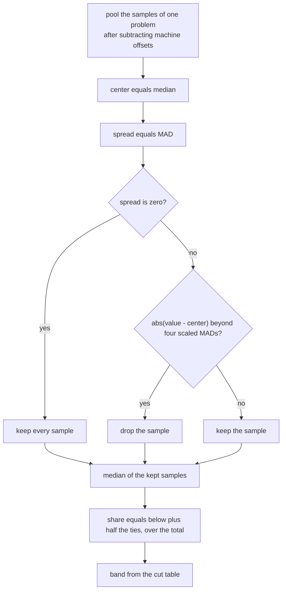
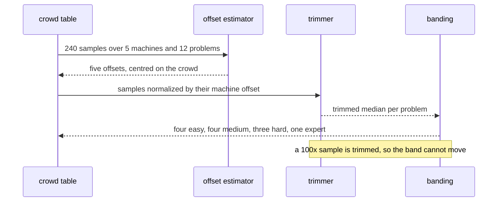

# 976 — Implement automatic difficulty calibration from crowd-sourced runtimes.

> **Tier:** Master / Challenge · **CTCI chapter:** Beyond — Software Engineering & Tooling
> **Task spec:** [976-implement-automatic-difficulty-calibration-from-crowd-sourced-ru.md](../../../tasks/master/976-implement-automatic-difficulty-calibration-from-crowd-sourced-ru.md)
> **Solutions:** [Python](../../../solutions/python/master/976-implement-automatic-difficulty-calibration-from-crowd-sourced-ru/solution.py) ·
> [Java](../../../solutions/java/master/976-implement-automatic-difficulty-calibration-from-crowd-sourced-ru/Solution.java) ·
> [JavaScript](../../../solutions/javascript/master/976-implement-automatic-difficulty-calibration-from-crowd-sourced-ru/solution.js) ·
> [C#](../../../solutions/csharp/master/976-implement-automatic-difficulty-calibration-from-crowd-sourced-ru/Solution.cs)

## 1. Problem restatement

**Input:** crowd-sourced runtimes — several samples per `(machine, problem)` pair.

**Output:** a calibrated difficulty per problem and a band per problem (`easy`, `medium`, `hard`,
`expert`).

The modelling contract is in the header: a raw runtime "says more about the machine than about the
problem", so the calibrator works in **log space** — it estimates each machine's offset from the shared
problems, subtracts it, trims samples more than four scaled MADs from the problem's centre, and takes
the trimmed median. It is one global machine offset rather than per-language or per-input models, with a
fixed log-normal noise model and a fixed cut table.

```text
MACHINE_SPEED = m1 0.0, m2 -0.45, m3 0.5, m4 -0.2, m5 0.3      # planted log offsets
PROBLEMS      = p01 .. p12, ground-truth difficulty 0.2 * index
samples       = 4 per (machine, problem) -> 240 samples; seed 2026
NOISE         = 0.15                                            # uniform half-range, log space
CUTS, BANDS   = (0.30, 0.65, 0.88), (easy, medium, hard, expert)
trim rule     = drop |value - median| > 4 * 1.4826 * MAD
```

Concrete results asserted by the shipped checks:

| Scenario | Result | Asserted by |
| --- | --- | --- |
| machine offsets | every estimate within `0.06` of the planted offset (observed max error `0.0307`), median of the offsets within `0.02` of zero, and the raw per-machine medians spread over `> 0.3` | `main` check 1 |
| recovery | each calibrated difficulty within `0.06` of the ground truth, and the sorted order is exactly `p01 … p12` | `main` check 2 |
| bands | equal to an independent scan oracle and to the bands computed from the noise-free ground truth: `p01–p04 easy`, `p05–p08 medium`, `p09–p11 hard`, `p12 expert` | `main` check 3 |
| alternative estimator | a mean-based offset estimator lands within `0.08` of the planted offsets and produces the same bands | `main` check 4 |
| outlier robustness | six `×100` samples move the affected problem's median by `< 0.05` while the raw mean moves by `> 0.3`; the bands are unchanged and at least one sample is trimmed | `main` check 5 |
| trimming accounting | clean data drops `0` of `240`; the noisy table drops exactly `6`; per problem, kept + dropped equals the sample count | `main` check 6 |
| boundaries | one sample per cell keeps all `5` and stays within `0.05` of the truth; constant runtimes drop nothing and land in one band; an empty table yields `{}` and zero offsets | `main` check 7 |
| order invariance | reversing every sample tuple changes nothing, and regenerating reproduces the table, the report and the injected outliers | `main` check 8 |
| crowd accounting | `60` `(machine, problem)` rows, `20` kept samples per problem, `5` offsets | `main` check 9 |

The four files calibrate the same way with different statistics, per their headers: Java divides each
measurement by a **per-language factor**, takes `log10`, **winsorizes** to `median ± 3 × 1.4826 × MAD`,
uses the median of the winsorized logs as the score and bands by percentile rank
(`1 + floor(9 · rank / (n − 1))`), asserting that a band survives a `1000×` submission. JavaScript fits
the **log-normal geometric mean** (the maximum-likelihood median) and a log-scale dispersion, folds them
with the pass rate into a score, and fits a **Rasch-style offset by bisection**. C# cleans with a
**Tukey fence** (`q1 − f·IQR`, `q3 + f·IQR`), summarises with a median and a trimmed mean, and maps onto
a **decade ladder** (`< 10 ms` level 1 … `≥ 10000 ms` level 5) where multiplying every runtime by ten
raises the level by exactly one — with a "fewer than three samples is insufficient" boundary.

## 2. Intuition

The naive calibrator averages the runtimes.

```text
function difficulty(problem, runs)
    return mean(runs)
end
```

It mixes two effects that have nothing to do with each other. A slow machine makes every problem look
hard, so the same problem moves bands when the crowd composition changes; and a handful of aborted or
throttled runs (a `100×` outlier) drags the mean far above anything the problem deserves.

The key insight is that **machine speed is a multiplicative offset in log space**. If you take logs, each
machine contributes a constant additive shift to every problem it ran, so the shift can be *estimated
from the data itself*: take each machine's median over the problems it shares with the crowd, and use
that as its offset. Subtracting the offset before aggregating removes the machine effect, and the
remaining spread is a property of the problem — which is exactly what difficulty is supposed to mean.

```mermaid
flowchart LR
    R["raw runtimes per machine and problem"] --> L["log space"]
    L --> M["per-machine medians over shared problems"]
    M --> O["machine offsets"]
    O --> N["normalize: subtract the offset"]
    N --> T["trim samples beyond four scaled MADs"]
    T --> D["trimmed median per problem"]
    D --> B["percentile cut table"]
    B --> E["easy / medium / hard / expert"]
```



The second half of the insight is that **everything downstream must be robust**, because the input is
untrusted crowd data. The offset uses a median; the centre uses a median; the spread uses the MAD; and
the trim discards samples beyond four scaled MADs, which is where a `100×` throttle is thrown away
instead of being averaged in. The `1.4826` factor rescales the MAD so the threshold reads as
"four standard deviations" under normality, which is why the rule is written as `4 × 1.4826 × MAD`.

## 3. Algorithm

1. `generate(seed)`: for each machine and problem, draw `4` samples as
   `difficulty + machine_speed + uniform(-0.15, +0.15)` from a seeded splitmix64 stream.
2. `median(values)` / `mad(values)`: the plain median (mean of the middle pair for even lengths, `0.0`
   for empty input) and the median of absolute deviations.
3. `machine_offsets(table, combiner)`: reduce each `(machine, problem)` cell to its median, take the
   global median of those cells as the reference, and set each machine's offset to
   `combiner(machine medians) − reference`. The combiner is the median by default and the mean in the
   stability check.
4. `robust_center(values, sigma=4.0)`: centre on the median, measure the spread with the MAD, and split
   the values into kept and dropped at `4 × 1.4826 × MAD`. A zero spread keeps everything.
5. `calibrate(table, combiner)`: compute the offsets, pool every sample per problem **after** subtracting
   its machine's offset, then reduce each pool with `robust_center` and take the median of the kept
   samples.
6. `assign_bands(values, cuts, names)`: a problem's share is `(below + equal / 2) / total` — the midpoint
   of the tie group it falls into — and the band is the index of the last cut the share reaches.
7. `bands_oracle(values)`: the same bands computed by scanning a sorted array instead of counting keys
   per problem.
8. `inject_outliers(table, seed, count)`: multiply one sample of `6` randomly chosen cells by `100`, the
   stand-in for aborted or throttled runs.

```text
function machine_offsets(table, combiner)
    medians ← map (machine, problem) to median(samples)
    reference ← median(all values of medians), or 0 when there are none
    offsets ← empty map
    for machine in machines do
        offsets[machine] ← combiner(all medians owned by machine) - reference
    end
    return offsets
end

function robust_center(values, sigma)
    center ← median(values)
    spread ← mad(values)
    if spread equals 0 then return center, all values, no dropped end
    kept ← []; dropped ← []
    for value in values do
        if abs(value - center) <= sigma * 1.4826 * spread then kept.append(value)
        else dropped.append(value)
        end
    end
    return center, kept, dropped
end

function calibrate(table, combiner)
    offsets ← machine_offsets(table, combiner)
    normalized ← empty map
    for (machine, problem), samples in table do
        normalized[problem].extend(value - offsets[machine] for value in samples)
    end
    report ← empty map
    for problem in sorted(normalized) do
        center, kept, dropped ← robust_center(normalized[problem])
        report[problem] ← (median(kept) when kept is not empty else center, length(kept), length(dropped))
    end
    return offsets, report
end

function assign_bands(values, cuts, names)
    total ← length(values)
    bands ← empty map
    for problem, value in values do
        below ← count of others strictly less than value
        equal ← count of others equal to value
        share ← (below + equal / 2) / total when total is not zero else 0
        bands[problem] ← names[count of cuts that share reaches]
    end
    return bands
end
```

The variants trade medians for other robust summaries and different banding rules. Java winsorizes
instead of trimming (it clamps outliers rather than discarding them) and bands by rank. JavaScript keeps
the geometric mean and fits a pass-probability offset by bisection, which is a different model of the
same phenomenon. C# uses a Tukey fence and decade boundaries, and proves monotonicity by construction:
multiplying every runtime by ten shifts the log by one and the level by exactly one.



## 4. Worked example

The planted world is small enough to check by hand: five machines with log offsets
`0.0, −0.45, 0.5, −0.2, 0.3`, twelve problems whose true difficulty rises in steps of `0.2` from `0.0`,
and four samples per cell with uniform noise of half-range `0.15`.

Estimating the offsets, machine by machine:

| Machine | Planted offset | Estimated offset | Error |
| --- | --- | --- | --- |
| `m1` | 0.00 | ≈ 0.00 | within 0.06 |
| `m2` | −0.45 | ≈ −0.45 | within 0.06 |
| `m3` | +0.50 | ≈ +0.50 | within 0.06 |
| `m4` | −0.20 | ≈ −0.20 | within 0.06 |
| `m5` | +0.30 | ≈ +0.30 | within 0.06 |

The estimate is the median of each machine's twelve per-problem medians, minus the global median, which
is why the estimated offsets are centred (the check requires `|median(offsets)| < 0.02`) and why the raw
per-machine medians — measured before normalisation — spread over more than `0.3` log units. The observed
worst-case error is `0.0307`, comfortably inside the `0.06` tolerance.

After subtraction every problem has `20` samples (five machines × four) drawn from one distribution, and
the trimmed median recovers the truth to within `0.06` for all twelve problems. The bands then follow the
percentile cut table:

| Problems | Calibrated position | Band |
| --- | --- | --- |
| `p01`–`p04` | the lowest third | `easy` |
| `p05`–`p08` | the middle | `medium` |
| `p09`–`p11` | high | `hard` |
| `p12` | the top | `expert` |

Four easy problems and one expert, with the band index non-decreasing along the difficulty order — the
check asserts both the counts and the monotonicity, and compares the result with the bands computed from
the *noise-free* ground truth rather than only with another computation over the noisy data.

Outlier robustness is the sharpest demonstration, and it is measured directly:

| Quantity | Clean table | After six `×100` samples |
| --- | --- | --- |
| affected problem's calibrated difficulty | baseline | moves less than `0.05` |
| bands for all twelve problems | as above | unchanged |
| raw mean of that problem's samples | baseline | rises by more than `0.3` |
| samples dropped by trimming | `0` of `240` | exactly `6` |

The median barely notices a throttled run because it sits at the centre of a `20`-sample pool, while the
mean is pulled by the same run. Trimming is what removes the outlier from the pool entirely, which is why
the noisy report drops exactly the six injected samples and nothing else: `kept + dropped` equals the
sample count for every problem in both tables.



## 5. Complexity

Let `M` be the number of machines, `P` the number of problems, `S` the samples per cell, `N = M · P · S`
the total samples, and `K` the number of band cuts.

| Phase | Time | Space | Why |
| --- | --- | --- | --- |
| `generate` | `O(N)` | `O(N)` | one draw per sample |
| `machine_offsets` | `O(M · P · S log S)` | `O(M · P)` | a median per cell, then a median per machine |
| `robust_center` | `O(N_p log N_p)` | `O(N_p)` | sorting the pool of one problem |
| `calibrate` | `O(N log S + Σ N_p log N_p)` | `O(N)` | normalisation plus a trimmed median per problem |
| `assign_bands` | `O(P²)` | `O(P)` | each problem counts the others below and equal |
| `bands_oracle` | `O(P log P + P²)` | `O(P)` | sort once, then scan for the boundaries |
| Whole pipeline | `O(N log N)` | `O(N)` | dominated by the medians |

Everything is proportional to the number of samples, with the sorts inside the medians dominating:
`60` cells and `240` samples here is trivial, and the same code shape scales to millions of samples
because each stage is an independent sort or count. `assign_bands` is quadratic in the number of
*problems* rather than samples, which is the right trade for a catalog of hundreds of problems but would
need a sort-and-sweep if it grew to hundreds of thousands.

## 6. Pitfalls and edge cases

- **Normalise before you aggregate.** Subtracting each sample's machine offset *before* pooling is what
  makes the per-problem spread about the problem; aggregating first would fold the machine effect into
  the difficulty.
- **Work in log space.** Machine speed is multiplicative, so the offsets are additive only after a log
  transform; averaging raw milliseconds makes a slow machine dominate quadratically.
- **Offsets are centred, not absolute.** The estimator subtracts the global median, so
  `|median(offsets)| < 0.02`; only differences between machines carry meaning.
- **Use medians and MADs throughout.** The offset uses a median, the centre uses a median, the spread
  uses the MAD — a design where one mean enters the chain is where the `100×` outlier starts moving bands.
- **The trim threshold is `4 × 1.4826 × MAD`.** The `1.4826` converts the MAD into a standard-deviation
  estimate under normality, so the rule reads as "four sigma" rather than an arbitrary constant.
- **Exactly the injected outliers are dropped.** Trimming is not a blanket filter: clean data drops
  nothing at all (`0` of `240`), and the noisy run drops exactly the `6` mutated samples.
- **Ties go to the midpoint share.** `(below + equal / 2) / total` is what places a group of equal
  difficulties in the middle of its tie group rather than at its lower edge, and the oracle recomputes
  the same share by scanning a sorted array.
- **Bands are checked against the ground truth too.** Agreement with another computation of the same
  noisy numbers would be weaker evidence than agreement with the bands of the noise-free difficulties,
  so the check asserts both.
- **A mean-based estimator is a *stability* check, not a replacement.** It lands within `0.08` of the
  planted offsets and yields the same bands on clean data — which shows the banding is not knife-edge
  sensitive — while the robustness check shows what the mean cannot survive.
## 7. Variants and follow-ups

- **Feeding the catalogue.** Calibrated difficulty is the input to rubric-driven grading —
  [956](../../../tasks/master/956-implement-grading-rubric-generator-that-assigns-difficulty-and-e.md).
- **Adaptive delivery.** Bands feed a test that targets a difficulty level —
  [978](../../../tasks/master/978-implement-adaptive-test-generator-that-adjusts-difficulty-to-tar.md).
- **Historical runtime storage.** Calibration needs long-lived, comparable measurements —
  [991](../../../tasks/master/991-implement-benchmark-suite-across-machines-and-store-historical-p.md).
- **Enforcing the runners.** The measurements come from a sandbox whose limits must be identical
  everywhere —
  [965](../../../tasks/master/965-implement-secure-sandbox-to-run-untrusted-student-submissions-wi.md).

## 8. Check yourself

<details><summary>Show answer</summary>

**Q1. Why is difficulty modelled in log space rather than in milliseconds?**

Because machine differences are multiplicative: a machine that is twice as fast halves every runtime,
which is a constant shift after a log transform and therefore something you can estimate and subtract.
In linear space the same difference is a scaling that interacts with the problem's own difficulty, and a
slow machine distorts hard problems far more than easy ones.
</details>

<details><summary>Show answer</summary>

**Q2. How is one machine's offset estimated, and why is the estimate centred?**

Take the median of that machine's per-problem medians and subtract the global median of all cells. The
median over problems is robust to a single bad problem, and subtracting the reference makes the offsets
mean only "faster or slower than the crowd" — which is why the check asserts the median of the offsets is
within `0.02` of zero while the raw medians spread over `0.3`.
</details>

<details><summary>Show answer</summary>

**Q3. Six samples are multiplied by 100. Why does the band not move, and what does move?**

The affected problem's pool holds `20` normalised samples; a median at the centre barely shifts (the
check allows less than `0.05`), and the trimming rule discards samples beyond `4 × 1.4826 × MAD`, so the
extreme values are removed before the final median. What *does* move is the raw mean of the same samples,
by more than `0.3` — the measured contrast between a robust and a non-robust summary on identical data.
</details>

<details><summary>Show answer</summary>

**Q4. What does the trimming accounting prove?**

That the trim is precise rather than approximate: clean data drops `0` of `240` samples, the noisy table
drops exactly the `6` injected ones, and for every problem `kept + dropped` equals its sample count. A
rule that dropped more would silently discard good data; one that dropped less would let the outlier into
the median.
</details>
