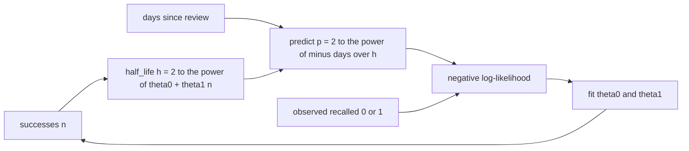
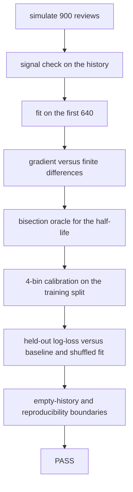
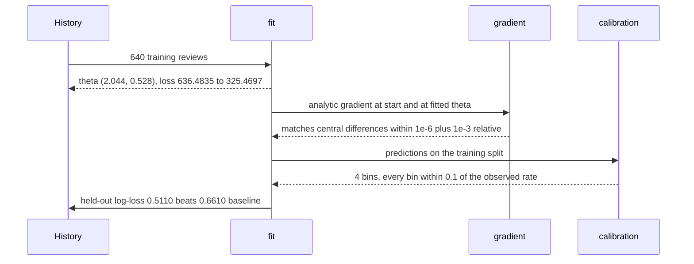

# 977 — Implement long-term retention estimator using learner response models.

> **Tier:** Master · **CTCI chapter:** Beyond — Software Engineering & Tooling
> **Task spec:** [977-implement-long-term-retention-estimator-using-learner-response-m.md](../../../tasks/master/977-implement-long-term-retention-estimator-using-learner-response-m.md)
> **Solutions:** [Python](../../../solutions/python/master/977-implement-long-term-retention-estimator-using-learner-response-m/solution.py) ·
> [Java](../../../solutions/java/master/977-implement-long-term-retention-estimator-using-learner-response-m/Solution.java) ·
> [JavaScript](../../../solutions/javascript/master/977-implement-long-term-retention-estimator-using-learner-response-m/solution.js) ·
> [C#](../../../solutions/csharp/master/977-implement-long-term-retention-estimator-using-learner-response-m/Solution.cs)

## 1. Problem restatement

**Input:** a learner's review history. Each row is a triple `(successes, days, recalled)` — how many
times the item had already been recalled successfully before the review, how many days passed since
that last review, and whether this review succeeded. The repository simulates 900 such rows from a
planted model (`PARAMETERS = {"examples": 900, "split": 640, "spread": 22}`) and keeps the first 640
as the training split and the remaining 260 as held-out data.

**Output:** a fitted two-parameter response model plus the evidence that it is right:

1. the parameters `(theta0, theta1)` of the half-life curve,
2. the predicted recall probability for any `(successes, days)` pair,
3. a calibration table over the training split,
4. a held-out log-loss compared against a base-rate baseline and against a fit on shuffled labels,
5. a gate that fails loudly (`AssertionError`) when any of those checks does not hold.

The model itself is two lines:

```text
half_life(theta, successes) = 2 ** (theta[0] + theta[1] * successes)      days
predict(theta, successes, days) = 2 ** (-days / half_life(theta, successes))
```

Concrete values from the planted model `TRUE_THETA = (2.0, 0.5)`:

| Call | Result | Why |
| --- | --- | --- |
| `half_life(TRUE_THETA, 0)` | `4.0` | `2 ** 2.0` — an item seen zero times is forgotten in four days |
| `half_life(TRUE_THETA, 3)` | `11.3137` | `2 ** 3.5` — three successful reviews more than double the memory |
| `predict(theta, 3, 0)` | `1.0` | exactly one after a review, the ratio `-0/h` is zero |
| `predict(theta, 3, half_life(theta, 3))` | `0.5` | the definition of a half-life |

Every one of those boundaries is asserted by the solution; the task is graded on the fit, not on the
formula.

## 2. Intuition

The naive estimator is a single number: "learners recall this item about 70% of the time". That claim
cannot distinguish two very different facts — an item that is always recalled a day later, and an item
that is recalled half the time after three weeks — and it cannot answer the question the platform
actually asks: *when should we schedule the next review?*

The key insight is that forgetting is **exponential in delay and linear in the exponent** once you
write it in log space:

```text
log2 p = -days / h          and          log2 h = theta0 + theta1 * successes
```

so `log2 p = -days * 2 ** (-(theta0 + theta1 * successes))`. Both features (`successes` and `days`)
enter only through the ratio `days / h`, which means:

* the curve is pinned at `p = 1` for `days = 0` and at `p = 0.5` for `days = h`, for every parameter
  setting — no separate intercept to fit;
* each successful review multiplies the half-life by the constant factor `2 ** theta1`, so `theta1`
  is "how much one more success buys";
* the probability is a smooth, strictly decreasing function of `days`, which is what makes a
  coordinate search on the negative log-likelihood viable without any derivative bookkeeping.



The picture also explains why the regulariser matters: with no data at all, "every scale of forgetting
is equally likely", and the only thing that keeps the parameters finite is the `L2 = 1e-4` penalty,
which drags both of them to zero.

## 3. Algorithm

The Python solution is a five-stage pipeline; the same pipeline is what the Java, JavaScript and C#
files verify from their own angle.

1. **Simulate** a history from the planted model with a deterministic PRNG (`splitmix64`, seed 11):
   `successes` uniform in `0..4`, `days` uniform in `1..30`, `recalled` a Bernoulli draw whose
   probability is `predict(TRUE_THETA, successes, days)`.
2. **Check that the history has signal**: the mean recall rate over short delays (`days <= 8`) exceeds
   the mean over long delays (`days >= 22`) by more than `0.2`, and the mean for many successful
   reviews (`n >= 3`) exceeds the mean for few (`n <= 1`) by more than `0.2`. Without that, a fit
   would be meaningless.
3. **Fit** `(theta0, theta1)` to the training split by coordinate search on a shrinking grid:
   for each parameter, try `+size` and `-size`; accept any step that lowers the L2-regularised
   negative log-likelihood; when a whole sweep finds nothing, halve every size. 44 sweeps,
   starting from `(1.0, 0.2)` with sizes `[1.0, 0.5]`.
4. **Check the gradient**: the analytic derivative of the loss is compared against central finite
   differences with `epsilon = 1e-6` at two very different parameter settings.
5. **Judge the model**: a bisection oracle for the half-life (`bisect_days`), a 4-bin calibration
   table, held-out log-loss against the base rate and against a fit on shuffled labels, plus the
   empty-history boundary and byte-identical reproducibility.

```text
procedure fit(examples, steps, l2)
    theta ← (1.0, 0.2)
    sizes ← (1.0, 0.5)
    best ← negative_log_likelihood(theta, examples, l2)
    history ← [best]
    repeat steps times do
        improved ← false
        for index in 0..1 do
            for direction in (-1, +1) do
                candidate ← copy of theta
                candidate[index] ← candidate[index] + direction * sizes[index]
                value ← negative_log_likelihood(candidate, examples, l2)
                if value < best - 1e-12 then
                    theta ← candidate
                    best ← value
                    improved ← true
                end
            end
        end
        append best to history
        if improved is false then
            sizes ← sizes / 2
        end
    end
    return theta, history
end
```

The negative log-likelihood is the usual binary cross-entropy with the probability clamped to
`[1e-12, 1 - 1e-12]` so a saturated prediction can never produce `log(0)`:

```text
function negative_log_likelihood(theta, examples, l2)
    total ← 0.5 * l2 * (theta[0] ** 2 + theta[1] ** 2)
    for each (successes, days, recalled) in examples do
        p ← clamp(predict(theta, successes, days), 1e-12, 1 - 1e-12)
        total ← total − log(p) if recalled else total − log(1 − p)
    end
    return total
end
```

The analytic gradient is worth writing out because it is the one place where the two-parameter form
pays off. With `z = ln2 * days / h` the loss derivative is

```text
dL/dtheta[j] = l2 * theta[j] − (y/p − (1−y)/(1−p)) * p * z * ln2 * (1 if j = 0 else successes)
```

and the file checks exactly that expression against central differences.



## 4. Worked example

Running the Python file prints two lines and `PASS`:

```text
examples=900 train=640 held_out=260 fitted_theta=(2.044, 0.528) planted=(2.0, 0.5) loss=636.4835->325.4697
held_out_logloss=0.5110 baseline=0.6610 shuffled=0.5869 half_lives=[4.12, 5.95, 8.57, 12.36, 17.83]
```

The trace of that run, stage by stage:

| Stage | Value | Check it must satisfy |
| --- | --- | --- |
| planted parameters | `(2.0, 0.5)` | used to simulate; never passed to the fit |
| initial parameters | `(1.0, 0.2)` | `half_life = 2 ** 1.0 = 2` days at `n = 0` |
| loss at the start | `636.4835` | `history[0]` |
| fitted parameters | `(2.044, 0.528)` | `abs(theta0 − 2.0) < 0.15`, `abs(theta1 − 0.5) < 0.15`, `theta1 > 0` |
| loss at the end | `325.4697` | `history[-1] < history[0]`, and no step ever increased it |
| half-lives for `n = 0..4` | `4.12, 5.95, 8.57, 12.36, 17.83` | strictly increasing; `2 ** (2.044 + 0.528n)` |
| held-out log-loss | `0.5110` | `< baseline 0.6610 − 0.01` and `< shuffled 0.5869 − 0.005` |
| calibration | 4 bins, at least 40 rows each | every bin within `0.1` of its observed rate |
| bisection oracle | `bisect_days(theta, n)` | equals `half_life(theta, n)` to within `1e-6`, and `predict` there is `0.5` |

One bisection in isolation, for `n = 0` with the fitted parameters: the search starts on `[0, 200]`
and halves 80 times; the `predict` value at the midpoint is compared with the target `0.5`, so the
bracket converges on `4.12` days — the closed-form `2 ** 2.044` — and the check asserts agreement to
`1e-6`.



## 5. Complexity

Let `N` be the number of examples, `S = 44` the number of sweeps and `P = 2` the number of
parameters.

| Phase | Time | Space | Why the bound holds |
| --- | --- | --- | --- |
| simulate | `O(N)` | `O(N)` | one trip through the PRNG per example, one tuple kept per example |
| loss | `O(N)` | `O(1)` | one `predict` and one `log` per example |
| analytic gradient | `O(N)` | `O(P)` | one pass, two accumulators |
| coordinate fit | `O(S * P * 2 * N)` | `O(1)` extra | 44 sweeps × 2 parameters × 2 directions × one loss evaluation each; no data structure grows |
| numerical gradient oracle | `O(P * N)` | `O(P)` | two loss evaluations per parameter |
| calibration | `O(N log N)` | `O(N)` | sort the predictions, then walk the bin chunks once |
| total | `O(S * P * N) ≈ O(N)` with a constant of about 180 | `O(N)` | dominated by the fit; the sorting term is smaller for `N = 900` |

The alternative — stochastic gradient descent — is `O(K * N)` for `K` epochs with a much smaller
constant and no `44`-sweep ceiling, but it is not reproducible without extra machinery and it has no
built-in guarantee that the loss never rises. The grid search is intentionally the slower, provable
choice: every accepted step strictly lowers the loss, so `history` is non-increasing by construction,
and `fit` is a pure function of `(examples, steps, l2)`.

## 6. Pitfalls and edge cases

* **`log(0)` on a saturated prediction.** `predict` is clamped to `[1e-12, 1 - 1e-12]` inside both
  the loss and the gradient. Without the clamp, a parameter vector that drives `days / h` to a huge
  value yields `math domain error`; with it, the loss stays finite and the gradient stays defined.
* **An exactly-zero delay must give exactly `1.0`.** `predict(theta, 3, 0) == 1.0` is asserted with
  `==`, not with a tolerance: `2 ** (-0.0 / h)` is exactly `1.0` in IEEE-754. A formulation that adds
  an intercept to the exponent would fail this check.
* **The grid search can stall.** When neither direction of either parameter improves the loss, the
  sizes halve; after enough sweeps both sizes are microscopic and the parameters stop moving. That is
  why `history[-1] < history[0]` (a strict improvement over the start) is checked but
  `history[-1] < 1e-12` is not.
* **Empty history.** `fit([])` returns parameters driven to zero by the regulariser
  (`|theta0|, |theta1| < 0.01`, final loss `< 1e-9`), `predict(empty_theta, 0, 0) == 1.0`, and
  `log_loss(theta, []) == 0.0`. `negative_log_likelihood(TRUE_THETA, [])` is the pure L2 term, and
  `gradient(TRUE_THETA, [])` is exactly `[l2 * theta0, l2 * theta1]`.
* **Unused simulation knob.** `PARAMETERS["spread"]` is declared but never read; the day range is
  hard-coded as `1 + rng.below(30)`. Do not assume the constant has an effect.
* **Shuffled-label control.** `shuffle_labels` permutes only the outcomes with a Fisher-Yates pass
  driven by seed 3, keeping the base rate fixed. The held-out loss of that fit (`0.5869`) is closer to
  the baseline (`0.6610`) than the real fit (`0.5110`) — the fit learned the shape of forgetting, not
  a per-item constant.
* **Reproducibility.** `Rng` is a hand-written `splitmix64`, not the `random` module, so `simulate()`
  returns the same 900 tuples on every interpreter and `fit` returns the same `(theta, history)`.

## 7. Variants and follow-ups

* **Per-learner models.** The natural extension is one `(theta0, theta1)` per learner with a shared
  prior; the Java solution in this repository already takes that route, rescaling one learner's
  half-life multiplicatively after each response (`h *= 1 + 0.4 * (1 - p) + 0.1` on a successful
  recall) instead of fitting a global model.
* **A richer curve.** The JavaScript solution fits a stretched exponential
  `R(t) = exp(-(t / h) ** beta)` — three parameters, and a shape that can express a plateau followed
  by a cliff — still by a deterministic coordinate search on the negative log-likelihood. The C#
  solution keeps the two-parameter half-life but updates `log h` along the log-likelihood gradient of
  each observation, i.e. online rather than batch.
* **From estimate to schedule.** The estimate is only useful once it drives a scheduler: see
  [971-implement-spaced-repetition-scheduling-for-problem-revisit-recom.md](../../../tasks/master/971-implement-spaced-repetition-scheduling-for-problem-revisit-recom.md)
  for turning a half-life into review dates, and
  [976-implement-automatic-difficulty-calibration-from-crowd-sourced-ru.md](../../../tasks/master/976-implement-automatic-difficulty-calibration-from-crowd-sourced-ru.md)
  for the sibling problem of calibrating item difficulty from runtime signals.
* **From estimate to test.** The same response curve is the item model of
  [978-implement-adaptive-test-generator-that-adjusts-difficulty-to-tar.md](../../../tasks/master/978-implement-adaptive-test-generator-that-adjusts-difficulty-to-tar.md),
  where `p` becomes the probability of a correct answer rather than a recall.

## 8. Check yourself

<details><summary>Why does the model force `p = 0.5` at `days = h` instead of fitting an intercept?</summary>

Because both features enter only through the ratio `days / h`. At `days = h` the exponent is
`-(h / h) = -1`, so `p = 2 ** -1 = 0.5` regardless of `(theta0, theta1)`. That is what makes the
bisection oracle meaningful: the day on which the fitted curve crosses `0.5` is a closed-form
function of the parameters, and the numeric search must agree with it to `1e-6`.</details>

<details><summary>What exactly does the gradient check compare, and why at two parameter settings?</summary>

The analytic gradient `dL/dtheta` against central differences of the loss with `epsilon = 1e-6`. The
solution evaluates both at the starting point `(1.0, 0.2)` and at the fitted point `(2.044, 0.528)`
because the `successes` term is scaled by `p * z * ln2`, and `z = ln2 * days / h` differs by orders of
magnitude between the two points; a sign or factor error that cancels at one scale usually shows up at
the other.</details>

<details><summary>The held-out loss of the shuffled fit is `0.5869`, the baseline is `0.6610` and the real fit is `0.5110`. Why does a label-shuffled fit still beat the baseline?</summary>

Shuffling keeps the base rate, so a shuffled fit learns the right overall constant (roughly the
baseline) and can shave a little off the loss by exploiting the regulariser and the pass-through
probability. The point of the control is the *ordering*: the real fit must beat the baseline by more
than `0.01` and must beat the shuffled fit by more than `0.005`. Those two margins are asserted.</details>

<details><summary>What happens when the input is empty, and why is the answer not "the fit fails"?</summary>

`fit([])` still converges — to `(0.0, 0.0)`, because the only term left in the loss is the L2 penalty
`0.5 * l2 * (theta0 ** 2 + theta1 ** 2)`. `history` decreases monotonically to a value `< 1e-9`, the
prediction at `(0, 0)` days is still exactly `1.0`, and `log_loss` of an empty held-out set is `0.0`.
The empty case is a boundary the solution asserts rather than an error path.</details>
