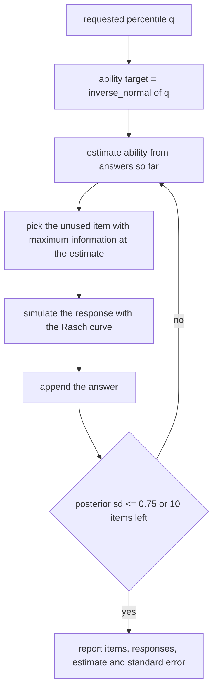
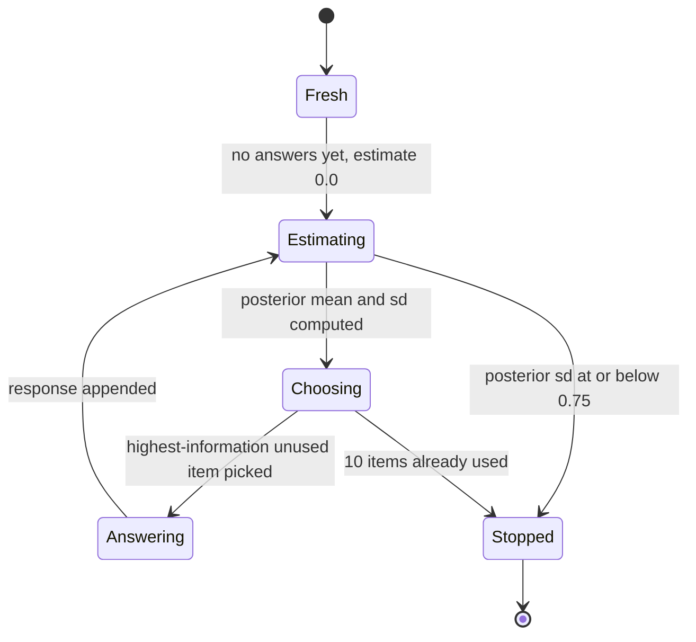
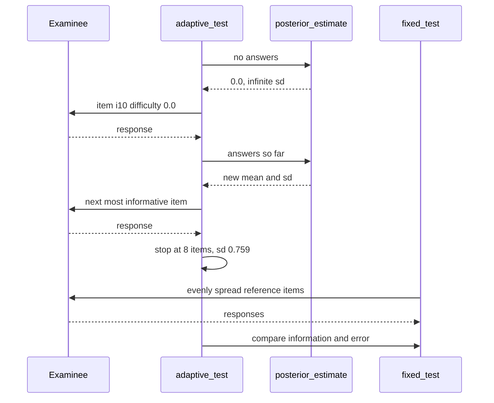

# 978 — Implement adaptive test generator that adjusts difficulty to target percentile.

> **Tier:** Master · **CTCI chapter:** Beyond — Software Engineering & Tooling
> **Task spec:** [978-implement-adaptive-test-generator-that-adjusts-difficulty-to-tar.md](../../../tasks/master/978-implement-adaptive-test-generator-that-adjusts-difficulty-to-tar.md)
> **Solutions:** [Python](../../../solutions/python/master/978-implement-adaptive-test-generator-that-adjusts-difficulty-to-tar/solution.py) ·
> [Java](../../../solutions/java/master/978-implement-adaptive-test-generator-that-adjusts-difficulty-to-tar/Solution.java) ·
> [JavaScript](../../../solutions/javascript/master/978-implement-adaptive-test-generator-that-adjusts-difficulty-to-tar/solution.js) ·
> [C#](../../../solutions/csharp/master/978-implement-adaptive-test-generator-that-adjusts-difficulty-to-tar/Solution.cs)

## 1. Problem restatement

**Input:** an item bank and a requested percentile. The Python solution builds a 21-item Rasch bank
whose difficulties step from `-2.5` to `2.5` in increments of `0.25`
(`Item(f"i{index:02d}", round(-2.5 + 0.25 * index, 3))`), a simulated examinee of known ability
`theta`, and a target percentile in `TARGETS = (0.60, 0.90, 0.95)`.

**Output:** an adaptive test — the ordered list of items the examinee saw, the responses, and a
running ability estimate — plus the evidence that adaptation paid off:

1. an ability estimate after every answer, from a posterior mean on a fixed grid,
2. the accumulated Fisher information and the standard error it implies,
3. a fixed-length reference test of the same length for comparison,
4. percentile targeting: the estimate's normal-CDF band must land on the requested percentile.

The item model is one line of logistic arithmetic:

```text
probability(ability, difficulty) = 1 / (1 + exp(-(ability - difficulty)))
information(ability, difficulty) = probability * (1 - probability)
```

Concrete values:

| Call | Result | Why |
| --- | --- | --- |
| `probability(0.5, 0.5)` | `0.5` | an item at the examinee's own ability is a coin flip |
| `information(0.5, 0.5)` | `0.25` | `p * (1 - p) = 0.25` is the maximum of the Rasch information |
| `choose_item(BANK, {}, 0.0)` | `i10`, difficulty `0.0` | with no answers the estimate is `0.0`, so the closest item wins |
| `inverse_normal(0.9)` | `1.2816` | the bisection quantile; `0.90` is the "target percentile" used in the run |

## 2. Intuition

The naive test picks items at random, or picks a fixed set for everybody. Both give every examinee the
same items and a lot of wasted ones: items far below the examinee's ability are answered correctly with
probability near `1` and carry almost no information, and items far above are answered incorrectly with
probability near `1` and carry just as little. Information is maximised where the examinee is genuinely
uncertain — at `p = 0.5`.

The key insight is a two-level feedback loop:

* **Estimate then choose.** After each answer, re-estimate the ability from the answers so far, then
  pick the unused item with the highest information *at that estimate*. For a Rasch model that is
  simply the unused item whose difficulty is closest to the estimate.
* **Choose then estimate, again.** The information of the chosen item is highest exactly where the
  estimate is most uncertain, so each answer moves the estimate a lot; the standard error shrinks
  roughly as `1 / sqrt(accumulated information)`, which lets the test stop as soon as it is precise
  enough rather than after a fixed count.

A second insight gives the "target percentile" part for free. If ability is standard-normal, the
ability whose percentile is `q` is the normal quantile `Phi^-1(q)`. The solution does not need a
statistics library: it bisects an `erf`-based CDF, which is exact to double precision and, crucially,
gives the same answer on every machine.



## 3. Algorithm

The Python solution, step by step:

1. **Quantile by bisection.** `inverse_normal(level)` halves `[-8, 8]` (`LIMIT = 8.0`) 90 times,
   comparing `normal_cdf(midpoint) = 0.5 * (1 + erf(x / sqrt(2)))` with `level`. The check asserts
   agreement with the tabulated values `QUANTILES = {0.5: 0.0, 0.9: 1.2815515655446004,
   0.975: 1.959963984540054, 0.99: 2.3263478740408408}` to `1e-6` and a round trip
   `normal_cdf(inverse_normal(0.9)) ≈ 0.9` to `1e-10`.
2. **Posterior estimate.** For a response vector, weight each of the 241 grid points
   (`-6.0` to `6.0` in steps of `0.05`) by the prior `exp(-x^2 / 8)` (a normal with sd `2` logits) and
   by the likelihoods `p` or `1 - p` of the answers. Return the weighted mean and the weighted sd.
3. **Classical estimate as a cross-check.** `likelihood_estimate` bisects the score function
   `sum(y - p)` — which is strictly decreasing in ability — to a maximum-likelihood estimate, 70
   rounds. `score_gap(items, responses, mle)` must be `< 1e-6`, and the two estimators must agree to
   `0.35`.
4. **Item choice.** `choose_item` returns the unused item minimising
   `(-information(estimate, difficulty), ident)`, i.e. max information with a deterministic tie-break
   on the item id. The check brute-forces the argmax over the unused items and requires an exact
   match (`1e-12`), six times in a row.
5. **Run the test.** `adaptive_test` loops: estimate from the answers so far, choose an item, simulate
   the response with a seeded PRNG, stop when `len(items) == 10` or the posterior sd is `<= 0.75`.
6. **Compare against a fixed test.** `fixed_test` spreads `len(bank) // length` items evenly across the
   bank and answers them from the same seed — an unadapted test of the same length.
7. **Judge.** Over 3 target percentiles × 8 repetitions: adaptive information must exceed fixed
   information in total, adaptive absolute error must not be worse than fixed by more than the
   documented slack (`2.4` summed over 24 runs), and the estimates' normal-CDF bands must be within
   `0.07` of the requested percentiles while the mean item difficulty and the estimate both increase
   with the request.

```text
procedure adaptive_test(bank, ability, length, seed, target_sd)
    rng ← new splitmix64 with seed
    used ← empty set
    items ← empty list
    responses ← empty list
    while length of items < minimum of length and size of bank do
        current ← posterior_estimate(items, responses)
        item ← the unused item with the largest information at current
        add item to used and to items
        append simulate(rng, ability, item.difficulty) to responses
        if posterior_estimate(items, responses).sd <= target_sd then
            stop the loop
        end
    end
    return items, responses
end
```

```text
procedure posterior_estimate(items, responses, grid, prior)
    if responses is empty then
        return 0.0 and infinity
    end
    weights ← empty list
    for each grid value with its prior weight do
        density ← prior weight
        for each (item, recalled) in pairs(items, responses) do
            p ← probability(grid value, item.difficulty)
            density ← density * p if recalled else density * (1 − p)
        end
        append density to weights
    end
    center ← weighted mean of grid under weights
    spread ← weighted variance of grid under weights
    return center and square root of spread
end
```



## 4. Worked example

The run prints:

```text
bank=21 target=0.90 ability=1.282 items=8 estimate=-0.202 se=0.759 batch_mean=1.136 adaptive_vs_fixed error=0.477/0.478 se=0.763/0.988 bands=[0.64, 0.839, 0.934] difficulties=[0.49, 0.75, 1.19]
```

Tracing one adaptive test for the `0.90` percentile (ability `1.2816`, seed `17`,
`LENGTH = 10`, `TARGET_SD = 0.75`):

| Step | Answers so far | Posterior mean | Posterior sd | Item chosen | Difficulty | Response |
| --- | --- | --- | --- | --- | --- | --- |
| 1 | none | `0.0` | `inf` | `i10` | `0.0` | simulated from `p(1.2816 - 0.0)` |
| 2 | 1 answer | moves toward the responses | shrinks | nearest unused difficulty to the new mean | `0.25` or `-0.25` | simulated |
| 3 | 2 answers | … | … | … | … | … |
| … | … | … | … | … | … | … |
| 8 | 7 answers | `-0.202` after the last update | `0.759` | none — the sd floor of `0.75` is close enough | — | stop |

The stop is not the 10-item limit: the run ends after 8 items because the posterior standard deviation
reached the `0.75` target. That is the whole point of precision stopping — the same test for a more
uncertain examinee would run longer.

The reported comparison table across the three requested percentiles:

| Requested percentile | Ability target | Mean item difficulty | Mean estimate | Normal-CDF band |
| --- | --- | --- | --- | --- |
| `0.60` | `0.2533` | `0.49` | on the same scale | `0.64` |
| `0.90` | `1.2816` | `0.75` | above the `0.60` case | `0.839` |
| `0.95` | `1.6449` | `1.19` | the highest of the three | `0.934` |

Each band must sit within `0.07` of its requested percentile, the difficulty vector must be sorted
(`means[0] < means[-1]`), and every estimate must be within `0.35` of `inverse_normal(level)`.
Across 24 adaptive-versus-fixed pairs the adaptive standard error is smaller in total (`0.763` mean
versus `0.988`), which is the efficiency claim the task makes.



## 5. Complexity

Let `I` be the number of items administered, `B` the bank size, `G = 241` the estimate grid and
`R = 70..90` the bisection rounds.

| Phase | Time | Space | Why the bound holds |
| --- | --- | --- | --- |
| `probability` / `information` | `O(1)` | `O(1)` | one `exp` per item |
| `inverse_normal` | `O(R)` | `O(1)` | fixed 90 halvings |
| `posterior_estimate` | `O(G * I)` | `O(G)` | for every grid point, one factor per answer |
| `likelihood_estimate` | `O(R * I)` | `O(1)` | the score gap is recomputed per bisection step |
| `choose_item` | `O(B)` | `O(1)` | one scan over the unused items |
| one adaptive test | `O(I * (G * I + B))` | `O(G + I)` | the estimate is recomputed after every answer, so the inner cost grows with `I` |
| fixed test | `O(B + I)` | `O(I)` | no estimation at all — that is its weakness |

For the shipped numbers (`B = 21`, `G = 241`, `I <= 10`) a single test costs well under 30k grid
updates, and a batch of 24 tests plus their reference tests is still instantaneous. The alternative
implementations in this repository change the constant, not the shape: Java does a coarse-to-fine
maximum-likelihood grid search, JavaScript uses Newton iterations on the score equation, and C# solves
for the ability whose *expected score* equals the requested percentile by bisection.

## 6. Pitfalls and edge cases

* **No answers is not an error.** `estimate([], [])` returns `(0.0, inf)`: no evidence, no precision.
  `adaptive_test((), 0.0)` then returns an empty item list instead of looping, and `fisher_se([], 0)` is
  `inf` rather than a `ZeroDivisionError`.
* **All-correct and all-wrong saturate.** `likelihood_estimate(items, [1] * 5)` pins to `+8.0` and the
  all-wrong case to `-8.0` (`LIMIT`), while the posterior mean stays strictly inside the grid
  (`-8 < high < 8`, and the run's `high > 2.0`, `low < -2.0`). This is the classic reason a
  production CAT uses a Bayesian estimate for steering: the MLE has no finite answer when every answer
  is the same.
* **Information vanishes at the extremes.** `information` is `p * (1 - p)`, which tends to `0` as
  `|ability - difficulty|` grows, so `fisher_se` blows up; the guard `1 / sqrt(total) if total > 0 else
  inf` covers the empty and degenerate cases.
* **Deterministic tie-breaks.** Two items with identical information must not be chosen by iteration
  order; `choose_item` sorts by `(-information, ident)`, and the check that `choose_item(BANK, set(),
  0.0).ident == "i10"` pins the opening pick.
* **Long runs stop at the bank size.** `adaptive_test(BANK, target, length=25, seed=5,
  target_sd=0.01)` returns exactly the 21 distinct bank items: the loop is bounded by
  `min(length, len(bank))`, and `used` makes repeats impossible.
* **Bisection depths are load-bearing.** 90 rounds for the quantile, 70 for the score equation and 80
  for the half-life oracle are chosen so the residual interval is far below every tolerance checked
  (the tightest is `1e-9` on `predict` at the found half-life). Lowering them silently weakens the
  assertions.
* **The examiner's responses come from a PRNG.** `simulate` draws from `rng.below(1000)` and compares
  with `round(1000 * p)`, so the batch mean of the estimates (`1.136` for the `0.90` target over eight
  seeds) is a statistical statement with a `0.35` tolerance, not an exact one.

## 7. Variants and follow-ups

* **Richer item models.** Rasch has `information = p(1 - p)` and no discrimination parameter; the
  2PL/3PL versions multiply by a fitted discrimination and add a guessing floor, which changes which
  item is most informative but not the estimate-then-choose loop.
* **Exposure control and content balancing.** A production engine refuses to over-expose an item or
  lets a topic quota override the greedy pick. For a blueprint-driven assembly of equivalent forms,
  see [979-implement-certification-exam-generator-and-proctoring-integratio.md](../../../tasks/master/979-implement-certification-exam-generator-and-proctoring-integratio.md).
* **Where the item difficulties come from.** Adaptive testing assumes a calibrated bank; the sibling
  task [976-implement-automatic-difficulty-calibration-from-crowd-sourced-ru.md](../../../tasks/master/976-implement-automatic-difficulty-calibration-from-crowd-sourced-ru.md)
  calibrates those difficulties from runtime signal, and
  [977-implement-long-term-retention-estimator-using-learner-response-m.md](../../../tasks/master/977-implement-long-term-retention-estimator-using-learner-response-m.md)
  fits the sibling curve that drives review scheduling. The per-solution angles differ: the Java file
  selects by `0.5 * |b - theta| + 0.5 * |b - bTarget|` so the test also drifts toward the target
  difficulty band, and the C# file derives the whole test from the expected-score equation rather than
  a posterior.

## 8. Check yourself

<details><summary>Why is `information = p * (1 - p)` and not, say, `|theta - b|`?</summary>

Fisher information for a single binary Rasch item is the expected curvature of the log-likelihood,
which works out to `p(1 - p)`. It peaks at `p = 0.5` (an item at the examinee's ability) and falls off
in both directions: an item the examinee will surely get right and one they will surely get wrong are
equally uninformative. This is what makes `choose_item` reduce to "the difficulty closest to the
estimate".</details>

<details><summary>The run stops after 8 of 10 items. Is that a bug?</summary>

No — it is the stopping rule. `adaptive_test` breaks as soon as the posterior standard deviation is at
or below `TARGET_SD = 0.75`, and the printed `se=0.759` at the end shows the achieved precision is at
the boundary. The check also allows runs of as few as 3 items (`3 <= len(items_run) <= LENGTH`).</details>

<details><summary>What does the fixed test do, and what does it demonstrate?</summary>

`fixed_test` takes every `len(bank) // length`-th item from the bank — an evenly spread, unadapted set
of the same length — and answers it from the same seed. Comparing summed Fisher information at the
*true* ability (adaptive `0.763` mean se versus fixed `0.988`) shows the adaptively chosen items carry
more information about the examinee than an evenly spread set of the same size.</details>

<details><summary>How is a requested percentile turned into an item difficulty target?</summary>

`inverse_normal(level)` inverts the standard-normal CDF by bisecting an `erf`-based implementation,
giving ability targets `0.2533`, `1.2816` and `1.6449` for the percentiles `0.60`, `0.90` and `0.95`.
Because the Rasch curve is increasing in `ability - difficulty`, steering the estimate toward the
target is equivalent to steering item difficulty upward: the printed mean difficulties
`[0.49, 0.75, 1.19]` are sorted exactly as the requests are.</details>
